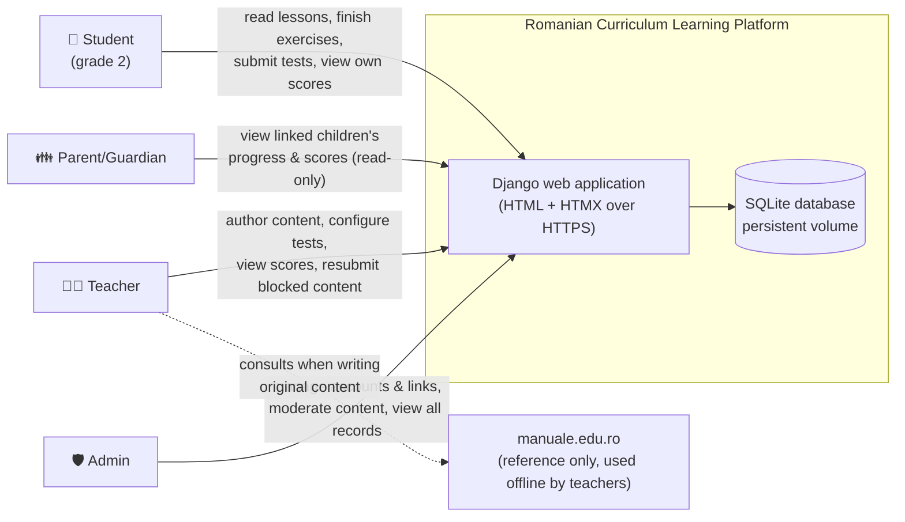
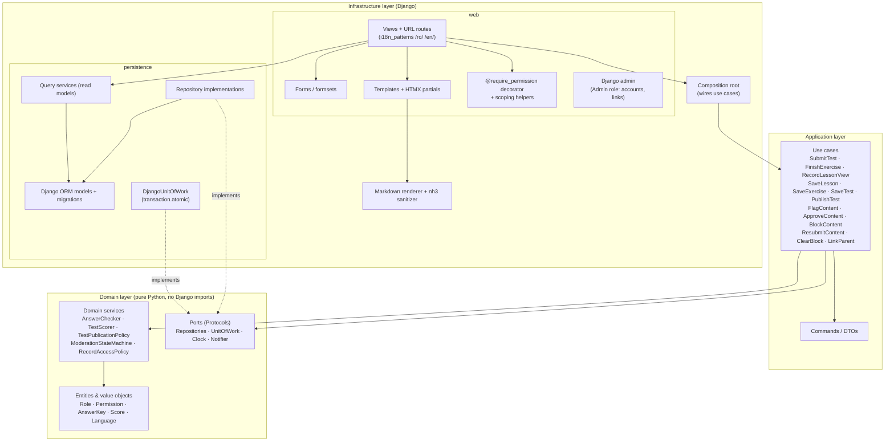
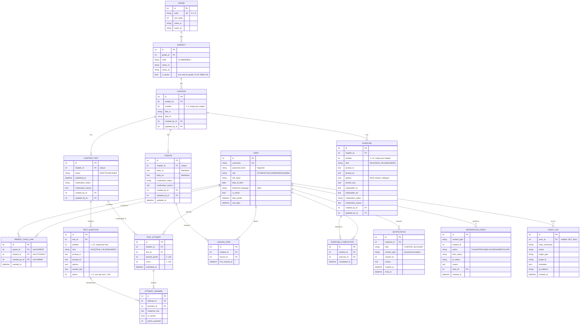
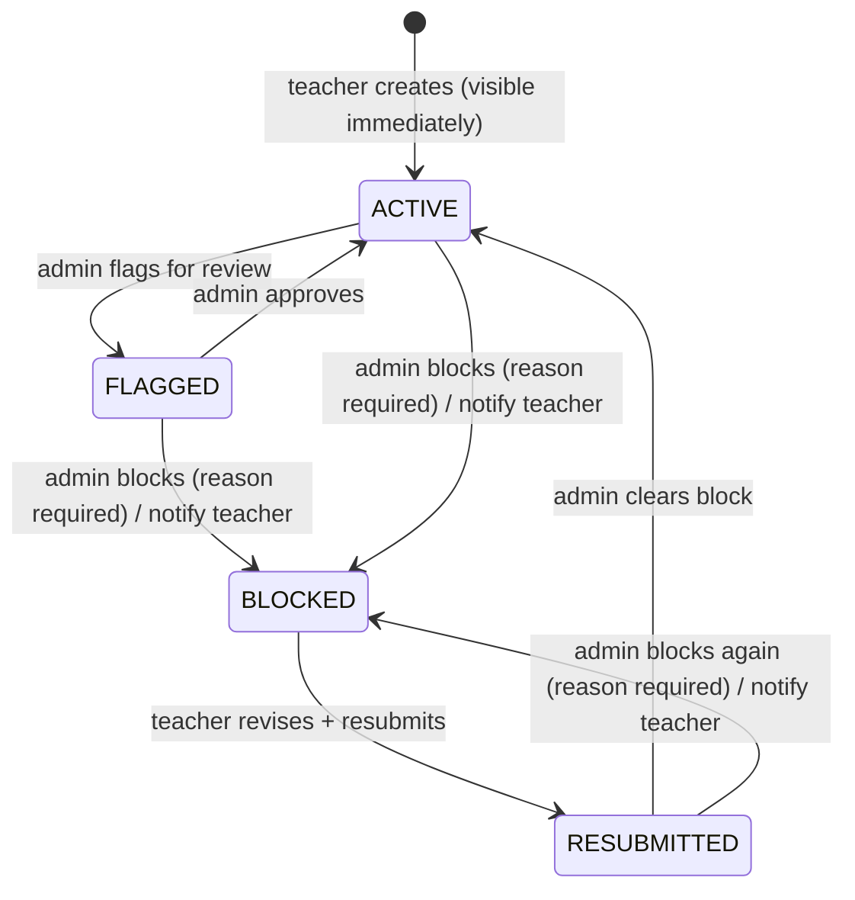
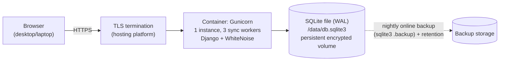

# Architecture Diagrams - Romanian Curriculum Learning Platform (Working Title)

**Source**: `docs/architecture/design/00-system-architecture-greenfield.md`
**Generated**: 2026-10-19

> This file contains Mermaid diagrams extracted from the architecture document for easy preview.
> For full architecture details, refer to the source `.md` file.

---

## System Context Diagram

---

## Component Architecture (Layered View)

---

## Data Model / ER Diagram

---

## Moderation State Machine

---

## Deployment View (Logical)

