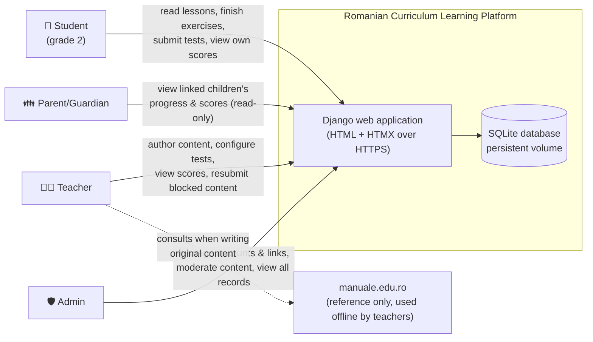
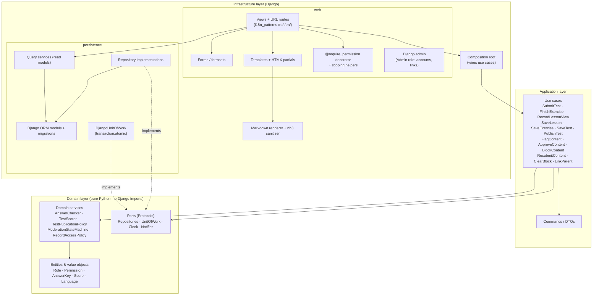
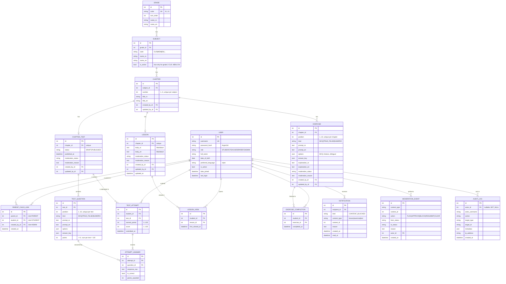
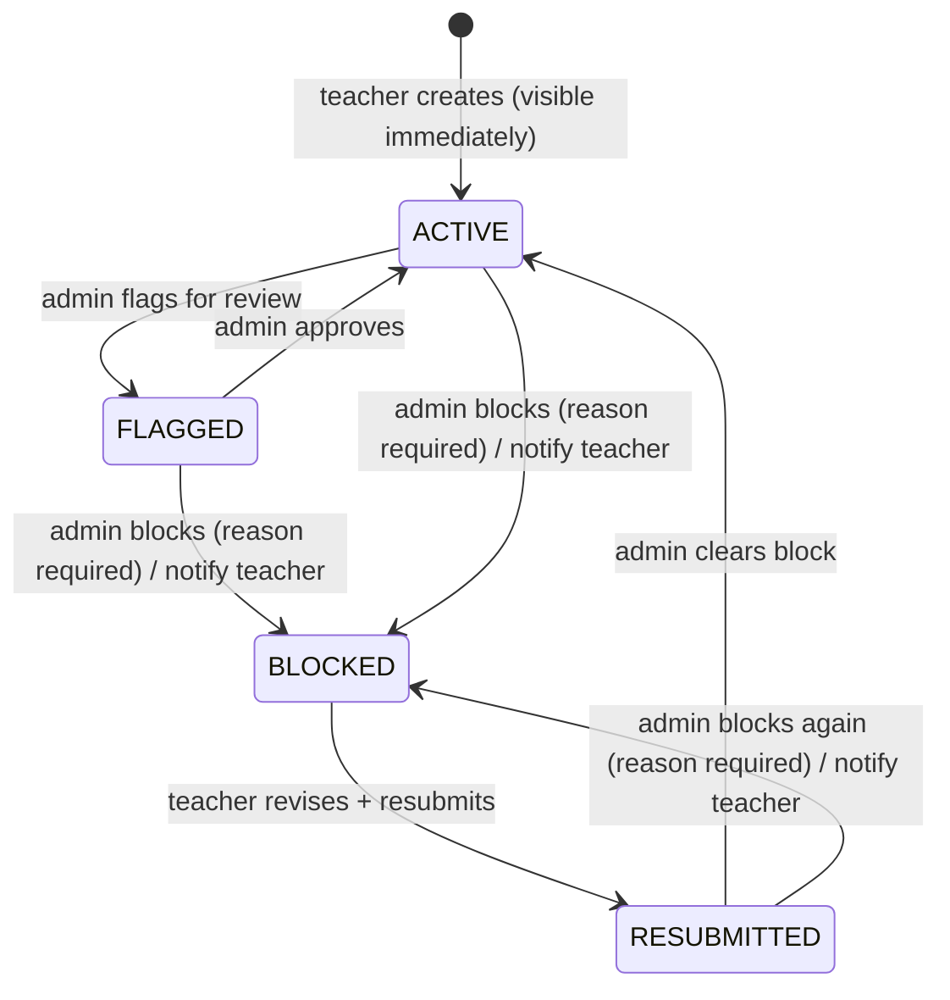
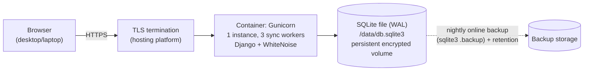

# System Architecture - Romanian Curriculum Learning Platform (Working Title)

**Date**: 2026-10-19
**Author**: ARCHITECT
**Status**: Approved
**Version**: 1.0
**Source requirements**: `docs/requirements.md` v1.0 (Approved 2026-10-19)

---

## Overview

### Purpose

A bilingual (Romanian/English) web learning platform for a second-grade pilot. Students read lessons, practice with unscored exercises and take one scored 10-question test per chapter. Teachers author content and configure test weights. Admins manage accounts and parent–child links and moderate content. Parents/Guardians see their linked children's progress and scores (read-only).

Pilot scale: 10 students, 2 teachers, linked parents, at least 1 admin. There are 3 active subjects (CLR, MEM, EN) with 3 chapters each, so 9 chapters in total.

### Architecture Style

**Modular monolith**: one Django application, one process and one SQLite database. Server-rendered HTML with HTMX for partial updates. Inside the codebase there are Clean Architecture layers (domain → application → infrastructure) split by bounded context. See ADR-001 and ADR-005.

### Key Drivers (traced to requirements)

| # | Driver | Source |
|---|--------|--------|
| D1 | Python is mandatory; it is a web app for desktop/laptop | Technical Constraints |
| D2 | Data persists across restarts | NFR Persistence |
| D3 | Strict record isolation: students see only their own records, parents only admin-linked children | Quality Gate "Parent/student privacy", FC-2 |
| D4 | Correct test scoring: weights total 100, score 1–100, all incorrect → 1, numeric answers compared by value, one attempt | Feature "Chapter tests", Quality Gate "Test scoring" |
| D5 | Moderation: flagged or blocked content hidden immediately, in-app teacher notice, resubmissions hidden until cleared | Feature "Teacher-managed content", Quality Gate "Content moderation" |
| D6 | Bilingual UI **and** content (RO/EN) | NFR Language |
| D7 | One-month timeline (pilot launch 2026-11-19), small team, MVP for real users | Project Type |
| D8 | Content completeness is measurable (9 chapters × lesson + 5–10 exercises + 10-question test) | SC-2, FC-1 |

### Design Decisions Confirmed with the User (2026-10-19)

| Topic | Decision |
|-------|----------|
| Framework | Django 5.2 LTS |
| Frontend | Server-rendered Django templates + HTMX |
| Database | SQLite (single-instance deployment, persistent volume, scheduled backups) |
| Hosting | Deferred to `aire-devops-discover`; the app ships as a Docker image |
| Flagged content | **Hidden** from students/parents while flagged; visible again only after admin approval |
| Test edits after attempts | **Scoring locked** after the first submission (answer keys, points, question set, question types). Wording and typo fixes are still allowed. |
| Scores of a blocked test | **Remain visible** to the student and linked parents; only the test content is hidden |
| "Progress" definition | Per chapter: lesson opened (yes/no), exercises finished (n/total visible), test submitted + score. Exercises use the same formats as test questions. |

---

## Technology Stack

| Category | Technology | Version | Justification |
|----------|------------|---------|---------------|
| Language | Python | 3.12 | Required by the user (D1). Stable, and supported by Django 5.2. |
| Web framework | Django | 5.2 LTS | Includes sessions, password hashing, ORM + migrations, i18n, CSRF and an admin site, which cover most pilot needs (D7). LTS support runs to April 2028. ADR-002. |
| Frontend | Django templates + HTMX | HTMX 2.0.x (vendored static file) | One codebase with no JS build step. HTMX handles "Finish exercise", the test editor rows and the notification badge. ADR-003. |
| CSS | Plain CSS with a small design-token stylesheet | — | The pilot UI is simple. A UI/UX spec (optional workflow) may refine it. |
| Database | SQLite (WAL mode) | Python-bundled SQLite ≥ 3.40 | Chosen by the user. Enough for about 12 concurrent users. Single writer, file on a persistent volume. ADR-004. |
| Content format | Markdown → sanitized HTML | `Markdown` 3.x + `nh3` 0.2.x | Teachers write rich text safely. Output is sanitized against XSS. ADR-010. |
| Password hashing | Argon2id | `argon2-cffi` 23.x | Stronger than the PBKDF2 default; natively supported by Django. |
| Login throttling | django-axes | 7.x / 8.x | Locks out brute-force attempts on child accounts. |
| Security headers | django-csp | 4.x | Content-Security-Policy. No inline scripts are needed with HTMX. |
| App server | Gunicorn | 23.x | Production WSGI server. Single instance because of SQLite. |
| Static files | WhiteNoise | 6.x | Serves static assets without a separate web server. |
| Unit / integration tests | pytest + pytest-django + coverage | 8.x / 4.9+ / 7.x | Coverage gate ≥85% (project core rule). |
| End-to-end tests | Playwright for Python | 1.4x | Verifies the role workflows end to end (FC-2 quality gate). |
| Lint / format / types | ruff, mypy (domain + application) | latest stable at project start | Consistent code style; type safety in the pure layers. |
| Packaging / runtime | Docker image | — | Portable across any later hosting choice. ADR-011. |

> Exact patch versions are pinned in the patterns document (`aire-greenfield-patterns`) and in the lock file at Story 1.1.

---

## System Context



**External integrations:** none at runtime. The platform does not call manuale.edu.ro. Teachers use it as a reference when writing original content. There is no email, SSO, analytics or CDN, so the system makes no third-party requests that would expose children's data.

### Data flows

| Flow | From → To | Data | Protection |
|------|-----------|------|------------|
| Login | Any role → app | username, password | TLS; Argon2id hash at rest; axes lockout |
| Learning | Student ↔ app | lesson/exercise content, exercise answers (not stored), test answers | TLS; session auth; record scoping |
| Authoring | Teacher → app | Markdown content, questions, answer keys, points | TLS; sanitized on render; permission checks |
| Moderation | Admin → app → Teacher | status changes, block reason, notification | TLS; audit log |
| Progress | app → Parent | linked child's progress and scores | TLS; parent–child link check (404 otherwise) |

---

## Component Architecture

### Bounded contexts (modules)

| Module | Responsibility | Owns |
|--------|----------------|------|
| `accounts` | Users, roles, the permission map, parent–child links, login/logout, language preference | `User`, `ParentChildLink` |
| `catalogue` | Grades K–8, subjects, active/inactive flag | `Grade`, `Subject` |
| `content` | Chapters, lessons, exercises, chapter tests and questions, authoring rules, test publishing, scoring lock | `Chapter`, `Lesson`, `Exercise`, `ChapterTest`, `TestQuestion` |
| `moderation` | Moderation state machine, review queue, events | moderation fields on content, `ModerationEvent` |
| `assessment` | Answer checking, test scoring, single-attempt submission | `TestAttempt`, `AttemptAnswer` |
| `progress` | Lesson views, exercise completions, progress read models for student/parent/teacher/admin | `LessonView`, `ExerciseCompletion` |
| `notifications` | In-app notices (block notices to teachers) | `Notification` |
| `audit` | Append-only log of security-relevant actions | `AuditLog` |
| `reporting` | Pilot readiness (SC-2/FC-1) and pilot completion (SC-1/SC-3) dashboards for admins | read models only |

> **Owner decision (2026-10-21):** "kindergarten" = **Grădiniță** (code `K`, preschool, 5 experiential domains); **Clasa pregătitoare** (code `P`) is shown as its own level before grade 1, so the catalogue has 10 levels. See Story 2.1.

### Layered view



**Dependency rule:** `domain` imports nothing outside the standard library. `application` imports only `domain`. `infrastructure` imports both and implements the ports. This is enforced by import-linter in CI (configured at Story 1.1). Read-only pages use query services directly (CQRS-lite, ADR-005), and every **write** goes through a use case.

### Source layout

```
src/
├── config/                       # Django project: settings/, urls.py, wsgi.py
├── domain/
│   ├── accounts/                 # Role, Permission, ROLE_PERMISSIONS, RecordAccessPolicy
│   ├── content/                  # QuestionKind, AnswerKey, TestPublicationPolicy, ScoringLockPolicy
│   ├── moderation/               # ModerationStatus, ModerationStateMachine, transitions
│   ├── assessment/               # AnswerChecker, TestScorer, Score
│   ├── common/                   # Language, errors, Clock port
│   └── ports.py                  # Repository / UnitOfWork / Notifier Protocols
├── application/
│   ├── accounts/  content/  moderation/  assessment/  progress/
│   └── dto.py
└── infrastructure/
    ├── persistence/              # Django apps: accounts, catalogue, content, assessment,
    │                             # progress, notifications, audit (models, migrations, repos, queries)
    ├── web/                      # views, urls, forms, templates/, static/ (htmx.min.js vendored)
    ├── i18n/locale/ro|en/        # gettext catalogues for UI strings
    ├── rendering/                # markdown + nh3
    └── container.py              # composition root
tests/
├── unit/ (domain, application)   ├── integration/ (views, repos)   └── e2e/ (Playwright)
```

---

## Data Model



### Integrity rules (enforced in the database where SQLite allows, otherwise in the domain)

| Rule | Enforcement |
|------|-------------|
| One attempt per student per test | `UNIQUE(student_id, test_id)` on `TEST_ATTEMPT` + check inside the transaction |
| Score range | `CHECK (score BETWEEN 1 AND 100)`, `CHECK (earned_points BETWEEN 0 AND 100)` |
| 3 chapters per subject | `CHECK (number BETWEEN 1 AND 3)` + `UNIQUE(subject_id, number)` |
| ≤10 exercises per chapter | `CHECK (position BETWEEN 1 AND 10)` + `UNIQUE(chapter_id, position)` |
| 10 questions per test; points ≥1; sum = 100 | `TestPublicationPolicy` (domain), checked on publish and on every save of a published test |
| One lesson and one test per chapter | `UNIQUE(chapter_id)` |
| Parent link roles | `LinkParent` use case checks parent=PARENT and student=STUDENT; `UNIQUE(parent_id, student_id)` |
| Scoring lock | `ScoringLockPolicy`: when a test has ≥1 attempt, `kind`, `options` identity, `answer_key`, `points` and the question set are immutable |
| Both languages required | Form validation and the domain reject saving content with an empty `_ro` or `_en` field |
| Account deletion | Hard delete cascades to links, attempts, answers, views, completions and notifications. Authored content keeps `created_by/updated_by = NULL`. `AUDIT_LOG.actor_username` is kept. |

### Answer key formats (JSON)

| Kind | `options` | `answer_key` | Correct when |
|------|-----------|--------------|--------------|
| `MCQ` | `[{"id":"a","ro":"…","en":"…"}, …]` (2–6 options) | `{"option_id":"b"}` | the selected option id equals `option_id` |
| `TRUE_FALSE` | `null` | `{"value": true}` | the selected boolean equals `value` |
| `NUMERIC` | `null` | `{"value":"2.5"}` (decimal string) | the parsed response equals `value` as a `Decimal` (see Scoring) |

---

## Key Domain Logic

### Test scoring (`domain/assessment`)

```
AnswerChecker.is_correct(kind, answer_key, response_raw) -> bool
  NUMERIC: normalize(response_raw):
     strip whitespace (incl. thousands spaces) → replace a single "," decimal separator with "." →
     parse as Decimal; if parsing fails → incorrect (never an error after submission)
     compare Decimal(response) == Decimal(answer_key.value)   # "2" == "2.0" == "2,0" == " 2.00 "
  MCQ / TRUE_FALSE: exact id / boolean equality; missing answer → incorrect

TestScorer.score(questions, responses) -> (earned_points, score)
  earned = Σ points of correct questions          # 0..100 because Σ points == 100
  score  = max(1, earned)                          # all incorrect → 1, never 0
```

Students never see per-question correctness. The result page shows only the final `score`. Per-question `ATTEMPT_ANSWER` rows are stored for auditability and are not shown to students or parents.

### Moderation state machine (`domain/moderation`)



| Rule | Detail |
|------|--------|
| Visibility | Students and parents see an item **only** when `moderation_status = ACTIVE` (and, for tests, `status = PUBLISHED`). FLAGGED, BLOCKED and RESUBMITTED are hidden immediately in the next request, because there is no caching layer. |
| Granularity | Moderated units are `Lesson`, `Exercise` and `ChapterTest` (the whole test, including its questions). Chapter titles are not moderated. |
| Teacher edits | Allowed in every state; editing does not change state. An ACTIVE item's edits are visible immediately. Edits to FLAGGED, BLOCKED or RESUBMITTED items stay hidden. |
| Notification | On every transition into BLOCKED, one `Notification` goes to each distinct teacher among `created_by` and `updated_by`, with the reason. |
| Illegal transition | Raises `InvalidModerationTransition`, shown as HTTP 409 with a localized message. |
| Audit | Every transition writes a `MODERATION_EVENT` and an `AUDIT_LOG` entry in the same transaction. |
| Scores | Blocking a test never deletes or hides existing `TEST_ATTEMPT` scores (user decision). Students who haven't attempted it can't open it. |

### Progress (read model, `progress`)

For each chapter of an active subject, counted only over content currently visible (ACTIVE):
- **Lesson**: opened ✓/✗ (first `LESSON_VIEW`)
- **Exercises**: `completed / visible` (from `EXERCISE_COMPLETION`)
- **Test**: not available / available / submitted with score. A submitted score stays shown even if the test was later blocked.

---

## Roles & Authorization

Role names and permission keys are copied **verbatim** from the Roles & Permissions Matrix in `docs/requirements.md`. No roles or permissions were added.

| Role | Permissions (code constant `ROLE_PERMISSIONS`) | Record scope |
|------|-----------------------------------------------|--------------|
| Student | `lessons:view`, `exercises:complete`, `tests:submit`, `scores:view-own` | own records only; ACTIVE content only |
| Teacher | `content:create`, `content:edit`, `tests:configure`, `scores:view-all`, `content:resubmit` | all content in any state; all pilot student scores |
| Parent/Guardian | `child-progress:view`, `child-scores:view` | only students linked via `PARENT_CHILD_LINK`; ACTIVE content only |
| Admin | `accounts:manage`, `parents:link`, `content:review`, `content:block`, `content:unblock`, `scores:view-all` | all records; all content in any state |

**Permission → action mapping (architecture-level):**

| Permission | Guards |
|------------|--------|
| `content:review` | review queue; **flag** and **approve** transitions; reading content in any state |
| `content:block` | ACTIVE/FLAGGED/RESUBMITTED → BLOCKED |
| `content:unblock` | RESUBMITTED → ACTIVE ("clear block") |
| `content:resubmit` | BLOCKED → RESUBMITTED |
| `tests:configure` | edit test questions/points; publish a test |
| `content:create` / `content:edit` | create/edit chapters, lessons, exercises, tests (a draft test) |

**Enforcement (two checks, both mandatory):**
1. **Role check:** the `@require_permission("<key>")` decorator on every view. Anonymous users are redirected to login. A missing permission returns **403**.
2. **Record scope:** `RecordAccessPolicy` (domain) applied through scoped queries (`queries.for_viewer(user)`). Out-of-scope records return **404**, never 403, so the existence of other children is not revealed.

Django admin (`/admin/`) is limited to the Admin role (`is_staff` is derived from `role == ADMIN`). It is used **only** for account CRUD, password resets and parent–child links. Moderation fields are read-only there, so state changes always go through the use cases (state machine + notification + audit).

---

## API Design (HTTP routes)

This is a server-rendered app, so the "API" is a set of HTML routes plus HTMX partial endpoints. Every route except login, `/healthz` and the language switch requires an authenticated session. Every POST requires a CSRF token. URLs carry a language prefix (`/ro/…`, `/en/…`).

### Route catalogue

| Method | Path (after `/<lang>`) | Permission | Response |
|--------|------------------------|------------|----------|
| GET/POST | `/accounts/login/` | — | login form / 302 to the role home in the user's `preferred_language` |
| POST | `/accounts/logout/` | authenticated | 302 to login |
| POST | `/i18n/setlang/` | — (any) | switch the UI language; saves `preferred_language` if logged in |
| GET | `/catalogue/` | any authenticated | grades K–8 + subjects; inactive ones shown disabled, without links |
| GET | `/subjects/<id>/` | `lessons:view` | chapters of an active subject; 404 if the subject is inactive |
| GET | `/chapters/<id>/lesson/` | `lessons:view` | lesson HTML; records `LESSON_VIEW`; 404 unless ACTIVE |
| GET | `/chapters/<id>/exercises/` | `lessons:view` | visible exercises + completion marks |
| POST | `/exercises/<id>/finish/` | `exercises:complete` | **HTMX partial**: the student's answers, correct answers and explanations; records completion |
| GET | `/chapters/<id>/test/` | `tests:submit` | test form, or 302 to the result if already submitted; 404 unless PUBLISHED + ACTIVE |
| POST | `/tests/<id>/submit/` | `tests:submit` | 302 → result (see contract) |
| GET | `/tests/<id>/result/` | `scores:view-own` | final score only |
| GET | `/me/progress/` | `scores:view-own` | own progress |
| GET | `/children/` | `child-progress:view` | linked children |
| GET | `/children/<student_id>/progress/` | `child-progress:view` + `child-scores:view` | child's progress + scores; 404 if not linked |
| GET | `/teach/` | `content:edit` | teacher dashboard: chapter completeness, item states, block reasons |
| GET/POST | `/teach/subjects/<id>/chapters/new/`, `/teach/chapters/<id>/edit/` | `content:create` / `content:edit` | chapter form |
| GET/POST | `/teach/chapters/<id>/lesson/` | `content:create` / `content:edit` | lesson editor (Markdown, RO+EN, preview via HTMX) |
| GET/POST | `/teach/chapters/<id>/exercises/new/`, `/teach/exercises/<id>/edit/` | `content:create` / `content:edit` | exercise editor |
| GET/POST | `/teach/chapters/<id>/test/` | `tests:configure` | test editor: 10 questions + points, live total via HTMX |
| POST | `/teach/tests/<id>/publish/` | `tests:configure` | publish (see contract) |
| POST | `/teach/content/<type>/<id>/resubmit/` | `content:resubmit` | BLOCKED → RESUBMITTED |
| GET | `/teach/notifications/` · POST `/teach/notifications/<id>/read/` | `content:edit` | in-app notices; the unread badge is an HTMX partial |
| GET | `/scores/` | `scores:view-all` | all pilot students' scores (Teacher, Admin) |
| GET | `/manage/moderation/` | `content:review` | queue: FLAGGED + RESUBMITTED items, and a list of all content |
| POST | `/manage/moderation/<type>/<id>/flag/` · `/approve/` | `content:review` | state transition |
| POST | `/manage/moderation/<type>/<id>/block/` | `content:block` | state transition, `reason` required |
| POST | `/manage/moderation/<type>/<id>/clear/` | `content:unblock` | RESUBMITTED → ACTIVE |
| GET | `/manage/pilot/` | `accounts:manage` | pilot readiness (SC-2/FC-1) + onboarding/completion (SC-1/SC-3) |
| * | `/admin/…` | `accounts:manage`, `parents:link` | Django admin: users, links |
| GET | `/healthz` | — | `200 {"status":"ok","db":"ok"}` or `503` |

`<type>` ∈ `lesson | exercise | test`.

### Key contracts

**POST `/tests/<id>/submit/`** (Student)

| Item | Contract |
|------|----------|
| Request (form) | `csrfmiddlewaretoken`; `q_<question_id>` for each question: an option id (MCQ), `true`/`false` (TRUE_FALSE), or free text (NUMERIC). Missing fields are scored as incorrect. The UI asks for confirmation before submitting if any are unanswered. |
| Processing | One transaction (`BEGIN IMMEDIATE`): load the test, which must be PUBLISHED + ACTIVE → check there is no existing attempt → score → insert `TEST_ATTEMPT` and `ATTEMPT_ANSWER` rows → audit. |
| Success | `302` → `/tests/<id>/result/`, which shows `score` (1–100) only. |
| Errors | `403` without `tests:submit` · `404` if the test is not visible · `409` "already submitted" (also returned if a duplicate submit races and violates the UNIQUE constraint) · `400` malformed form (re-render) |

**POST `/exercises/<id>/finish/`** (Student, HTMX)

| Item | Contract |
|------|----------|
| Request | `answer` (same encoding as test questions) |
| Success | `200` partial: the student's answer, the correct answer and the explanation in the current language. Inserts `EXERCISE_COMPLETION` if it doesn't exist (idempotent; a repeat finish is allowed). |
| Errors | `403`, `404` (not ACTIVE / not visible) |

**POST `/teach/tests/<id>/publish/`** (Teacher)

| Item | Contract |
|------|----------|
| Preconditions (`TestPublicationPolicy`) | exactly 10 questions; every `points ≥ 1`; Σ points = 100; every question has a valid answer key; both languages filled |
| Success | `302` → test editor with the "Published" state; `status = PUBLISHED`, `published_at` set |
| Errors | `422` editor re-rendered with a list of violations, e.g. "Total points is 95; must be 100" · `403` |

**POST `/manage/moderation/<type>/<id>/block/`** (Admin)

| Item | Contract |
|------|----------|
| Request | `reason` (required, 10–1000 characters) |
| Success | `302` → queue. Status → BLOCKED; `MODERATION_EVENT` + `AUDIT_LOG` + `NOTIFICATION`s written atomically. |
| Errors | `403` without `content:block` · `404` unknown item · `409` illegal transition (e.g. already BLOCKED) · `422` missing or short reason |

---

## Security Design

| Area | Design |
|------|--------|
| Authentication | Django session authentication. Admin-created username/password accounts only; no self-registration. Argon2id hashing. Django password validators (min length 8, common-password check). Admins reset passwords. |
| Brute-force protection | django-axes: 5 failures per username+IP → 15-minute lockout. Admins can unlock in Django admin. Lockouts are written to the audit log. |
| Sessions | DB-backed sessions; cookies `Secure`, `HttpOnly`, `SameSite=Lax`; 8-hour expiry; session rotated on login; logout via POST. |
| Authorization | Code-defined `ROLE_PERMISSIONS` matching the requirements matrix. Decorator role checks plus scoped queries (403 vs 404 as described above). Default deny: a view without a decorator fails a CI test that lists every URL pattern. |
| CSRF | Django CSRF middleware. HTMX sends the token via an `hx-headers` meta tag. |
| XSS | Template autoescape. Teacher Markdown is rendered with `Markdown` and then sanitized with `nh3` against an allowlist (headings, lists, emphasis, tables, links with `rel="noopener noreferrer"`; no `script`, `style`, `iframe` or event handlers). Content-Security-Policy `default-src 'self'` with no inline scripts. |
| Transport | HTTPS only (TLS terminated by the hosting platform). `SECURE_SSL_REDIRECT`, HSTS (1 year), `SECURE_PROXY_SSL_HEADER`. |
| Headers | `X-Content-Type-Options: nosniff`, `Referrer-Policy: same-origin`, `X-Frame-Options: DENY`. |
| Secrets | `SECRET_KEY` and the DB path come from environment variables; nothing is committed. `DEBUG=False` outside development. |
| Data protection | Minimal personal data: name, date of birth, username. No third-party scripts, fonts or CDNs; HTMX is served locally. The SQLite file sits on an encrypted volume (DevOps). Backups are encrypted and access-restricted. |
| Data retention | Records are kept until an admin deletes the account. Deletion cascades (see Integrity rules). |
| Audit | `AUDIT_LOG` records: logins and failures, lockouts, account create/update/delete, role changes, parent links, moderation transitions and test submissions. Append-only from the application; there is no edit UI. Failed sign-ins store the typed username only for existing accounts, otherwise a keyed fingerprint (owner decision 2026-10-22). Sensitive metadata keys are rejected, and SQLite triggers enforce append-only in the database too. |

> **Compliance note (not in the requirements):** the platform processes minors' personal data in Romania/EU. GDPR obligations such as a lawful basis/consent from parents, a privacy notice and handling of data-subject requests are organisational matters outside this architecture. The design above minimises collection and keeps the data first-party. Flagged as a risk for the project owner.

---

## Internationalization (RO/EN)

| Concern | Design |
|---------|--------|
| UI strings | Django `gettext` catalogues (`ro`, `en`); `LocaleMiddleware`; `i18n_patterns` URL prefix; default `ro`. |
| Language choice | The user's `preferred_language` is applied at login. A switcher in the header (`/i18n/setlang/`) changes it and saves the choice. |
| Content | Paired fields `*_ro` / `*_en` on every content model (ADR-006). Both languages are required on save, so the app never shows a missing translation. |
| Numbers | Numeric answers accept both `2.5` and `2,5` (see Scoring). Dates are formatted in the active locale. |

---

## Error Handling

| Category | Example | Domain exception | HTTP / UI behaviour |
|----------|---------|------------------|---------------------|
| Not authenticated | session expired | — | 302 → login with `next` |
| Forbidden (role) | Parent opens `/teach/` | `PermissionDenied` | 403 localized page |
| Out of scope / hidden | Parent opens an unlinked child; a student opens a BLOCKED lesson | `NotFound` | 404 localized page |
| Business-rule violation | weights ≠ 100; illegal moderation transition; scoring lock | `PolicyViolation`, `InvalidModerationTransition`, `ScoringLocked` | form re-rendered with messages (422 for HTMX partials); 409 for state conflicts |
| Conflict | second test submission | `AlreadySubmitted` | 409 page "You already submitted this test" + link to result |
| Validation | missing RO/EN text, bad Markdown link | Django form errors | inline field errors (400 re-render) |
| Unexpected | bug, disk full | — | 500 localized page; error logged with request id; no stack trace shown |

- **Retries:** there are no outbound integrations, so nothing to retry. SQLite `database is locked` is avoided with WAL mode + `transaction_mode=IMMEDIATE` + `timeout=20s` (ADR-004). If it still happens, the request fails with 503 and the user resubmits. The test submission is idempotent thanks to the UNIQUE constraint.
- **Fallbacks:** HTMX endpoints degrade to full-page form posts when JavaScript is unavailable (`hx-boost` progressive enhancement), so core workflows don't depend on JS.
- Domain exceptions are mapped to responses in **one** place (a web-layer exception middleware), never per view.

---

## Observability

| Concern | Design |
|---------|--------|
| Logging | Structured JSON logs to stdout: `timestamp, level, request_id, user_id, role, method, path, status, duration_ms`. No passwords, answers or DOB in logs. |
| Request correlation | Middleware assigns `X-Request-ID`, which is added to logs and to the 500 page so users can report it. |
| Audit trail | `AUDIT_LOG` table (Security Design). It is the business-level record and separate from operational logs. |
| Health | `GET /healthz` checks the DB connection (`SELECT 1`) and the writable data volume. |
| Pilot metrics | The `/manage/pilot/` dashboard computes SC-1 (accounts onboarded by role), SC-2/FC-1 (per-chapter completeness checklist for 9 chapters) and SC-3 (students with ≥1 chapter test submitted, target ≥8/10). SC-4 feedback is collected outside the app. |
| Alerting / monitoring | Uptime check on `/healthz` and error-rate alerts on 5xx log lines. The tooling is chosen in `aire-devops-discover`. |
| Performance | No numeric target in the requirements. Expected load is tiny (about 12 concurrent users). Log `duration_ms` and review it during QA. |

---

## Deployment View (logical; platform decided in DevOps)



**Constraints given to DevOps** (consequences of ADR-004):
1. Exactly **one** app instance, with no horizontal scaling and no blue/green running two writers at the same time.
2. The DB file lives on a **persistent** volume. An ephemeral container filesystem would violate the persistence requirement (D2).
3. Back up with SQLite's online `.backup` API (not a raw file copy). Test restores before the pilot launch.
4. Migrations run once at container start, before Gunicorn accepts traffic.

---

## Technical Decisions (ADRs)

### ADR-001 — Modular monolith
- **Context:** about 12 users, one month, a small team, no independent scaling needs.
- **Options:** (a) modular monolith; (b) microservices; (c) serverless functions.
- **Decision:** (a). One deployable, with bounded-context modules inside.
- **Rationale:** (b) and (c) add network boundaries, deployment and auth overhead with no benefit at pilot scale. The module boundaries keep a later split possible.
- **Consequences:** a single deploy pipeline. Module boundaries rely on code discipline and import-linter.

### ADR-002 — Django 5.2 LTS (user-confirmed)
- **Options:** (a) Django; (b) FastAPI + SPA; (c) Flask + extensions.
- **Decision:** (a).
- **Rationale:** Built-in auth, sessions, ORM/migrations, i18n, CSRF and the admin site directly cover the account, bilingual and persistence requirements within the timeline. (b) means two codebases and hand-built auth, admin and i18n. (c) means integrating many extensions by hand.
- **Consequences:** Django conventions have to coexist with Clean Architecture (ADR-005).

### ADR-003 — Server-rendered templates + HTMX (user-confirmed)
- **Options:** (a) templates + HTMX; (b) React SPA + REST API.
- **Decision:** (a).
- **Rationale:** The interactions are simple (forms, the reveal after "Finish exercise", a live points total). One language, no JS build, and translations in one place. Works with CSP and no inline JS.
- **Consequences:** No public JSON API. One would be added later if a mobile client is needed.

### ADR-004 — SQLite as the persistent database (user-confirmed)
- **Options:** (a) SQLite; (b) PostgreSQL 16.
- **Decision:** (a).
- **Rationale:** Zero operational overhead; durable; enough throughput for about 12 users. The user chose it over the PostgreSQL recommendation.
- **Configuration:** `journal_mode=WAL`, `synchronous=NORMAL`, `foreign_keys=ON`, `busy_timeout`/`timeout=20`, Django 5.1+ `OPTIONS={"transaction_mode": "IMMEDIATE", "init_command": …}`.
- **Consequences:** single writer and single instance (Deployment constraints). Some constraints live in the domain rather than the DB. If the pilot grows, migrating to PostgreSQL means a settings change plus data migration, because the ORM keeps the app portable. Avoid SQLite-only SQL.

### ADR-005 — Clean Architecture layers on Django, CQRS-lite
- **Options:** (a) "fat models", with logic in models and views (Django default); (b) full Clean Architecture: domain/application/infrastructure, repository ports for writes, query services for reads; (c) full Clean Architecture with repositories for reads too.
- **Decision:** (b).
- **Rationale:** `SPEC/rulebooks/aire-clean-architecture.md` requires inward dependencies and pure domain logic. The riskiest rules (scoring, moderation, access policy) become pure Python with fast unit tests and no mocks. Read pages (catalogue, progress, dashboards) go through query services to avoid mapping boilerplate. (c) roughly doubles the code for little benefit.
- **Consequences:** ORM models ≠ domain entities, so mapping is needed in repositories. Writes must go through use cases, which is checked in review.

### ADR-006 — Bilingual content as paired columns
- **Options:** (a) `*_ro`/`*_en` columns; (b) a translation table (`ContentTranslation(content, lang, field, text)`); (c) a third-party package (django-modeltranslation / django-parler).
- **Decision:** (a).
- **Rationale:** Exactly two fixed languages, both required. Simple queries and forms, with no extra dependency. (b) and (c) only pay off with many or variable languages.
- **Consequences:** adding a third language needs a migration (acceptable; it's not in scope).

### ADR-007 — RBAC as a code-defined permission map + scoped queries
- **Options:** (a) a `ROLE_PERMISSIONS` constant in the domain with a single role per user; (b) Django Groups/Permissions tables; (c) an external policy engine.
- **Decision:** (a).
- **Rationale:** The matrix in the requirements is fixed and canonical. Keeping it in code makes it versioned, reviewed and unit-tested against the requirements table. (b) allows runtime drift from the approved matrix through Django admin. (c) is overkill.
- **Consequences:** changing permissions needs a code change and a requirements matrix update, which is intended.

### ADR-008 — Moderation as an embedded state machine + event log
- **Options:** (a) a status field on each content model + a domain state machine + `MODERATION_EVENT`; (b) a separate generic `ModerationCase` table with a generic FK; (c) versioned content with approved snapshots.
- **Decision:** (a).
- **Rationale:** Visibility is a single-column filter, which is fast and hard to get wrong. The state machine is pure and fully unit-tested. Events give history. (c) (showing the last approved version while a revision is pending) isn't required. The requirement is that blocked or resubmitted items are hidden.
- **Consequences:** while an item is flagged or blocked, students see nothing for that item rather than an older version.

### ADR-009 — Test scoring and single attempt
- **Options for single attempt:** (a) a DB UNIQUE constraint + immediate transaction, with the attempt created only on submit; (b) a "start attempt" row with an in-progress state.
- **Decision:** (a).
- **Rationale:** The requirements have no timer or resume, so the attempt is created atomically at submit and it's impossible to "burn" an attempt by opening the page. The UNIQUE constraint makes concurrent duplicates impossible.
- **Scoring:** `score = max(1, Σ points of correct answers)`, with Decimal comparison for numeric answers, accepting `.` or `,` as decimal separators.
- **Consequences:** if the browser closes before submitting, the answers are lost but the attempt is not used up.

### ADR-010 — Markdown + nh3 for teacher content
- **Options:** (a) Markdown rendered and then sanitized with nh3; (b) a WYSIWYG HTML editor storing HTML; (c) plain text only.
- **Decision:** (a).
- **Rationale:** Enough formatting for grade-2 lessons. The allowlist sanitization removes the XSS risk. No JS editor dependency (CSP-friendly). (c) is too limited for lessons; (b) adds a heavy JS dependency and riskier HTML.
- **Consequences:** no image or file uploads in the MVP (not required; profile photos are explicitly out). Images in lessons would be a future enhancement with a media-storage decision.

### ADR-011 — Container packaging; hosting deferred
- **Options:** (a) a Docker image, platform chosen in `aire-devops-discover`; (b) commit to a specific PaaS now.
- **Decision:** (a) (user-confirmed).
- **Consequences:** DevOps must honour the ADR-004 single-instance and persistent-volume constraints.

---

## Requirements Traceability

| Requirement | Architectural element |
|-------------|----------------------|
| Grade/subject catalogue K–8, only grade 2 CLR/MEM/EN active | `catalogue` (`Subject.is_active`), seeded by a data migration; inactive items rendered without links and their routes return 404 |
| 3 chapters per subject; lesson + 5–10 exercises | DB checks on chapter number / exercise position; min-5 checked on the readiness dashboard |
| Exercises unscored; correct answers + explanations after "Finish exercise" | `POST /exercises/<id>/finish/` HTMX partial; `EXERCISE_COMPLETION` |
| 10-question tests: MCQ/TF/numeric, one attempt, final score only, weights = 100, score 1–100, numeric equivalence | `TestPublicationPolicy`, `AnswerChecker`, `TestScorer`, ADR-009, UNIQUE constraint |
| Teacher content management; live immediately unless flagged | `content` use cases; initial state ACTIVE |
| Admin flag/review/block; hidden immediately; in-app notice with reason; resubmissions hidden until cleared | `ModerationStateMachine`, `Notification`, ADR-008 |
| Admin-created accounts with roles; parent links; record isolation | Django admin limited to Admin; `ParentChildLink`; `RecordAccessPolicy`; 404 on out-of-scope |
| Name + DOB stored; generic avatar; no photo upload | `User.full_name`, `User.date_of_birth`; static avatar icon |
| Retention until admin deletes | hard delete with cascade |
| RO/EN UI and content | gettext + `i18n_patterns`; paired `_ro/_en` fields required |
| Persistence across restarts | SQLite on a persistent volume, backups (ADR-004) |
| SC-1/SC-2/SC-3 measurable | `/manage/pilot/` dashboard |
| FC-2 role workflows | Playwright E2E per role; URL-permission coverage test |

---

## Assumptions & Open Points

| # | Item | Status |
|---|------|--------|
| A1 | Each user has exactly one role. | Assumed (the matrix lists distinct roles) |
| A2 | Chapters (exactly 3 per active subject) are created by teachers; the grade/subject catalogue (K–8) is seeded by migration. The exact subject list per non-pilot grade is content-curation data. | Assumed |
| A3 | Admins can also block ACTIVE content directly, without flagging it first. | Assumed (a superset of the requirement) |
| A4 | A block notice goes to the teacher(s) who created or last edited the item. | Assumed ("its teacher") |
| A5 | No images or media in lessons for the MVP. | Assumed. Confirm with the content team. |
| A6 | Unanswered test questions count as incorrect; the UI warns before submitting. | Assumed |
| R1 | GDPR/consent handling for minors' data | Project-owner action (outside the architecture) |

---

## Approval

| Role | Name | Date | Status |
|------|------|------|--------|
| Stakeholder | User/project owner | 2026-10-19 | Approved |
| Technical Lead | TBD | — | Pending |
