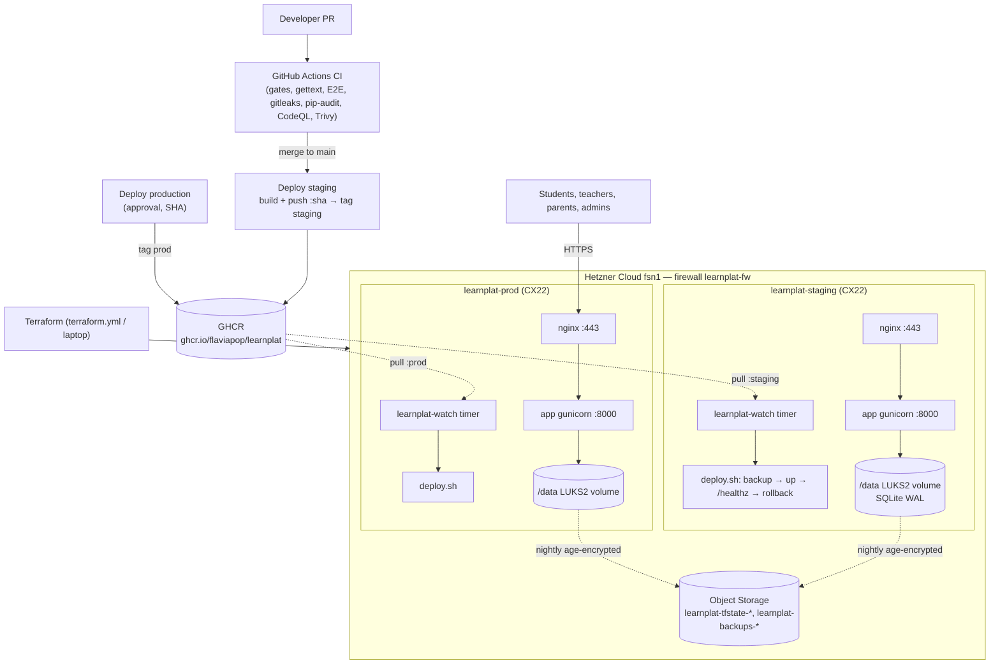

# Deployment Architecture

| Concern | Decision |
|---|---|
| Hosting | Hetzner Cloud fsn1, one CX22 VM per environment (EU data residency) |
| Runtime | Docker Compose: `app` (Gunicorn, 3 workers, non-root) + `nginx` |
| Data | SQLite (WAL) on a LUKS2-encrypted Hetzner volume at `/data`; single writer |
| Delivery | Pull-based: VMs follow GHCR tags; no inbound SSH from CI |
| Safety | Health-gated deploys with automatic image + DB rollback; failed digests not retried |
| Backups | Nightly SQLite online backup, age-encrypted, Object Storage: daily 30 d, monthly 12 m |
| Edge | Nginx: TLS (Let's Encrypt), login rate limit, request id, catch-all default server |
| Security in CI | gitleaks, pip-audit, Dependabot, CodeQL, Trivy (CRITICAL gate) |
| IaC | Terraform (hcloud), state in Object Storage, plan on PR / apply with approval |
