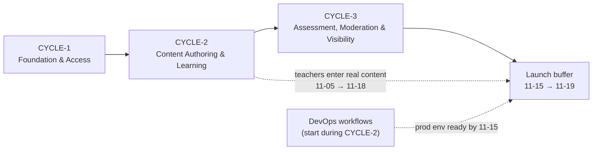

# Build Cycles Overview — Romanian Curriculum Learning Platform (Working Title)

**Date**: 2026-10-19 · **Author**: BUILD_CYCLE_PLANNER · **Status**: Confirmed by user 2026-10-19

## Summary

Total Cycles: 3 (+ launch buffer 2026-11-15 → 2026-11-19)
Cycle Plans: `docs/plans/builds/cycle-[N]/cycle-plan.md`
Story Files: `docs/plans/stories/` (created by `aire-greenfield-plan`; every story carries its cycle's BUILDID)
Pilot launch target: **2026-11-19**

## Cycle Map

| Cycle | BUILDID | Dates | Scope Summary | Expected Outcome |
|---|---|---|---|---|
| Cycle 1 | CYCLE-1 | 10-19 → 10-26 | Epic 1 Foundation (scaffold, auth, RBAC, i18n, layout + primitives, admin accounts/links, audit, health) · Epic 2 Catalogue | Every role logs in (RO/EN) and sees its home page and the K–8 catalogue; Admin manages accounts and links |
| Cycle 2 | CYCLE-2 | 10-27 → 11-05 | Epic 3 Teacher Content Authoring · Epic 4 Student Lessons & Practice · Epic 5 Pilot Reporting (readiness) | Teacher authors and publishes a full chapter; student reads and practises; readiness of 9 chapters visible; **real content entry starts** |
| Cycle 3 | CYCLE-3 | 11-06 → 11-14 | Epic 6 Tests & Scoring · Epic 7 Progress & Score Visibility · Epic 8 Moderation & Notifications · Epic 5 Pilot Reporting (SC-1/SC-3) | All four role workflows end to end (FC-2); pilot metrics visible |
| Buffer | — | 11-15 → 11-19 | UAT, bug fixes, content completeness (FC-1), production deploy, onboarding | Pilot launch |

## Proposed Epic Map (vertical feature slices; finalised by `aire-greenfield-plan`)

| Epic | Name | Cycle |
|------|------|-------|
| 1 | Foundation | CYCLE-1 |
| 2 | Grade & Subject Catalogue | CYCLE-1 |
| 3 | Teacher Content Authoring | CYCLE-2 |
| 4 | Student Lessons & Practice | CYCLE-2 |
| 5 | Pilot Reporting | CYCLE-2 (readiness) · CYCLE-3 (onboarding & completion) |
| 6 | Chapter Tests & Scoring | CYCLE-3 |
| 7 | Progress & Score Visibility | CYCLE-3 |
| 8 | Content Moderation & Notifications | CYCLE-3 |

## Dependency Map

- CYCLE-2 needs from CYCLE-1: accounts/RBAC, i18n, layout + primitives, catalogue (active subjects).
- CYCLE-3 needs from CYCLE-2: content models (with moderation fields already present), published tests, lesson views / exercise completions.
- No cycle depends on unfinished work of a later cycle.

## Risk Log

| Risk | Probability | Impact | Mitigation |
|------|-------------|--------|------------|
| Content entry window (~2 weeks after CYCLE-2) too short for 9 bilingual chapters (FC-1) | High | High | Teachers draft offline from 2026-10-19; readiness dashboard tracks gaps daily; authoring placed as early as dependencies allow |
| Cycles are 1–1.5 weeks (planner default is 2–3) because of the fixed 2026-11-19 launch | Medium | High | Strict scope per cycle; buffer week reserved for UAT/fixes only; any slip moves scope into the buffer, never new features |
| UI/UX spec incomplete (workflow paused at Step 05) | Medium | Medium | Finish before CYCLE-1 Day 3, or proceed with provisional tokens and restyle via `tokens.css` later |
| Production environment not ready at launch | Medium | High | Run DevOps workflows during CYCLE-2; honour the single-instance / persistent-volume / backup constraints (ADR-004) |
| GDPR/consent for minors' data unresolved before onboarding (architecture R1) | Medium | High | Project owner action before the launch buffer |
| SQLite single-writer limits | Low | Medium | WAL + IMMEDIATE transactions; ~12 users; ORM keeps a PostgreSQL migration possible |
