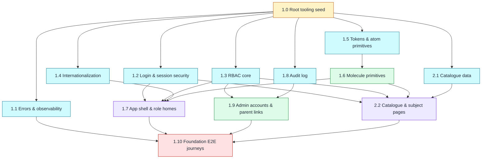

# Romanian Curriculum Learning Platform (Working Title) - Implementation Plan

**Project**: Romanian Curriculum Learning Platform | **Version**: 1.0 | **Created**: 2026-10-19
**Author**: PRODUCT_OWNER | **Status**: APPROVED (index, 2026-10-19)
**Scope of this plan version**: CYCLE-1 (Epics 1–2). CYCLE-2 (Epics 3–5) and CYCLE-3 (Epics 5–8) are appended by later `aire-greenfield-plan` sessions — see `docs/plans/build-cycles.md`.

---

## Dependency Graph

> Source of truth: `docs/plans/dependency-graph.yml`. If the Mermaid drifts from the YAML, the YAML wins. The plan workflow re-renders the Mermaid whenever the graph changes.

| Wave | Stories | Notes |
|------|---------|-------|
| 1 | 1.0 | Root tooling seed — single story, one branch (creates every shared file + custom user model) |
| 2 | 1.1, 1.2, 1.3, 1.4, 1.5, 1.8, 2.1 | Disjoint packages — true parallel; overlap only on seeded `shared_files` |
| 3 | 1.6, 1.9 | Disjoint files |
| 4 | 1.7, 2.2 | Disjoint files |
| 5 | 1.10 | E2E journeys — needs all CYCLE-1 features merged |

📊 **Wave Workload Distribution (team_size: 2)**

| Wave | Stories | Per Dev | Dev Assignments | Notes |
|------|---------|---------|-----------------|-------|
| 1 | 1 | 1 / 0 | Dev-1: [1.0] / Dev-2: — | ⚠️ 1 dev idles (R1 seed constraint) |
| 2 | 7 | 4 / 3 | Dev-1: [1.5, 1.2, 2.1, 1.1] / Dev-2: [1.3, 1.8, 1.4] | ✅ All devs active |
| 3 | 2 | 1 each | Dev-1: [1.6] / Dev-2: [1.9] | ✅ All devs active |
| 4 | 2 | 1 each | Dev-1: [1.7] / Dev-2: [2.2] | ✅ All devs active |
| 5 | 1 | 1 / 0 | Dev-1: [1.10] / Dev-2: — | ⚠️ 1 dev idles (integration must follow features) |

---

## 1. Overview

**Success Criteria** (from `docs/requirements.md`):
- SC-1: 10 students and 2 teachers onboarded via admin-created accounts
- SC-2: 3 subjects × 3 chapters; each chapter has a main lesson, 5–10 higher-difficulty exercises and one 10-question test
- SC-3: ≥ 8 of 10 students complete a chapter test
- SC-4: feedback collected from all 10 students and both teachers
- FC-1 / FC-2: no missing chapter content; every role workflow passes its acceptance criteria (incl. no unauthorized access)

**CYCLE-1 contribution**: the platform foundation every later criterion depends on — accounts and roles (SC-1 enabler), record isolation primitives (FC-2), bilingual UI, and the K–8 catalogue.

**Epic Breakdown** (CYCLE-1):
- Epic 1: Foundation — deployable, secure, bilingual walking skeleton with accounts, roles, audit and the UI primitive library
- Epic 2: Grade & Subject Catalogue — K–8 catalogue with only grade 2 CLR/MEM/EN active

---

## EPIC 1: FOUNDATION

**Owner**: DEV | **Goal**: Every role logs in (RO/EN), lands on a role home inside the shared app shell; the Admin manages accounts and parent links; security, audit, error handling and quality gates are in place.

**Must Read References**:
- `docs/architecture/design/00-system-architecture-greenfield.md` — architecture (ADR-001…011, security, error handling, observability)
- `docs/architecture/design/01-patterns-and-standards-greenfield.md` — patterns, boundary map, quality checklist
- `docs/ui-ux/ui-ux-spec.md` + `docs/ui-ux/08-visual-foundation.md` — design tokens and visual foundation (FE stories)
- `docs/plans/builds/cycle-1/cycle-plan.md` — CYCLE-1 scope

**Prerequisites**: uv 0.13.1 + Python 3.12.15 installed | **Completion**: all Epic 1 stories Done, CYCLE-1 acceptance criteria for accounts/RBAC/i18n/primitives pass, quality gates green.

| Story | Title | BUILDID | Wave | One-line objective |
|-------|-------|---------|------|--------------------|
| 1.0 | Root tooling seed | CYCLE-1 | 1 | Create the uv/Django project, layered `src/`, settings, custom user model (migration 0001), quality tooling and `/healthz` — every shared file exists after this story |
| 1.1 | Error handling & observability | CYCLE-1 | 2 | Domain error hierarchy mapped to localized 403/404/409/500 pages in one middleware; JSON logs with request id; injectable clock |
| 1.2 | Login & session security | CYCLE-1 | 2 | Admin-created accounts can log in/out with Argon2id hashing, 5-strikes/15-min lockout, hardened sessions and a redirect to their role home in their language |
| 1.3 | RBAC core | CYCLE-1 | 2 | Encode the Roles & Permissions Matrix verbatim, enforce it with `@require_permission` (403) and record scoping (404), and prove every URL is protected |
| 1.4 | Internationalization | CYCLE-1 | 2 | `/ro/` and `/en/` URLs, a language switcher that persists `preferred_language`, and a `localized` helper for bilingual content |
| 1.5 | Design tokens & atom primitives | CYCLE-1 | 2 | `tokens.css` from the UI/UX spec, Phosphor sprite, self-hosted font, 7 atom primitives and the DEBUG-only `/_styleguide/` page |
| 1.6 | Molecule primitives | CYCLE-1 | 3 | The remaining 8 shared primitives (form field with RO|EN pair, alert, card, disabled tile, empty state, page header, confirm dialog, data table) on the styleguide |
| 1.7 | App shell & role homes | CYCLE-1 | 4 | Base layout with role-specific top bar, avatar menu, flash messages, HTMX/CSRF wiring and a home page per role |
| 1.8 | Audit log | CYCLE-1 | 2 | Append-only `AUDIT_LOG` with an `AuditPort`, recording logins, failed logins and lockouts |
| 1.9 | Admin account management & parent–child links | CYCLE-1 | 3 | Admin-only Django admin for accounts and parent–child links with role validation and audit entries |
| 1.10 | Foundation E2E journeys | CYCLE-1 | 5 | Playwright harness and per-role journeys proving the CYCLE-1 outcome end to end |

---

## EPIC 2: GRADE & SUBJECT CATALOGUE

**Owner**: DEV | **Goal**: Users see grades K–8 with their subject categories; only grade 2 CLR, MEM and EN are interactive.

**Must Read References**:
- `docs/requirements.md` — Feature "Grade and subject catalogue"
- `docs/architecture/design/00-system-architecture-greenfield.md` — `catalogue` module, route catalogue
- `docs/ui-ux/ui-ux-spec.md` — tokens; `disabled_tile`, `card` primitives

**Prerequisites**: Story 1.0 (data), Stories 1.2/1.3/1.6 (pages); subject categories for non-pilot grades supplied by the project owner (open item, CYCLE-1 plan) | **Completion**: catalogue AC in `docs/plans/builds/cycle-1/cycle-plan.md` pass.

| Story | Title | BUILDID | Wave | One-line objective |
|-------|-------|---------|------|--------------------|
| 2.1 | Catalogue data | CYCLE-1 | 2 | Grade and Subject models with constraints and a reversible data migration seeding K–8, with only grade 2 CLR/MEM/EN active |
| 2.2 | Catalogue & subject pages | CYCLE-1 | 4 | Catalogue grid with active cards and unavailable tiles; inactive routes return 404; active subjects open a chapter-list shell |

---

## Quality Gates

**Per Story**: patterns followed, tests written first and passing, ruff/mypy/import-linter clean, coverage ≥85% overall (domain 100%, application ≥95%), AC met, DoD Gates 1–3 evidence in `docs/stories-implemented/story-N.M-review.md`
**Per Epic**: all stories Done, full suite green, feature demonstrable, route catalogue/README updated
**Cycle**: CYCLE-1 acceptance criteria (`docs/plans/builds/cycle-1/cycle-plan.md`) pass at the Day-4 review

---

## Risks

| Risk | Impact | Mitigation |
|------|--------|------------|
| Seed story 1.0 is large (project + user model + tooling) and blocks all of wave 2 | H | Keep it to skeleton + stubs; Dev-2 reviews it immediately so wave 2 starts the same day |
| Subject categories for non-pilot grades not supplied before Story 2.1 | M | Story 2.1 seeds from one data module; project owner supplies the list (open item) |
| Atkinson Hyperlegible Next lacks a Romanian glyph (ș ț ă â î) | L | Story 1.5 verifies glyphs; falls back to `system-ui` |
| Shared-file merge conflicts in wave 2 (settings, urls, `.po`) | M | One appended block per story (alphabetical); `makemessages` only at story end |

---

## QA Manual Testing Groups

### Epic 1: Foundation

**Group 1** — Stories: 1.0 `[backend]`, 1.1, 1.8 `[backend]`
Once these are done, QA can verify the platform's operational baseline: `/healthz` returns `200 {"status":"ok","db":"ok"}`; visiting an unknown URL shows the localized 404 page; forcing a server error shows the 500 page with a request id that also appears in the JSON log line for that request; the seed's quality gates (lint, types, import contracts, coverage) run green. The audit table (inspected via the Django shell or admin once 1.9 lands) receives entries for logins, failed logins and lockouts.

**Group 2** — Stories: 1.2, 1.3 `[backend]`, 1.4
QA logs in as each role with admin-created credentials, confirms the redirect to the role's home in that user's preferred language, switches RO↔EN and sees the choice persist across logout/login, triggers a lockout with 5 wrong passwords (then confirms login is refused for 15 minutes), and confirms role boundaries: a Student or Parent opening a teacher or admin URL gets the 403 page; logged-out access to any protected page redirects to login.

**Group 3** — Stories: 1.5, 1.6
With `DEBUG=True`, QA opens `/_styleguide/` and checks all 16 primitives in RO and EN: colours and contrast match the UI/UX spec, focus outline visible on every interactive element, confirm dialog traps focus and closes with Esc, status pills show text plus colour, disabled tiles are not clickable; with `DEBUG=False` the styleguide returns 404.

**Group 4** — Stories: 1.7, 1.9, 1.10
End-to-end: the Admin creates a Teacher, a Student and a Parent in the admin area, links the Parent to the Student (and sees an error when linking two students or a teacher as parent), each new user logs in and sees the correct top bar (role menu, language switcher, avatar menu) and role home; flash messages appear after actions; non-Admins get 403 on the admin area. The Playwright suite from 1.10 runs these journeys automatically.

### Epic 2: Grade & Subject Catalogue

**Group 1** — Stories: 2.1 `[backend]`, 2.2
After migrations, QA opens the catalogue as each role: grades K–8 appear with their subject categories; only grade 2 CLR, MEM and EN are clickable cards; every other grade/subject is a visibly unavailable tile with no link, and typing its URL directly returns 404; opening an active subject shows its chapter-list shell (empty until CYCLE-2 content exists, with an empty-state message). Data survives an app restart.
