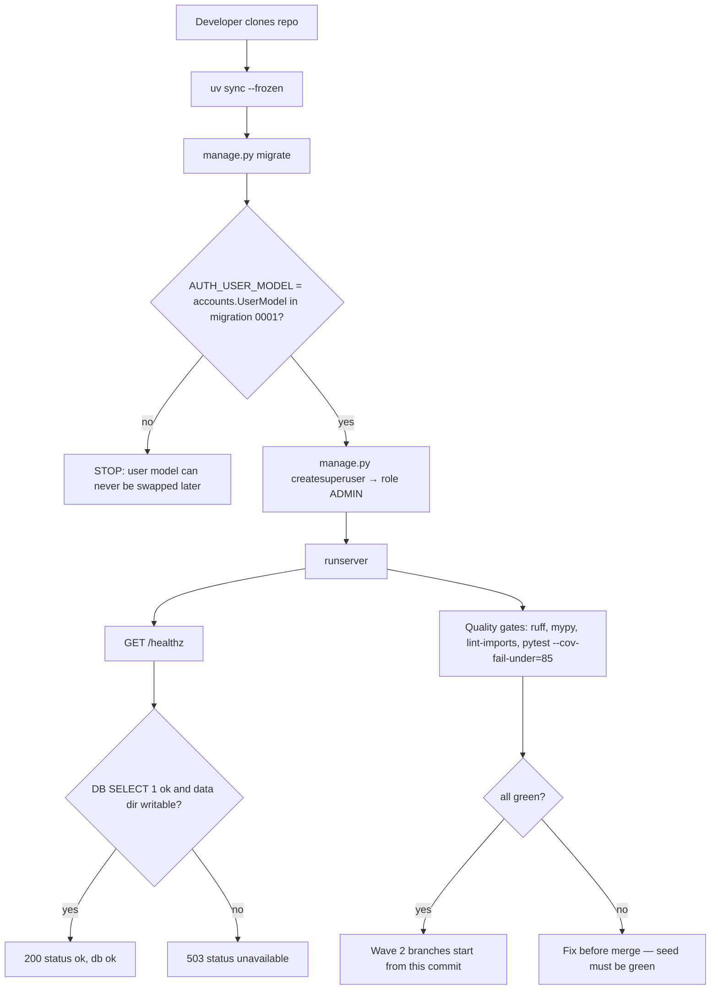

### Story 1.0: Root Tooling Seed

**BUILDID**: CYCLE-1 | **GitHub**: LOCAL | **AzureDevOps**: LOCAL | **Epic**: 1 - Foundation | **ID**: 1.0 | **Date**: 2026-10-19
**File**: `docs/plans/stories/epic-1-story-1.0-Root-Tooling-Seed.md`
**Build Ref**: `docs/plans/builds/cycle-1/cycle-plan.md` — CYCLE-1 Foundation & Access (Workshop Day 1: scaffold and quality gates)
**Wave**: 1
**Requires**: []
**Enables**: [1.1, 1.2, 1.3, 1.4, 1.5, 1.8, 2.1]
**Files Touched**:
  - pyproject.toml
  - uv.lock
  - .python-version
  - .gitignore
  - .env.example
  - README.md
  - manage.py
  - src/config/__init__.py
  - src/config/settings/__init__.py
  - src/config/settings/env.py
  - src/config/settings/base.py
  - src/config/settings/dev.py
  - src/config/settings/test.py
  - src/config/settings/prod.py
  - src/config/urls.py
  - src/config/wsgi.py
  - src/domain/__init__.py
  - src/application/__init__.py
  - src/infrastructure/__init__.py
  - src/infrastructure/container.py
  - src/infrastructure/persistence/__init__.py
  - src/infrastructure/persistence/accounts/**
  - src/infrastructure/web/__init__.py
  - src/infrastructure/web/common/__init__.py
  - src/infrastructure/web/common/decorators.py
  - src/infrastructure/web/common/health.py
  - src/infrastructure/web/templates/layouts/base.html
  - src/infrastructure/web/static/css/tokens.css
  - src/infrastructure/web/templatetags/__init__.py
  - src/infrastructure/web/templatetags/ui.py
  - src/infrastructure/i18n/locale/ro/LC_MESSAGES/django.po
  - src/infrastructure/i18n/locale/en/LC_MESSAGES/django.po
  - tests/conftest.py
  - tests/factories/__init__.py
  - tests/factories/accounts.py
  - tests/integration/web/test_role_access_matrix.py
  - tests/integration/web/test_healthz.py
  - tests/integration/persistence/accounts/test_user_model.py
  - tests/unit/config/test_env.py
**Roles Ref**: docs/requirements.md#roles--permissions-matrix — single-actor — no role variation (infrastructure seed; the user model stores the four canonical roles but nothing in this story differentiates behaviour by role)
**QA Candidate**: No — pure tooling/infrastructure seed; the only runtime surface (`/healthz`) is verified by integration tests here and re-checked by QA Group 1 together with Story 1.1.

---

#### 👤 User Reference

**Description**:
This story creates the empty-but-working project that every other piece of the platform is built on. After it is done, the team has one shared code repository with a fixed folder structure, the agreed tools for checking code quality and running tests, a database file that keeps its data when the application restarts, and a simple "health check" address that tells an operator whether the application and its database are working.

It also creates the list of people who can use the platform ("user accounts") with the information the requirements ask us to keep: name, date of birth, role (Student, Teacher, Parent/Guardian or Admin) and preferred language (Romanian or English). This has to happen first because the framework only allows the shape of user accounts to be decided once, at the very beginning; changing it later would mean rebuilding the database.

Finally, it creates — empty or minimal — every file that several developers will need to edit later (settings, the list of web addresses, the page layout, the colour definitions, the translation files). Creating them once, on one branch, means two developers working in parallel next week never both try to create the same file, which would cause conflicts that cannot be merged automatically.

Nothing visible to students, teachers or parents is delivered yet — no login page, no menus. Those come in Stories 1.2–1.7.

**Acceptance Criteria** (plain-English):
- A developer can download the repository, run one install command and one start command, and the application starts on their laptop with Python 3.12.
- Visiting the health-check address returns "ok" when the application and database work, and a clear "unavailable" answer when the database cannot be reached.
- The health check is reachable without logging in and only answers to "read" requests.
- User accounts can be stored with full name, date of birth, one of the four roles and a preferred language (Romanian by default); passwords are never stored in readable form.
- The very first administrator account can be created from the command line, and it is automatically given the Admin role.
- Data written to the database is still there after the application is stopped and started again.
- The automated quality checks (formatting, lint, type checks, layer rules, tests with coverage of at least 85%) all run with one command each and pass.
- Every file that later stories share already exists, so parallel work in the next wave starts without file-creation conflicts.
- Settings never contain real secrets; the production configuration refuses to start without a secret key supplied from the environment.

**User Flow**:
Actor: system — no role variation.

**Flow Diagram**:



---

#### 🤖 AI Agent Reference

**Must Read**:
- `docs/architecture/design/01-patterns-and-standards-greenfield.md` — §1 (layout, naming, dependencies), §2 (formatting), §3 (layering + import-linter), §6.1 (SQLite config), §6.4 (migrations, `AUTH_USER_MODEL`), §10 (configuration), §12.6 (coverage), §16 (boundary map, `shared_files`)
- `docs/architecture/design/00-system-architecture-greenfield.md` — Technology Stack, Data Model (`USER`), ADR-002/004/005, Deployment View, `/healthz` in the route catalogue
- `docs/ui-ux/ui-ux-spec.md` + `docs/ui-ux/08-visual-foundation.md` — token values for `tokens.css`
- `docs/plans/dependency-graph.yml` — `shared_files` list this story must create
- `docs/plans/builds/cycle-1/cycle-plan.md` — CYCLE-1 scope

**Description**:
Bootstrap the uv-managed Django 5.2 project with the layered `src/` layout from the patterns doc (`config`, `domain`, `application`, `infrastructure`) and wire every quality gate (ruff format/check, mypy, import-linter, pytest + pytest-django + coverage ≥85%). Configure SQLite per ADR-004 (WAL, `IMMEDIATE` transactions, 20 s timeout) with the DB path from `DATABASE_PATH`.

Create the custom user model `accounts.UserModel` in the `infrastructure.persistence.accounts` app and generate migration `0001` **before any other migration exists**, because Django can't change `AUTH_USER_MODEL` once migrations are applied. The model stores `role` (STUDENT/TEACHER/PARENT/ADMIN as persisted string values), `full_name`, `date_of_birth`, `preferred_language` (`ro` default, `en`). `first_name` and `last_name` are removed. A custom manager makes `createsuperuser` produce an ADMIN. The domain `Role` enum is **not** created here, because `src/domain/accounts/**` belongs to Story 1.3. The model uses literal choices, and 1.3 adds a test asserting the choices equal `Role` values.

Add a public, read-only `GET /healthz` (outside the language prefix) that runs `SELECT 1` and checks the data directory is writable, returning `200 {"status":"ok","db":"ok"}` or `503 {"status":"unavailable","db":"error"}`.

Finally, create **every** file listed in `shared_files` (dependency graph), so wave-2 branches only modify existing files (R1 seed rule). Shared files whose content is owned by later stories are created as minimal, valid, working stubs: no `TODO` and no placeholder logic. To keep `uv.lock` out of wave-2 merges, declare **all** runtime and dev dependencies from patterns §1.3 now.

**Design Tokens** (FE — `tokens.css` seed only; components arrive in 1.5/1.6):
- Colors: primary `#0E7490`, primary-hover `#155E75`, accent `#FBBF24`, focus `#C2410C`, success `#15803D`, error `#B91C1C`, warning `#B45309`, text `#1F2937`, muted `#4B5563`, border `#6B7280`, bg-student `#FFF8EC`, bg-staff `#F5F7FA`, surface `#FFFFFF`, disabled `#F3F4F6`
- Spacing: 4px unit; student 8/16/24/32/48/64; staff 4/8/12/16/24/32/48
- Typography: `'Atkinson Hyperlegible Next', system-ui, sans-serif`; base student 18px / staff 16px; scale 14/16/18/20/24/32/40; weights 400/600/700
- Radius: student 16px, staff 8px · Elevation: 0–3 per `08-visual-foundation.md`
- Validation: on submit | Error: inline + top banner (implemented in 1.1/1.6)

**Acceptance Criteria**:
1. `uv sync --frozen` installs from the committed `uv.lock`; `.python-version` pins `3.12`; `requires-python = ">=3.12,<3.13"`.
2. `pyproject.toml` declares every runtime dependency (`django>=5.2,<5.3`, `argon2-cffi`, `django-axes`, `django-csp`, `markdown`, `nh3`, `gunicorn`, `whitenoise`) and the dev group (`pytest`, `pytest-django`, `pytest-cov`, `factory-boy`, `pytest-playwright`, `ruff`, `mypy`, `django-stubs`, `import-linter`) with the ranges from patterns §1.3.
3. `src/` contains `config`, `domain`, `application`, `infrastructure` packages; `manage.py`, `wsgi.py`, pytest and mypy all resolve imports from `src/`.
4. `AUTH_USER_MODEL = "accounts.UserModel"`; `infrastructure/persistence/accounts/migrations/0001_initial.py` creates it, and no other first-party migration exists.
5. `UserModel` has `role` (choices STUDENT/TEACHER/PARENT/ADMIN, required), `full_name` (≤150 chars, required), `date_of_birth` (required), `preferred_language` (choices `ro`/`en`, default `ro`); `first_name`/`last_name` are removed; `get_full_name()` returns `full_name`.
6. `UserModel.objects.create_superuser(...)` sets `role=ADMIN`, `is_staff=True`, `is_superuser=True`; `create_user(...)` hashes the password (never stored in plain text).
7. SQLite is configured exactly as patterns §6.1 (`transaction_mode=IMMEDIATE`, `timeout=20`, WAL + `synchronous=NORMAL` via `init_command`), and `ATOMIC_REQUESTS=False`.
8. Settings split: `base.py` (shared), `dev.py` (DEBUG, dev-only secret, creates the `data/` directory), `test.py` (fast `MD5PasswordHasher` for tests only, temporary DB), `prod.py` (DEBUG False, `DJANGO_SECRET_KEY` **required**, security flags from patterns §10). Environment variables are read **only** through `config/settings/env.py`.
9. `GET /healthz` (no language prefix, no auth) → `200 {"status":"ok","db":"ok"}` when `SELECT 1` succeeds and the DB directory is writable; `503 {"status":"unavailable","db":"error"}` otherwise; non-GET/HEAD → `405`. The URL name `healthz` is in `PUBLIC_URL_NAMES`.
10. Every `shared_files` entry exists after this story: `container.py` (empty composition root module with a docstring), `decorators.py` (`PUBLIC_URL_NAMES` only), `base.html` (valid minimal layout), `tokens.css` (full token set), `templatetags/ui.py` (empty `Library`), both `django.po` (valid headers), `tests/conftest.py`, `tests/factories/accounts.py`, `tests/integration/web/test_role_access_matrix.py` (public-route assertion), `.env.example`, `README.md`, `.gitignore`.
11. Quality commands pass on the seed: `uv run ruff format --check .`, `uv run ruff check .`, `uv run mypy`, `uv run lint-imports`, `uv run pytest --cov=src --cov-branch --cov-fail-under=85`.
12. import-linter contracts "Layers point inward" and "Domain is framework-free" are configured (with `include_external_packages = true`) and kept.
13. Restart persistence: data created, server stopped and started again → still present (integration test against a file-based DB).
14. No secrets committed: `.env` and `data/` are git-ignored; `.env.example` lists every variable from patterns §10 with placeholders only.
15. `makemigrations --check --dry-run` reports no changes.

**RBAC Enforcement**:
No role-differentiated access — single actor.
- `/healthz` is intentionally public (operator/uptime probe) and returns no personal data. It is registered in `PUBLIC_URL_NAMES`, which Story 1.3's URL-coverage test reads.

**System responses + error cases**:

| Trigger | Response | Side-effect |
|---------|----------|-------------|
| `GET /healthz`, DB reachable, data dir writable | `200 {"status":"ok","db":"ok"}`, `Cache-Control: no-store` | none (read-only) |
| `GET /healthz` repeated (idempotent) | identical `200` body | none, no session created, no cookie set |
| `HEAD /healthz` | `200`, empty body | none |
| `GET /healthz` when `SELECT 1` raises `DatabaseError` | `503 {"status":"unavailable","db":"error"}` | `ERROR` log line with the exception class (no stack trace in the body) |
| `GET /healthz` when the DB directory is read-only | `503 {"status":"unavailable","db":"error"}` | `ERROR` log line |
| `POST /healthz` (or any non-GET/HEAD) | `405 Method Not Allowed` | none |
| `GET /ro/healthz` / `GET /en/healthz` | `404` (health is deliberately outside `i18n_patterns`) | none |
| `manage.py migrate` on an empty DB | creates all tables; `accounts_user` exists | DB file created at `DATABASE_PATH` |
| `manage.py migrate` repeated | "No migrations to apply." | none |
| `manage.py createsuperuser` | prompts for username, full name, date of birth, password | user with `role=ADMIN`, `is_staff`, `is_superuser` |
| Prod settings without `DJANGO_SECRET_KEY` | process fails at start with `ImproperlyConfigured: Required environment variable DJANGO_SECRET_KEY is not set` | none |

**Prerequisites**:
- uv 0.13.1 and Python 3.12.15 installed (done 2026-10-19, `~/.local/bin/uv`).
- Empty repository on a feature branch from `main` (only `docs/`, `SPEC/`, `.claude/` exist).
- Note for Story 1.4 (not needed here): Django `compilemessages` needs GNU gettext (`msgfmt`), which isn't currently installed on the dev machine. 1.4 must install it or choose an alternative.

**Context**: `docs/architecture/design/01-patterns-and-standards-greenfield.md`, `docs/architecture/design/00-system-architecture-greenfield.md`, `docs/ui-ux/08-visual-foundation.md`, `docs/plans/dependency-graph.yml`

**Patterns**: Project Structure (§1), Code Structure (§2), Layering Rules (§3), Database Access (§6.1, §6.4), Configuration (§10), Testing (§12) — see `docs/architecture/design/01-patterns-and-standards-greenfield.md`

**Steps**:

1. **Initialise the uv project and pin Python.** Run `uv init --bare --name learning-platform`, then `uv python pin 3.12` (creates `.python-version`). Write `pyproject.toml`; `uv lock` resolves exact versions into `uv.lock`, and both are committed.
   ```toml
   [project]
   name = "learning-platform"
   version = "0.1.0"
   requires-python = ">=3.12,<3.13"
   dependencies = [
     "django>=5.2,<5.3",
     "argon2-cffi>=23.1",
     "django-axes>=7.0",
     "django-csp>=4.0",
     "markdown>=3.7",
     "nh3>=0.2.18",
     "gunicorn>=23.0",
     "whitenoise>=6.7",
   ]

   [dependency-groups]
   dev = [
     "pytest>=8.3", "pytest-django>=4.9", "pytest-cov>=6.0", "factory-boy>=3.3",
     "pytest-playwright>=0.6", "ruff>=0.8", "mypy>=1.13", "django-stubs[compatible-mypy]>=5.1",
     "import-linter>=2.1",
   ]

   [tool.ruff]
   line-length = 100
   src = ["src", "tests"]
   extend-exclude = ["src/infrastructure/persistence/*/migrations"]

   [tool.ruff.lint]
   select = ["E", "F", "W", "I", "B", "UP", "SIM", "N", "S", "DJ", "PT", "RUF", "C90", "FIX"]
   [tool.ruff.lint.mccabe]
   max-complexity = 8
   [tool.ruff.lint.per-file-ignores]
   "tests/**" = ["S101", "S105", "S106"]   # asserts and test passwords are expected in tests

   [tool.mypy]
   mypy_path = "src"
   packages = ["domain", "application", "infrastructure", "config"]
   plugins = ["mypy_django_plugin.main"]
   [tool.django-stubs]
   django_settings_module = "config.settings.test"
   [[tool.mypy.overrides]]
   module = ["domain.*", "application.*"]
   strict = true

   [tool.pytest.ini_options]
   DJANGO_SETTINGS_MODULE = "config.settings.test"
   pythonpath = ["src", "."]
   testpaths = ["tests"]
   addopts = "--import-mode=importlib -m 'not e2e'"
   markers = ["e2e: browser end-to-end tests (run with -m e2e)"]

   [tool.coverage.run]
   source = ["src"]
   branch = true
   omit = ["*/migrations/*", "src/config/settings/*", "src/config/wsgi.py", "src/infrastructure/web/styleguide/*"]

   [tool.importlinter]
   root_packages = ["domain", "application", "infrastructure", "config"]
   include_external_packages = true

   [[tool.importlinter.contracts]]
   name = "Layers point inward"
   type = "layers"
   layers = ["config", "infrastructure", "application", "domain"]

   [[tool.importlinter.contracts]]
   name = "Domain is framework-free"
   type = "forbidden"
   source_modules = ["domain", "application"]
   forbidden_modules = ["django", "markdown", "nh3"]
   ```
   import-linter needs `src` on the path. Document running it as `PYTHONPATH=src uv run lint-imports` in the README.

2. **Create the package skeleton.** Add `__init__.py` files for `src/config`, `src/config/settings`, `src/domain`, `src/application`, `src/infrastructure`, `src/infrastructure/persistence`, `src/infrastructure/web`, `src/infrastructure/web/common`, `src/infrastructure/web/templatetags`, `tests/factories`. `manage.py` and `wsgi.py` put `src/` on `sys.path`:
   ```python
   # manage.py
   import os
   import sys
   from pathlib import Path


   def main() -> None:
       sys.path.insert(0, str(Path(__file__).resolve().parent / "src"))
       os.environ.setdefault("DJANGO_SETTINGS_MODULE", "config.settings.dev")
       from django.core.management import execute_from_command_line

       execute_from_command_line(sys.argv)


   if __name__ == "__main__":
       main()
   ```

3. **Environment helper** `src/config/settings/env.py`: exactly the `env_str` / `env_list` / `env_path` helpers from patterns §10. A missing required variable raises `ImproperlyConfigured` naming the variable.

4. **Settings.** In `base.py`: `BASE_DIR = Path(__file__).resolve().parents[3]` (repo root). `INSTALLED_APPS` = Django contrib (`admin`, `auth`, `contenttypes`, `sessions`, `messages`, `staticfiles`) + `"infrastructure.persistence.accounts"`. Use the standard middleware stack. Templates: `DIRS = [BASE_DIR / "src/infrastructure/web/templates"]`, `APP_DIRS = True`, `builtins` none. `LANGUAGE_CODE = "ro"`, `LANGUAGES = [("ro", "Română"), ("en", "English")]`, `LOCALE_PATHS = [BASE_DIR / "src/infrastructure/i18n/locale"]`, `USE_I18N = USE_TZ = True`, `TIME_ZONE = "Europe/Bucharest"`. `STATIC_URL = "static/"`, `STATICFILES_DIRS = [BASE_DIR / "src/infrastructure/web/static"]`, `STATIC_ROOT = BASE_DIR / "staticfiles"`. `AUTH_USER_MODEL = "accounts.UserModel"`, `DEFAULT_AUTO_FIELD = "django.db.models.BigAutoField"`. `DATABASES` exactly per patterns §6.1, with `ATOMIC_REQUESTS = False`. `ROOT_URLCONF = "config.urls"`, `WSGI_APPLICATION = "config.wsgi.application"`. `LOGGING` writes plain console output for now; JSON comes in 1.1.
   ```python
   # src/config/settings/dev.py
   from config.settings.base import *  # noqa: F403
   from config.settings.base import DATABASES

   DEBUG = True
   SECRET_KEY = "dev-only-insecure-key-do-not-use-in-production"  # noqa: S105
   ALLOWED_HOSTS = env_list("DJANGO_ALLOWED_HOSTS", "localhost,127.0.0.1")  # noqa: F405
   DATABASES["default"]["NAME"].parent.mkdir(parents=True, exist_ok=True)
   ```
   ```python
   # src/config/settings/prod.py
   from config.settings.base import *  # noqa: F403

   DEBUG = False
   SECRET_KEY = env_str("DJANGO_SECRET_KEY")  # noqa: F405 — required, no default
   ALLOWED_HOSTS = env_list("DJANGO_ALLOWED_HOSTS")  # noqa: F405
   CSRF_TRUSTED_ORIGINS = env_list("DJANGO_CSRF_TRUSTED_ORIGINS")  # noqa: F405
   SECURE_SSL_REDIRECT = True
   SECURE_HSTS_SECONDS = 31_536_000
   SESSION_COOKIE_SECURE = CSRF_COOKIE_SECURE = True
   SECURE_PROXY_SSL_HEADER = ("HTTP_X_FORWARDED_PROTO", "https")
   ```
   In `test.py`: a fixed test secret; `PASSWORD_HASHERS = ["django.contrib.auth.hashers.MD5PasswordHasher"]` (speed, tests only; Argon2 is configured for real settings in 1.2); `DATABASES["default"]["NAME"] = BASE_DIR / "data" / "test.sqlite3"` (pytest-django creates and destroys the test DB).

5. **Custom user model** in `src/infrastructure/persistence/accounts/` (`apps.py` with `label = "accounts"`, `models.py`, `managers.py`). Generate the migration with `uv run python manage.py makemigrations accounts`.
   ```python
   # src/infrastructure/persistence/accounts/models.py
   from django.contrib.auth.models import AbstractUser
   from django.db import models

   from infrastructure.persistence.accounts.managers import UserManager

   # Values mirror domain.accounts.roles.Role (Story 1.3 asserts equality).
   ROLE_CHOICES = [("STUDENT", "Student"), ("TEACHER", "Teacher"),
                   ("PARENT", "Parent/Guardian"), ("ADMIN", "Admin")]
   LANGUAGE_CHOICES = [("ro", "Română"), ("en", "English")]


   class UserModel(AbstractUser):
       first_name = None  # replaced by full_name (requirements: store user name)
       last_name = None
       full_name = models.CharField(max_length=150)
       date_of_birth = models.DateField()
       role = models.CharField(max_length=10, choices=ROLE_CHOICES)
       preferred_language = models.CharField(max_length=2, choices=LANGUAGE_CHOICES, default="ro")

       objects = UserManager()
       REQUIRED_FIELDS = ["full_name", "date_of_birth"]

       class Meta:
           db_table = "accounts_user"

       def get_full_name(self) -> str:
           return self.full_name

       def get_short_name(self) -> str:
           return self.full_name
   ```
   ```python
   # src/infrastructure/persistence/accounts/managers.py
   from django.contrib.auth.models import UserManager as DjangoUserManager


   class UserManager(DjangoUserManager):
       def create_superuser(self, username, email=None, password=None, **extra_fields):
           # The first operator account is always an Admin in the platform's RBAC.
           extra_fields["role"] = "ADMIN"
           return super().create_superuser(username, email, password, **extra_fields)
   ```

6. **Health endpoint** `src/infrastructure/web/common/health.py`, routed in `config/urls.py` **outside** `i18n_patterns`:
   ```python
   import logging
   import os

   from django.conf import settings
   from django.db import DatabaseError, connection
   from django.http import HttpRequest, JsonResponse
   from django.views.decorators.cache import never_cache
   from django.views.decorators.http import require_safe

   logger = logging.getLogger(__name__)


   def _database_ok() -> bool:
       try:
           with connection.cursor() as cursor:
               cursor.execute("SELECT 1")
       except DatabaseError as exc:
           logger.error("healthz.db_unavailable", extra={"error": type(exc).__name__})
           return False
       db_dir = settings.DATABASES["default"]["NAME"].parent
       return os.access(db_dir, os.W_OK)


   @never_cache
   @require_safe
   def healthz(request: HttpRequest) -> JsonResponse:
       """GET /healthz — public uptime probe; no personal data."""
       if _database_ok():
           return JsonResponse({"status": "ok", "db": "ok"})
       return JsonResponse({"status": "unavailable", "db": "error"}, status=503)
   ```
   ```python
   # src/config/urls.py
   from django.conf.urls.i18n import i18n_patterns
   from django.urls import path

   from infrastructure.web.common.health import healthz

   urlpatterns = [
       path("healthz", healthz, name="healthz"),
   ]

   urlpatterns += i18n_patterns(
       # Context URL includes are appended here, one block per context, alphabetically.
       prefix_default_language=True,
   )
   ```
   The Django admin route is added by Story 1.9; the language-switch route by Story 1.4.

7. **Seed the remaining shared files** as minimal, working stubs:
   ```python
   # src/infrastructure/web/common/decorators.py
   """Authorization decorators and the public-route registry.

   PUBLIC_URL_NAMES lists every URL name reachable without a permission check. Story 1.3
   adds @require_permission here, plus a test that fails for any URL that is neither
   decorated nor listed below.
   """

   PUBLIC_URL_NAMES: frozenset[str] = frozenset({"healthz"})
   ```
   ```python
   # src/infrastructure/container.py
   """Composition root: the only module that chooses concrete implementations for ports.

   One factory function per use case, grouped in one block per context (alphabetical).
   """
   ```
   ```python
   # src/infrastructure/web/templatetags/ui.py
   """Inclusion tags for the shared UI primitive library (patterns §11.2)."""
   from django import template

   register = template.Library()
   ```
   ```django
   {# src/infrastructure/web/templates/layouts/base.html #}
   <!doctype html>
   <html lang="{{ LANGUAGE_CODE|default:'ro' }}">
   <head>
     <meta charset="utf-8">
     <meta name="viewport" content="width=device-width, initial-scale=1">
     <title>Learning Platform</title>
     <link rel="stylesheet" href="">
   </head>
   <body>
     <main id="content"></main>
   </body>
   </html>
   ```
   ```css
   /* src/infrastructure/web/static/css/tokens.css — values from docs/ui-ux/ui-ux-spec.md */
   :root {
     --color-primary: #0E7490; --color-primary-hover: #155E75; --color-accent: #FBBF24;
     --color-focus: #C2410C; --color-success: #15803D; --color-error: #B91C1C;
     --color-warning: #B45309; --color-text: #1F2937; --color-muted: #4B5563;
     --color-border: #6B7280; --color-bg-student: #FFF8EC; --color-bg-staff: #F5F7FA;
     --color-surface: #FFFFFF; --color-disabled: #F3F4F6;
     --space-1: 4px; --space-2: 8px; --space-3: 12px; --space-4: 16px; --space-6: 24px;
     --space-8: 32px; --space-12: 48px; --space-16: 64px;
     --font-family: 'Atkinson Hyperlegible Next', system-ui, sans-serif;
     --font-size-base-student: 18px; --font-size-base-staff: 16px;
     --font-14: 14px; --font-16: 16px; --font-18: 18px; --font-20: 20px; --font-24: 24px;
     --font-32: 32px; --font-40: 40px;
     --weight-regular: 400; --weight-semibold: 600; --weight-bold: 700;
     --radius-student: 16px; --radius-staff: 8px; --radius-pill: 999px;
     --elevation-1: 0 1px 2px rgba(31,41,55,.08), 0 1px 3px rgba(31,41,55,.12);
     --elevation-2: 0 4px 8px rgba(31,41,55,.12);
     --elevation-3: 0 12px 32px rgba(31,41,55,.24);
     --touch-min: 32px; --touch-student: 44px;
   }
   ```
   - `django.po` (ro and en): a standard gettext header only (`Language: ro` / `Language: en`, `Content-Type: text/plain; charset=UTF-8`).
   - `.gitignore` (outside the AIRE-managed block): `.venv/`, `__pycache__/`, `.env`, `data/`, `staticfiles/`, `.coverage`, `htmlcov/`, `.pytest_cache/`, `.mypy_cache/`, `.ruff_cache/`, `test-results/`.
   - `.env.example`: `DJANGO_SETTINGS_MODULE=config.settings.dev`, `DJANGO_SECRET_KEY=change-me`, `DJANGO_ALLOWED_HOSTS=localhost,127.0.0.1`, `DJANGO_CSRF_TRUSTED_ORIGINS=`, `DATABASE_PATH=./data/db.sqlite3`, `LOG_LEVEL=INFO`.
   - `README.md`: the sections from patterns §14 (Overview · Prerequisites · Setup · Running · Testing · Project structure · Configuration · Troubleshooting), with the exact commands from this story.

8. **Test scaffolding.** Add `tests/conftest.py` (shared fixtures; role clients are added by later stories) and the user factory:
   ```python
   # tests/factories/accounts.py
   import datetime

   import factory

   from infrastructure.persistence.accounts.models import UserModel


   class UserFactory(factory.django.DjangoModelFactory):
       class Meta:
           model = UserModel
           django_get_or_create = ("username",)

       username = factory.Sequence(lambda n: f"user{n}")
       full_name = factory.Faker("name")
       date_of_birth = datetime.date(2018, 5, 1)
       role = "STUDENT"
       preferred_language = "ro"
       password = factory.django.Password("pilot-pass-123")
   ```

9. **Run every gate locally and record the output** for the review doc: `uv run ruff format --check .`, `uv run ruff check .`, `uv run mypy`, `PYTHONPATH=src uv run lint-imports`, `uv run python manage.py makemigrations --check --dry-run`, `uv run pytest --cov=src --cov-branch --cov-fail-under=85`.

**Tests**:

```python
# tests/integration/web/test_healthz.py
import pytest
from django.db import DatabaseError

pytestmark = pytest.mark.django_db


def test_healthz_returns_ok_when_database_reachable(client):
    response = client.get("/healthz")

    assert response.status_code == 200
    assert response.json() == {"status": "ok", "db": "ok"}
    assert "no-store" in response["Cache-Control"]


def test_healthz_is_idempotent_and_sets_no_session_cookie(client):
    first, second = client.get("/healthz"), client.get("/healthz")

    assert first.json() == second.json()
    assert "sessionid" not in second.cookies


def test_healthz_returns_503_when_database_query_fails(client, monkeypatch):
    def broken_cursor(*args, **kwargs):
        raise DatabaseError("disk I/O error")

    monkeypatch.setattr("django.db.backends.base.base.BaseDatabaseWrapper.cursor", broken_cursor)

    response = client.get("/healthz")

    assert response.status_code == 503
    assert response.json() == {"status": "unavailable", "db": "error"}


def test_healthz_returns_503_when_data_directory_not_writable(client, monkeypatch):
    monkeypatch.setattr("infrastructure.web.common.health.os.access", lambda *_: False)

    assert client.get("/healthz").status_code == 503


def test_healthz_rejects_post(client):
    assert client.post("/healthz").status_code == 405


@pytest.mark.parametrize("prefix", ["/ro", "/en"])
def test_healthz_is_not_language_prefixed(client, prefix):
    assert client.get(f"{prefix}/healthz").status_code == 404
```

```python
# tests/integration/persistence/accounts/test_user_model.py
import datetime

import pytest
from django.conf import settings
from django.contrib.auth import get_user_model
from django.db import connection

pytestmark = pytest.mark.django_db


def test_auth_user_model_is_custom_accounts_model():
    assert settings.AUTH_USER_MODEL == "accounts.UserModel"
    assert get_user_model()._meta.db_table == "accounts_user"


def test_create_user_stores_profile_fields_and_hashes_password():
    user = get_user_model().objects.create_user(
        username="ana", password="pilot-pass-123", full_name="Ana Pop",
        date_of_birth=datetime.date(2018, 3, 2), role="STUDENT")

    user.refresh_from_db()
    assert (user.full_name, user.role, user.preferred_language) == ("Ana Pop", "STUDENT", "ro")
    assert user.password != "pilot-pass-123"
    assert user.check_password("pilot-pass-123")
    assert user.get_full_name() == "Ana Pop"


def test_create_superuser_is_always_admin_role():
    admin = get_user_model().objects.create_superuser(
        username="root", password="x-strong-pass-9", full_name="Admin One",
        date_of_birth=datetime.date(1990, 1, 1), role="STUDENT")

    assert (admin.role, admin.is_staff, admin.is_superuser) == ("ADMIN", True, True)


def test_first_and_last_name_columns_are_removed():
    columns = {c.name for c in connection.introspection.get_table_description(
        connection.cursor(), "accounts_user")}

    assert {"full_name", "date_of_birth", "role", "preferred_language"} <= columns
    assert not {"first_name", "last_name"} & columns


def test_sqlite_runs_in_wal_mode_with_immediate_transactions():
    with connection.cursor() as cursor:
        cursor.execute("PRAGMA journal_mode")
        journal_mode = cursor.fetchone()[0]

    assert journal_mode.lower() == "wal"
    assert connection.settings_dict["OPTIONS"]["transaction_mode"] == "IMMEDIATE"
```

```python
# tests/unit/config/test_env.py
from pathlib import Path

import pytest
from django.core.exceptions import ImproperlyConfigured

from config.settings.env import env_list, env_path, env_str


def test_env_str_raises_naming_the_missing_required_variable(monkeypatch):
    monkeypatch.delenv("DJANGO_SECRET_KEY", raising=False)

    with pytest.raises(ImproperlyConfigured, match="DJANGO_SECRET_KEY"):
        env_str("DJANGO_SECRET_KEY")


def test_env_str_returns_default_when_unset(monkeypatch):
    monkeypatch.delenv("LOG_LEVEL", raising=False)

    assert env_str("LOG_LEVEL", "INFO") == "INFO"


def test_env_list_splits_and_strips_empty_items(monkeypatch):
    monkeypatch.setenv("DJANGO_ALLOWED_HOSTS", " a.ro, ,b.ro ")

    assert env_list("DJANGO_ALLOWED_HOSTS") == ["a.ro", "b.ro"]


def test_env_path_prefers_environment(monkeypatch):
    monkeypatch.setenv("DATABASE_PATH", "/data/db.sqlite3")

    assert env_path("DATABASE_PATH", Path("x")) == Path("/data/db.sqlite3")
```

```python
# tests/integration/web/test_role_access_matrix.py — seeded; Stories 1.3, 1.7, 2.2 add rows
import pytest
from django.urls import reverse

from infrastructure.web.common.decorators import PUBLIC_URL_NAMES

pytestmark = pytest.mark.django_db


@pytest.mark.parametrize("url_name", sorted(PUBLIC_URL_NAMES))
def test_public_routes_are_reachable_anonymously(client, url_name):
    response = client.get(reverse(url_name))

    assert response.status_code == 200
```

Manual:
- Fresh clone → `uv sync --frozen` → `uv run python manage.py migrate` → `uv run python manage.py createsuperuser` → `uv run python manage.py runserver` → `curl -i localhost:8000/healthz` shows `200` and the JSON body.
- Stop the server, start it again, then `uv run python manage.py shell -c "from django.contrib.auth import get_user_model as g; print(g().objects.count())"` still prints `1` (persistence).
- `DJANGO_SETTINGS_MODULE=config.settings.prod uv run python manage.py check` without `DJANGO_SECRET_KEY` fails with the `ImproperlyConfigured` message.
- `chmod -w data/` then `curl /healthz` shows `503`; restore permissions afterwards.

**Quality**: `ruff format --check` and `ruff check` 0 issues; `mypy` 0 errors; `lint-imports` both contracts kept; `makemigrations --check` clean; tests pass; coverage ≥85% (domain/application gates start applying once those packages contain code in wave 2); no `TODO`/`FIXME`; no secrets.

**OUT**:
- ❌ Login/logout views, Argon2 hasher configuration, axes, session hardening (Story 1.2)
- ❌ `Role`/`Permission` domain types, `@require_permission` (Story 1.3)
- ❌ `LocaleMiddleware`, language switcher, `makemessages`/`compilemessages`, gettext installation (Story 1.4)
- ❌ UI primitives, fonts, icons, styleguide (Stories 1.5/1.6); layout beyond the minimal `base.html` (Story 1.7)
- ❌ JSON logging, request id, error pages (Story 1.1); audit log (Story 1.8); Django admin registration and `is_staff` derivation from role (Story 1.9)
- ❌ Dockerfile, CI workflows (DevOps workflows)
- ❌ Any Grade/Subject or content models

**Evidence**: Pasted output of all six commands in Step 9 (incl. coverage %), `curl -i /healthz` output (200 and 503 cases), the restart-persistence check, and the list of created `shared_files`, all recorded in `docs/stories-implemented/story-1.0-review.md` under "## DoD Evidence".
