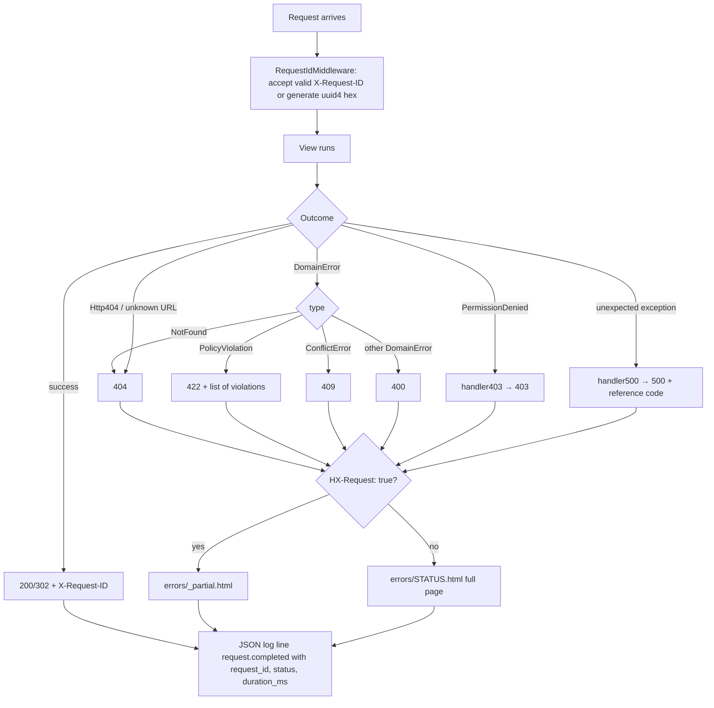

### Story 1.1: Error Handling & Observability

**BUILDID**: CYCLE-1 | **GitHub**: LOCAL | **AzureDevOps**: LOCAL | **Epic**: 1 - Foundation | **ID**: 1.1 | **Date**: 2026-10-19
**File**: `docs/plans/stories/epic-1-story-1.1-Error-Handling-and-Observability.md`
**Build Ref**: `docs/plans/builds/cycle-1/cycle-plan.md` — CYCLE-1 Foundation & Access (Workshop Day 3: error pages, domain error middleware, JSON logs with request ids)
**Wave**: 2
**Requires**: [1.0]
**Enables**: [1.10]
**Files Touched**:
  - src/domain/common/**
  - src/infrastructure/system_clock.py
  - src/infrastructure/web/common/middleware.py
  - src/infrastructure/web/common/errors.py
  - src/infrastructure/web/common/htmx.py
  - src/infrastructure/web/templates/errors/**
  - src/infrastructure/logging/**
  - src/config/settings/base.py
  - src/config/urls.py
  - src/infrastructure/i18n/locale/ro/LC_MESSAGES/django.po
  - src/infrastructure/i18n/locale/en/LC_MESSAGES/django.po
  - tests/unit/domain/common/**
  - tests/integration/web/common/test_error_middleware.py
  - tests/integration/web/common/test_request_id_logging.py
**Roles Ref**: docs/requirements.md#roles--permissions-matrix — single-actor — no role variation (every visitor, signed in or not, gets the same error pages and logging; the 403 page is *rendered* here but the decision to deny is made by Story 1.3)
**QA Candidate**: Yes — **Observable:** localized, friendly 400/403/404/409/422/500 pages (full page and HTMX partial), each 500 page shows a reference code that matches the server log line; every response carries an `X-Request-ID` header. **Mechanism:** `RequestIdMiddleware` assigns or accepts a request id, stores it in a context variable and logs one JSON `request.completed` line per request. `DomainErrorMiddleware.process_exception` maps `DomainError` subclasses to 404/422/409/400 in one place. Django `handler403/404/500` render the same templates; `PolicyViolation` lists each violation. **Authz & preconditions:** none — applies to anonymous and authenticated requests alike; no personal data appears in pages or logs. **Edge & idempotency:** malformed or oversized incoming `X-Request-ID` values are replaced, never echoed; repeating a failing request produces the same status and page with a new request id; unexpected exceptions never leak stack traces (`DEBUG=False`); an unknown error code falls back to the generic message for its status. **Regression:** every later story's 403/404/409/422 assertions depend on this mapping; QA checks the RO and EN variants of each page, the HTMX partial variant, the request id shown on the 500 page against the logs, and that no password, answer, date of birth or full name appears in any log line (privacy/compliance).

---

#### 👤 User Reference

**Description**:
When something goes wrong, people using the platform should see a calm, clear page in their own language that tells them what happened and what they can do next. They should never see a technical crash screen. This story builds those pages for six situations:
- "you're not allowed to see this"
- "this page doesn't exist" (also shown when something exists but you aren't allowed to know about it)
- "this was already done" (for example, a test that was already submitted)
- "some of what you entered doesn't follow the rules" (with every problem listed)
- "the request was malformed"
- "something went wrong on our side"

When a part of the page updates without a full reload, the same message appears in place instead of a whole new page.

For the team running the platform, every request now gets a short reference code. It's included in the server's records and, when something breaks, shown on the error page. If a teacher reports "I got an error, the code was 3f9c…", the team can find exactly what happened. The server's records are written in a structured format that monitoring tools can read. They deliberately leave out passwords, test answers, names and dates of birth, because the platform holds children's data.

The story also adds a single trustworthy source for "what time is it now?" that later features use (test submission times, moderation history), so the timing rules can be tested reliably.

**Acceptance Criteria** (plain-English):
- Visiting an address that doesn't exist shows a friendly "page not found" page in the current language, with a link back to the home page.
- When someone tries to open something their role doesn't allow, they see a friendly "you don't have access" page instead of the content.
- When the system rejects an action because of a business rule, the person sees a message explaining every problem, not just the first one.
- When an action was already completed and can't be repeated, the person sees an "already done" message.
- When something unexpected breaks, the person sees a "something went wrong" page with a reference code and no technical details.
- Every message is available in Romanian and English and follows the language the person is using.
- When only part of a page was updating, the error appears inside that part of the page rather than replacing the whole screen.
- Every response carries a reference code, and the same code appears in the server's records for that request.
- Server records never contain passwords, test or exercise answers, full names or dates of birth.
- A reference code supplied by another system is reused only if it looks valid; otherwise a new one is created.

**User Flow** (no role variation — every visitor sees the same error behaviour):

**User Journey**:
- **Entry**: a person follows a link, submits a form or triggers a partial-page action (HTMX).
- **Load**: the request receives a request id before anything else runs (`RequestIdMiddleware`), and the id is attached to every log line written during the request.
- **Render (success)**: the page renders normally; the response carries `X-Request-ID`; one `request.completed` log line records method, path, status and duration.
- **Interact → rule broken**: a use case raises a `DomainError`. The person sees the right page or partial: 404 "Page not found", 422 "Please fix the following" with each violation listed, 409 "Already done" with a link back, or 400 "Request could not be processed".
- **Empty/error**: an unknown URL shows the 404 page. An unexpected exception shows the 500 page with "Reference: `<request id>`" and no stack trace. A denied role (raised by Story 1.3's decorator) shows the 403 page.
- **Language**: every page and partial renders in the active language (RO default, EN). The `<html lang>` attribute matches.
- **Responsive**: desktop-only per the UI/UX spec. Error pages use the staff/student-neutral layout centred at max 960px.

**Flow Diagram**:



---

#### 🤖 AI Agent Reference

**Must Read**:
- `docs/architecture/design/01-patterns-and-standards-greenfield.md` — §4 (domain errors), §7.5 (response conventions), §8 (error handling), §9 (logging, never-log list), §11.1 (templates), §11.3 (i18n)
- `docs/architecture/design/00-system-architecture-greenfield.md` — Error Handling table, Observability table
- `docs/ui-ux/ui-ux-spec.md` — tokens, `error_display: inline+top_banner`, a11y
- `docs/plans/stories/epic-1-story-1.0-Root-Tooling-Seed.md` — settings layout, `base.html`, `tokens.css`

**Description**:
Implements the cross-cutting error and observability layer every later story relies on:
1. **Domain primitives** (`src/domain/common/`, pure Python):
   - the `DomainError` hierarchy (`NotFound`, `PolicyViolation`, `ConflictError`), each with a stable `code`
   - a `Violation` value object so policy violations can be translated with parameters (e.g. total points 95)
   - the `Clock` port and the `Language` enum
2. **Web error mapping** (`infrastructure/web/common/`):
   - `DomainErrorMiddleware` maps domain errors to HTTP status in one place, per patterns §8
   - `render_error` picks the full-page template or the HTMX partial and resolves a localized message from the error `code`
   - Django's `handler403/404/500` reuse the same rendering
   - `is_htmx()` helper
3. **Observability** (`infrastructure/logging/`):
   - stdlib JSON formatter
   - a context-variable logging filter that adds `request_id`, `user_id` and `role` to every record
   - `RequestIdMiddleware` that validates or creates the id, sets the `X-Request-ID` response header and emits one `request.completed` line
4. **`SystemClock`** adapter.

> **Refinement of patterns §4:** `PolicyViolation` carries `Violation(code, params)` objects instead of bare strings, so messages such as "Total points is 95; must be 100" can be translated with parameters in the web layer while the domain stays framework-free. `PolicyViolation.violations` is still a list, and the error `code` contract is unchanged.

**Design Tokens** (FE):
- Colors: text `#1F2937`, muted `#4B5563`, error `#B91C1C`, warning `#B45309`, primary link `#0E7490` (hover `#155E75`), surface `#FFFFFF`, bg-staff `#F5F7FA`; focus outline 3px `#C2410C`
- Spacing: staff scale — 16px block gap, 24px card padding, 48px top offset
- Typography: base 16px; heading 24px/700; reference code 14px monospace-free (keep the font family; `letter-spacing: .02em`)
- Radius 8px; elevation-1 on the error card
- Icons: Phosphor regular — `warning-circle` (409/422/400), `lock-simple` (403), `compass` (404), `plugs` (500), 32px, `aria-hidden="true"`
- Validation: on submit | Error: inline + top banner (this story supplies the full-page/partial banner; field-level inline errors come with forms in later stories)
- **Styling decision:** this story ships **no CSS**. Inline `<style>` is forbidden by CSP, and a separate stylesheet would sit outside this story's file boundary. Error templates are semantic HTML (readable unstyled) using the class hooks `error-card`, `error-card__violations`, `error-card__ref` and `error-partial`. **Story 1.6** styles these hooks in its `card.css` / `alert.css` primitives. QA Group 1 checks the visual result after wave 3.

**Acceptance Criteria**:
1. `src/domain/common/errors.py` defines `DomainError(code="domain_error")`, `NotFound(code="not_found")`, `PolicyViolation(code="policy_violation", violations: Sequence[Violation])`, `ConflictError(code="conflict")`, and the frozen dataclass `Violation(code: str, params: Mapping[str, str | int])`. `PolicyViolation` with an empty violation list raises `ValueError`.
2. `src/domain/common/clock.py` defines `class Clock(Protocol): def now(self) -> datetime: ...`; `src/domain/common/language.py` defines `Language(StrEnum)` with `RO="ro"`, `EN="en"` and `DEFAULT_LANGUAGE = Language.RO`. The domain package imports only the stdlib (import-linter contract kept).
3. `infrastructure/system_clock.py::SystemClock.now()` returns a timezone-aware UTC `datetime` (via `django.utils.timezone.now`).
4. `DomainErrorMiddleware.process_exception` maps `NotFound→404`, `PolicyViolation→422`, `ConflictError→409`, any other `DomainError→400`. The most specific class wins (MRO order), and non-domain exceptions return `None` so Django handles them.
5. `config/urls.py` sets `handler400`, `handler403`, `handler404`, `handler500` to functions in `infrastructure/web/common/errors.py` that render the same templates.
6. Full-page requests render `errors/<status>.html` (400, 403, 404, 409, 422, 500), extending `layouts/base.html`, with `<h1>`, a plain-language explanation, a "Back to home" link (`/`), and the matching Phosphor icon (`aria-hidden`).
7. Requests with header `HX-Request: true` receive `errors/_partial.html` (a `role="alert"` region with the same message) and the same status code. `infrastructure/web/common/htmx.py::is_htmx(request) -> bool` is the only HTMX detector in the codebase.
8. Messages resolve from `ERROR_MESSAGES: dict[str, str]` (gettext_lazy) keyed by error `code`. An unknown code falls back to the generic message for its status, and `Violation` messages are formatted with their `params`.
9. 422 pages list **every** violation as a `<ul>` in the order raised.
10. The 500 page shows `Reference: <request_id>` and never shows exception text or a stack trace (verified with `DEBUG=False`).
11. `RequestIdMiddleware` is the **first** middleware. It accepts an incoming `X-Request-ID` only if it matches `^[A-Za-z0-9-]{8,64}$`, otherwise generates `uuid4().hex`. It sets `request.request_id` and the response header `X-Request-ID`, and emits exactly one `INFO` `request.completed` log with `method`, `path` (no query string), `status` and `duration_ms`.
12. All log output is JSON lines on stdout with keys `timestamp` (ISO-8601 UTC), `level`, `logger`, `event`, `request_id`, `user_id`, `role`, plus `extra` fields. `user_id` and `role` are `null` for anonymous requests. The level comes from `LOG_LEVEL` (default `INFO`).
13. No log line produced by this story contains query strings, request bodies, passwords, full names, dates of birth or answers. A test asserts the request-completed line for `/x?password=secret` doesn't contain `secret`.
14. Each handled `DomainError` logs one `INFO` `domain_error` line with `code` and `status`. Unexpected exceptions log `ERROR` with `exc_info` via Django's `django.request` logger.
15. RO and EN translations exist in both `django.po` files for every new message id (6 page titles, 6 explanations, "Back to home", "Reference", "Please fix the following").
16. Coverage: `src/domain/common` 100%; the overall gate still ≥85%.

**RBAC Enforcement**:
No role-differentiated access — single actor.
- This story only **renders** 403 (Django `PermissionDenied` → `handler403`). Deciding who is denied belongs to Story 1.3. Out-of-scope records surface as `NotFound` → 404, so other users' records are never revealed (IDOR guard, architecture §Roles & Authorization).

**System responses + error cases**:

| Trigger | Response | Side-effect |
|---------|----------|-------------|
| Normal request, no incoming `X-Request-ID` | Normal response + `X-Request-ID: <32-hex>` | one `request.completed` INFO line with the same id |
| Incoming valid `X-Request-ID: abc12345-proxy` | Response echoes `X-Request-ID: abc12345-proxy` | log lines carry `abc12345-proxy` |
| Incoming invalid id (`<script>`, 200 chars, empty) | New uuid4 hex id in the header; the invalid value is never echoed | none |
| View raises `NotFound` | `404` `errors/404.html` | `domain_error` INFO log `{code: not_found, status: 404}` |
| View raises `PolicyViolation([Violation("points_total_not_100", {"total": 95})])` | `422` page listing "Total points is 95; it must be 100" | `domain_error` INFO log |
| View raises `ConflictError` subclass with code `test_already_submitted` | `409` page; message from `ERROR_MESSAGES` if registered, otherwise the generic 409 text | `domain_error` INFO log |
| View raises a bare `DomainError` | `400` page, generic message | `domain_error` INFO log |
| Same failing request repeated | Same status and page, a new request id | one log pair per request (idempotent behaviour, no accumulated state) |
| HTMX request (`HX-Request: true`) raising any of the above | Same status, body = `errors/_partial.html` only (no `<html>`) | same logs |
| `PermissionDenied` raised (Story 1.3 decorator) | `403` `errors/403.html` (or partial for HTMX) | `django.security` WARNING (Django default) + `request.completed` |
| Unknown URL | `404` page | `request.completed` with status 404 |
| Unexpected `RuntimeError` | `500` page with `Reference: <id>`; no exception text | `ERROR` log with `exc_info` and the same `request_id` |
| Malformed request (`SuspiciousOperation`, bad Host) | `400` page | `django.security` log |

**QA-observable behaviour**:
- For each status 400/403/404/409/422/500, the full page has `<html lang="ro">` under `/ro/…` and `lang="en"` under `/en/…`, one `<h1>`, a "Back to home" link to `/`, and no stack trace or exception text.
- The `X-Request-ID` response header equals the `request_id` field of the `request.completed` log line for that request; on a 500 it also equals the "Reference" shown on the page.
- A 422 lists exactly N `<li>` items for N violations, in order.
- An HTMX request gets the same status code with a body that has no `<html>` element and has `role="alert"`.
- Log lines are valid JSON, one per line, and contain none of: the query string, form values, passwords, full names, dates of birth.
- **What does NOT change**: no database rows are created, updated or deleted by any error path. No session or cookie is created by error handling itself. Successful responses keep their original status and body (the middleware only adds a header).

**Prerequisites**:
- Story 1.0 merged (settings split, `base.html`, `tokens.css`, `.po` headers, quality gates).
- **GNU gettext** (`msgfmt`, `xgettext`) installed on the dev machine to run `makemessages`/`compilemessages`. It's **currently missing** on the project laptop (no Homebrew). Until it's installed, write `.po` entries by hand and compile in Story 1.4 (see that story's prerequisites). Tests in this story assert English text and the `lang` attribute, so they don't depend on compiled catalogues.

**Context**: `docs/architecture/design/01-patterns-and-standards-greenfield.md`, `docs/architecture/design/00-system-architecture-greenfield.md`, `docs/ui-ux/ui-ux-spec.md`, `src/config/settings/base.py`, `src/config/urls.py`

**Patterns**: Domain Pattern (§4), Web Layer — Response conventions (§7.5), Error Handling (§8), Logging (§9), Templates & i18n (§11) — see `docs/architecture/design/01-patterns-and-standards-greenfield.md`

**Steps**:

1. **Domain errors and value objects** (pure stdlib). Write the tests in `tests/unit/domain/common/` first.
   ```python
   # src/domain/common/errors.py
   from collections.abc import Mapping, Sequence
   from dataclasses import dataclass, field


   @dataclass(frozen=True)
   class Violation:
       """One broken business rule. `code` is a stable i18n key; `params` fill its placeholders."""

       code: str
       params: Mapping[str, str | int] = field(default_factory=dict)


   class DomainError(Exception):
       """Base for expected business failures; the web layer maps `code` to a localized message."""

       code = "domain_error"

       def __init__(self, detail: str = "") -> None:
           super().__init__(detail or self.code)
           self.detail = detail


   class NotFound(DomainError):
       code = "not_found"


   class ConflictError(DomainError):
       code = "conflict"


   class PolicyViolation(DomainError):
       code = "policy_violation"

       def __init__(self, violations: Sequence[Violation]) -> None:
           if not violations:
               raise ValueError("PolicyViolation requires at least one Violation")
           super().__init__("; ".join(v.code for v in violations))
           self.violations: tuple[Violation, ...] = tuple(violations)
   ```
   ```python
   # src/domain/common/clock.py
   from datetime import datetime
   from typing import Protocol


   class Clock(Protocol):
       def now(self) -> datetime: ...
   ```
   ```python
   # src/domain/common/language.py
   from enum import StrEnum


   class Language(StrEnum):
       RO = "ro"
       EN = "en"


   DEFAULT_LANGUAGE = Language.RO
   ```

2. **System clock adapter**:
   ```python
   # src/infrastructure/system_clock.py
   from datetime import datetime

   from django.utils import timezone


   class SystemClock:
       def now(self) -> datetime:
           return timezone.now()  # aware UTC (USE_TZ=True)
   ```

3. **Request context and JSON logging** (`src/infrastructure/logging/`): `request_context.py` holds the context variables, a filter copies them onto records, and `json_formatter.py` serialises them.
   ```python
   # src/infrastructure/logging/request_context.py
   import logging
   from contextvars import ContextVar

   request_id_var: ContextVar[str | None] = ContextVar("request_id", default=None)
   user_id_var: ContextVar[int | None] = ContextVar("user_id", default=None)
   role_var: ContextVar[str | None] = ContextVar("role", default=None)


   class RequestContextFilter(logging.Filter):
       def filter(self, record: logging.LogRecord) -> bool:
           record.request_id = request_id_var.get()
           record.user_id = user_id_var.get()
           record.role = role_var.get()
           return True
   ```
   ```python
   # src/infrastructure/logging/json_formatter.py
   import json
   import logging
   from datetime import UTC, datetime

   _STANDARD = set(vars(logging.makeLogRecord({}))) | {"message", "asctime"}
   _CONTEXT = ("request_id", "user_id", "role")


   class JsonFormatter(logging.Formatter):
       def format(self, record: logging.LogRecord) -> str:
           payload = {
               "timestamp": datetime.fromtimestamp(record.created, UTC).isoformat(),
               "level": record.levelname,
               "logger": record.name,
               "event": record.getMessage(),
               **{key: getattr(record, key, None) for key in _CONTEXT},
           }
           extras = {k: v for k, v in vars(record).items() if k not in _STANDARD and k not in _CONTEXT}
           payload.update(extras)
           if record.exc_info:
               payload["exc_info"] = self.formatException(record.exc_info)
           return json.dumps(payload, default=str, ensure_ascii=False)
   ```
   `config/settings/base.py`:
   ```python
   LOGGING = {
       "version": 1,
       "disable_existing_loggers": False,
       "filters": {"request_context": {"()": "infrastructure.logging.request_context.RequestContextFilter"}},
       "formatters": {"json": {"()": "infrastructure.logging.json_formatter.JsonFormatter"}},
       "handlers": {"stdout": {"class": "logging.StreamHandler", "stream": "ext://sys.stdout",
                               "formatter": "json", "filters": ["request_context"]}},
       "root": {"handlers": ["stdout"], "level": env_str("LOG_LEVEL", "INFO")},
   }
   ```

4. **Middleware** (`src/infrastructure/web/common/middleware.py`): `RequestIdMiddleware` goes first in `MIDDLEWARE`, `DomainErrorMiddleware` last. The authenticated user is read in `process_view`, after `AuthenticationMiddleware` has run.
   ```python
   import logging
   import re
   import time
   import uuid

   from domain.common.errors import ConflictError, DomainError, NotFound, PolicyViolation
   from infrastructure.logging.request_context import request_id_var, role_var, user_id_var
   from infrastructure.web.common.errors import render_error

   logger = logging.getLogger(__name__)
   _VALID_ID = re.compile(r"^[A-Za-z0-9-]{8,64}$")
   _STATUS_BY_ERROR: tuple[tuple[type[DomainError], int], ...] = (
       (NotFound, 404), (PolicyViolation, 422), (ConflictError, 409), (DomainError, 400),
   )


   class RequestIdMiddleware:
       def __init__(self, get_response):
           self.get_response = get_response

       def __call__(self, request):
           incoming = request.headers.get("X-Request-ID", "")
           request.request_id = incoming if _VALID_ID.match(incoming) else uuid.uuid4().hex
           tokens = [request_id_var.set(request.request_id), user_id_var.set(None), role_var.set(None)]
           started = time.perf_counter()
           try:
               response = self.get_response(request)
               response["X-Request-ID"] = request.request_id
               logger.info("request.completed", extra={
                   "method": request.method, "path": request.path, "status": response.status_code,
                   "duration_ms": round((time.perf_counter() - started) * 1000, 1)})
               return response
           finally:
               for var, token in zip((request_id_var, user_id_var, role_var), tokens, strict=True):
                   var.reset(token)

       def process_view(self, request, view_func, view_args, view_kwargs):
           user = getattr(request, "user", None)
           if user is not None and user.is_authenticated:
               user_id_var.set(user.pk)
               role_var.set(user.role)


   class DomainErrorMiddleware:
       def __init__(self, get_response):
           self.get_response = get_response

       def __call__(self, request):
           return self.get_response(request)

       def process_exception(self, request, exception):
           if not isinstance(exception, DomainError):
               return None
           status = next(code for err, code in _STATUS_BY_ERROR if isinstance(exception, err))
           logger.info("domain_error", extra={"code": exception.code, "status": status})
           return render_error(request, status, exception)
   ```
   > `process_view` is reached only by middleware classes that Django recognises as having that hook. `RequestIdMiddleware` defines it, so Django calls it after the auth middleware has attached `request.user`.

5. **Rendering and handlers** (`src/infrastructure/web/common/errors.py` and `htmx.py`):
   ```python
   # src/infrastructure/web/common/htmx.py
   from django.http import HttpRequest


   def is_htmx(request: HttpRequest) -> bool:
       """True for requests issued by HTMX (header HX-Request: true)."""
       return request.headers.get("HX-Request") == "true"
   ```
   ```python
   # src/infrastructure/web/common/errors.py
   from django.shortcuts import render
   from django.utils.translation import gettext_lazy as _

   from domain.common.errors import DomainError, PolicyViolation, Violation
   from infrastructure.web.common.htmx import is_htmx

   GENERIC_BY_STATUS = {
       400: _("Your request could not be processed. Please try again."),
       403: _("You do not have access to this page."),
       404: _("We could not find this page."),
       409: _("This has already been done and cannot be repeated."),
       422: _("Please fix the following:"),
       500: _("Something went wrong on our side. Please try again later."),
   }
   # Extended by later stories with their own error codes (e.g. "test_already_submitted").
   ERROR_MESSAGES: dict[str, str] = {}


   def violation_message(violation: Violation) -> str:
       template = ERROR_MESSAGES.get(violation.code, violation.code)
       return str(template).format(**violation.params)


   def render_error(request, status: int, exc: DomainError | None = None):
       message = ERROR_MESSAGES.get(exc.code) if exc else None
       context = {
           "status": status,
           "message": message or GENERIC_BY_STATUS[status],
           "violations": [violation_message(v) for v in exc.violations]
           if isinstance(exc, PolicyViolation) else [],
           "request_id": getattr(request, "request_id", ""),
       }
       template = "errors/_partial.html" if is_htmx(request) else f"errors/{status}.html"
       return render(request, template, context, status=status)


   def handle_400(request, exception=None):
       return render_error(request, 400)


   def handle_403(request, exception=None):
       return render_error(request, 403)


   def handle_404(request, exception=None):
       return render_error(request, 404)


   def handle_500(request):
       return render_error(request, 500)
   ```
   ```python
   # src/config/urls.py (append)
   handler400 = "infrastructure.web.common.errors.handle_400"
   handler403 = "infrastructure.web.common.errors.handle_403"
   handler404 = "infrastructure.web.common.errors.handle_404"
   handler500 = "infrastructure.web.common.errors.handle_500"
   ```

6. **Templates** (`src/infrastructure/web/templates/errors/`): `_error.html` holds the shared body, `400/403/404/409/422/500.html` extend `layouts/base.html` and include it, and `_partial.html` is the HTMX fragment.
   ```django
   {# errors/_error.html #}
   
   <section class="error-card" aria-labelledby="error-title">
     <svg class="icon icon--32" aria-hidden="true"><use href="#{{ icon }}"></use></svg>
     <h1 id="error-title">{{ title }}</h1>
     <p>{{ message }}</p>
     
       <ul class="error-card__violations"><li>{{ item }}</li></ul>
     
     <p class="error-card__ref">: {{ request_id }}</p>
     <a href="/"></a>
   </section>
   ```
   ```django
   {# errors/404.html — the other status pages follow the same shape #}
   
   
   
   
     
     
   
   ```
   ```django
   {# errors/_partial.html #}
   <div class="error-partial" role="alert">
     <p>{{ message }}</p>
     <ul><li>{{ item }}</li></ul>
   </div>
   ```
   Titles: 400 "Request could not be processed", 403 "Access denied", 404 "Page not found", 409 "Already done", 422 "Please check your input", 500 "Something went wrong". The Phosphor sprite (`icons/sprite.svg`) is delivered by Story 1.5. Until then the `<use>` reference renders nothing, which is harmless because the icon is decorative and `aria-hidden`.

7. **Translations:** add every new msgid to both `django.po` files, with the Romanian `msgstr` filled in the `ro` catalogue (e.g. "Page not found" → "Pagina nu a fost găsită", "Back to home" → "Înapoi la pagina principală", "Reference" → "Cod de referință"). Compile once gettext is available (see Prerequisites).

8. **Wire settings:** in `MIDDLEWARE`, put `"infrastructure.web.common.middleware.RequestIdMiddleware"` first and `"infrastructure.web.common.middleware.DomainErrorMiddleware"` last. Add `LOGGING` (Step 3).

9. **Run all gates** and paste the output (ruff, mypy, lint-imports, pytest with coverage).

**Tests**:

```python
# tests/unit/domain/common/test_errors.py
import pytest

from domain.common.errors import ConflictError, DomainError, NotFound, PolicyViolation, Violation


@pytest.mark.parametrize(("error", "code"), [
    (DomainError(), "domain_error"), (NotFound(), "not_found"), (ConflictError(), "conflict"),
])
def test_each_domain_error_exposes_a_stable_code(error, code):
    assert error.code == code


def test_policy_violation_keeps_every_violation_in_order():
    violations = [Violation("points_total_not_100", {"total": 95}), Violation("questions_not_10", {"count": 9})]

    error = PolicyViolation(violations)

    assert error.violations == tuple(violations)
    assert error.code == "policy_violation"


def test_policy_violation_requires_at_least_one_violation():
    with pytest.raises(ValueError, match="at least one"):
        PolicyViolation([])


def test_subclass_codes_override_parent_codes():
    class AlreadySubmitted(ConflictError):
        code = "test_already_submitted"

    assert isinstance(AlreadySubmitted(), ConflictError)
    assert AlreadySubmitted().code == "test_already_submitted"
```

```python
# tests/unit/domain/common/test_language.py
from domain.common.language import DEFAULT_LANGUAGE, Language


def test_languages_are_romanian_default_and_english():
    assert [lang.value for lang in Language] == ["ro", "en"]
    assert DEFAULT_LANGUAGE is Language.RO
```

```python
# tests/integration/web/common/test_error_middleware.py
import pytest
from django.core.exceptions import PermissionDenied
from django.urls import path

from domain.common.errors import ConflictError, DomainError, NotFound, PolicyViolation, Violation
from infrastructure.web.common.errors import ERROR_MESSAGES


def _raise(exc):
    def view(request):
        raise exc
    return view


urlpatterns = [
    path("nf", _raise(NotFound())),
    path("pv", _raise(PolicyViolation([Violation("a_rule"), Violation("b_rule")]))),
    path("cf", _raise(ConflictError())),
    path("de", _raise(DomainError())),
    path("pd", _raise(PermissionDenied())),
    path("boom", _raise(RuntimeError("secret internal detail"))),
]
handler403 = "infrastructure.web.common.errors.handle_403"
handler404 = "infrastructure.web.common.errors.handle_404"
handler500 = "infrastructure.web.common.errors.handle_500"

pytestmark = [pytest.mark.django_db, pytest.mark.urls(__name__)]


@pytest.mark.parametrize(("url", "status"), [
    ("/nf", 404), ("/pv", 422), ("/cf", 409), ("/de", 400), ("/pd", 403), ("/unknown", 404),
])
def test_errors_map_to_status_and_full_page(client, url, status):
    response = client.get(url)

    assert response.status_code == status
    assert b"<html" in response.content
    assert b"<h1" in response.content


def test_policy_violation_lists_every_violation(client, monkeypatch):
    monkeypatch.setitem(ERROR_MESSAGES, "a_rule", "Rule A broken")
    monkeypatch.setitem(ERROR_MESSAGES, "b_rule", "Rule B broken")

    content = client.get("/pv").content.decode()

    assert content.index("Rule A broken") < content.index("Rule B broken")
    assert content.count("<li>") == 2


def test_htmx_request_gets_partial_with_same_status(client):
    response = client.get("/cf", headers={"HX-Request": "true"})

    assert response.status_code == 409
    assert b"<html" not in response.content
    assert b'role="alert"' in response.content


def test_unexpected_error_shows_reference_without_details(client):
    client.raise_request_exception = False

    response = client.get("/boom", headers={"X-Request-ID": "qa-ref-0001"})

    assert response.status_code == 500
    assert b"qa-ref-0001" in response.content
    assert b"secret internal detail" not in response.content
    assert b"Traceback" not in response.content


def test_repeated_failure_gets_same_status_and_new_request_id(client):
    first, second = client.get("/nf"), client.get("/nf")

    assert first.status_code == second.status_code == 404
    assert first["X-Request-ID"] != second["X-Request-ID"]
```

```python
# tests/integration/web/common/test_request_id_logging.py
import json
import logging

import pytest

pytestmark = pytest.mark.django_db
# capfd (not capsys): the logging handler holds the real stdout captured at settings load time.


def _completed_lines(capfd):
    lines = [json.loads(line) for line in capfd.readouterr().out.splitlines() if line.startswith("{")]
    return [line for line in lines if line["event"] == "request.completed"]


def test_response_header_matches_logged_request_id(client, capfd):
    response = client.get("/healthz")

    (line,) = _completed_lines(capfd)
    assert response["X-Request-ID"] == line["request_id"]
    assert (line["status"], line["path"], line["user_id"]) == (200, "/healthz", None)


def test_valid_incoming_request_id_is_reused(client):
    assert client.get("/healthz", headers={"X-Request-ID": "proxy-1234"})["X-Request-ID"] == "proxy-1234"


@pytest.mark.parametrize("bad", ["<script>", "x" * 65, "short", "a b c d e f g h"])
def test_invalid_incoming_request_id_is_replaced(client, bad):
    returned = client.get("/healthz", headers={"X-Request-ID": bad})["X-Request-ID"]

    assert returned != bad
    assert len(returned) == 32


def test_query_string_values_never_reach_logs(client, capfd):
    client.get("/healthz?password=secret&dob=2018-01-01")

    output = capfd.readouterr().out
    assert "secret" not in output
    assert "2018-01-01" not in output


def test_log_lines_are_json_with_context_keys(capfd):
    logging.getLogger("qa").info("probe", extra={"code": "x"})

    record = json.loads(capfd.readouterr().out.strip().splitlines()[-1])
    assert {"timestamp", "level", "logger", "event", "request_id", "user_id", "role", "code"} <= record.keys()
```

Manual:
- `/ro/does-not-exist` and `/en/does-not-exist` show the 404 page in Romanian and English respectively. Check `<html lang>`.
- Add a temporary view that raises `RuntimeError` (local branch only, never committed). With `DEBUG=False`, the page shows "Reference: …" and the server log has an ERROR line with the same `request_id` and `exc_info`.
- `curl -H "HX-Request: true" localhost:8000/ro/does-not-exist` returns a fragment with `role="alert"`, not a full HTML page.
- Read the stdout log during a manual session and confirm every line is JSON and that no names, dates of birth, passwords or query strings appear.

**Quality**: ruff 0 issues; mypy strict passes for `domain.*`; `lint-imports` contracts kept (domain imports stdlib only); tests pass; `src/domain/common` coverage 100%, overall ≥85%; no inline `<style>`/`<script>`; no `|safe`; no `TODO`.

**OUT**:
- ❌ Deciding who gets 403 (`@require_permission`, Story 1.3) or scoping queries.
- ❌ The `alert`/`card` primitives and their CSS (Story 1.6). Error pages are semantic HTML that Story 1.6 restyles via shared classes.
- ❌ The Phosphor sprite file (Story 1.5).
- ❌ Audit log entries (Story 1.8); logs are operational only.
- ❌ Alerting/monitoring tooling (DevOps workflows).
- ❌ Installing gettext or compiling catalogues (Story 1.4).
- ❌ Specific error codes of later features (each feature registers its own `ERROR_MESSAGES` entries).

**Evidence**: Test and coverage output (domain/common 100%), ruff/mypy/lint-imports output, screenshots of the 404 (RO), 422 (EN, two violations), and 500 (with reference) pages, plus a pasted log excerpt showing matching `X-Request-ID` and `request_id`, all recorded in `docs/stories-implemented/story-1.1-review.md` under "## DoD Evidence".
