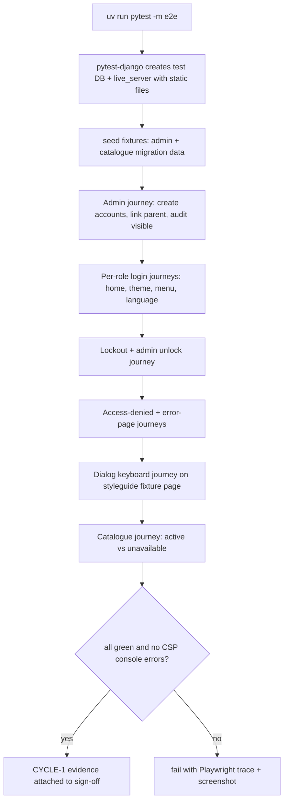

### Story 1.10: Foundation E2E Journeys

**BUILDID**: CYCLE-1 | **GitHub**: LOCAL | **AzureDevOps**: LOCAL | **Epic**: 1 - Foundation | **ID**: 1.10 | **Date**: 2026-10-19
**File**: `docs/plans/stories/epic-1-story-1.10-Foundation-E2E-Journeys.md`
**Build Ref**: `docs/plans/builds/cycle-1/cycle-plan.md` — CYCLE-1 Foundation & Access (Workshop Day 4: Playwright smoke per role; demo and sign-off)
**Wave**: 5
**Requires**: [1.1, 1.7, 1.9, 2.2]
**Enables**: [3.1, 3.2, 3.3]
**Files Touched**:
  - tests/e2e/**
  - README.md
**Roles Ref**: docs/requirements.md#roles--permissions-matrix — single-actor — no role variation in *this story's code* (it is test-only; the journeys it scripts exercise the role behaviour delivered by Stories 1.2–1.9 and 2.2)
**QA Candidate**: No — test-only story. It automates QA Groups 1–4 of Epic 1 and Group 1 of Epic 2 and adds no product behaviour. Its pass/fail result is itself QA evidence for the CYCLE-1 sign-off.

---

#### 👤 User Reference

**Description**:
This story builds automatic "robot user" tests that open a real browser and click through the platform the way people will. It proves the whole of Cycle 1 works together, not just its separate parts.

The robot checks that:
- **Accounts and links:** an administrator can create accounts and link a parent to a child.
- **Sign-in per role:** each kind of user (student, teacher, parent, administrator) can sign in and lands on the right home page in the right language and look.
- **Language switching:** switching between Romanian and English works and is remembered.
- **Lockout:** too many wrong passwords lock the account until the administrator unlocks it.
- **Access denied:** students, teachers and parents are refused entry to the administration area.
- **Friendly errors:** error pages are friendly and show a reference code.
- **Confirmation box:** it opens, can be closed with Esc, and returns keyboard focus.
- **Catalogue:** the subject catalogue shows grade 2's three subjects as usable and everything else as unavailable.

The tests run with one command, so the team can repeat them before every demo and release. They're the evidence used at the Cycle 1 sign-off.

**Acceptance Criteria** (plain-English):
- One command runs all browser journeys against a freshly prepared copy of the platform.
- The administrator journey creates a student, a teacher and a parent, links the parent to the student, and finds each action in the audit log.
- Each role's journey signs in, checks the home page, theme, menu and language, and signs out.
- The language journey switches to English, signs out and back in, and lands in English.
- The lockout journey shows the "too many attempts" page after 5 wrong passwords, and the administrator's unlock lets the student in again.
- The access journey confirms students, teachers and parents get "Access denied" in the administration area.
- The error journey shows the "page not found" page in both languages.
- The confirmation-box journey proves it opens, closes with Esc and returns focus.
- The catalogue journey proves grade 2 CLR, MEM and EN open, and an unavailable subject can't be opened even by typing its address.
- The browser console shows no security-policy (CSP) violations during any journey.
- These browser tests are kept separate from the fast unit tests and don't slow down everyday test runs.

**User Flow**:
Actor: system — no role variation.

**Flow Diagram**:



---

#### 🤖 AI Agent Reference

**Must Read**:
- `docs/plans/implementation-plan.md` — QA Manual Testing Groups (Epic 1 Groups 1–4, Epic 2 Group 1): the journeys automate these
- `docs/plans/builds/cycle-1/cycle-plan.md` — CYCLE-1 acceptance criteria (each must map to a journey)
- `docs/architecture/design/01-patterns-and-standards-greenfield.md` — §12.5 E2E rules (role/label locators, `-m e2e`, `live_server`, `DJANGO_ALLOW_ASYNC_UNSAFE`)
- Stories 1.2, 1.4, 1.6, 1.7, 1.9, 2.2 — the behaviours under test (selectors come from their labels and roles)

**Description**:
Adds the Playwright harness (`pytest-playwright`, already locked in the seed) under `tests/e2e/`:
- `conftest.py`:
  - `DJANGO_ALLOW_ASYNC_UNSAFE=true` for the e2e session only
  - a `base_url` fixture from `live_server.url`
  - helpers `login(page, username, password, lang="ro")` and `logout(page)`
  - a `console_errors` fixture collecting `console` messages of type `error` and failing the test on any CSP violation
  - `transactional_db` (live server runs in another thread)
- A small test-only page for the dialog journey: a DEBUG-independent template route registered **only** in the e2e urlconf (`tests/e2e/urls.py`, which extends `config.urls`), so production routing is untouched.
- One journey file per area.
- E2E-only pytest options (`--browser=chromium`, tracing, screenshots) set in `tests/e2e/conftest.py`. `pyproject.toml` is **not** changed: the seed already declares the `e2e` marker and excludes it by default.
- README "End-to-end tests" section: `uv run playwright install chromium`, `uv run pytest -m e2e`, traces on failure (`--tracing retain-on-failure`).

> **Hand-off from Story 1.6 review v1 (2026-10-22), part of AC 9's dialog page:** also include a dismissible `ui_alert` on the test-only page and assert that pressing Enter on its × removes the alert and leaves `document.activeElement` on `<main id="content">`, not on `<body>` (ISS-002; today this is checked only statically in `test_molecules_groups_and_headings.py`).

**Acceptance Criteria**:
1. `uv run playwright install chromium` is documented. `uv run pytest -m e2e` runs only the e2e suite; the default `uv run pytest` still excludes it (`-m 'not e2e'` from the seed).
2. Locators use only `get_by_role`, `get_by_label` and `get_by_text` (patterns §12.5). No CSS-class or XPath selectors.
3. `test_admin_journey.py`: Admin signs in, creates a Student, a Teacher and a Parent via the admin forms, links the Parent to the Student, and asserts a duplicate link shows "This parent is already linked to this student." and the audit-log changelist lists `accounts.created` ×3 and `accounts.parent_linked` ×1.
4. `test_role_logins.py` (parametrised over 4 roles): sign in → URL `/<preferred_language>/` → `<body>` has the expected theme class → the main nav contains exactly the expected items available in CYCLE-1 (Student: Home, Learn; Teacher: Home; Parent: Home; Admin: Home, Accounts) → the avatar menu shows the full name → sign out → back on the login page.
5. `test_language.py`: Student switches to EN on the home page → URL `/en/`, `html[lang=en]` → signs out → signs in → lands on `/en/`.
6. `test_lockout.py`: 5 wrong passwords → page heading "Too many attempts" (429) → the correct password is still refused → Admin deletes the access attempt in the admin → the student signs in successfully.
7. `test_access_denied.py`: Student, Teacher and Parent visiting `/ro/admin/` see the "Access denied" heading. Anonymous `/ro/` redirects to the login page.
8. `test_error_pages.py`: `/ro/nu-exista/` shows "Pagina nu a fost găsită" (once RO is compiled; otherwise asserts `lang="ro"` and the 404 structure) and `/en/missing/` shows "Page not found". Both show the "Back to home" link.
9. `test_dialog_keyboard.py` (test-only page with `ui_dialog_trigger` + `ui_confirm_dialog`): keyboard Enter on the trigger opens the dialog (`dialog[open]`); Tab stays within the dialog; Escape closes it; the focused element equals the trigger.
10. `test_catalogue_journey.py`: Student opens "Learn" → grade 2 shows three subject cards (CLR, MEM, EN) as links → another grade's subject is an "Unavailable" tile with no link → navigating directly to an inactive subject's URL shows "Page not found" → opening an active subject shows its chapter-list shell with the empty-state message.
11. Every test uses the `console_errors` fixture: any console error containing "Content Security Policy" fails the test.
12. On failure, Playwright keeps a trace and screenshot (`--tracing retain-on-failure --screenshot only-on-failure`), output to `test-results/` (git-ignored by the seed).
13. Total e2e run time is under 3 minutes on the dev laptop (recorded in the review doc).

**RBAC Enforcement**:
No role-differentiated access — single actor.
- The test-only dialog page exists only in `tests/e2e/urls.py` (used via `settings.ROOT_URLCONF` override in the e2e conftest). It's never part of `config.urls`, so production routing and the URL-coverage test are unaffected. The role boundaries under test are those of Stories 1.3, 1.7 and 1.9.

**System responses + error cases** (harness behaviour):

| Trigger | Response | Side-effect |
|---------|----------|-------------|
| `uv run pytest` (default) | e2e tests deselected | none |
| `uv run pytest -m e2e` with browsers installed | journeys run against `live_server` | test DB created and destroyed |
| `-m e2e` without browsers installed | Playwright error naming `playwright install` | none |
| A journey assertion fails | test fails; trace + screenshot in `test-results/` | artefacts written |
| A page logs a CSP violation | `console_errors` fixture fails the test with the message | none |
| Re-running the suite (idempotent) | same results; each test uses a fresh transactional DB | none persisted |
| Static asset missing (e.g. font 404) | console error → test fails | none |

**Prerequisites**:
- All of CYCLE-1 merged: Stories 1.0–1.9 and 2.1–2.2.
- Chromium installed for Playwright on the dev laptop (and in CI later via DevOps).
- RO catalogue compiled if asserting Romanian text (Story 1.4's gettext prerequisite). Otherwise the RO checks fall back to structure and `lang` assertions, as AC 8 allows.

**Context**: `docs/plans/implementation-plan.md`, `docs/plans/builds/cycle-1/cycle-plan.md`, `docs/architecture/design/01-patterns-and-standards-greenfield.md`, `tests/conftest.py`, `pyproject.toml` (read only: e2e marker)

**Patterns**: E2E tests (§12.5), Testing organisation (§12.1), Documentation — README (§14) — see `docs/architecture/design/01-patterns-and-standards-greenfield.md`

**Steps**:

1. **Harness** (`tests/e2e/conftest.py`):
   ```python
   import os

   import pytest
   from playwright.sync_api import Page

   os.environ.setdefault("DJANGO_ALLOW_ASYNC_UNSAFE", "true")  # Playwright sync API inside pytest-django
   PASSWORD = "pilot-pass-123"


   @pytest.fixture(autouse=True)
   def _e2e_db(transactional_db, settings):
       settings.ROOT_URLCONF = "tests.e2e.urls"  # adds the test-only dialog page


   @pytest.fixture
   def base_url(live_server) -> str:
       return live_server.url


   @pytest.fixture
   def console_errors(page: Page):
       errors: list[str] = []
       page.on("console", lambda msg: errors.append(msg.text) if msg.type == "error" else None)
       yield errors
       csp = [e for e in errors if "Content Security Policy" in e]
       assert csp == [], f"CSP violations: {csp}"


   def login(page: Page, base_url: str, username: str, password: str = PASSWORD, lang: str = "ro") -> None:
       page.goto(f"{base_url}/{lang}/accounts/login/")
       page.get_by_label("Username" if lang == "en" else "Nume de utilizator").fill(username)
       page.get_by_label("Password" if lang == "en" else "Parolă").fill(password)
       page.get_by_role("button", name="Sign in" if lang == "en" else "Autentificare").click()


   def logout(page: Page) -> None:
       page.get_by_label("Account menu").click()
       page.get_by_role("button", name="Sign out").click()
   ```
   > Language-specific labels: write journeys in **EN** by default (stable without the compiled RO catalogue). Only the language and error-page journeys assert RO text, guarded by AC 8.

2. **Test-only urlconf** (`tests/e2e/urls.py`):
   ```python
   from django.urls import path
   from django.views.generic import TemplateView

   from config.urls import urlpatterns as root_urlpatterns

   urlpatterns = [
       path("e2e/dialog/", TemplateView.as_view(template_name="e2e/dialog.html")),
   ] + root_urlpatterns
   ```
   The template lives at `tests/e2e/templates/e2e/dialog.html`. Add that directory to `TEMPLATES[0]["DIRS"]` **only** in the e2e conftest via the `settings` fixture. It extends `layouts/base.html` and renders ``.

3. **Journeys** (excerpts):
   ```python
   # tests/e2e/test_role_logins.py
   import pytest
   from playwright.sync_api import Page, expect

   from tests.e2e.conftest import login, logout
   from tests.factories.accounts import AdminFactory, ParentFactory, StudentFactory, TeacherFactory

   pytestmark = pytest.mark.e2e
   CASES = [
       (StudentFactory, "theme-student", ["Home", "Learn"]),
       (TeacherFactory, "theme-staff", ["Home"]),
       (ParentFactory, "theme-staff", ["Home"]),
       (AdminFactory, "theme-staff", ["Home", "Accounts"]),
   ]


   @pytest.mark.parametrize(("factory", "theme", "menu"), CASES)
   def test_role_login_home_and_logout(page: Page, base_url, console_errors, factory, theme, menu):
       user = factory(username="e2e", full_name="Ana Pop", preferred_language="en")

       login(page, base_url, "e2e", lang="en")

       expect(page).to_have_url(f"{base_url}/en/")
       expect(page.locator("body")).to_have_class(theme)
       nav = page.get_by_role("navigation", name="Main")
       expect(nav.get_by_role("link")).to_have_text(menu)
       page.get_by_label("Account menu").click()
       expect(page.get_by_text(user.full_name)).to_be_visible()
       logout(page)
       expect(page).to_have_url(f"{base_url}/en/accounts/login/")
   ```
   ```python
   # tests/e2e/test_dialog_keyboard.py
   import pytest
   from playwright.sync_api import Page, expect

   pytestmark = pytest.mark.e2e


   def test_dialog_opens_traps_focus_and_returns_focus(page: Page, base_url, console_errors):
       page.goto(f"{base_url}/e2e/dialog/")  # anonymous: the test page only extends base.html
       trigger = page.get_by_role("button", name="Open")

       trigger.focus()
       page.keyboard.press("Enter")
       dialog = page.get_by_role("dialog", name="Confirm?")
       expect(dialog).to_be_visible()
       for _ in range(4):
           page.keyboard.press("Tab")
           assert page.evaluate("document.activeElement.closest('dialog') !== null")
       page.keyboard.press("Escape")

       expect(dialog).to_be_hidden()
       assert page.evaluate("document.activeElement.textContent.trim()") == "Open"
   ```
   The other journeys (`test_admin_journey.py`, `test_language.py`, `test_lockout.py`, `test_access_denied.py`, `test_error_pages.py`, `test_catalogue_journey.py`) follow the same shape and map one-to-one to AC 3 and AC 5–10.

4. **E2E options and README:** in `tests/e2e/conftest.py`, a `pytest_configure` hook sets `browser_name=chromium`, `tracing=retain-on-failure` and `screenshot=only-on-failure` when the `e2e` marker is selected (pytest-playwright options are only valid when its plugin is active). Append an "End-to-end tests" section to `README.md`.

5. **Run** `uv run pytest -m e2e` three times in a row to confirm the results are stable (no flakiness), and record the timings.

**Tests**: this story *is* tests. Its own correctness is shown by the suite passing on the CYCLE-1 build, by deliberately breaking one behaviour locally (e.g. remove `aria-label="Account menu"`) and seeing the matching journey fail, then restoring it.

Manual:
- Run `uv run pytest -m e2e --headed --slowmo=300` once and watch the journeys.
- Open a failure trace with `uv run playwright show-trace test-results/<test>/trace.zip` to confirm the artefacts are usable.

**Quality**: ruff 0 on `tests/e2e`; only role/label/text locators; no `time.sleep` (use Playwright auto-waiting and `expect`); 3 consecutive green runs; suite < 3 minutes; the default `pytest` run time is unchanged.

**OUT**:
- ❌ CI execution of e2e (DevOps `aire-devops-pipeline` adds the job and browser install).
- ❌ Cross-browser (Firefox/WebKit) and mobile viewports (desktop-only scope).
- ❌ Visual-regression screenshots/diffing.
- ❌ CYCLE-2/3 journeys (added by those cycles' integration stories).
- ❌ Any change to production code. Defects found are raised with `aire-raise-defect` against the owning story.

**Evidence**: output of 3 consecutive `uv run pytest -m e2e` runs (counts, durations), a table mapping each CYCLE-1 acceptance criterion to its journey test, and a trace screenshot from the deliberate-failure check, all recorded in `docs/stories-implemented/story-1.10-review.md` under "## DoD Evidence".
