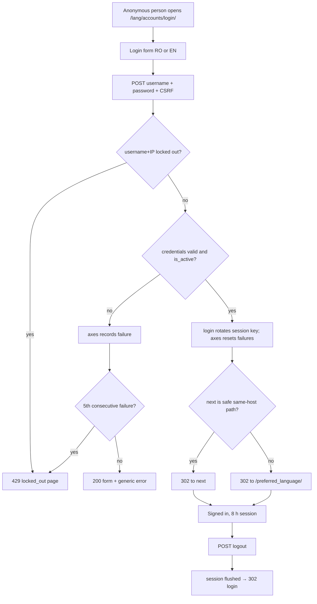

### Story 1.2: Login & Session Security

**BUILDID**: CYCLE-1 | **GitHub**: LOCAL | **AzureDevOps**: LOCAL | **Epic**: 1 - Foundation | **ID**: 1.2 | **Date**: 2026-10-19
**File**: `docs/plans/stories/epic-1-story-1.2-Login-and-Session-Security.md`
**Build Ref**: `docs/plans/builds/cycle-1/cycle-plan.md` — CYCLE-1 Foundation & Access (Workshop Day 2: login/logout with Argon2id and lockout)
**Wave**: 2
**Requires**: [1.0]
**Enables**: [1.7, 2.2]
**Files Touched**:
  - src/infrastructure/web/accounts/**
  - src/infrastructure/web/templates/accounts/**
  - src/config/settings/base.py
  - src/config/settings/prod.py
  - src/config/urls.py
  - src/infrastructure/web/common/decorators.py
  - src/infrastructure/i18n/locale/ro/LC_MESSAGES/django.po
  - src/infrastructure/i18n/locale/en/LC_MESSAGES/django.po
  - tests/conftest.py
  - tests/factories/accounts.py
  - tests/integration/web/accounts/**
**Roles Ref**: docs/requirements.md#roles--permissions-matrix — single-actor — no role variation (Student, Teacher, Parent/Guardian and Admin all use the identical login/logout flow; the role-specific home behind `/<lang>/` is Story 1.7)
**QA Candidate**: Yes — **Observable:** a bilingual login page; correct credentials sign the person in and send them to `/<preferred_language>/`; wrong credentials show one generic error; 5 failures lock the account for 15 minutes; logout signs the person out; security headers are present on every response. **Mechanism:** `GET/POST /<lang>/accounts/login/` (Django `LoginView` subclass, `AxesStandaloneBackend` before `ModelBackend`, session key rotated by `login()`), `POST /<lang>/accounts/logout/` (POST-only), Argon2id first in `PASSWORD_HASHERS` (existing hashes upgrade on next login), DB-backed sessions with an 8 h lifetime, django-csp + Django security middleware headers. **Authz & preconditions:** anonymous access to login/logout only (both in `PUBLIC_URL_NAMES`); accounts must exist (admin-created) and be `is_active`; no self-registration or password reset by users. **Edge & idempotency:** a repeated login while signed in simply re-authenticates and rotates the session; logout while signed out redirects to login without error; `next` is honoured only for same-host relative URLs (open-redirect guard); an inactive account gets the same generic error as a wrong password (no account enumeration); a locked-out username+IP gets 429 even with the right password until the cool-off expires; a successful login resets the failure counter. **Regression:** login per role, the lockout/cool-off boundary (4 vs 5 failures), session expiry and cookie flags, logout via GET refused, CSP/headers present, open-redirect attempts. Brute-force protection of children's accounts is security-critical and release-blocking.

---

#### 👤 User Reference

**Description**:
This story lets people sign in to the platform. There's no sign-up page: as the requirements state, the administrator creates every account and hands each person a username and password. Students, teachers, parents and administrators all use the same sign-in page, available in Romanian and English. After signing in, each person is taken to their home area in the language they prefer. Story 1.7 decides what each home area shows; this story makes sure people arrive there.

Because most accounts belong to 7–8-year-old children, the sign-in is protected:
- **Passwords** are stored with a modern, slow-to-crack method.
- **Lockout:** after 5 wrong attempts in a row, that username is blocked from that computer for 15 minutes. This stops someone guessing a child's password. The administrator can lift the block sooner (Story 1.9).
- **Generic errors:** the error message never reveals whether the username exists.
- **Sessions:** a signed-in session lasts at most 8 hours.
- **Browser protections:** every page tells the browser to refuse embedding in other sites and to run only the platform's own scripts.

Signing out ends the session immediately. Signing out only works through the sign-out button, never by just visiting a link, so another website can't sign people out behind their back.

**Acceptance Criteria** (plain-English):
- Anyone can open the sign-in page in Romanian or English without being signed in.
- With a correct username and password, the person is signed in and taken to their home area in their preferred language.
- With a wrong password, an unknown username or a deactivated account, the person sees the same message: "Incorrect username or password."
- After 5 wrong attempts for the same username from the same computer, sign-in is refused for 15 minutes, even with the correct password, and a clear "too many attempts" message explains what to do.
- A successful sign-in clears the count of earlier wrong attempts.
- If the person was sent to sign in from a specific page of the platform, they return to that page afterwards. Links that try to send them to another website are ignored.
- Signing out ends the session; pressing the browser's Back button doesn't give access to protected pages again.
- A signed-in session expires after 8 hours.
- Passwords are stored with Argon2id. Older password formats are upgraded automatically at the next successful sign-in.
- Every page carries browser security protections (no embedding in other sites, only the platform's own scripts and styles, no content-type guessing).

**User Flow** (no role variation — every account type uses the same sign-in):

**User Journey**:
- **Entry**: an anonymous person opens any protected page, or `/ro/accounts/login/` directly. Protected pages redirect to `/<lang>/accounts/login/?next=<path>` (enforced by Story 1.3's decorator using `LOGIN_URL`).
- **Load**: the login page renders in the URL's language with labelled "Username" and "Password" fields, a "Sign in" button and the CSRF token. No other personal information is shown.
- **Render → submit (happy)**: the server authenticates through `AxesStandaloneBackend` then `ModelBackend` and calls `login()`, which rotates the session key. The redirect goes to a safe `next`, otherwise to `/<user.preferred_language>/`.
- **Interact → wrong credentials**: the form re-renders with status 200 and the single generic error. The username stays filled, the password is cleared, and axes records the failure for username+IP.
- **Empty/error → lockout**: on the 5th failure (and every attempt during the 15-minute cool-off) the server answers **429** with `accounts/locked_out.html`: "Too many failed attempts. Try again in 15 minutes or ask the administrator."
- **Empty/error → missing fields**: an empty username or password shows field-level "This field is required." and counts as no attempt.
- **Logout**: the avatar menu (Story 1.7) posts to `/<lang>/accounts/logout/`. The session is flushed and the person is redirected to the login page. A GET to the logout URL returns 405.
- **Expiry**: after 8 h the session cookie is invalid, and the next protected request redirects to login with `next`.
- **Responsive**: desktop-only. The login card is centred, max 960px wide, using the student-friendly 18px base so children can read it.

**Flow Diagram**:



---

#### 🤖 AI Agent Reference

**Must Read**:
- `docs/architecture/design/00-system-architecture-greenfield.md` — Security Design (authentication, brute-force, sessions, headers), route catalogue (`/accounts/login/`, `/accounts/logout/`)
- `docs/architecture/design/01-patterns-and-standards-greenfield.md` — §7 (web layer), §10 (fixed policy constants live in `base.py`), §12.3 (role fixtures), §13 (security coding rules, `url_has_allowed_host_and_scheme`)
- `docs/ui-ux/ui-ux-spec.md` + `docs/ui-ux/08-visual-foundation.md` — tokens, student base size, a11y
- `docs/plans/stories/epic-1-story-1.0-Root-Tooling-Seed.md` — user model, settings layout
- `docs/plans/stories/epic-1-story-1.1-Error-Handling-and-Observability.md` — error pages (the 429 page follows the same template shape)

**Description**:
Configure authentication and session security and deliver the login/logout UI:
1. **Password hashing:** Argon2id first in `PASSWORD_HASHERS`, keeping PBKDF2 as a fallback so older hashes upgrade on login. Add Django's password validators (min length 8, common-password, numeric-only); the admin forms in 1.9 use them.
2. **django-axes:** enabled with a DB handler. Lockout keyed on `[username, ip_address]` (architecture: "5 failures per username+IP"), `AXES_FAILURE_LIMIT=5`, `AXES_COOLOFF_TIME=15 min`, reset on success, 429 lockout template. `AxesStandaloneBackend` goes first in `AUTHENTICATION_BACKENDS` and `AxesMiddleware` last in `MIDDLEWARE`.
3. **Session hardening:** DB sessions, 8 h `SESSION_COOKIE_AGE`, `HttpOnly`, `SameSite=Lax`, Secure in prod; logout only via POST.
4. **Security headers:** django-csp 4 with `default-src 'self'` and no inline scripts or styles, `X-Frame-Options: DENY`, `nosniff`, `Referrer-Policy: same-origin`.
5. **Views:** `PlatformLoginView` (`LoginView` subclass) whose success URL is a safe `next` or `/<preferred_language>/`, and `LogoutView`.
6. **Registry:** login and logout added to `PUBLIC_URL_NAMES`; `LOGIN_URL = "accounts:login"`.
7. **Test fixtures:** role factories and fixtures (`student`, `other_student`, `teacher`, `parent`, `admin_user` + `*_client`) that every later story uses.

The role home **content** (what `/<lang>/` shows per role) is Story 1.7. This story only guarantees the redirect target.

**Design Tokens** (FE — login and lockout pages):
- Colors: page bg `#FFF8EC` (student-friendly), card surface `#FFFFFF`, text `#1F2937`, muted `#4B5563`, input border `#6B7280`, primary button `#0E7490` (hover `#155E75`, white text 5.36:1), error text `#B91C1C`, focus outline 3px `#C2410C`
- Spacing: student scale — card padding 32px, field gap 24px, label→input 8px
- Typography: base 18px; title 32px/700; labels 18px/600; error 16px/600
- Radius 16px (card, inputs, button); elevation-1 on the card; button and inputs min-height 44px (student touch target)
- Icons: Phosphor duotone `sign-in` 32px beside the title (`aria-hidden`); lockout page `lock-simple` 32px
- Validation: on submit | Error: generic auth error as a top banner inside the card (`role="alert"`) + field-level "required" inline
- The login page uses plain semantic markup with the class hooks `login-card`, `form-banner`, `form-banner--error` and `field-error`. Story 1.6's `card.css`/`alert.css`/`form_field.css` style these hooks, so the template doesn't need to change later (`templates/accounts/**` is owned by this story only).

**Acceptance Criteria**:
1. `PASSWORD_HASHERS` in `base.py` = `[Argon2PasswordHasher, PBKDF2PasswordHasher, PBKDF2SHA1PasswordHasher, ScryptPasswordHasher]`; `AUTH_PASSWORD_VALIDATORS` = MinimumLength(8), CommonPassword, NumericPassword. (`test.py` keeps MD5 for speed; a test asserts the `base` value.)
2. `INSTALLED_APPS` includes `axes` (its migrations applied). `AUTHENTICATION_BACKENDS = ["axes.backends.AxesStandaloneBackend", "django.contrib.auth.backends.ModelBackend"]`. `axes.middleware.AxesMiddleware` is the **last** middleware entry (after `DomainErrorMiddleware` from 1.1).
3. Axes settings: `AXES_FAILURE_LIMIT = 5`, `AXES_COOLOFF_TIME = timedelta(minutes=15)`, `AXES_LOCKOUT_PARAMETERS = [["username", "ip_address"]]`, `AXES_RESET_ON_SUCCESS = True`, `AXES_LOCKOUT_TEMPLATE = "accounts/locked_out.html"`, `AXES_HTTP_RESPONSE_CODE = 429`, `AXES_IPWARE_PROXY_COUNT` from env `AXES_PROXY_COUNT` (default 0; DevOps sets it behind a proxy).
4. Sessions: `SESSION_ENGINE = "django.contrib.sessions.backends.db"`, `SESSION_COOKIE_AGE = 8 * 3600`, `SESSION_COOKIE_HTTPONLY = True`, `SESSION_COOKIE_SAMESITE = "Lax"`, `CSRF_COOKIE_HTTPONLY = True`; prod keeps `SESSION_COOKIE_SECURE`/`CSRF_COOKIE_SECURE = True` (from 1.0).
5. Headers on every response: `Content-Security-Policy` with `default-src 'self'; script-src 'self'; style-src 'self'; img-src 'self' data:; font-src 'self'; form-action 'self'; frame-ancestors 'none'; base-uri 'self'` (django-csp 4 `CONTENT_SECURITY_POLICY` dict + `csp.middleware.CSPMiddleware`), `X-Frame-Options: DENY`, `X-Content-Type-Options: nosniff`, `Referrer-Policy: same-origin`.
6. Routes inside `i18n_patterns` under `accounts:`: `login` → `/<lang>/accounts/login/` (GET, POST) and `logout` → `/<lang>/accounts/logout/` (POST only; GET → 405). Both names are added to `PUBLIC_URL_NAMES`. `LOGIN_URL = "accounts:login"`.
7. A successful POST rotates the session key (`cycle_key`) and redirects (302) to `next` when `url_has_allowed_host_and_scheme(next, allowed_hosts={request.get_host()}, require_https=request.is_secure())` holds, otherwise to `f"/{user.preferred_language}/"`.
8. Wrong password, unknown username and `is_active=False` all re-render the form (200) with exactly one non-field error, "Incorrect username or password." The password field is cleared and the username is kept.
9. Missing username or password shows field-level "This field is required." and does **not** count as an axes failure.
10. The 5th consecutive failure for the same username+IP, and any attempt (including correct credentials) during the 15-minute cool-off, returns **429** with `accounts/locked_out.html` (localized). After the cool-off, a correct login succeeds.
11. A successful login resets the failure count: 4 failures + 1 success + 4 failures doesn't lock.
12. Logout (`POST`) flushes the session (the session row is deleted) and redirects to `accounts:login` in the current language. Afterwards a protected URL redirects to login (asserted once 1.3 exists; here, `request.user.is_anonymous` is asserted on the next request).
13. Login and lockout templates extend `layouts/base.html`, use `` for every string, have one `<h1>`, `<label for>` on each input, `autocomplete="username"` / `autocomplete="current-password"`, and no inline `style`/`script`.
14. `tests/conftest.py` provides `student`, `other_student`, `teacher`, `parent`, `admin_user` and the logged-in clients `student_client`, `teacher_client`, `parent_client`, `admin_client` (via `force_login`; `Client.login()` is unusable with axes because it doesn't pass `request`). `tests/factories/accounts.py` provides `StudentFactory`, `TeacherFactory`, `ParentFactory`, `AdminFactory`.
15. RO + EN translations exist for every new msgid.

**RBAC Enforcement**:
No role-differentiated access — single actor.
- `accounts:login` and `accounts:logout` are public (`PUBLIC_URL_NAMES`). Identity after login comes only from the server-side session (`request.user`), never from request parameters. The post-login target derives from `request.user.preferred_language`, not from client input other than a validated same-host `next`.

**System responses + error cases**:

| Trigger | Response | Side-effect |
|---------|----------|-------------|
| `GET /ro/accounts/login/` (anonymous) | `200` login form in Romanian | none |
| `POST` valid credentials, `preferred_language=en`, no `next` | `302 Location: /en/` | session created, key rotated; axes failure count reset; `last_login` updated |
| `POST` valid credentials with `next=/ro/catalogue/` | `302 Location: /ro/catalogue/` | as above |
| `POST` valid credentials with `next=https://evil.example/` or `//evil.example` | `302 Location: /<preferred_language>/` (unsafe `next` ignored) | as above |
| `POST` valid credentials while already signed in (repeat) | `302` to the same target | session key rotated again; no duplicate account state |
| `POST` wrong password / unknown username / inactive account | `200` form + "Incorrect username or password." | axes `AccessAttempt` failure +1 for username+IP |
| `POST` with empty username or password | `200` form + field "This field is required." | none (not an attempt) |
| 5th consecutive failure (same username+IP) | `429` `locked_out.html` | axes lockout recorded (`user_locked_out` signal, consumed by Story 1.8) |
| Any `POST` during cool-off, even with correct password | `429` `locked_out.html` | none |
| Correct credentials after 15 min cool-off | `302` to home | failures reset |
| Same username from a different IP during a lockout | evaluated independently (lockout is per username+IP) | — |
| `POST /ro/accounts/logout/` signed in | `302 Location: /ro/accounts/login/` | session row deleted |
| `POST` logout when already signed out (repeat) | `302` to login | none |
| `GET /ro/accounts/logout/` | `405` | none |
| `POST` without CSRF token | `403` page (Story 1.1 handler) | none |

**QA-observable behaviour**:
- After a successful login, the `sessionid` cookie value differs from any pre-login value. Cookie flags: `HttpOnly`, `SameSite=Lax`, `Max-Age=28800` (and `Secure` in prod). The `Location` header is exactly `/en/` for an EN-preferring user.
- After 4 failures `AccessAttempt.failures_since_start == 4` and login with the right password succeeds. After 5 failures the response status is 429 and the body contains "15".
- Error text is byte-identical for wrong-password, unknown-user and inactive-user cases (no enumeration).
- Every response (login page, 302, 429) carries the four security headers with the exact CSP string from AC 5.
- The stored password for a user created after this story starts with `argon2$argon2id$` (in non-test settings).
- **What does NOT change**: no user rows are created or modified except `last_login` (and a hash upgrade on login). No profile, role or language field is altered by signing in. Failed attempts never create sessions.

**Prerequisites**:
- Story 1.0 merged (user model, settings, `PUBLIC_URL_NAMES`, `base.html`, factories file).
- Dependencies `argon2-cffi`, `django-axes`, `django-csp` already locked by Story 1.0, so **don't** edit `uv.lock`.
- GNU gettext for compiling the RO catalogue (see the Story 1.1 prerequisite note). Tests assert English strings and `lang`.
- Coordination: Story 1.1 also edits `MIDDLEWARE` in `base.py` (same wave). Final order: `RequestIdMiddleware`, `SecurityMiddleware`, `CSPMiddleware`, `SessionMiddleware`, `LocaleMiddleware` (1.4), `CommonMiddleware`, `CsrfViewMiddleware`, `AuthenticationMiddleware`, `MessageMiddleware`, `XFrameOptionsMiddleware`, `DomainErrorMiddleware`, `AxesMiddleware`. Each story appends its own entry at its position; resolve the merge by keeping this order.

**Context**: `docs/architecture/design/00-system-architecture-greenfield.md`, `docs/architecture/design/01-patterns-and-standards-greenfield.md`, `docs/ui-ux/ui-ux-spec.md`, `src/config/settings/base.py`, `src/infrastructure/web/common/decorators.py`

**Patterns**: Web Layer — thin views (§7.1), Configuration — fixed policy constants (§10), Security Coding Rules (§13), Testing — role fixtures (§12.3) — see `docs/architecture/design/01-patterns-and-standards-greenfield.md`

**Steps**:

1. **Write the tests first** (`tests/integration/web/accounts/`), covering every row of the System responses table.

2. **Hashing and validators** in `base.py`:
   ```python
   PASSWORD_HASHERS = [
       "django.contrib.auth.hashers.Argon2PasswordHasher",  # Argon2id (architecture: Security Design)
       "django.contrib.auth.hashers.PBKDF2PasswordHasher",
       "django.contrib.auth.hashers.PBKDF2SHA1PasswordHasher",
       "django.contrib.auth.hashers.ScryptPasswordHasher",
   ]
   AUTH_PASSWORD_VALIDATORS = [
       {"NAME": "django.contrib.auth.password_validation.MinimumLengthValidator", "OPTIONS": {"min_length": 8}},
       {"NAME": "django.contrib.auth.password_validation.CommonPasswordValidator"},
       {"NAME": "django.contrib.auth.password_validation.NumericPasswordValidator"},
   ]
   ```

3. **Axes, sessions and headers** in `base.py` (product-policy constants, not env vars, per patterns §10; only the proxy count is deployment-specific):
   ```python
   from datetime import timedelta

   from csp.constants import NONE, SELF

   INSTALLED_APPS += ["axes", "csp"]
   AUTHENTICATION_BACKENDS = [
       "axes.backends.AxesStandaloneBackend",
       "django.contrib.auth.backends.ModelBackend",
   ]
   AXES_FAILURE_LIMIT = 5
   AXES_COOLOFF_TIME = timedelta(minutes=15)
   AXES_LOCKOUT_PARAMETERS = [["username", "ip_address"]]
   AXES_RESET_ON_SUCCESS = True
   AXES_LOCKOUT_TEMPLATE = "accounts/locked_out.html"
   AXES_HTTP_RESPONSE_CODE = 429
   AXES_IPWARE_PROXY_COUNT = int(env_str("AXES_PROXY_COUNT", "0"))

   SESSION_ENGINE = "django.contrib.sessions.backends.db"
   SESSION_COOKIE_AGE = 8 * 60 * 60
   SESSION_COOKIE_HTTPONLY = True
   SESSION_COOKIE_SAMESITE = "Lax"
   CSRF_COOKIE_HTTPONLY = True  # HTMX reads the token from the page, not the cookie (Story 1.7)

   LOGIN_URL = "accounts:login"
   X_FRAME_OPTIONS = "DENY"
   SECURE_CONTENT_TYPE_NOSNIFF = True
   SECURE_REFERRER_POLICY = "same-origin"
   CONTENT_SECURITY_POLICY = {
       "DIRECTIVES": {
           "default-src": [SELF], "script-src": [SELF], "style-src": [SELF],
           "img-src": [SELF, "data:"], "font-src": [SELF], "form-action": [SELF],
           "frame-ancestors": [NONE], "base-uri": [SELF],
       }
   }
   ```
   Add `AXES_PROXY_COUNT=0` to the env table in the README; `.env.example` is updated by whichever story next touches it. Add `csp.middleware.CSPMiddleware` and `axes.middleware.AxesMiddleware` to `MIDDLEWARE` at the positions given in Prerequisites.

4. **Views and form** (`src/infrastructure/web/accounts/`):
   ```python
   # src/infrastructure/web/accounts/forms.py
   from django.contrib.auth.forms import AuthenticationForm
   from django.utils.translation import gettext_lazy as _


   class PlatformLoginForm(AuthenticationForm):
       """Same message for wrong password, unknown user and inactive account (no enumeration)."""

       error_messages = {
           "invalid_login": _("Incorrect username or password."),
           "inactive": _("Incorrect username or password."),
       }
   ```
   ```python
   # src/infrastructure/web/accounts/views.py
   from django.contrib.auth.views import LoginView, LogoutView
   from django.utils.http import url_has_allowed_host_and_scheme

   from infrastructure.web.accounts.forms import PlatformLoginForm


   class PlatformLoginView(LoginView):
       """GET/POST /<lang>/accounts/login/ — public; redirects to a safe `next` or the user's home."""

       template_name = "accounts/login.html"
       authentication_form = PlatformLoginForm
       redirect_authenticated_user = False

       def get_success_url(self) -> str:
           next_url = self.get_redirect_url()  # LoginView already validates host/scheme
           if next_url and url_has_allowed_host_and_scheme(
                   next_url, allowed_hosts={self.request.get_host()},
                   require_https=self.request.is_secure()):
               return next_url
           return f"/{self.request.user.preferred_language}/"


   class PlatformLogoutView(LogoutView):
       """POST /<lang>/accounts/logout/ — public; flushes the session (GET → 405, Django default)."""

       next_page = "accounts:login"
   ```
   ```python
   # src/infrastructure/web/accounts/urls.py
   from django.urls import path

   from infrastructure.web.accounts.views import PlatformLoginView, PlatformLogoutView

   app_name = "accounts"
   urlpatterns = [
       path("accounts/login/", PlatformLoginView.as_view(), name="login"),
       path("accounts/logout/", PlatformLogoutView.as_view(), name="logout"),
   ]
   ```
   In `config/urls.py`, append inside `i18n_patterns(...)`: `path("", include("infrastructure.web.accounts.urls"))`. In `decorators.py`: `PUBLIC_URL_NAMES = frozenset({"healthz", "accounts:login", "accounts:logout"})`.

5. **Templates** (`templates/accounts/login.html`, `templates/accounts/locked_out.html`):
   ```django
   
   
   
   
   <section class="login-card" aria-labelledby="login-title">
     <h1 id="login-title"></h1>
     
       <div class="form-banner form-banner--error" role="alert">{{ form.non_field_errors.0 }}</div>
     
     <form method="post" novalidate>
       
       <input type="hidden" name="next" value="{{ next }}">
       <label for="id_username"></label>
       <input id="id_username" name="username" autocomplete="username" required
              value="{{ form.username.value|default_if_none:'' }}"
              aria-invalid="true" aria-describedby="err-username">
       <p id="err-username" class="field-error">{{ form.username.errors.0 }}</p>
       <label for="id_password"></label>
       <input id="id_password" name="password" type="password" autocomplete="current-password" required
              aria-invalid="true" aria-describedby="err-password">
       <p id="err-password" class="field-error">{{ form.password.errors.0 }}</p>
       <button type="submit" class="button button--primary"></button>
     </form>
   </section>
   
   ```
   The lockout page has the `<h1>` "Too many attempts" and the text "Too many failed attempts. Try again in 15 minutes or ask the administrator." The class hooks (`login-card`, `form-banner`, `field-error`) are styled by Story 1.6's primitives (`card`, `alert`, `form_field`). There's no inline CSS (CSP).

6. **Fixtures and factories** (shared files: append blocks, don't reorder existing content):
   ```python
   # tests/factories/accounts.py (append)
   class StudentFactory(UserFactory):
       role = "STUDENT"
       date_of_birth = datetime.date(2018, 5, 1)


   class TeacherFactory(UserFactory):
       role = "TEACHER"
       date_of_birth = datetime.date(1985, 9, 15)


   class ParentFactory(UserFactory):
       role = "PARENT"
       date_of_birth = datetime.date(1987, 2, 20)


   class AdminFactory(UserFactory):
       role = "ADMIN"
       date_of_birth = datetime.date(1980, 1, 10)
       is_staff = True
       is_superuser = True
   ```
   ```python
   # tests/conftest.py (append)
   import pytest

   from tests.factories.accounts import AdminFactory, ParentFactory, StudentFactory, TeacherFactory


   @pytest.fixture
   def student(db):
       return StudentFactory(username="student1")


   @pytest.fixture
   def other_student(db):
       return StudentFactory(username="student2")


   @pytest.fixture
   def teacher(db):
       return TeacherFactory(username="teacher1")


   @pytest.fixture
   def parent(db):
       return ParentFactory(username="parent1")  # linked to `student` by Story 1.9's fixture


   @pytest.fixture
   def admin_user(db):
       return AdminFactory(username="admin1")


   def _logged_in(client, user):
       client.force_login(user, backend="django.contrib.auth.backends.ModelBackend")
       return client


   @pytest.fixture
   def student_client(client, student):
       return _logged_in(client, student)


   @pytest.fixture
   def teacher_client(client, teacher):
       return _logged_in(client, teacher)


   @pytest.fixture
   def parent_client(client, parent):
       return _logged_in(client, parent)


   @pytest.fixture
   def admin_client(client, admin_user):  # overrides pytest-django's builtin admin_client
       return _logged_in(client, admin_user)
   ```

7. **Translations:** add RO `msgstr` values for "Sign in" ("Autentificare"), "Username" ("Nume de utilizator"), "Password" ("Parolă"), "Incorrect username or password." ("Nume de utilizator sau parolă incorecte."), "Too many attempts" and the lockout sentence.

8. **Migrate and run all gates:** `manage.py migrate` (axes tables), `makemigrations --check`, ruff, mypy, lint-imports, pytest with coverage.

**Tests**:

```python
# tests/integration/web/accounts/test_login.py
import pytest
from axes.models import AccessAttempt
from django.contrib.sessions.models import Session

from tests.factories.accounts import StudentFactory, TeacherFactory

pytestmark = pytest.mark.django_db
LOGIN = "/ro/accounts/login/"
PASSWORD = "pilot-pass-123"


def _post(client, username, password=PASSWORD, **extra):
    return client.post(LOGIN, {"username": username, "password": password, **extra})


@pytest.mark.parametrize("language", ["ro", "en"])
def test_valid_login_redirects_to_preferred_language_home(client, language):
    StudentFactory(username="ana", preferred_language=language)

    response = _post(client, "ana")

    assert response.status_code == 302
    assert response["Location"] == f"/{language}/"


def test_login_rotates_session_key(client, settings):
    TeacherFactory(username="t1")
    session = client.session  # create an anonymous pre-login session
    session["probe"] = 1
    session.save()
    client.cookies[settings.SESSION_COOKIE_NAME] = session.session_key

    _post(client, "t1")

    assert client.cookies[settings.SESSION_COOKIE_NAME].value != session.session_key


@pytest.mark.parametrize("next_url", ["https://evil.example/", "//evil.example/x", "javascript:alert(1)"])
def test_unsafe_next_is_ignored(client, next_url):
    StudentFactory(username="ana")

    response = _post(client, "ana", next=next_url)

    assert response["Location"] == "/ro/"


def test_safe_next_is_honoured(client):
    StudentFactory(username="ana")

    assert _post(client, "ana", next="/ro/catalogue/")["Location"] == "/ro/catalogue/"


@pytest.mark.parametrize("case", ["wrong_password", "unknown_user", "inactive"])
def test_failures_share_one_generic_message(client, case):
    StudentFactory(username="ana", is_active=case != "inactive")
    username = "ghost" if case == "unknown_user" else "ana"
    password = "nope-nope-1" if case == "wrong_password" else PASSWORD

    # English URL: the assertion must not depend on compiled RO catalogues.
    response = client.post("/en/accounts/login/", {"username": username, "password": password})

    assert response.status_code == 200
    assert response.content.decode().count("Incorrect username or password.") == 1


def test_empty_fields_are_not_counted_as_attempts(client):
    _post(client, "", "")

    assert AccessAttempt.objects.count() == 0


def test_fifth_failure_locks_even_correct_password(client):
    StudentFactory(username="ana")
    for _ in range(4):
        assert _post(client, "ana", "wrong-pass-1").status_code == 200

    assert _post(client, "ana", "wrong-pass-1").status_code == 429
    assert _post(client, "ana").status_code == 429


def test_success_resets_failure_counter(client):
    StudentFactory(username="ana")
    for _ in range(4):
        _post(client, "ana", "wrong-pass-1")
    _post(client, "ana")
    client.post("/ro/accounts/logout/")

    for _ in range(4):
        assert _post(client, "ana", "wrong-pass-1").status_code == 200


def test_logout_requires_post_and_flushes_session(student_client):
    assert student_client.get("/ro/accounts/logout/").status_code == 405

    response = student_client.post("/ro/accounts/logout/")

    assert response["Location"] == "/ro/accounts/login/"
    assert Session.objects.count() == 0


def test_logout_when_signed_out_is_harmless(client):
    assert client.post("/ro/accounts/logout/").status_code == 302


def test_post_without_csrf_is_rejected():
    from django.test import Client

    strict = Client(enforce_csrf_checks=True)

    assert strict.post(LOGIN, {"username": "x", "password": "y"}).status_code == 403
```

```python
# tests/integration/web/accounts/test_security_settings.py
import importlib

import pytest

pytestmark = pytest.mark.django_db
EXPECTED_CSP = ("default-src 'self'; script-src 'self'; style-src 'self'; img-src 'self' data:; "
                "font-src 'self'; form-action 'self'; frame-ancestors 'none'; base-uri 'self'")


def test_argon2_is_the_primary_hasher_in_real_settings():
    base = importlib.import_module("config.settings.base")

    assert base.PASSWORD_HASHERS[0].endswith("Argon2PasswordHasher")


def test_security_headers_on_login_page(client):
    response = client.get("/ro/accounts/login/")

    assert response["X-Frame-Options"] == "DENY"
    assert response["X-Content-Type-Options"] == "nosniff"
    assert response["Referrer-Policy"] == "same-origin"
    assert sorted(response["Content-Security-Policy"].split("; ")) == sorted(EXPECTED_CSP.split("; "))


def test_session_cookie_flags(client):
    from tests.factories.accounts import StudentFactory

    StudentFactory(username="ana")
    client.post("/ro/accounts/login/", {"username": "ana", "password": "pilot-pass-123"})
    cookie = client.cookies["sessionid"]

    assert cookie["httponly"] is True
    assert cookie["samesite"] == "Lax"
    assert int(cookie["max-age"]) == 8 * 3600


def test_login_and_logout_are_public_routes():
    from infrastructure.web.common.decorators import PUBLIC_URL_NAMES

    assert {"accounts:login", "accounts:logout"} <= PUBLIC_URL_NAMES
```

Manual:
- Log in as each of the four role accounts (created via `createsuperuser` / shell until Story 1.9 adds the admin) and confirm the redirect to `/ro/` or `/en/` per preferred language. A 404 there is expected until Story 1.7.
- Enter 5 wrong passwords and confirm the lockout page (RO and EN) and that the right password is refused. Wait 15 minutes (or clear with `uv run python manage.py axes_reset`) and log in successfully.
- In the browser's dev tools, check the cookie flags and the four security headers. Confirm the console shows **no CSP violations** on the login page.
- Visit `/ro/accounts/logout/` by typing it in the address bar and confirm 405 (logout only via the button).

**Quality**: ruff 0 issues; mypy passes; lint-imports kept; all tests pass; coverage ≥85% overall; no inline `style`/`script` (CSP); no `|safe`; no secrets; `makemigrations --check` clean (axes migrations are third-party).

**OUT**:
- ❌ Role home pages and the top bar / avatar menu with the logout button (Story 1.7).
- ❌ `@require_permission` and the redirect-to-login for protected views (Story 1.3).
- ❌ Audit entries for login, failed login and lockout (Story 1.8 consumes the auth/axes signals).
- ❌ Admin unlock UI and admin password resets (Story 1.9; `axes_reset` CLI only for now).
- ❌ Self-registration, "forgot password", email, MFA (not in requirements).
- ❌ Language switcher and persisting `preferred_language` (Story 1.4).
- ❌ Shared `form_field`/`alert` primitives (Story 1.6).

**Evidence**: pytest output (all login/security tests), coverage %, ruff/mypy/lint-imports output, a screenshot of the login page (RO and EN) and the lockout page, and a pasted response-header dump (`curl -I`) showing the CSP and the other three headers, all recorded in `docs/stories-implemented/story-1.2-review.md` under "## DoD Evidence".
