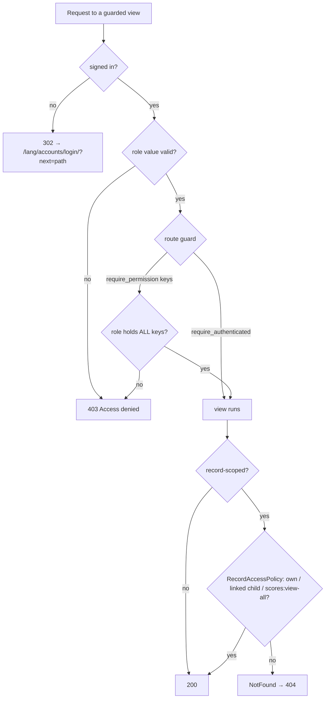

### Story 1.3: RBAC Core

**BUILDID**: CYCLE-1 | **GitHub**: LOCAL | **AzureDevOps**: LOCAL | **Epic**: 1 - Foundation | **ID**: 1.3 | **Date**: 2026-10-19
**File**: `docs/plans/stories/epic-1-story-1.3-RBAC-Core.md`
**Build Ref**: `docs/plans/builds/cycle-1/cycle-plan.md` — CYCLE-1 Foundation & Access (Workshop Day 2: `ROLE_PERMISSIONS` + decorator + matrix tests)
**Wave**: 2
**Requires**: [1.0]
**Enables**: [1.7, 1.9, 2.2]
**Files Touched**:
  - src/domain/accounts/**
  - src/infrastructure/web/common/decorators.py
  - tests/unit/domain/accounts/**
  - tests/integration/web/test_role_access_matrix.py
  - tests/integration/web/test_url_protection.py
**Roles Ref**: docs/requirements.md#roles--permissions-matrix — personas this story differentiates: Student, Teacher, Parent/Guardian, Admin
**QA Candidate**: Yes — **Observable:** role-gated pages answer 403 (wrong role) or redirect to sign-in (anonymous); records outside a user's scope answer 404. **Mechanism:**
- `@require_permission(*keys)` checks `ROLE_PERMISSIONS[Role(request.user.role)]` before the view runs and raises `PermissionDenied` → 403 (Story 1.1 page).
- `@require_authenticated` admits any signed-in user.
- Anonymous users are redirected to `LOGIN_URL?next=…`.
- `RecordAccessPolicy.can_view_student_records()` decides student-record scope from server-side identity only.
- Every URL pattern is checked by `test_url_protection` to be either decorated or listed in `PUBLIC_URL_NAMES`.

**Authz & preconditions:** the four canonical roles and 16 permission keys, copied verbatim from the requirements matrix; identity comes only from the session. **Edge & idempotency:** a user with a corrupt or unknown role value is denied (403), never granted; repeating a denied request is denied identically with no side-effects; multiple keys on one view require **all** of them. **Regression:** the permission matrix test locks the code to `docs/requirements.md`; the URL-coverage test fails any future route added without a guard; the role-access-matrix test is extended by every story that adds a route. A missing guard is release-blocking (FC-2: unauthorized access).

---

#### 👤 User Reference

**Description**:
The requirements define exactly what each kind of user may do. Students read lessons, practise and take tests, and see only their own scores. Teachers create content and see all pilot scores. Parents see only the progress of the children the administrator linked to them. Administrators manage accounts and moderate content. This story turns that table into the single rule book the whole application checks before showing any page or doing any action.

It does two kinds of checks:
- **"Is your role allowed to do this at all?"** For example, a student trying to open the teacher's editing area is told politely that they don't have access.
- **"Is this particular record yours to see?"** For example, a parent can see their own child's results but gets "page not found" for any other child. The page doesn't even confirm that the other child exists.

Who someone is always comes from their signed-in session, never from anything typed into the address bar.

The story also adds two automatic safety checks:
- **Rule book matches the requirements:** a test fails if the rule book ever drifts from the requirements document.
- **Every page is guarded:** a test fails if a developer adds a page and forgets to protect it, unless that page is deliberately public, like the sign-in page or the health check.

**Acceptance Criteria** (plain-English):
- The rules for Student, Teacher, Parent/Guardian and Admin match the Roles & Permissions table in the requirements exactly, and an automatic check enforces this.
- Someone not signed in who opens a protected page is sent to the sign-in page and returned there afterwards.
- A signed-in person whose role doesn't allow a page sees the "Access denied" page.
- Some pages are open to any signed-in person (for example, their home page and the catalogue).
- A student can only ever see their own records; a parent only their linked children's; teachers and administrators can see all pilot students' records.
- A request for someone else's record answers "Page not found", so the record's existence isn't revealed.
- An account with a broken or unknown role is treated as having no permissions.
- Adding a page without protection makes the automatic checks fail, unless the page is explicitly marked public.

**User Flow** (role-differentiated):

### Student
**Scenario / narrative**: As a Student who has just signed in, I explore the platform. I can open pages meant for learners, but when I paste a teacher's editing link my classmate showed me, the platform shows a friendly "Access denied" page instead of the editor. Nothing changes and nobody's content is exposed. If I try to change the number in a progress address to look at another student, I get "Page not found", the same as for a page that doesn't exist.
**Steps**:
1. Student requests a route decorated `@require_permission("content:edit")`.
2. The decorator reads `request.user.role` = `STUDENT` and resolves `ROLE_PERMISSIONS[Role.STUDENT]`, which lacks `content:edit`.
3. It raises `PermissionDenied`; Story 1.1's `handler403` renders the 403 page. The view body never runs.
4. On a scoped route, `RecordAccessPolicy.can_view_student_records(viewer=student, student_id=other.id, linked_ids=∅)` returns False, so the query service raises `NotFound` and the response is 404.

### Teacher
**Scenario / narrative**: As a Teacher, I can reach content-authoring and all-scores pages (in later cycles). If I open the administrator's moderation queue by URL, I get "Access denied". When I view a pilot student's scores, I see them because my role holds `scores:view-all`.
**Steps**:
1. Teacher requests a `scores:view-all` route; the decorator finds the key in `ROLE_PERMISSIONS[Role.TEACHER]` and lets the view run.
2. `RecordAccessPolicy` returns True for any student id (`scores:view-all`).
3. Teacher requests a `content:review` route, which is missing from the role, so the response is 403.

### Parent/Guardian
**Scenario / narrative**: As a Parent whose account the administrator linked to my daughter, I can see her progress. When I change the address to another child's id, the platform answers "Page not found". If the administrator hasn't linked any child yet, I see no children's data at all.
**Steps**:
1. Parent requests a child-progress route decorated `@require_permission("child-progress:view", "child-scores:view")`; both keys are present.
2. The query service loads the parent's linked student ids from the DB using `request.user.pk` only.
3. `RecordAccessPolicy` returns True only if the requested id is among them; otherwise `NotFound` → 404.

### Admin
**Scenario / narrative**: As the Admin, I can manage accounts, link parents and moderate content, and I can see every pilot student's scores. I have no student-learning permissions (`lessons:view`), because the matrix doesn't grant them, so learner-only pages tell me "Access denied".
**Steps**:
1. Admin requests an `accounts:manage` route; the key is present, so it's allowed.
2. Admin requests a `tests:submit` route; it's missing, so 403.
3. `RecordAccessPolicy` returns True for any student (`scores:view-all`).

**Flow Diagram**:



---

#### 🤖 AI Agent Reference

**Must Read**:
- `docs/requirements.md` — **Roles & Permissions Matrix** (canonical; copy verbatim)
- `docs/architecture/design/00-system-architecture-greenfield.md` — Roles & Authorization (permission → action mapping, enforcement, 403 vs 404), ADR-007
- `docs/architecture/design/01-patterns-and-standards-greenfield.md` — §4 (`Permission`, `ROLE_PERMISSIONS`), §7.2 (decorator), §12.4 (mandatory cross-cutting tests)
- `docs/plans/stories/epic-1-story-1.0-Root-Tooling-Seed.md` — `ROLE_CHOICES` in the user model, seeded `PUBLIC_URL_NAMES`
- `docs/plans/stories/epic-1-story-1.1-Error-Handling-and-Observability.md` — `NotFound`, `handler403`

**Description**:
Implements ADR-007 in the pure domain and the web layer:
1. **`domain/accounts/roles.py`:** `Role` StrEnum with values equal to the persisted `ROLE_CHOICES` from Story 1.0.
2. **`domain/accounts/permissions.py`:** `Permission` StrEnum (16 keys), the read-only `ROLE_PERMISSIONS` map copied verbatim from the requirements matrix, and `has_permission()`.
3. **`domain/accounts/access_policy.py`:** `RecordAccessPolicy`, a pure function deciding whether a viewer may see a given student's records, from the viewer's id, role and linked-student ids. Every later progress or score query service calls it.
4. **`web/common/decorators.py`:**
   - `@require_permission(*permissions)`: all permissions required; 403 on failure; anonymous → login redirect.
   - `@require_authenticated`: any signed-in user.
   - Both decorators attach `required_permissions` to the wrapper, so the URL-coverage test can introspect them.
5. **Tests:** the matrix-equals-requirements test; the URL-coverage test walking the resolver; the role-access-matrix harness (`CLIENT_FOR_ROLE`, parametrised rows) that later stories extend; and a test that `Role` values equal the model's `ROLE_CHOICES`.

**Acceptance Criteria**:
1. `Role` has exactly `STUDENT`, `TEACHER`, `PARENT`, `ADMIN` with values equal to the keys of `infrastructure.persistence.accounts.models.ROLE_CHOICES` (test-proven).
2. `Permission` has exactly the 16 keys listed in the requirements, with identical string values (e.g. `"child-progress:view"`).
3. `ROLE_PERMISSIONS` is a `MappingProxyType` of `frozenset`s equal to the requirements matrix:
   - Student → `lessons:view`, `exercises:complete`, `tests:submit`, `scores:view-own`
   - Teacher → `content:create`, `content:edit`, `tests:configure`, `scores:view-all`, `content:resubmit`
   - Parent → `child-progress:view`, `child-scores:view`
   - Admin → `accounts:manage`, `parents:link`, `content:review`, `content:block`, `content:unblock`, `scores:view-all`

   The test spells the expected table out literally rather than importing it.
4. `has_permission(role, permission) -> bool`; `parse_role(value: str) -> Role | None` returns `None` for unknown values.
5. `RecordAccessPolicy.can_view_student_records(viewer_id, viewer_role, student_id, linked_student_ids) -> bool`:
   - Student: only `viewer_id == student_id`
   - Parent: only `student_id in linked_student_ids`
   - Teacher/Admin: True (they hold `scores:view-all`)

   Unknown role → False. Pure function, 100% branch coverage.
6. `@require_permission(*permissions)` requires at least one permission (`ValueError` at import time otherwise). Anonymous → `redirect_to_login(request.get_full_path())` (uses `settings.LOGIN_URL`). Unknown role → `PermissionDenied`. Missing **any** permission → `PermissionDenied`. Otherwise the view runs. The wrapper exposes `required_permissions: tuple[Permission, ...]`.
7. `@require_authenticated`: anonymous → login redirect; any authenticated user with a valid role → view runs; wrapper `required_permissions = ()`.
8. Both decorators preserve `__name__`/`__doc__` (`functools.wraps`) and work on function views and on `View.as_view()` callables.
9. `test_url_protection.py` walks `get_resolver().url_patterns` recursively. Every leaf pattern must have `callback.required_permissions` or a fully qualified name (`namespace:name`) in `PUBLIC_URL_NAMES`, or live in the explicitly exempted `admin` namespace (protected by Django admin; Story 1.9 restricts it to the Admin role). Patterns without a name fail the test.
10. `test_role_access_matrix.py` gains `CLIENT_FOR_ROLE` (anonymous, Student, Teacher, Parent, Admin → client fixtures from Story 1.2) and a `ROWS` list of `(role, url, expected_status)`. Later stories append rows; this story adds rows for the public routes (`/healthz` 200 for every role).
11. A denied request leaves no trace beyond the 403/404 response and the Story 1.1 log line: no DB writes and no session changes.
12. Coverage of `src/domain/accounts` is 100% (statements + branches).

**RBAC Enforcement**:

| Persona | Permission key | Guarded route/endpoint | Allowed | Denied behavior | UI when denied |
|---------|----------------|------------------------|---------|-----------------|----------------|
| Student | `lessons:view`, `exercises:complete`, `tests:submit`, `scores:view-own` | learner routes (CYCLE-2/3) | yes | n/a | n/a |
| Student | any staff key (`content:*`, `accounts:manage`, `scores:view-all`, …) | `/teach/…`, `/manage/…`, `/scores/` | no | `PermissionDenied` → 403 | 403 page; staff links never rendered in Student navigation (Story 1.7) |
| Teacher | `content:create`, `content:edit`, `tests:configure`, `scores:view-all`, `content:resubmit` | `/teach/…`, `/scores/` | yes | n/a | n/a |
| Teacher | `content:review`, `content:block`, `content:unblock`, `accounts:manage`, `parents:link`, learner keys | `/manage/…`, `/admin/`, learner routes | no | 403 | 403 page; links hidden |
| Parent/Guardian | `child-progress:view` + `child-scores:view` | `/children/<id>/progress/` | linked children only | unlinked child → `NotFound` → 404 | 404 page (existence not revealed) |
| Parent/Guardian | everything else | all other guarded routes | no | 403 | 403 page; links hidden |
| Admin | `accounts:manage`, `parents:link`, `content:review`, `content:block`, `content:unblock`, `scores:view-all` | `/admin/`, `/manage/…`, `/scores/` | yes | n/a | n/a |
| Admin | learner/teacher keys | learner and `/teach/…` routes | no | 403 | 403 page |
| Anonymous | — | any guarded route | no | `302` → `/<lang>/accounts/login/?next=<path>` | sign-in page |

- **Enforcement points:** `@require_permission` / `@require_authenticated` in `src/infrastructure/web/common/decorators.py` on every view; `RecordAccessPolicy` in `src/domain/accounts/access_policy.py`, called by query services or repositories **inside** the query path.
- **Denied-access contract:** role denial → 403 page (or HTMX partial); out-of-scope record → 404 page. Navigation never renders links a role lacks (Story 1.7); hiding is a convenience, and the server check is the guarantee.
- **Scope derivation (IDOR guard):** `viewer_id` and `viewer_role` come only from `request.user` (session). `linked_student_ids` is loaded by the server from `PARENT_CHILD_LINK` filtered by `parent_id = request.user.pk`. A `student_id` from the URL is only ever the *subject* of the check, never a source of identity. Query parameters such as `?parent=`, `?as=` or `?role=` are ignored.

**System responses + error cases**:

| Trigger | Response | Side-effect |
|---------|----------|-------------|
| Anonymous GET of a `require_permission` view | `302 Location: <LOGIN_URL>?next=<full path>` | none |
| Anonymous GET of a `require_authenticated` view | `302` to login with `next` | none |
| Student GET of a view requiring `content:edit` | `403` page | none (view body not executed) |
| Teacher GET of a view requiring `content:edit` | `200` (view runs) | as defined by the view |
| Parent GET of a view requiring both `child-progress:view` and `child-scores:view` | `200` | — |
| Parent GET of a view requiring `child-progress:view` and `scores:view-all` | `403` (all keys required) | none |
| User with `role="SUPERHERO"` (corrupt data) GET of any guarded view | `403` | none |
| Same denied request repeated | identical `403` | none (no lockout or counters) |
| Parent requests linked child's record | policy True → `200` | — |
| Parent requests an unlinked child's record (`/children/999/…`) | `NotFound` → `404` | none |
| Student requests own record vs another student's | own `200`; other `404` | none |
| Developer registers a route without a guard and not in `PUBLIC_URL_NAMES` | `test_url_protection` fails naming the route | CI red |
| `@require_permission()` with no arguments | `ValueError` at import | app fails fast |

**QA-observable behaviour**:
- For each role and each guarded route in `ROWS`, the HTTP status equals the matrix expectation exactly (200 / 302 / 403 / 404).
- A 302 for anonymous users carries `next` equal to the originally requested path, including the language prefix.
- A 404 for an out-of-scope record is byte-identical in structure to the 404 for a non-existent id (same template, same status).
- `test_permission_matrix_matches_requirements` fails if any key is added, removed or renamed in `ROLE_PERMISSIONS`.
- **What does NOT change**: denied requests create no sessions, DB rows, audit entries or messages. A successful check doesn't modify the user. Roles can't be elevated by any request parameter.

**Prerequisites**:
- Story 1.0 merged (`ROLE_CHOICES`, `PUBLIC_URL_NAMES`, seeded role-access-matrix test).
- Story 1.2's role fixtures (`student_client` etc.) are created in the same wave. `CLIENT_FOR_ROLE` resolves fixtures by name via `request.getfixturevalue`, so this story's own tests don't depend on 1.2. They build users with `UserFactory(role=...)` and `client.force_login`.
- Story 1.1's `handler403`/`NotFound` (same wave): the decorator raises Django's `PermissionDenied`, which renders even without 1.1, so there's no hard dependency.

**Context**: `docs/requirements.md`, `docs/architecture/design/00-system-architecture-greenfield.md`, `docs/architecture/design/01-patterns-and-standards-greenfield.md`, `src/infrastructure/persistence/accounts/models.py`, `src/infrastructure/web/common/decorators.py`

**Patterns**: Domain Pattern (§4), Authorization decorator (§7.2), Mandatory cross-cutting tests (§12.4), Security Coding Rules (§13) — see `docs/architecture/design/01-patterns-and-standards-greenfield.md`

**Steps**:

1. **Tests first:** `tests/unit/domain/accounts/test_permissions.py`, `test_access_policy.py`, `test_roles_match_model.py`, then the two integration tests.

2. **Domain roles and permissions** (stdlib only):
   ```python
   # src/domain/accounts/roles.py
   from enum import StrEnum


   class Role(StrEnum):
       STUDENT = "STUDENT"
       TEACHER = "TEACHER"
       PARENT = "PARENT"
       ADMIN = "ADMIN"


   def parse_role(value: str) -> Role | None:
       try:
           return Role(value)
       except ValueError:
           return None
   ```
   `src/domain/accounts/permissions.py` exactly as patterns §4 (`Permission`, `P` alias, `ROLE_PERMISSIONS` as `MappingProxyType`, `has_permission`).

3. **Record access policy:**
   ```python
   # src/domain/accounts/access_policy.py
   from collections.abc import Collection

   from domain.accounts.permissions import Permission, has_permission
   from domain.accounts.roles import Role, parse_role


   def can_view_student_records(viewer_id: int, viewer_role: str, student_id: int,
                                linked_student_ids: Collection[int]) -> bool:
       """Object-level scope for any student record (progress, scores, attempts).

       Identity arguments MUST come from the authenticated session, never from request input.
       """
       role = parse_role(viewer_role)
       if role is None:
           return False
       if has_permission(role, Permission.SCORES_VIEW_ALL):
           return True
       if role is Role.PARENT:
           return student_id in linked_student_ids
       return role is Role.STUDENT and viewer_id == student_id
   ```

4. **Decorators** (extend the seeded `decorators.py`; keep `PUBLIC_URL_NAMES` and add to it, never reorder it):
   ```python
   from collections.abc import Callable
   from functools import wraps

   from django.contrib.auth.views import redirect_to_login
   from django.core.exceptions import PermissionDenied
   from django.http import HttpRequest, HttpResponse

   from domain.accounts.permissions import Permission, has_permission
   from domain.accounts.roles import parse_role

   View = Callable[..., HttpResponse]


   def _guard(view: View, permissions: tuple[Permission, ...]) -> View:
       @wraps(view)
       def wrapper(request: HttpRequest, *args, **kwargs) -> HttpResponse:
           if not request.user.is_authenticated:
               return redirect_to_login(request.get_full_path())
           role = parse_role(request.user.role)
           if role is None or not all(has_permission(role, p) for p in permissions):
               raise PermissionDenied
           return view(request, *args, **kwargs)

       wrapper.required_permissions = permissions  # read by test_url_protection
       return wrapper


   def require_permission(*permissions: Permission) -> Callable[[View], View]:
       """Allow the view only if the user's role holds ALL given permissions (403 otherwise)."""
       if not permissions:
           raise ValueError("require_permission needs at least one Permission")
       return lambda view: _guard(view, tuple(permissions))


   def require_authenticated(view: View) -> View:
       """Allow any signed-in user with a valid role (home, catalogue)."""
       return _guard(view, ())
   ```

5. **URL-coverage test** (`tests/integration/web/test_url_protection.py`):
   ```python
   from django.urls import URLPattern, URLResolver, get_resolver

   from infrastructure.web.common.decorators import PUBLIC_URL_NAMES

   EXEMPT_NAMESPACES = {"admin"}  # Django admin: has_permission restricted to Admin role (Story 1.9)


   def _leaves(patterns, namespace=""):
       for entry in patterns:
           if isinstance(entry, URLResolver):
               ns = entry.namespace or namespace
               yield from _leaves(entry.url_patterns, ns)
           elif isinstance(entry, URLPattern):
               yield namespace, entry


   def test_every_url_is_protected_or_public():
       offenders = []
       for namespace, pattern in _leaves(get_resolver().url_patterns):
           if namespace in EXEMPT_NAMESPACES:
               continue
           full_name = f"{namespace}:{pattern.name}" if namespace else pattern.name
           guarded = hasattr(pattern.callback, "required_permissions")
           if not guarded and full_name not in PUBLIC_URL_NAMES:
               offenders.append(full_name or str(pattern.pattern))
       assert offenders == [], f"Unprotected routes: {offenders}"
   ```

6. **Role-access-matrix harness** (extend the seeded file; later stories append to `ROWS`):
   ```python
   CLIENT_FOR_ROLE = {
       "anonymous": "client", "Student": "student_client", "Teacher": "teacher_client",
       "Parent/Guardian": "parent_client", "Admin": "admin_client",
   }
   # (role, path, expected_status) — append one block per story, grouped by route.
   ROWS = [(role, "/healthz", 200) for role in CLIENT_FOR_ROLE]


   @pytest.mark.parametrize(("role", "path", "expected"), ROWS)
   def test_role_access_matrix(request, role, path, expected):
       client = request.getfixturevalue(CLIENT_FOR_ROLE[role])

       assert client.get(path).status_code == expected
   ```

7. **Run all gates.** Domain coverage must be 100% (`coverage report --include="src/domain/*" --fail-under=100`).

**Tests**:

```python
# tests/unit/domain/accounts/test_permissions.py
import pytest

from domain.accounts.permissions import ROLE_PERMISSIONS, Permission, has_permission
from domain.accounts.roles import Role, parse_role

# Literal copy of docs/requirements.md → Roles & Permissions Matrix. Do NOT import from src.
EXPECTED = {
    "STUDENT": {"lessons:view", "exercises:complete", "tests:submit", "scores:view-own"},
    "TEACHER": {"content:create", "content:edit", "tests:configure", "scores:view-all", "content:resubmit"},
    "PARENT": {"child-progress:view", "child-scores:view"},
    "ADMIN": {"accounts:manage", "parents:link", "content:review", "content:block",
              "content:unblock", "scores:view-all"},
}


def test_permission_matrix_matches_requirements():
    actual = {role.value: {p.value for p in perms} for role, perms in ROLE_PERMISSIONS.items()}

    assert actual == EXPECTED


def test_permission_keys_are_exactly_the_sixteen_from_requirements():
    assert {p.value for p in Permission} == set().union(*EXPECTED.values())
    assert len(Permission) == 16


def test_matrix_is_read_only():
    with pytest.raises(TypeError):
        ROLE_PERMISSIONS[Role.STUDENT] = frozenset()  # type: ignore[index]


@pytest.mark.parametrize(("role", "permission", "expected"), [
    (Role.STUDENT, Permission.TESTS_SUBMIT, True),
    (Role.STUDENT, Permission.CONTENT_EDIT, False),
    (Role.PARENT, Permission.SCORES_VIEW_ALL, False),
    (Role.ADMIN, Permission.LESSONS_VIEW, False),
    (Role.TEACHER, Permission.SCORES_VIEW_ALL, True),
])
def test_has_permission(role, permission, expected):
    assert has_permission(role, permission) is expected


@pytest.mark.parametrize("value", ["", "student", "SUPERHERO"])
def test_parse_role_rejects_unknown_values(value):
    assert parse_role(value) is None
```

```python
# tests/unit/domain/accounts/test_access_policy.py
import pytest

from domain.accounts.access_policy import can_view_student_records


@pytest.mark.parametrize(("viewer_id", "role", "student_id", "linked", "expected"), [
    (1, "STUDENT", 1, set(), True),        # own record
    (1, "STUDENT", 2, set(), False),       # another student → IDOR denied
    (9, "PARENT", 1, {1, 3}, True),        # linked child
    (9, "PARENT", 2, {1, 3}, False),       # unlinked child
    (9, "PARENT", 1, set(), False),        # parent with no links
    (5, "TEACHER", 2, set(), True),        # scores:view-all
    (7, "ADMIN", 2, set(), True),          # scores:view-all
    (1, "SUPERHERO", 1, set(), False),     # corrupt role never granted
])
def test_can_view_student_records(viewer_id, role, student_id, linked, expected):
    assert can_view_student_records(viewer_id, role, student_id, linked) is expected
```

```python
# tests/unit/domain/accounts/test_roles_match_model.py
from domain.accounts.roles import Role
from infrastructure.persistence.accounts.models import ROLE_CHOICES


def test_persisted_role_choices_equal_domain_roles():
    assert [value for value, _label in ROLE_CHOICES] == [role.value for role in Role]
```

```python
# tests/integration/web/test_url_protection.py (continued — decorator behaviour tests use this
# module's own `urlpatterns` via @pytest.mark.urls(__name__); the coverage test above is unmarked
# and therefore walks the real ROOT_URLCONF)
import pytest
from django.http import HttpResponse
from django.urls import path

from domain.accounts.permissions import Permission as P
from infrastructure.web.common.decorators import require_authenticated, require_permission
from tests.factories.accounts import UserFactory


@require_permission(P.CONTENT_EDIT)
def _edit(request):
    return HttpResponse("edit")


@require_permission(P.CHILD_PROGRESS_VIEW, P.CHILD_SCORES_VIEW)
def _child(request):
    return HttpResponse("child")


@require_authenticated
def _any(request):
    return HttpResponse("any")


urlpatterns = [path("edit", _edit, name="edit"), path("child", _child, name="child"),
               path("any", _any, name="any"), path("login", _any, name="login")]


@pytest.mark.django_db
@pytest.mark.urls(__name__)
@pytest.mark.parametrize(("role", "url", "status"), [
    ("TEACHER", "/edit", 200), ("STUDENT", "/edit", 403), ("ADMIN", "/edit", 403),
    ("PARENT", "/child", 200), ("TEACHER", "/child", 403),
    ("STUDENT", "/any", 200), ("SUPERHERO", "/any", 403),
])
def test_decorators_enforce_role_permissions(client, role, url, status):
    client.force_login(UserFactory(role=role))

    assert client.get(url).status_code == status


@pytest.mark.django_db
@pytest.mark.urls(__name__)
def test_anonymous_is_redirected_to_login_with_next(client, settings):
    settings.LOGIN_URL = "/login"

    response = client.get("/edit?x=1")

    assert response.status_code == 302
    assert response["Location"] == "/login?next=/edit%3Fx%3D1"


def test_decorator_requires_at_least_one_permission():
    with pytest.raises(ValueError):
        require_permission()


def test_wrappers_expose_required_permissions_and_names():
    assert _edit.required_permissions == (P.CONTENT_EDIT,)
    assert _any.required_permissions == ()
    assert _edit.__name__ == "_edit"
```

Manual:
- Temporarily point a scratch view at `@require_permission(Permission.CONTENT_EDIT)` (local branch, not committed). Sign in as each role and confirm 403 for Student/Parent/Admin and 200 for Teacher; signed out, confirm the redirect to sign-in with `next`.
- In the Django shell, set a user's `role` to an invalid value and confirm every guarded page answers 403.
- Delete a decorator from any registered view (local) and confirm `test_url_protection` fails naming that route.

**Quality**: ruff 0; `mypy --strict` passes for `domain.accounts`; lint-imports kept (domain imports stdlib only); `src/domain/accounts` coverage 100%; overall ≥85%; no `TODO`.

**OUT**:
- ❌ Real feature routes and their matrix rows (Stories 1.7, 2.2 and CYCLE-2/3 add them).
- ❌ Loading `linked_student_ids` from the DB (`ParentChildLink` model is Story 1.9; query services in CYCLE-3 call the policy).
- ❌ Restricting Django admin to the Admin role (Story 1.9).
- ❌ Hiding navigation links per role (Story 1.7).
- ❌ Django Groups/Permissions tables (rejected in ADR-007).
- ❌ Login view or `LOGIN_URL` definition (Story 1.2).

**Evidence**: pytest output (matrix, policy, decorator, URL-coverage tests), `src/domain/accounts` coverage at 100%, mypy strict and lint-imports output, and a screenshot of the 403 page for a Student on a teacher route, all recorded in `docs/stories-implemented/story-1.3-review.md` under "## DoD Evidence".
