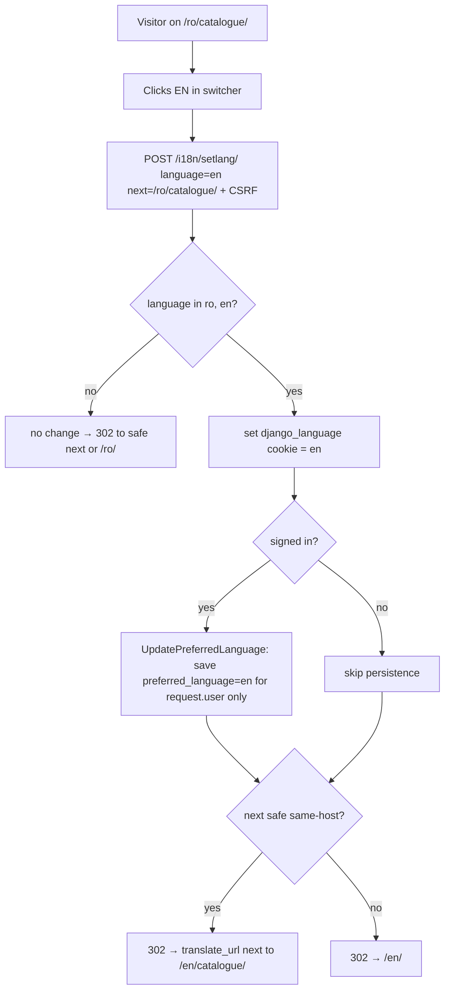

### Story 1.4: Internationalization

**BUILDID**: CYCLE-1 | **GitHub**: LOCAL | **AzureDevOps**: LOCAL | **Epic**: 1 - Foundation | **ID**: 1.4 | **Date**: 2026-10-19
**File**: `docs/plans/stories/epic-1-story-1.4-Internationalization.md`
**Build Ref**: `docs/plans/builds/cycle-1/cycle-plan.md` — CYCLE-1 Foundation & Access (Workshop Day 3: RO/EN switching)
**Wave**: 2
**Requires**: [1.0]
**Enables**: [1.7]
**Files Touched**:
  - src/application/accounts/update_preferred_language.py
  - src/infrastructure/persistence/accounts/repositories.py
  - src/infrastructure/container.py
  - src/infrastructure/web/common/decorators.py
  - src/infrastructure/web/common/i18n.py
  - src/infrastructure/web/i18n_views.py
  - src/infrastructure/web/templatetags/i18n_content.py
  - src/infrastructure/web/templates/components/language_switcher.html
  - src/infrastructure/web/static/css/components/language_switcher.css
  - src/config/settings/base.py
  - src/config/urls.py
  - src/infrastructure/i18n/locale/ro/LC_MESSAGES/django.po
  - src/infrastructure/i18n/locale/en/LC_MESSAGES/django.po
  - .gitignore
  - README.md
  - tests/unit/infrastructure/test_i18n_helpers.py
  - tests/unit/application/accounts/test_update_preferred_language.py
  - tests/integration/web/i18n/**
**Roles Ref**: docs/requirements.md#roles--permissions-matrix — single-actor — no role variation (every visitor, signed in or not, can switch language; signed-in users of every role additionally get their choice saved)
**QA Candidate**: Yes — **Observable:** every page exists under `/ro/…` and `/en/…`. A RO|EN switcher changes the language of the current page and keeps you on the same page; for signed-in users the choice is remembered on the next sign-in. Bilingual content renders in the active language. **Mechanism:** `LocaleMiddleware` + `i18n_patterns(prefix_default_language=True)`. `POST /i18n/setlang/` (public, CSRF-protected) wraps Django's `set_language` (sets the `django_language` cookie and translates `next` to the chosen prefix) and, when authenticated, runs `UpdatePreferredLanguage`, which persists `UserModel.preferred_language`. The `localized` helper and `` tag read `<field>_ro`/`<field>_en` by the active language. `test_translations_complete` parses the `ro` catalogue. **Authz & preconditions:** none for switching (public); persisting requires a signed-in user and only ever updates **that** user (`request.user.pk`). **Edge & idempotency:** an unsupported language code (`de`, empty) is ignored, leaving the language and preference unchanged and redirecting back. An unsafe `next` falls back to `/<lang>/`. Choosing the current language again is a no-op write (the use case skips unchanged values). Unprefixed URLs (`/`) redirect to the cookie or `Accept-Language` language, defaulting to `ro`. **Regression:** RO/EN parity of every UI string (empty `msgstr` fails CI); the language switch on every page; the preference persisting across sign-out/sign-in; no other user is modified.

---

#### 👤 User Reference

**Description**:
The platform has to work fully in Romanian and English: the menus, buttons and messages, and also the lessons and tests teachers write in both languages. This story builds that foundation:
- **Addresses per language:** every page has a Romanian address (starting `/ro/`) and an English one (starting `/en/`), so a link always opens in the language it was shared in.
- **Switcher:** a small RO | EN switch lets anyone change language. They stay on the same page and it simply re-appears in the other language.
- **Remembered choice:** for signed-in people, the choice is saved on their account, so the next time they sign in the platform opens in their language. That matters for children, who shouldn't have to find the switch every time.
- **Bilingual content:** a single helper shows the right language version of anything written in both languages (lesson titles, subject names), so later features can't accidentally show the wrong one.
- **Translation check:** an automatic check fails if a Romanian translation is missing for any interface text.

Romanian is the default language.

**Acceptance Criteria** (plain-English):
- Every page can be opened in Romanian (`/ro/…`) and English (`/en/…`). Romanian is the default.
- Opening the site without a language in the address takes the person to their last-chosen language, or to Romanian.
- Choosing a language with the switcher shows the same page in that language.
- For a signed-in person, the chosen language is saved and used automatically after their next sign-in.
- Choosing an unsupported language changes nothing.
- The switcher can't be used to send someone to another website.
- Text written in both languages (for example a subject's name) appears in the language currently in use.
- The automatic checks fail if any interface text has no Romanian translation.
- The switcher is usable with the keyboard and screen readers, and clearly shows which language is active.

**User Flow** (no role variation — identical for anonymous visitors and every role):

**User Journey**:
- **Entry**: a person opens `/` or any page. `LocaleMiddleware` redirects unprefixed paths to `/<cookie or Accept-Language or ro>/…`; prefixed paths render in that language, with `<html lang>` set.
- **Load**: the page renders with `` strings from the `ro`/`en` catalogue. Bilingual model fields render through ``.
- **Render**: the switcher (included in the top bar by Story 1.7) shows "RO | EN" as two submit buttons in a small form. The active one has `aria-pressed="true"` and is styled as current.
- **Interact**: clicking "EN" POSTs `language=en&next=<current path>` to `/i18n/setlang/`. The server validates the code, sets the `django_language` cookie, translates `next` from `/ro/x/` to `/en/x/`, and, if signed in, saves `preferred_language="en"` on the current user. Then it redirects 302 to `/en/x/`.
- **Empty/error**: an unknown code (`de`) or a missing code leaves everything unchanged and redirects to `next` (if safe) or `/<current>/`. An external `next` is replaced by `/<lang>/`. A missing CSRF token gives 403.
- **Next sign-in**: Story 1.2 redirects to `/<preferred_language>/`, so the saved choice applies immediately.
- **Responsive**: desktop-only. The switcher is a compact 2-button group in the top bar, each button at least 32px (staff) or 44px (student theme).

**Flow Diagram**:



---

#### 🤖 AI Agent Reference

**Must Read**:
- `docs/architecture/design/00-system-architecture-greenfield.md` — Internationalization table, ADR-006 (paired `_ro`/`_en` columns), route `/i18n/setlang/`
- `docs/architecture/design/01-patterns-and-standards-greenfield.md` — §5 (use case + UoW), §11.3 (i18n rules, `localized`), §12.4 (`test_translations_complete`)
- `docs/ui-ux/ui-ux-spec.md` + `docs/ui-ux/08-visual-foundation.md` — language switcher in the top bar, touch targets, a11y
- `docs/plans/stories/epic-1-story-1.2-Login-and-Session-Security.md` — redirect to `/<preferred_language>/`, middleware order
- `docs/plans/stories/epic-1-story-1.0-Root-Tooling-Seed.md` — `LANGUAGES`, `LOCALE_PATHS`, `.po` headers

**Description**:
1. **URL language prefixes:** `LocaleMiddleware` at the position fixed in Story 1.2. The `i18n_patterns` block (seeded in 1.0) holds every user-facing route.
2. **Language switch:** a public `POST /i18n/setlang/` (outside `i18n_patterns`, URL name `set_language`, listed in `PUBLIC_URL_NAMES`) delegates to `django.views.i18n.set_language`, which handles cookie, `next` validation and URL translation. For authenticated users it then calls the `UpdatePreferredLanguage` use case.
3. **Use case:** `UpdatePreferredLanguage(users: UserPreferencePort, uow: UnitOfWork)` validates the code against `domain.common.language.Language` and writes only when it changed. `UserPreferencePort` is a Protocol in the use-case module; the application layer may declare its own ports. `DjangoUserPreferences` in `persistence/accounts/repositories.py` implements it. It's wired in `container.py`.
4. **Content helper:** `content_language()` / `localized(obj, field)` in `web/common/i18n.py` and the `` tag. These are the only sanctioned way to read `_ro`/`_en` fields.
5. **Language switcher:** the `language_switcher` component (a shared primitive per patterns §11.2) with its CSS.
6. **Translation-completeness test:** parses the `ro` `.po` file without needing gettext installed.
7. **Translation tooling:** install and document GNU gettext (`makemessages`/`compilemessages`).

> **Dependency on 1.8's `UnitOfWork`:** Story 1.8 creates `application/common/unit_of_work.py` and `persistence/common/unit_of_work.py` in the same wave. To stay independent, this use case depends on a **structural** context-manager type (`AbstractContextManager[object]`). The container passes `django.db.transaction.atomic()` until 1.8's `DjangoUnitOfWork` exists, after which 1.8 switches the container entry. Both satisfy the same protocol, so the use case doesn't change.

**Design Tokens** (FE — language switcher):
- Colors: inactive button text `#0E7490` on transparent, border `#6B7280`. Active button bg `#0E7490`, text `#FFFFFF` (5.36:1). Hover `#155E75`. Focus 3px `#C2410C`.
- Spacing: staff 4px gap, 8px/12px padding · student 8px gap, 12px/16px padding
- Typography: 16px/600 (staff), 18px/600 (student), uppercase labels "RO" / "EN"
- Radius: 8px staff / 16px student (pill group). Min size 32px staff, 44px student.
- Icons: Phosphor `translate` 20px, regular for staff and duotone for student, `aria-hidden`
- a11y: `<form>` with `aria-label="Language"` / "Limba". Each button has `lang="ro"`/`lang="en"`, `aria-pressed`, and a full-name `title` ("Română" / "English").

**Acceptance Criteria**:
1. `MIDDLEWARE` contains `django.middleware.locale.LocaleMiddleware` right after `SessionMiddleware` (order from Story 1.2). `LANGUAGE_CODE="ro"`, `LANGUAGES=[("ro","Română"),("en","English")]`, `LANGUAGE_COOKIE_NAME="django_language"`, `LANGUAGE_COOKIE_AGE=31_536_000`, `LANGUAGE_COOKIE_SAMESITE="Lax"`, `LANGUAGE_COOKIE_SECURE` follows `SESSION_COOKIE_SECURE`.
2. `GET /` redirects (302) to `/ro/` with no cookie or `Accept-Language`, to `/en/` with `Accept-Language: en`, and to the cookie language when the cookie is set.
3. `POST /i18n/setlang/` (name `set_language`, outside `i18n_patterns`, in `PUBLIC_URL_NAMES`) with `language ∈ {ro, en}` sets the cookie and redirects 302 to `next` translated to the chosen prefix (`/ro/a/b/` → `/en/a/b/`). An unsafe or missing `next` → `/<language>/`.
4. Invalid `language` (`de`, empty, `RO`) → 302 back to the safe `next` (unchanged language) or `/<current>/`; no cookie change and no DB write.
5. `GET /i18n/setlang/` → 405. A POST without CSRF → 403.
6. Signed-in POST with a valid code → `UpdatePreferredLanguage.execute(user_id=request.user.pk, language=code)` persists `preferred_language` for **that** user only (`UPDATE … WHERE id = request.user.pk`). If unchanged, no write happens (`DjangoUserPreferences.set` isn't called).
7. `UpdatePreferredLanguage` raises `PolicyViolation([Violation("unsupported_language", {"language": code})])` for invalid codes. The view validates first and never reaches it with an invalid code; the use-case check is defence in depth.
8. `content_language()` returns `ro` or `en` from `translation.get_language()`, falling back to `ro` for anything else (e.g. `en-us` → `en`, `de` → `ro`). `localized(obj, "title")` returns `obj.title_<lang>` and raises `AttributeError` for a missing field (fail loudly; never silently show the other language).
9. `` renders the localized value, autoescaped.
10. `components/language_switcher.html` renders a POST form (CSRF token, hidden `next = request.get_full_path`) with two `<button name="language">` elements. The current language has `aria-pressed="true"`. There's no JavaScript and no inline style.
11. `test_translations_complete` parses `locale/ro/LC_MESSAGES/django.po`: no entry other than the header has an empty `msgstr`, and no entry is marked `#, fuzzy`. It runs without gettext installed.
12. GNU gettext is installed on the dev machine; `uv run python manage.py makemessages -l ro -l en --ignore=.venv` and `compilemessages --ignore=.venv` succeed. Compiled `.mo` files are **build artefacts**: gitignored and produced by `compilemessages` in Docker builds and CI. The README documents this.
13. RO + EN entries exist for the switcher strings ("Language"/"Limba", "Română", "English").

**RBAC Enforcement**:
No role-differentiated access — single actor.
- `set_language` is public by design (anonymous visitors must switch too). The persistence step derives the target user **only** from `request.user.pk` (session). No `user_id` or `username` parameter is accepted; any extra POST field is ignored. This is the IDOR guard for preference writes.

**System responses + error cases**:

| Trigger | Response | Side-effect |
|---------|----------|-------------|
| `GET /` (no cookie, no `Accept-Language`) | `302 → /ro/` | none |
| `GET /` with `Accept-Language: en-GB` | `302 → /en/` | none |
| Anonymous `POST /i18n/setlang/ language=en next=/ro/accounts/login/` | `302 → /en/accounts/login/` | `django_language=en` cookie set |
| Signed-in Student `POST language=en next=/ro/` (pref was `ro`) | `302 → /en/` | cookie set; `UPDATE accounts_user SET preferred_language='en' WHERE id=<student>` |
| Same POST repeated (pref already `en`) | `302 → /en/` | cookie re-set; **no** DB write |
| `POST language=de` | `302 →` safe `next` unchanged (`/ro/…`) | none |
| `POST language=en next=https://evil.example/` | `302 → /en/` | cookie set; preference saved if signed in |
| `POST` with an extra `user_id=<other>` field | treated as if absent; only `request.user` updated | — |
| `GET /i18n/setlang/` | `405` | none |
| `POST` without CSRF token | `403` | none |
| `POST` while DB unavailable (signed in) | `500` page with reference (Story 1.1) | cookie not set (exception before response) |

**QA-observable behaviour**:
- After switching to EN on `/ro/catalogue/`, the browser lands on `/en/catalogue/` with `<html lang="en">` and the `django_language` cookie = `en`.
- For a signed-in user, `accounts_user.preferred_language` for that user's row equals the chosen code; every other user's value is byte-identical before and after.
- After sign-out and sign-in, the redirect `Location` is `/en/` (Story 1.2 behaviour driven by this persisted value).
- The active switcher button has `aria-pressed="true"` and the other has `"false"`.
- **What does NOT change**: no other user fields (role, name, date of birth, password) and no other users. An invalid code leaves both cookie and DB untouched. Content values (`*_ro`/`*_en`) are never modified by display helpers.

**Prerequisites**:
- Story 1.0 merged.
- **Install GNU gettext** (blocking for AC 12): Homebrew isn't installed on the project laptop. Pick one approach and record it in the README:
  1. install Homebrew (needs an admin password), then `brew install gettext`
  2. install MacPorts, then `sudo port install gettext`
  3. run `makemessages`/`compilemessages` inside the project's Docker image (DevOps) where `apt-get install gettext` is used

  CI (Ubuntu) uses `apt-get install -y gettext`. AC 11 doesn't need gettext.
- Story 1.2's middleware order and Story 1.8's `UnitOfWork` (same wave; see the Description note).

**Context**: `docs/architecture/design/00-system-architecture-greenfield.md`, `docs/architecture/design/01-patterns-and-standards-greenfield.md`, `docs/ui-ux/08-visual-foundation.md`, `src/config/settings/base.py`, `src/config/urls.py`, `src/domain/common/language.py` (Story 1.1)

**Patterns**: Application use case (§5), Repository (§6.3), Web Layer (§7), Internationalization (§11.3), UI Primitive Catalogue — language switcher (§11.2), Testing (§12) — see `docs/architecture/design/01-patterns-and-standards-greenfield.md`

**Steps**:

1. **Tests first:** the unit tests for helpers and the use case, then the integration tests in `tests/integration/web/i18n/`.

2. **Use case** (the application layer imports only domain + stdlib):
   ```python
   # src/application/accounts/update_preferred_language.py
   from collections.abc import Callable
   from contextlib import AbstractContextManager
   from dataclasses import dataclass
   from typing import Protocol

   from domain.common.errors import PolicyViolation, Violation
   from domain.common.language import Language


   class UserPreferencePort(Protocol):
       def get_language(self, user_id: int) -> str: ...
       def set_language(self, user_id: int, language: str) -> None: ...


   @dataclass(frozen=True)
   class UpdatePreferredLanguageCommand:
       user_id: int  # always request.user.pk — never request input
       language: str


   class UpdatePreferredLanguage:
       def __init__(self, users: UserPreferencePort,
                    uow_factory: Callable[[], AbstractContextManager[object]]) -> None:
           self._users, self._uow_factory = users, uow_factory

       def execute(self, cmd: UpdatePreferredLanguageCommand) -> bool:
           """Persist the language; returns True if a write happened."""
           if cmd.language not in {lang.value for lang in Language}:
               raise PolicyViolation([Violation("unsupported_language", {"language": cmd.language})])
           with self._uow_factory():
               if self._users.get_language(cmd.user_id) == cmd.language:
                   return False
               self._users.set_language(cmd.user_id, cmd.language)
               return True
   ```
   `transaction.atomic` (now) and Story 1.8's `DjangoUnitOfWork` class (later) both satisfy `Callable[[], AbstractContextManager[object]]`.

3. **Repository** (`src/infrastructure/persistence/accounts/repositories.py`, new file; Story 1.9 adds to it later):
   ```python
   from infrastructure.persistence.accounts.models import UserModel


   class DjangoUserPreferences:
       def get_language(self, user_id: int) -> str:
           return UserModel.objects.values_list("preferred_language", flat=True).get(pk=user_id)

       def set_language(self, user_id: int, language: str) -> None:
           UserModel.objects.filter(pk=user_id).update(preferred_language=language)
   ```
   `container.py` (append an `accounts` block):
   ```python
   from django.db import transaction

   from application.accounts.update_preferred_language import UpdatePreferredLanguage
   from infrastructure.persistence.accounts.repositories import DjangoUserPreferences


   def update_preferred_language() -> UpdatePreferredLanguage:
       return UpdatePreferredLanguage(DjangoUserPreferences(), transaction.atomic)
   ```

4. **View** (`src/infrastructure/web/i18n_views.py`):
   ```python
   from django.conf import settings
   from django.http import HttpRequest, HttpResponse
   from django.shortcuts import redirect
   from django.utils.http import url_has_allowed_host_and_scheme
   from django.utils.translation import get_language
   from django.views.decorators.http import require_POST
   from django.views.i18n import set_language

   from application.accounts.update_preferred_language import UpdatePreferredLanguageCommand
   from infrastructure import container

   _SUPPORTED = {code for code, _name in settings.LANGUAGES}


   @require_POST
   def switch_language(request: HttpRequest) -> HttpResponse:
       """POST /i18n/setlang/ — public. Sets the cookie; persists the preference when signed in."""
       language = request.POST.get("language", "")
       if language not in _SUPPORTED:
           # Django's set_language accepts any locale Django ships (e.g. "de"); we allow ro/en only.
           next_url = request.POST.get("next", "")
           safe = url_has_allowed_host_and_scheme(next_url, {request.get_host()}, request.is_secure())
           return redirect(next_url if safe else f"/{(get_language() or 'ro')[:2]}/")
       response = set_language(request)  # sets cookie, validates next, translates the URL prefix
       if request.user.is_authenticated:
           container.update_preferred_language().execute(
               UpdatePreferredLanguageCommand(user_id=request.user.pk, language=language))
       return response
   ```
   In `config/urls.py` (outside `i18n_patterns`): `path("i18n/setlang/", switch_language, name="set_language")`. Add `"set_language"` to `PUBLIC_URL_NAMES`.

5. **Content helpers and template tag:** `web/common/i18n.py` per patterns §11.3, with the fallback mapping `language[:2]`. The tag:
   ```python
   # src/infrastructure/web/templatetags/i18n_content.py
   from django import template

   from infrastructure.web.common.i18n import localized as _localized

   register = template.Library()


   @register.simple_tag
   def localized(obj: object, field: str) -> str:
       """ → subject.name_ro / subject.name_en (autoescaped)."""
       return _localized(obj, field)
   ```

6. **Switcher component:**
   ```django
   {# components/language_switcher.html #}
   
   <form class="lang-switch" action="" method="post" aria-label="">
     
     <input type="hidden" name="next" value="{{ request.get_full_path }}">
     <button type="submit" name="language" value="ro" lang="ro" title="Română"
             class="lang-switch__btn" aria-pressed="truefalse">RO</button>
     <button type="submit" name="language" value="en" lang="en" title="English"
             class="lang-switch__btn" aria-pressed="truefalse">EN</button>
   </form>
   ```
   Style it in `static/css/components/language_switcher.css` with tokens only (`var(--color-primary)` etc.). Student and staff variants come from the body theme classes defined by Story 1.5 (`.theme-student .lang-switch__btn { min-height: var(--touch-student); }`).

7. **Translation workflow:** install gettext (Prerequisites), run `makemessages`, fill the RO `msgstr`, run `compilemessages`. Append `*.mo` to `.gitignore` (shared file, outside the AIRE-managed block) and a "Translations" section to `README.md` (shared file) covering the gettext install options, the two commands, and that `.mo` files are build artefacts.

8. **Run all gates.**

**Tests**:

```python
# tests/unit/infrastructure/test_i18n_helpers.py
from types import SimpleNamespace

import pytest
from django.utils import translation

from infrastructure.web.common.i18n import content_language, localized

SUBJECT = SimpleNamespace(name_ro="Matematică", name_en="Mathematics")


@pytest.mark.parametrize(("active", "expected"), [("ro", "ro"), ("en", "en"), ("en-us", "en"), ("de", "ro")])
def test_content_language_maps_active_language(active, expected):
    with translation.override(active):
        assert content_language() == expected


def test_localized_reads_the_active_language_field():
    with translation.override("en"):
        assert localized(SUBJECT, "name") == "Mathematics"
    with translation.override("ro"):
        assert localized(SUBJECT, "name") == "Matematică"


def test_localized_fails_loudly_for_missing_field():
    with translation.override("ro"), pytest.raises(AttributeError):
        localized(SUBJECT, "title")


def test_ro_catalogue_has_no_missing_or_fuzzy_translations():
    from pathlib import Path

    po = Path("src/infrastructure/i18n/locale/ro/LC_MESSAGES/django.po").read_text(encoding="utf-8")
    entries = [e for e in po.split("\n\n") if "msgid" in e and 'msgid ""\nmsgstr ""\n"' not in e]

    empty = [e for e in entries if e.rstrip().endswith('msgstr ""')]
    fuzzy = [e for e in entries if "#, fuzzy" in e]
    assert empty == [] and fuzzy == [], f"Missing RO translations: {empty or fuzzy}"
```

```python
# tests/unit/application/accounts/test_update_preferred_language.py
from contextlib import nullcontext

import pytest

from application.accounts.update_preferred_language import (
    UpdatePreferredLanguage, UpdatePreferredLanguageCommand)
from domain.common.errors import PolicyViolation


class FakePreferences:
    def __init__(self, stored):
        self.stored, self.writes = dict(stored), []

    def get_language(self, user_id):
        return self.stored[user_id]

    def set_language(self, user_id, language):
        self.writes.append((user_id, language))
        self.stored[user_id] = language


def test_changes_language_for_that_user_only():
    prefs = FakePreferences({1: "ro", 2: "ro"})

    changed = UpdatePreferredLanguage(prefs, nullcontext).execute(UpdatePreferredLanguageCommand(1, "en"))

    assert changed is True
    assert prefs.stored == {1: "en", 2: "ro"}


def test_same_language_is_a_no_op():
    prefs = FakePreferences({1: "en"})

    assert UpdatePreferredLanguage(prefs, nullcontext).execute(UpdatePreferredLanguageCommand(1, "en")) is False
    assert prefs.writes == []


@pytest.mark.parametrize("code", ["de", "", "RO"])
def test_unsupported_language_is_rejected(code):
    with pytest.raises(PolicyViolation) as error:
        UpdatePreferredLanguage(FakePreferences({1: "ro"}), nullcontext).execute(
            UpdatePreferredLanguageCommand(1, code))

    assert error.value.violations[0].code == "unsupported_language"
```

```python
# tests/integration/web/i18n/test_language_switch.py
import pytest
from django.contrib.auth import get_user_model

from tests.factories.accounts import UserFactory

pytestmark = pytest.mark.django_db
URL = "/i18n/setlang/"


def test_root_redirects_to_romanian_by_default(client):
    assert client.get("/")["Location"] == "/ro/"


def test_root_honours_accept_language(client):
    assert client.get("/", headers={"Accept-Language": "en-GB,en;q=0.9"})["Location"] == "/en/"


def test_anonymous_switch_sets_cookie_and_translates_next(client):
    response = client.post(URL, {"language": "en", "next": "/ro/accounts/login/"})

    assert response["Location"] == "/en/accounts/login/"
    assert response.cookies["django_language"].value == "en"


def test_signed_in_switch_persists_only_for_current_user(client):
    me, other = UserFactory(preferred_language="ro"), UserFactory(preferred_language="ro")
    client.force_login(me)

    client.post(URL, {"language": "en", "next": "/ro/", "user_id": other.pk})

    users = get_user_model().objects
    assert users.get(pk=me.pk).preferred_language == "en"
    assert users.get(pk=other.pk).preferred_language == "ro"


@pytest.mark.parametrize("code", ["de", ""])
def test_invalid_language_changes_nothing(client, code):
    me = UserFactory(preferred_language="ro")
    client.force_login(me)

    response = client.post(URL, {"language": code, "next": "/ro/accounts/login/"})

    assert response.status_code == 302
    assert "django_language" not in response.cookies
    assert get_user_model().objects.get(pk=me.pk).preferred_language == "ro"


def test_unsafe_next_falls_back_to_language_root(client):
    response = client.post(URL, {"language": "en", "next": "https://evil.example/"})

    assert response["Location"] == "/en/"


def test_get_is_not_allowed(client):
    assert client.get(URL).status_code == 405


def test_switcher_marks_current_language(rf):
    from django.template.loader import render_to_string
    from django.utils import translation

    request = rf.get("/en/accounts/login/")
    with translation.override("en"):
        html = render_to_string("components/language_switcher.html", request=request)

    assert 'value="en" lang="en" title="English"' in html
    assert html.count('aria-pressed="true"') == 1
```

Manual:
- In a fresh browser, open `/` and confirm you land on `/ro/`. Switch to EN on the login page and confirm the URL becomes `/en/accounts/login/` with English labels.
- Sign in as a student, switch to EN, sign out, sign in again, and confirm you land on `/en/`.
- Tab to the switcher and confirm the visible focus ring and that a screen reader announces "RO, toggle button, pressed".
- `curl -X POST /i18n/setlang/` without CSRF gives 403.

**Quality**: ruff 0; mypy strict for `application.accounts`; lint-imports kept; tests pass; coverage ≥85% overall, application ≥95%; translations complete; no inline script/style; no `TODO`.

**OUT**:
- ❌ Placing the switcher in the top bar (Story 1.7 includes the component).
- ❌ Translating content values (teachers author both languages in CYCLE-2).
- ❌ A third language, or automatic machine translation.
- ❌ Changing the language via a profile page (not required).
- ❌ `DjangoUnitOfWork` (Story 1.8 creates it and switches the container entry).

**Evidence**: pytest output (helpers, use case, switch integration tests), the `makemessages`/`compilemessages` output proving gettext works, coverage %, and screenshots of the same page in RO and EN with the switcher, all recorded in `docs/stories-implemented/story-1.4-review.md` under "## DoD Evidence".
