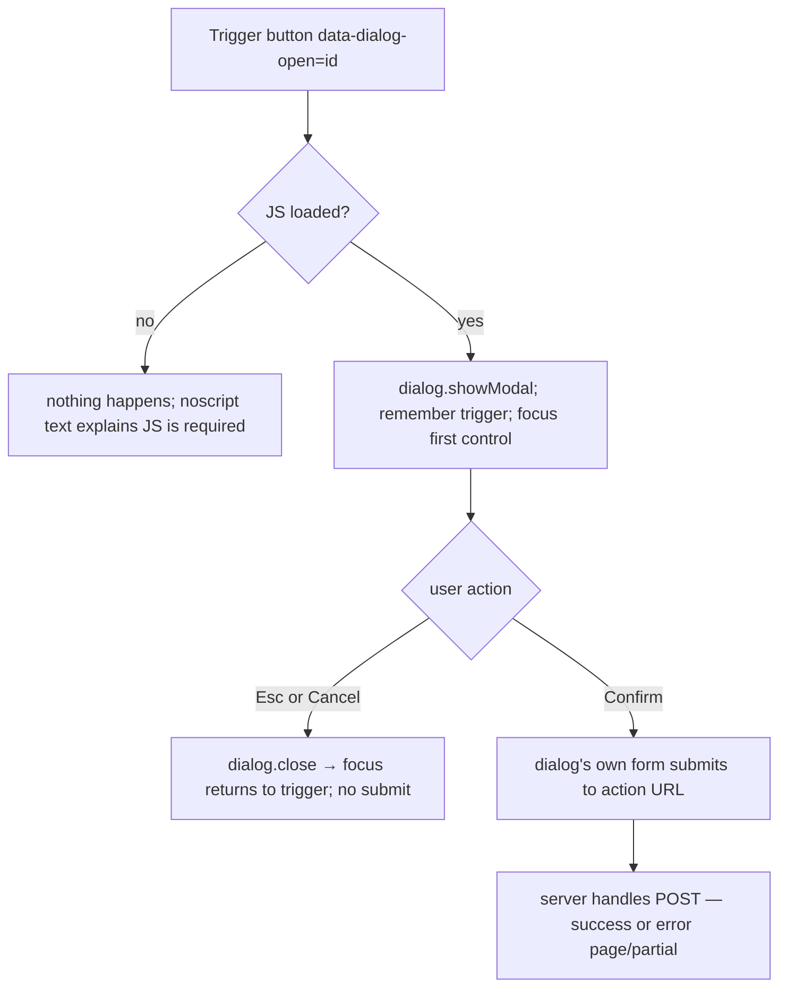

### Story 1.6: Molecule Primitives

**BUILDID**: CYCLE-1 | **GitHub**: LOCAL | **AzureDevOps**: LOCAL | **Epic**: 1 - Foundation | **ID**: 1.6 | **Date**: 2026-10-19
**File**: `docs/plans/stories/epic-1-story-1.6-Molecule-Primitives.md`
**Build Ref**: `docs/plans/builds/cycle-1/cycle-plan.md` — CYCLE-1 Foundation & Access (Workshop Day 3: the 16 primitives on `/_styleguide/`)
**Wave**: 3
**Requires**: [1.5]
**Enables**: [1.7, 2.2]
**Files Touched**:
  - src/infrastructure/web/templates/components/form_field.html
  - src/infrastructure/web/templates/components/alert.html
  - src/infrastructure/web/templates/components/card.html
  - src/infrastructure/web/templates/components/disabled_tile.html
  - src/infrastructure/web/templates/components/empty_state.html
  - src/infrastructure/web/templates/components/page_header.html
  - src/infrastructure/web/templates/components/confirm_dialog.html
  - src/infrastructure/web/templates/components/table.html
  - src/infrastructure/web/static/css/components/form_field.css
  - src/infrastructure/web/static/css/components/alert.css
  - src/infrastructure/web/static/css/components/card.css
  - src/infrastructure/web/static/css/components/disabled_tile.css
  - src/infrastructure/web/static/css/components/empty_state.css
  - src/infrastructure/web/static/css/components/page_header.css
  - src/infrastructure/web/static/css/components/confirm_dialog.css
  - src/infrastructure/web/static/css/components/table.css
  - src/infrastructure/web/static/js/ui.js
  - src/infrastructure/web/templatetags/ui.py
  - src/infrastructure/web/styleguide/**
  - src/infrastructure/web/templates/styleguide/**
  - src/infrastructure/i18n/locale/ro/LC_MESSAGES/django.po
  - src/infrastructure/i18n/locale/en/LC_MESSAGES/django.po
  - tests/integration/web/ui/test_molecules.py
**Roles Ref**: docs/requirements.md#roles--permissions-matrix — single-actor — no role variation (shared presentation components; any role-specific use is decided by the feature pages that include them)
**QA Candidate**: Yes — **Observable:** the styleguide shows the 8 molecules in both themes and languages:
- form field (single, and the RO | EN pair side by side)
- alert (info/success/warning/error, dismissible)
- card (plain and linked)
- disabled tile ("Unavailable", not clickable)
- empty state
- page header with breadcrumb and actions
- confirm dialog (opens, traps focus, closes with Esc, returns focus)
- data table (with caption, cells with pills/links, and its empty state)

The error pages (Story 1.1) and login page (Story 1.2) now look styled. **Mechanism:**
- Inclusion tags `ui_field`, `ui_field_pair`, `ui_alert`, `ui_card`, `ui_disabled_tile`, `ui_empty_state`, `ui_page_header`, `ui_confirm_dialog`, `ui_table` in `templatetags/ui.py`, with templates in `components/`.
- `Cell` dataclass for table cells.
- `static/js/ui.js` (CSP-safe external script) wires `data-dialog-open`, `data-dialog-close` and `data-dismiss`.
- `card.css`, `alert.css` and `form_field.css` also style the class hooks left by Stories 1.1/1.2 (`error-card`, `error-partial`, `login-card`, `form-banner`, `field-error`).

**Authz & preconditions:** none (presentation). **Edge & idempotency:**
- Invalid alert level or unknown table cell kind → `ValueError`.
- An empty table renders its empty state instead of an empty `<tbody>`.
- `ui_field` on a field with errors sets `aria-invalid` + `aria-describedby`.
- Dismissing an alert twice is a no-op.
- Opening an already-open dialog does nothing.
- Without JavaScript, the alert stays visible (no harm), and the dialog trigger is a `type="button"` that does nothing. JS is required for confirmations; the pilot browsers are managed desktops.

**Regression:** keyboard and screen-reader behaviour of the dialog (focus trap, Esc, focus return), labels for every input, error association, contrast in both themes, no inline script or style (CSP).

---

#### 👤 User Reference

**Description**:
This story builds the second layer of shared visual pieces, "molecules", which combine atoms into things people interact with:
- **Form field:** a properly labelled input with help text and error messages under it. There's a special side-by-side Romanian | English version so teachers always fill in both languages.
- **Message banner (alert):** for information, success, warnings and errors; it can be closed.
- **Card:** a box for things like a subject or a chapter, optionally clickable.
- **Unavailable tile:** for catalogue entries that exist but can't be used yet (all grades except grade 2). It looks clearly inactive, says "Unavailable", and can't be clicked or focused into.
- **Empty state:** "nothing here yet", with an optional action.
- **Page header:** title, "you are here" trail and action buttons.
- **Confirmation dialog:** "Are you sure?" before important or irreversible actions, such as submitting a test (students get one attempt) or blocking content. It works fully with the keyboard and screen readers.
- **Table:** for staff lists such as scores, which also shows a friendly message when empty.

It also gives the already-built error pages and sign-in page their final look.

**Acceptance Criteria** (plain-English):
- Every form input has a visible label; help text and errors are announced with the field.
- The Romanian | English field pair shows both languages side by side, clearly labelled.
- Message banners come in four kinds, each with an icon and words; they can be closed with the mouse or keyboard.
- Unavailable tiles look clearly inactive, say "Unavailable", can't be clicked and aren't reachable with Tab.
- Empty lists show a friendly message (and an action when one makes sense) instead of a blank area.
- The confirmation dialog opens on request, keeps keyboard focus inside itself, closes with Esc or "Cancel", and returns focus to the button that opened it.
- Tables have a caption and column headers that screen readers announce; when empty they show the empty-state message.
- The error pages and the sign-in page use these components' styling.
- All text is in Romanian and English; nothing uses inline scripts or styles.

**User Flow** (no role variation — shared components):

**User Journey** (developer/QA on the styleguide; end users meet these inside feature pages):
- **Entry**: with `DEBUG=True`, open `/ro/_styleguide/`. The Molecules section follows the Atoms section in both theme blocks.
- **Load**: `ui.js` loads as an external `defer` script (same origin); the component CSS loads from `/static/css/components/`.
- **Render**: examples of each molecule: a field (clean, with help, with error), an RO|EN pair, 4 alerts, plain and linked cards, a disabled tile, an empty state with an action, a page header with a 2-level breadcrumb, a dialog trigger, a table with rows (text, pill, link cells) and an empty table.
- **Interact**: click "Delete sample", and the dialog opens with focus on its first focusable element. Tab cycles inside it; Esc closes it and focus returns to the trigger. Click × on an alert and it's removed. The disabled tile can't be reached with Tab or activated.
- **Empty/error**: an empty table shows the empty-state message; a field with errors shows red text under the input and `aria-invalid="true"`.
- **Responsive**: desktop-only. The RO|EN pair is two equal columns of the 12-col grid (6+6); tables span full width (staff max 1200px).

**Flow Diagram** (confirm dialog interaction):



---

#### 🤖 AI Agent Reference

**Must Read**:
- `docs/ui-ux/ui-ux-spec.md`, `docs/ui-ux/08-visual-foundation.md` — tokens, molecule list, `error_display: inline+top_banner`, `confirm: [test_submit, block, clear, publish]`, `editors: ro_en_side_by_side`, a11y
- `docs/architecture/design/01-patterns-and-standards-greenfield.md` — §11.2 primitive catalogue, §11.4 a11y, §7.4 HTMX/no inline JS, §13
- `docs/plans/stories/epic-1-story-1.5-Design-Tokens-and-Atom-Primitives.md` — `ui.py` conventions, styleguide structure, tokens
- `docs/plans/stories/epic-1-story-1.1-Error-Handling-and-Observability.md` (class hooks `error-card`, `error-card__violations`, `error-card__ref`, `error-partial`)
- `docs/plans/stories/epic-1-story-1.2-Login-and-Session-Security.md` (class hooks `login-card`, `form-banner`, `form-banner--error`, `field-error`)

**Description**:
Adds the remaining 8 shared primitives as inclusion tags, templates and CSS. It also adds `static/js/ui.js`, a small dependency-free ES module, loaded via `<script type="module" src defer>` and CSP-compatible, which provides the dialog open/close/focus-return and alert dismissal through `data-*` attributes.

The confirm dialog **contains its own form** (`action`, hidden fields, optional extra fields template, e.g. the block-reason textarea in CYCLE-3), so confirmation never relies on intercepting another form.

Tables take `columns` and `rows` where each cell is a `str` (escaped) or a `Cell(text, href=None, pill=None)`. No raw HTML cells, so no `|safe`.

Adds a Molecules section to the styleguide (both themes) and styles the existing hooks from Stories 1.1/1.2.

**Design Tokens** (FE):
- **Form field:** label 600 weight (student 18px / staff 16px); input border 1px `#6B7280` (4.83:1), radius `var(--radius)`, min-height `var(--touch)`, padding 8px/12px (staff) or 12px/16px (student); help text `#4B5563` 14–16px; error text `#B91C1C` 600 + Phosphor `warning-circle` 20px; invalid input border 2px `#B91C1C`. Pair: two columns with a 24px gap, each labelled "Română" / "English" plus the field label.
- **Alert:** left border 4px + tinted bg — info `#0E7490`/`#CFFAFE`, success `#15803D`/`#DCFCE7`, warning `#B45309`/`#FEF3C7`, error `#B91C1C`/`#FEE2E2`; text `#1F2937`; icons: `bell` (info), `check-circle` (success), `warning-circle` (warning, error); close button × min 32px, `aria-label="Close"`.
- **Card:** surface `#FFFFFF`, radius `var(--radius)`, elevation-1, padding 24px (staff) / 32px (student); linked card hover elevation-2 + focus ring.
- **Disabled tile:** bg `#F3F4F6`, text `#4B5563` (≈6.9:1), dashed 1px `#6B7280` border, `lock-simple` 20px icon, label "Unavailable".
- **Empty state:** centred, icon 32px duotone (student) or regular (staff), message `#4B5563`, optional primary button.
- **Page header:** h1 32px/700 (student) or 24px/700 (staff); breadcrumb 14px `#4B5563` with `caret-right` separators; actions right-aligned.
- **Dialog:** surface, radius, elevation-3, max-width 480px, backdrop `rgba(31,41,55,.5)`, confirm button primary or danger.
- **Table:** header bg `#F5F7FA`, 600 weight; row border 1px `#F3F4F6`; cell padding 8px/12px; caption left-aligned 16px/600.
- Validation: on submit | Error: inline under the field + top banner via `ui_alert "error"`.

**Acceptance Criteria**:
1. `ui_field(field, help="")` renders the label (`for` = widget id), the widget (Django-rendered), help text (`id="<id>_help"`) and errors (`id="<id>_error"`; no live region is needed because errors render with the page after a full submit, and the top `ui_alert "error"` banner announces them). If errors exist the widget gets `aria-invalid="true"`, and `aria-describedby` lists help and error ids. Required fields show a visible "(required)" suffix, translated.
2. `ui_field_pair(field_ro, field_en)` renders a `<fieldset>` with `<legend>` = the shared label (the RO field's label without the language suffix), two columns labelled "Română" and "English" with `lang="ro"`/`lang="en"` on the inputs, and errors per column.
3. `ui_alert(level, message, dismissible=True)` accepts `info|success|warning|error` (otherwise `ValueError`). It renders `role="alert"` for error/warning and `role="status"` for info/success, plus icon and text, and a close button `data-dismiss` with `aria-label` "Close"/"Închide" when dismissible.
4. `ui_card(title, body="", href=None, icon=None, meta="")` renders `<article class="card">`. With `href`, the title is the link (single tab stop; the whole card is clickable via a CSS stretched-link pseudo-element, without nested links).
5. `ui_disabled_tile(title, reason="")` renders `<div class="tile tile--disabled" aria-disabled="true">` with the title, a `lock-simple` icon and the visible label "Unavailable" (+ optional reason). It has **no** `href`, no `tabindex`, and no interactive descendants.
6. `ui_empty_state(message, action_label="", action_url="", icon="list-checks")` renders the message, plus a link-styled-as-button only when both action args are given.
7. `ui_page_header(title, breadcrumbs=(), actions=())` renders `<header>` with `<h1>`, `<nav aria-label="Breadcrumb"><ol>` with `aria-current="page"` on the last item, and action links (`label, url, variant`).
8. `ui_confirm_dialog(dialog_id, title, body, confirm_label, action, confirm_variant="primary", hidden=None, extra_template=None)` renders:
   - a `<dialog id aria-labelledby aria-describedby>` containing `<form method="post" action>` with CSRF, hidden inputs and the optional ``
   - Cancel (`type="button" data-dialog-close`) and Confirm (`type="submit"`) buttons
   - a separate trigger tag, `ui_dialog_trigger(dialog_id, label, variant)`, rendering `<button type="button" data-dialog-open="id">` plus a `<noscript>` note "JavaScript is required to confirm this action."
9. `ui.js` behaviour:
   - `data-dialog-open` → `showModal()`, remembers the trigger, focuses the first focusable control in the dialog
   - `data-dialog-close` or Esc (native `cancel` event) → `close()`, focus returns to the trigger
   - `data-dismiss` → removes the closest `.alert`
   - idempotent: open when already open does nothing; dismiss twice does nothing
   - event delegation on `document`; no globals; no `eval`; no inline handlers
10. `ui_table(columns, rows, caption, empty_message)`:
    - renders `<table>` with `<caption>`, `<th scope="col">`, and cells from `str` or `Cell`
    - a `Cell` with `pill` renders `ui_status_pill`; with `href`, a link
    - an unknown cell type raises `ValueError`
    - empty `rows` render `ui_empty_state(empty_message)` instead of the table
11. CSS styles the 1.1/1.2 hooks: `error-card` and `login-card` (card styles, centred, max-width 560px), `error-card__violations`, `error-card__ref` (muted 14px), `error-partial` and `form-banner--error` (error alert styles), `field-error` (field error styles).
12. The styleguide shows all 8 molecules in both theme sections (`_molecules.html` included after `_atoms.html`) and loads `ui.js`.
13. Components use only tokens (no raw hex), with no inline `style`/`script`, no `|safe`, and no `!important`.
14. RO/EN translations for "(required)", "Close", "Unavailable", "Cancel", "Breadcrumb", "Română", "English", "JavaScript is required to confirm this action."

**RBAC Enforcement**:
No role-differentiated access — single actor.
- Components never decide access; feature views pass in only what the viewer may see. `ui_confirm_dialog` always renders `` in its form, and the receiving view enforces permissions (Story 1.3 decorators).

**System responses + error cases**:

| Trigger | Response | Side-effect |
|---------|----------|-------------|
| `` on an unbound form | label + input, no `aria-invalid` | none |
| Same on a bound form with errors | input `aria-invalid="true" aria-describedby="id_username_error"`; error text visible | none |
| `` | fieldset with two labelled columns, `lang` attributes | none |
| `` | `ValueError` | test failure |
| Click × on a dismissible alert | alert element removed | none server-side |
| Click × again / on an already-removed alert | no-op | none |
| Click a dialog trigger | dialog opens modally, focus inside | none |
| Click the trigger while the dialog is open | no-op | none |
| Press Esc in the dialog | dialog closes, focus back on the trigger, form **not** submitted | none |
| Click Confirm | the dialog's form POSTs to `action` with CSRF + hidden fields | handled by the receiving view |
| `` with `rows=[]` | empty-state block, no `<table>` | none |
| A table row cell is a `dict` | `ValueError("Unsupported cell")` | test failure |
| Tab key across a disabled tile | focus skips it | none |

**QA-observable behaviour**:
- In the styleguide, the RO|EN pair inputs carry `lang="ro"` and `lang="en"`. Screen readers announce "Title, Română" / "Title, English" (legend + column label).
- After a dialog closes by Esc, `document.activeElement` is the trigger button. The dialog element has `open` only while visible.
- A disabled tile has `aria-disabled="true"`, no `<a>`/`<button>` descendants, and isn't in the tab order.
- An empty table shows the message and `document.querySelectorAll("table").length` for that block is 0.
- The error and login pages show card styling (white surface, radius, shadow) and the error banner colours from the tokens.
- **What does NOT change**: atom tags and their output from Story 1.5 are untouched. No DB access. No new routes. The confirm dialog adds no server behaviour; it posts to an existing action.

**Prerequisites**:
- Story 1.5 merged (tokens, themes, atoms, `ui.py` conventions, styleguide skeleton).
- Stories 1.1 and 1.2 merged so their class hooks exist to verify styling (wave 2 completes before wave 3).

**Context**: `docs/ui-ux/ui-ux-spec.md`, `docs/ui-ux/08-visual-foundation.md`, `docs/architecture/design/01-patterns-and-standards-greenfield.md`, `src/infrastructure/web/templatetags/ui.py`, `src/infrastructure/web/templates/styleguide/index.html`, `src/infrastructure/web/templates/errors/_error.html`, `src/infrastructure/web/templates/accounts/login.html`

**Patterns**: UI Primitive Catalogue (§11.2), Accessibility (§11.4), HTMX & no inline JS (§7.4), Forms (§7.3), Security (§13) — see `docs/architecture/design/01-patterns-and-standards-greenfield.md`

**Steps**:

1. **Tests first** (`tests/integration/web/ui/test_molecules.py`).

2. **Tags** (append to `ui.py`; keep the 1.5 tags unchanged):
   ```python
   from dataclasses import dataclass

   ALERT_LEVELS = {"info": "bell", "success": "check-circle", "warning": "warning-circle",
                   "error": "warning-circle"}


   @dataclass(frozen=True)
   class Cell:
       text: str
       href: str | None = None
       pill: str | None = None  # a status for ui_status_pill


   @register.inclusion_tag("components/form_field.html")
   def ui_field(field, help: str = "") -> dict:
       widget_id = field.id_for_label
       described = [f"{widget_id}_help"] if help else []
       if field.errors:
           described.append(f"{widget_id}_error")
       attrs = {"aria-describedby": " ".join(described)} if described else {}
       if field.errors:
           attrs["aria-invalid"] = "true"
       return {"field": field, "widget": field.as_widget(attrs=attrs), "help": help, "id": widget_id}


   @register.inclusion_tag("components/alert.html")
   def ui_alert(level: str, message: str, dismissible: bool = True) -> dict:
       if level not in ALERT_LEVELS:
           raise ValueError(f"Unknown alert level: {level}")
       role = "alert" if level in {"error", "warning"} else "status"
       return {"level": level, "icon": ALERT_LEVELS[level], "message": message,
               "dismissible": dismissible, "role": role}


   @register.inclusion_tag("components/table.html")
   def ui_table(columns, rows, caption: str, empty_message: str) -> dict:
       for row in rows:
           for cell in row:
               if not isinstance(cell, (str, int, Cell)):
                   raise ValueError(f"Unsupported cell: {type(cell).__name__}")
       return {"columns": columns, "rows": rows, "caption": caption, "empty_message": empty_message}
   ```
   `ui_field_pair`, `ui_card`, `ui_disabled_tile`, `ui_empty_state`, `ui_page_header`, `ui_confirm_dialog` and `ui_dialog_trigger` follow the same pattern (validate, then build a context dict). `field.as_widget(attrs=…)` returns Django-escaped markup; templates output it with `{{ widget }}`, which Django already marks safe. **No `|safe` in our templates.**

3. **Templates** (excerpts):
   ```django
   {# components/form_field.html #}
   
   <div class="field field--invalid">
     <label class="field__label" for="{{ id }}">{{ field.label }}
       <span class="field__required"></span></label>
     {{ widget }}
     <p class="field__help" id="{{ id }}_help">{{ help }}</p>
     <p class="field__error field-error" id="{{ id }}_error">
       {{ field.errors.0 }}</p>
   </div>
   ```
   ```django
   {# components/confirm_dialog.html #}
   
   <dialog id="{{ dialog_id }}" class="dialog" aria-labelledby="{{ dialog_id }}-title" aria-describedby="{{ dialog_id }}-body">
     <form method="post" action="{{ action }}" class="dialog__form">
       
       <input type="hidden" name="{{ name }}" value="{{ value }}">
       <h2 id="{{ dialog_id }}-title">{{ title }}</h2>
       <p id="{{ dialog_id }}-body">{{ body }}</p>
       
       <div class="dialog__actions">
         <button type="button" class="button button--secondary" data-dialog-close></button>
         
       </div>
     </form>
   </dialog>
   ```
   ```django
   {# components/disabled_tile.html #}
   
   <div class="tile tile--disabled" aria-disabled="true">
     
     <span class="tile__title">{{ title }}</span>
     <span class="tile__status"></span>
     <span class="tile__reason">{{ reason }}</span>
   </div>
   ```

4. **`static/js/ui.js`** (ES module, no dependencies):
   ```javascript
   // Shared UI behaviour for primitives. Loaded as an external module (CSP: script-src 'self').
   const openers = new WeakMap();

   document.addEventListener('click', (event) => {
     const opener = event.target.closest('[data-dialog-open]');
     if (opener) {
       const dialog = document.getElementById(opener.dataset.dialogOpen);
       if (dialog && !dialog.open) {
         openers.set(dialog, opener);
         dialog.showModal();
         dialog.querySelector('input, textarea, select, button')?.focus();
       }
       return;
     }
     const closer = event.target.closest('[data-dialog-close]');
     if (closer) {
       closer.closest('dialog')?.close();
       return;
     }
     const dismiss = event.target.closest('[data-dismiss]');
     if (dismiss) {
       dismiss.closest('.alert')?.remove();
     }
   });

   // Native Esc fires "cancel" then "close"; return focus on every close.
   document.addEventListener('close', (event) => {
     if (event.target instanceof HTMLDialogElement) {
       openers.get(event.target)?.focus();
     }
   }, true);
   ```

5. **CSS:** one file per molecule (tokens only), including the hook styles from AC 11. Example:
   ```css
   /* static/css/components/card.css */
   .card, .error-card, .login-card { background: var(--color-surface); border-radius: var(--radius);
       box-shadow: var(--elevation-1); padding: var(--space-6); }
   .theme-student .card, .theme-student .login-card { padding: var(--space-8); }
   .error-card, .login-card { max-width: 560px; margin: var(--space-12) auto; }
   .card--link { position: relative; }
   .card--link .card__title a::after { content: ""; position: absolute; inset: 0; }
   .card--link:hover { box-shadow: var(--elevation-2); }
   .error-card__ref { color: var(--color-muted); font-size: var(--font-14); }
   ```

6. **Styleguide:** add `templates/styleguide/_molecules.html` (sample unbound and bound forms built in `styleguide/views.py`, sample rows with `Cell` objects, an empty table, a dialog posting to `#`). Include it after `_atoms.html` in both theme sections, and load `<script type="module" src=""></script>` in the styleguide content block. Story 1.7 adds `ui.js` to `layouts/base.html` for all pages.

7. **Translations,** then **run all gates.**

**Tests**:

```python
# tests/integration/web/ui/test_molecules.py
import pytest
from django import forms
from django.template import Context, Template
from django.utils import translation

from infrastructure.web.templatetags.ui import Cell


def render(source: str, **context) -> str:
    with translation.override("en"):
        return Template("" + source).render(Context(context))


class SampleForm(forms.Form):
    title_ro = forms.CharField(label="Title")
    title_en = forms.CharField(label="Title")


def test_field_without_errors_has_label_and_no_invalid_flag():
    html = render("", f=SampleForm())

    assert '<label class="field__label" for="id_title_ro">' in html
    assert "aria-invalid" not in html
    assert "(required)" in html


def test_field_with_errors_is_associated_and_flagged():
    form = SampleForm(data={})
    form.is_valid()

    html = render('', f=form)

    assert 'aria-invalid="true"' in html
    assert 'aria-describedby="id_title_ro_help id_title_ro_error"' in html
    assert 'id="id_title_ro_error"' in html


def test_field_pair_labels_languages():
    html = render("", f=SampleForm())

    assert "<fieldset" in html and "<legend" in html
    assert 'lang="ro"' in html and 'lang="en"' in html
    assert "Română" in html and "English" in html


@pytest.mark.parametrize(("level", "role"), [("error", "alert"), ("warning", "alert"),
                                            ("info", "status"), ("success", "status")])
def test_alert_roles(level, role):
    assert f'role="{role}"' in render("", lvl=level)


def test_alert_rejects_unknown_level():
    with pytest.raises(ValueError):
        render('')


def test_disabled_tile_is_not_interactive():
    html = render('')

    assert 'aria-disabled="true"' in html
    assert "<a " not in html and "<button" not in html and "tabindex" not in html
    assert "Unavailable" in html


def test_confirm_dialog_contains_its_own_csrf_form():
    html = render('',
                  csrf_token="tok")

    assert '<dialog id="d1"' in html
    assert 'action="/x/"' in html and 'name="csrfmiddlewaretoken"' in html
    assert "data-dialog-close" in html


def test_dialog_trigger_has_noscript_fallback_text():
    html = render('')

    assert 'data-dialog-open="d1"' in html and 'type="button"' in html
    assert "<noscript>" in html


def test_table_renders_cells_and_header_scope():
    rows = [["Ana", Cell("Active", pill="ACTIVE"), Cell("Open", href="/ro/x/")]]

    html = render('', cols=["Name", "Status", "Link"], rows=rows)

    assert html.count('scope="col"') == 3
    assert "pill--active" in html and 'href="/ro/x/"' in html
    assert "<caption" in html


def test_empty_table_renders_empty_state_instead():
    html = render('', cols=["Name"], rows=[])

    assert "<table" not in html
    assert "No scores yet." in html


def test_table_rejects_unsupported_cells():
    with pytest.raises(ValueError):
        render('', cols=["x"], rows=[[{"html": "<b>"}]])


def test_breadcrumb_marks_current_page():
    html = render('', crumbs=[("Catalogue", "/ro/catalogue/"), ("Chapter 1", "")])

    assert 'aria-label="Breadcrumb"' in html
    assert 'aria-current="page"' in html
```

Manual (in the styleguide, both themes):
- Open the dialog with the mouse and the keyboard (Enter on the trigger). Tab cycles inside; Esc closes and focus returns to the trigger. Confirm posts to `#`.
- Dismiss each alert with the mouse and with Enter on ×.
- Tab across the page and confirm the disabled tile is skipped.
- Screen reader (VoiceOver): field label, "(required)", help and error are announced; the table caption and headers are announced.
- Open `/ro/does-not-exist` and `/ro/accounts/login/` and confirm card styling and the error banner colours.

**Quality**: ruff 0; mypy passes; tests pass; coverage ≥85%; tokens only; no inline `style`/`script`; no `|safe`; no `!important`; `ui.js` has no globals and no `eval`; no `TODO`.

**OUT**:
- ❌ Including `ui.js` and `htmx.min.js` in `layouts/base.html`, flash messages and the top bar (Story 1.7).
- ❌ The block-reason textarea and any feature-specific dialog content (CYCLE-3 uses `extra_template`).
- ❌ Feature organisms (catalogue grid, editors, queues).
- ❌ JS unit-test tooling; dialog behaviour is verified by Playwright in Story 1.10.
- ❌ Toast notifications (rejected in UX patterns).

**Evidence**: pytest output, coverage %, styleguide screenshots of the Molecules section in both themes (including an open dialog and a field with errors), screenshots of the restyled 404 and login pages, and a short screen-recording or step log of the keyboard dialog test, all recorded in `docs/stories-implemented/story-1.6-review.md` under "## DoD Evidence".
