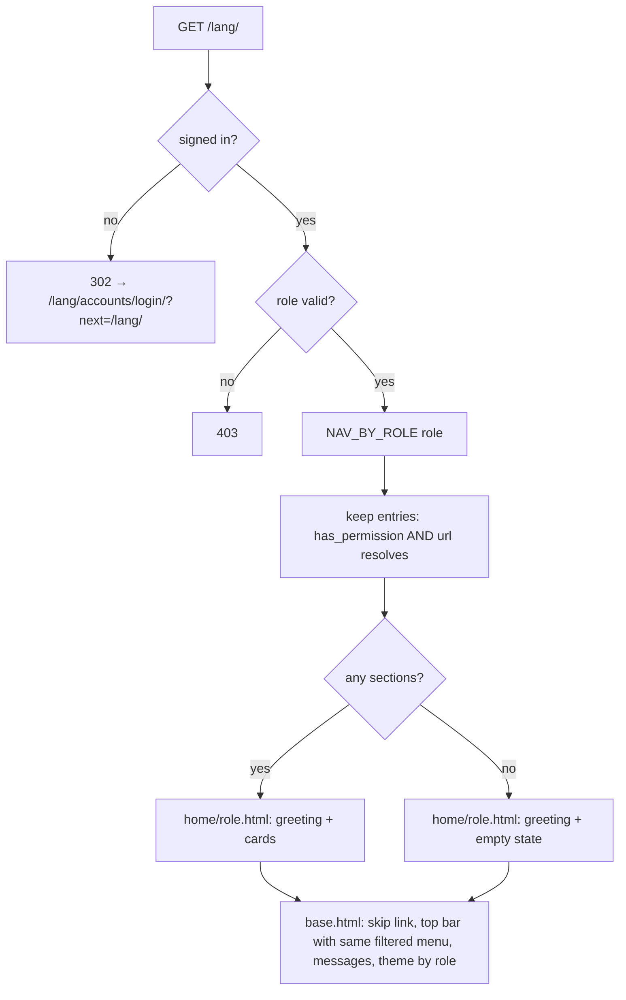

### Story 1.7: App Shell & Role Homes

**BUILDID**: CYCLE-1 | **GitHub**: LOCAL | **AzureDevOps**: LOCAL | **Epic**: 1 - Foundation | **ID**: 1.7 | **Date**: 2026-10-19
**File**: `docs/plans/stories/epic-1-story-1.7-App-Shell-and-Role-Homes.md`
**Build Ref**: `docs/plans/builds/cycle-1/cycle-plan.md` — CYCLE-1 Foundation & Access (Workshop Day 3–4: base layout, top navigation per role, role home pages)
**Wave**: 4
**Requires**: [1.2, 1.3, 1.4, 1.6]
**Enables**: [1.10]
**Files Touched**:
  - src/infrastructure/web/templates/layouts/base.html
  - src/infrastructure/web/templates/layouts/_top_bar.html
  - src/infrastructure/web/templates/layouts/_nav.html
  - src/infrastructure/web/templates/layouts/_messages.html
  - src/infrastructure/web/static/css/layout.css
  - src/infrastructure/web/static/js/htmx.min.js
  - src/infrastructure/web/templatetags/navigation.py
  - src/infrastructure/web/home/**
  - src/infrastructure/web/templates/home/**
  - src/config/urls.py
  - src/infrastructure/web/common/decorators.py
  - src/infrastructure/i18n/locale/ro/LC_MESSAGES/django.po
  - src/infrastructure/i18n/locale/en/LC_MESSAGES/django.po
  - tests/integration/web/test_role_access_matrix.py
  - tests/integration/web/home/**
**Roles Ref**: docs/requirements.md#roles--permissions-matrix — personas this story differentiates: Student, Teacher, Parent/Guardian, Admin
**QA Candidate**: Yes — **Observable:** every page shares one layout:
- skip link
- top bar with brand, a role-specific menu, the RO|EN switcher and an avatar menu with "Sign out"
- flash messages shown as alerts
- student theme for Students and signed-out visitors, staff theme for Teachers, Parents and Admins

`/<lang>/` shows a role-specific home with a greeting and cards for the sections that role can use. **Mechanism:**
- `layouts/base.html` (theme class from `user.role`, CSRF header for HTMX, `htmx-config` meta, external `htmx.min.js` + `ui.js`)
- `` / `` tags (`templatetags/navigation.py`) build menu entries from the `NAV_BY_ROLE` registry (`web/home/navigation.py`). They keep only entries whose permission the role holds (`has_permission`) and whose URL name resolves (`NoReverseMatch` → skipped), so later features appear automatically when their routes ship.
- `home:index` (`/<lang>/`, `@require_authenticated`) renders `home/<role>.html`.

**Authz & preconditions:** signed in for the home; the menu never shows a link whose permission the role lacks; anonymous → login. **Edge & idempotency:**
- A role with no available sections sees an empty state instead of a blank page.
- A corrupt role gets 403 (Story 1.3).
- Reloading is side-effect free (GET only).
- Messages appear once and are consumed.
- A missing route for a registry entry is silently skipped; no 500.
- The logout button posts (no GET logout).

**Regression:** the per-role menu contents (no privilege-revealing links), home access matrix rows, theme per role, keyboard navigation (skip link, avatar menu), CSP compliance of HTMX (no inline styles or eval), language switch from every page.

---

#### 👤 User Reference

**Description**:
This story gives the platform its frame: what every page looks like around its content.
- **Top bar:** across the top of every page, showing the platform name (which leads home), the menu for the person's role, the Romanian | English switch and a round user icon. The icon opens a small menu with the person's name and a "Sign out" button.
- **Messages:** short messages such as "Saved" or "Something needs your attention" appear just under the bar.
- **Themes:** students (and anyone not yet signed in) see the warm, larger, rounder student theme; teachers, parents and administrators see the calmer staff theme.
- **Home pages:** after signing in, each person lands on a home page for their role. It greets them by name and offers big cards for the sections they can use. A student sees "Learn" (the catalogue) and, later, "My progress". A teacher will see their dashboard, scores and notifications as those features are built. A parent will see "My children". An administrator sees "Accounts" and, later, moderation, scores and the pilot dashboard.

Menus and cards only ever show sections the person is allowed to use, so children never see links to teacher or admin tools.

**Acceptance Criteria** (plain-English):
- Every page has the same top bar and a "Skip to content" link for keyboard users.
- The menu shows only sections the person's role can use; sections that don't exist yet appear automatically once they're built.
- Students and signed-out visitors see the student theme; teachers, parents and administrators see the staff theme.
- The user menu shows the person's name and a "Sign out" button that ends the session.
- The language switch is in the top bar on every page.
- Confirmation and error messages appear under the top bar and disappear after being shown once.
- Each role's home page greets the person by name and shows a card for each available section; if none are available yet, a friendly message is shown.
- Someone not signed in who opens a home page is sent to sign in.
- Everything works with the keyboard and screen readers, and the page loads no outside resources.

**User Flow** (role-differentiated):

### Student
**Scenario / narrative**: As a 7-year-old Student, I sign in on the classroom laptop and land on my home page. It's warm and colourful, says "Hello, Ana!", and shows one big "Learn" card that opens the subject catalogue. The top bar has only things meant for me: Home, Learn and (later) My progress. I never see teacher or admin links. If a teacher shows me a link to their editor, I get the "Access denied" page. When I click my avatar I see my name and a big "Sign out" button.
**Steps**:
1. The browser requests `/ro/`. `home:index` (`@require_authenticated`) sees `request.user.role == "STUDENT"`.
2. The view builds cards via `available_sections(user)`: `NAV_BY_ROLE[STUDENT]` entries filtered by `has_permission` and resolvable URL names (`catalogue:index` resolves once Story 2.2 ships).
3. It renders `home/student.html` inside `base.html` with `body.theme-student`.
4. The top bar's `` renders the same filtered entries with `aria-current="page"` on Home.

### Teacher
**Scenario / narrative**: As a Teacher, I sign in and see the calm staff theme with my name. In this first release my home shows a short welcome and an empty-state message, because my authoring dashboard, scores and notifications arrive in later cycles. When they ship, they appear in my menu and as cards without any change to this page. I never see the admin's Accounts link.
**Steps**:
1. `home:index` sees TEACHER and resolves sections (`content:teacher_dashboard`, `progress:scores`, `notifications:list`), which are skipped while unresolvable.
2. With no cards it renders `ui_empty_state` ("Your tools will appear here as they become available.") in `body.theme-staff`.

### Parent/Guardian
**Scenario / narrative**: As a Parent, I sign in and see a welcome page in the staff theme. Once my children's progress pages exist (CYCLE-3), a "My children" card appears. Until then I see a friendly empty state. I can switch to English from the top bar, and my choice is remembered.
**Steps**:
1. `home:index` sees PARENT; the section `progress:children` (permission `child-progress:view`) is skipped until it exists.
2. `home/parent.html` renders the greeting + empty state; the switcher posts to `/i18n/setlang/` (Story 1.4).

### Admin
**Scenario / narrative**: As the Admin, I land on a staff-themed home with an "Accounts" card that opens the administration area, where I create accounts and link parents. Moderation, scores and the pilot dashboard cards appear as those features ship. If I open a student-only page by URL, I get "Access denied".
**Steps**:
1. `home:index` sees ADMIN; `admin:index` resolves (Story 1.9), so the Accounts card renders (permission `accounts:manage`).
2. Other admin entries (`moderation:queue`, `progress:scores`, `reporting:pilot`) are skipped until they resolve.

**Flow Diagram**:



---

#### 🤖 AI Agent Reference

**Must Read**:
- `docs/ui-ux/ui-ux-spec.md`, `docs/ui-ux/08-visual-foundation.md` — `nav: top_bar_64px`, role menus, themes, `max_width`, a11y (`skip_link`), `success_feedback: banner`
- `docs/architecture/design/01-patterns-and-standards-greenfield.md` — §7.4 HTMX (CSRF via `hx-headers`, no inline JS, vendored htmx), §11.1 templates, §11.2 primitives (reuse!), §11.4 a11y
- `docs/architecture/design/00-system-architecture-greenfield.md` — route catalogue (role menus), Security Design (CSP)
- `docs/plans/stories/epic-1-story-1.3-RBAC-Core.md` — `require_authenticated`, `has_permission`, role-access-matrix harness
- `docs/plans/stories/epic-1-story-1.4-Internationalization.md` — `components/language_switcher.html`
- `docs/plans/stories/epic-1-story-1.6-Molecule-Primitives.md` — `ui_alert`, `ui_card`, `ui_empty_state`, `ui_page_header`, `ui.js`

**Description**:
1. **Full `layouts/base.html`:**
   - `<html lang>` = current language
   - `<meta name="htmx-config" content='{"includeIndicatorStyles":false,"allowEval":false,"allowScriptTags":false}'>`: CSP-safe, because HTMX 2 would otherwise inject an inline `<style>`
   - CSS: `tokens.css`, the component CSS files and `layout.css`
   - deferred `htmx.min.js` (vendored 2.0.x, version in the file header) and `ui.js` as a module
   - `<body class="theme-…" hx-headers='{"X-CSRFToken": "…"}'>`
   - skip link, ``, `<main id="content" tabindex="-1">`, flash messages via `ui_alert`
   - blocks `title`, `content`, `extra_css`
2. **Navigation registry** (`web/home/navigation.py`): `NAV_BY_ROLE: Mapping[Role, tuple[NavEntry, ...]]`, where `NavEntry(label, url_name, permission | None, icon, description)`. `available_sections(user)` filters by permission and URL resolvability.
3. **Tags** (`templatetags/navigation.py`): `` (top-bar links with `aria-current`) and `` (cards for the home). The same registry feeds both, so menus and homes never disagree.
4. **Home:** `home:index` view (`@require_authenticated`) at the `i18n_patterns` root `""` rendering `home/student.html`, `teacher.html`, `parent.html` or `admin.html`.
5. **Matrix rows:** role-access-matrix rows for the home.

**Design Tokens** (FE):
- Top bar: height 64px, bg `#FFFFFF`, bottom border 1px `#F3F4F6`, elevation-1, fixed at the top (`position: sticky`). Brand 20px/700 `#1F2937` + Phosphor `house` (duotone student / regular staff). Nav links 16px/600 (staff) or 18px/600 (student), `#1F2937`; current link `#0E7490` with a 3px bottom border `#0E7490`; hover `#155E75`. Gap 24px (student) / 16px (staff).
- Avatar menu: `<details>` with summary = `ui_avatar` (32px staff / 44px student); panel surface `#FFFFFF`, elevation-2, radius `var(--radius)`, padding 16px; name 16px/600; role label 14px `#4B5563`; "Sign out" = `ui_button` secondary with the `sign-out` icon.
- Skip link: visually hidden until focused; on focus top-left, bg `#0E7490`, text `#FFFFFF`, padding 8px 16px.
- Main: max-width 960px (student) / 1200px (staff), centred, padding 32px (student) / 24px (staff). Messages stack under the top bar with a 16px gap.
- Home: greeting h1 40px/700 (student) or 32px/700 (staff). Cards in a 3-column grid (student, 24px gap) or 4-column grid (staff, 16px gap), each `ui_card` with icon 32px, title and description.
- Theme: `theme-student` → bg `#FFF8EC`, base 18px, radius 16px, touch 44px; `theme-staff` → bg `#F5F7FA`, base 16px, radius 8px, touch 32px.

> **Hand-offs from implemented stories (2026-10-22)**. These are binding for this story:
> - **Story 1.1 review v1 ISS-003, error pages must render without the database:** the top bar reads `request.user` (session → DB). Render `errors/*.html` from a minimal layout without the top bar, **or** guard the top bar so a `DatabaseError` while resolving the user renders it as anonymous. Add a test: with every DB cursor raising, the 500 page still renders the localized page and the reference id (and `/healthz` still answers 503, see BUG-002).
> - **Story 1.4 hand-off, `/` redirect:** once `home:index` exists at `/<lang>/`, add tests for `GET /` → `302 /ro/` (no cookie), `/en/` with `Accept-Language: en`, and the cookie language when set (Story 1.4 AC 2).
> - **Story 1.4:** include `components/language_switcher.html` in the top bar and link `css/components/language_switcher.css`.

**Acceptance Criteria**:
1. `base.html`:
   - `<html lang="{{ LANGUAGE_CODE }}">`
   - the `htmx-config` meta as above
   - `<link>`s for `css/tokens.css`, every `css/components/*.css` and `css/layout.css`
   - `<script src="" defer></script>` and `<script type="module" src=""></script>`
   - `<body class="theme-stafftheme-student" hx-headers='{"X-CSRFToken": "{{ csrf_token }}"}'>`
   - a skip link `<a class="skip-link" href="#content">` first in the body
   - `<main id="content" tabindex="-1">`
   - **no** inline `<script>`/`<style>`/`style=""`
2. Flash messages (`django.contrib.messages`) render under the top bar through `ui_alert`, with the level mapping `debug/info→info`, `success→success`, `warning→warning`, `error→error`, and are consumed after display.
3. `_top_bar.html` (for everyone):
   - brand link to `home:index` (signed in) or `accounts:login` (anonymous)
   - for signed-in users, `` as `<nav aria-label="Main">` with an `<ul>` of links, and `aria-current="page"` on the link whose URL matches `request.path`
   - the language switcher (Story 1.4 component)
   - for signed-in users, the avatar menu: `<details class="user-menu">` / `<summary>` with `ui_avatar` and `aria-label="Account menu"`, a panel with full name, translated role label, and a POST form to `accounts:logout` with `` and a "Sign out" button
3a. Anonymous users see brand + switcher only.
4. `NAV_BY_ROLE` (exact, in order):
   - Student: Home (`home:index`), Learn (`catalogue:index`, `lessons:view`), My progress (`progress:me`, `scores:view-own`)
   - Teacher: Home, Dashboard (`content:teacher_dashboard`, `content:edit`), Scores (`progress:scores`, `scores:view-all`), Notifications (`notifications:list`, `content:edit`)
   - Parent/Guardian: Home, My children (`progress:children`, `child-progress:view`)
   - Admin: Home, Accounts (`admin:index`, `accounts:manage`), Moderation (`moderation:queue`, `content:review`), Scores (`progress:scores`, `scores:view-all`), Pilot (`reporting:pilot`, `accounts:manage`)

   The URL names match the architecture route catalogue. Entries whose names don't resolve yet are skipped.
5. `available_sections(user)` returns entries where `permission is None or has_permission(role, permission)` **and** `reverse(url_name)` succeeds. An invalid role returns `()`. It never raises for unknown URL names.
6. `home:index` → `/<lang>/` (name `home:index`, `@require_authenticated`). It renders `home/<role-lowercase>.html` with `greeting_name` (first word of `full_name`) and `sections` (`available_sections` minus Home). Status 200 for all four roles; anonymous → 302 to login with `next`; corrupt role → 403.
7. Each home template uses `ui_page_header`-style headings (one `<h1>`), `ui_card` for each section (title, description and icon from the registry, `href` = reversed URL), and `ui_empty_state` when `sections` is empty.
8. The role-access-matrix gains rows `("anonymous", "/ro/", 302)` and `(role, "/ro/", 200)` for each of Student, Teacher, Parent/Guardian, Admin.
9. A test proves no menu or card link points to a route whose permission the role lacks: for every role, every rendered href resolves to a view whose `required_permissions` ⊆ the role's permissions.
10. `htmx.min.js` is vendored (2.0.x), served from `/static/` with its version comment intact. No CDN URL appears anywhere.
11. RO/EN translations for every new string ("Skip to content", "Main", "Account menu", "Sign out", "Hello, %(name)s!", role labels, section titles and descriptions, the empty-state texts).

**RBAC Enforcement**:

| Persona | Permission key | Guarded route/endpoint | Allowed | Denied behavior | UI when denied |
|---------|----------------|------------------------|---------|-----------------|----------------|
| Student | (authenticated) | `GET /<lang>/` `home:index` | yes | n/a | n/a |
| Teacher | (authenticated) | `GET /<lang>/` | yes | n/a | n/a |
| Parent/Guardian | (authenticated) | `GET /<lang>/` | yes | n/a | n/a |
| Admin | (authenticated) | `GET /<lang>/` | yes | n/a | n/a |
| Anonymous | — | `GET /<lang>/` | no | `302` → login with `next` | sign-in page |
| Any role | per `NAV_BY_ROLE` entry | menu links / home cards | only if `has_permission` | link not rendered | section absent from menu and home |

- **Enforcement point(s):** `@require_authenticated` on `home:index` (`web/home/views.py`); `available_sections()` filters presentation; each target view keeps its own `@require_permission` (hiding is convenience, the server check is the guarantee).
- **Denied-access contract:** a corrupt role → 403 (Story 1.3). Links a role lacks are **not rendered** (hidden, not disabled).
- **Scope derivation:** the role and the greeting name come only from `request.user` (session). No query parameter influences the menu or home content.

**System responses + error cases**:

| Trigger | Response | Side-effect |
|---------|----------|-------------|
| Student `GET /ro/` | `200` `home/student.html`, `body.theme-student`, menu Home/Learn* | none (*Learn when `catalogue:index` resolves) |
| Teacher `GET /en/` | `200` `home/teacher.html`, `theme-staff`, empty state while no teacher routes exist | none |
| Parent `GET /ro/` | `200` `home/parent.html`, empty state until `progress:children` exists | none |
| Admin `GET /ro/` | `200` `home/admin.html` with the Accounts card | none |
| Same GET repeated | identical `200` | none |
| Anonymous `GET /ro/` | `302 /ro/accounts/login/?next=/ro/` | none |
| User with corrupt role `GET /ro/` | `403` | none |
| Registry entry with an unresolvable URL name | entry silently skipped | none (no 500) |
| A view adds `messages.success(request, "Saved")` then redirects | the next page shows a success alert once | message consumed |
| Avatar menu → "Sign out" | POST `/ro/accounts/logout/` → `302` login | session flushed (Story 1.2) |
| Any page | CSP header unchanged and **no** CSP violation from HTMX (indicator styles off, eval off) | none |

**QA-observable behaviour**:
- For each role, the set of `<nav aria-label="Main">` hrefs equals the expected subset of `NAV_BY_ROLE` for currently resolvable routes. A Student's page contains no `/admin/`, `/teach/` or `/manage/` hrefs.
- `<body>` class is `theme-student` for Student and anonymous visitors, `theme-staff` for Teacher, Parent and Admin.
- The skip link is the first focusable element. Activating it moves focus to `<main id="content">`.
- The avatar `<summary>` has `aria-label="Account menu"`; the panel contains the user's full name and a POST form to `/<lang>/accounts/logout/`.
- The browser console shows zero CSP violations on the home pages.
- **What does NOT change**: no DB writes on any home or layout render. Story 1.2 login/logout behaviour, Story 1.4 switcher behaviour and existing routes are unchanged. The error pages keep their status codes, now inside the full layout.

**Prerequisites**:
- Stories 1.2 (login/logout, role fixtures), 1.3 (decorators, matrix harness), 1.4 (language switcher) and 1.6 (molecules, `ui.js`) merged.
- Story 2.2 runs in parallel (wave 4). The Student "Learn" entry appears once `catalogue:index` exists, with no coordination needed.
- Download htmx 2.0.x (`htmx.min.js`, BSD-2 licence header kept) once into `static/js/`.

**Context**: `docs/ui-ux/ui-ux-spec.md`, `docs/ui-ux/08-visual-foundation.md`, `docs/architecture/design/00-system-architecture-greenfield.md`, `docs/architecture/design/01-patterns-and-standards-greenfield.md`, `src/infrastructure/web/common/decorators.py`, `src/infrastructure/web/templatetags/ui.py`

**Patterns**: Web Layer thin views (§7.1), Authorization decorator (§7.2), HTMX (§7.4), Templates & primitives (§11.1–11.2), Accessibility (§11.4) — see `docs/architecture/design/01-patterns-and-standards-greenfield.md`

**Steps**:

1. **Tests first:** `tests/integration/web/home/test_home.py`, `test_navigation.py`, and the new matrix rows.

2. **Navigation registry:**
   ```python
   # src/infrastructure/web/home/navigation.py
   from collections.abc import Mapping
   from dataclasses import dataclass

   from django.urls import NoReverseMatch, reverse
   from django.utils.translation import gettext_lazy as _

   from domain.accounts.permissions import Permission as P
   from domain.accounts.permissions import has_permission
   from domain.accounts.roles import Role, parse_role


   @dataclass(frozen=True)
   class NavEntry:
       label: str
       url_name: str
       permission: P | None
       icon: str
       description: str = ""


   HOME = NavEntry(_("Home"), "home:index", None, "house")
   NAV_BY_ROLE: Mapping[Role, tuple[NavEntry, ...]] = {
       Role.STUDENT: (HOME,
                      NavEntry(_("Learn"), "catalogue:index", P.LESSONS_VIEW, "book-open", _("Choose a subject")),
                      NavEntry(_("My progress"), "progress:me", P.SCORES_VIEW_OWN, "chart-bar", _("See your results"))),
       Role.TEACHER: (HOME,
                      NavEntry(_("Dashboard"), "content:teacher_dashboard", P.CONTENT_EDIT, "chalkboard-teacher",
                               _("Write lessons, exercises and tests")),
                      NavEntry(_("Scores"), "progress:scores", P.SCORES_VIEW_ALL, "chart-bar", _("Pilot results")),
                      NavEntry(_("Notifications"), "notifications:list", P.CONTENT_EDIT, "bell", _("Messages about your content"))),
       Role.PARENT: (HOME,
                     NavEntry(_("My children"), "progress:children", P.CHILD_PROGRESS_VIEW, "users",
                              _("Progress and scores of your children"))),
       Role.ADMIN: (HOME,
                    NavEntry(_("Accounts"), "admin:index", P.ACCOUNTS_MANAGE, "shield-check",
                             _("Create accounts and link parents")),
                    NavEntry(_("Moderation"), "moderation:queue", P.CONTENT_REVIEW, "flag", _("Review flagged content")),
                    NavEntry(_("Scores"), "progress:scores", P.SCORES_VIEW_ALL, "chart-bar", _("Pilot results")),
                    NavEntry(_("Pilot"), "reporting:pilot", P.ACCOUNTS_MANAGE, "list-checks", _("Readiness and completion"))),
   }


   def available_sections(user) -> tuple[tuple[NavEntry, str], ...]:
       """(entry, url) pairs the user may use and that exist; unshipped features are skipped."""
       role = parse_role(getattr(user, "role", ""))
       if role is None:
           return ()
       result = []
       for entry in NAV_BY_ROLE[role]:
           if entry.permission is not None and not has_permission(role, entry.permission):
               continue
           try:
               result.append((entry, reverse(entry.url_name)))
           except NoReverseMatch:
               continue
       return tuple(result)
   ```

3. **Tags:**
   ```python
   # src/infrastructure/web/templatetags/navigation.py
   from django import template

   from infrastructure.web.home.navigation import available_sections

   register = template.Library()


   @register.inclusion_tag("layouts/_nav.html", takes_context=True)
   def role_nav(context) -> dict:
       request = context["request"]
       return {"items": [(entry, url, url == request.path) for entry, url in available_sections(request.user)]}


   @register.inclusion_tag("home/_cards.html", takes_context=True)
   def role_home_cards(context) -> dict:
       sections = [(e, url) for e, url in available_sections(context["request"].user) if e.url_name != "home:index"]
       return {"sections": sections}
   ```

4. **View and URLs:**
   ```python
   # src/infrastructure/web/home/views.py
   from django.shortcuts import render

   from infrastructure.web.common.decorators import require_authenticated

   _TEMPLATES = {"STUDENT": "home/student.html", "TEACHER": "home/teacher.html",
                 "PARENT": "home/parent.html", "ADMIN": "home/admin.html"}


   @require_authenticated
   def index(request):
       """GET /<lang>/ — any signed-in user; role-specific home."""
       greeting = (request.user.full_name or "").split(" ")[0]
       return render(request, _TEMPLATES[request.user.role], {"greeting_name": greeting})
   ```
   ```python
   # src/infrastructure/web/home/urls.py
   from django.urls import path

   from infrastructure.web.home import views

   app_name = "home"
   urlpatterns = [path("", views.index, name="index")]
   ```
   In `config/urls.py`, inside `i18n_patterns`, append `path("", include("infrastructure.web.home.urls"))` **after** the accounts include (one block per context, alphabetical).

5. **Templates:** `base.html` (AC 1), `_top_bar.html`, `_nav.html`, `home/student.html` (greeting + ``), the other role templates, `home/_cards.html` (grid of `ui_card`; `ui_empty_state` when empty).
   ```django
   {# layouts/base.html (body excerpt) #}
   
   <body class="theme-stafftheme-student"
         hx-headers='{"X-CSRFToken": "{{ csrf_token }}"}'>
     <a class="skip-link" href="#content"></a>
     
     
     <main id="content" tabindex="-1"></main>
   </body>
   ```
   ```django
   {# layouts/_messages.html — Django's "debug" level has no alert style, so it maps to info #}
   
   <div class="messages">
     
       
       
     
   </div>
   ```

6. **Layout CSS** (`static/css/layout.css`, tokens only): top bar, nav, user menu, skip link, main widths per theme, card grid.

7. **Matrix rows** (append to `ROWS` in `test_role_access_matrix.py`):
   ```python
   # Story 1.7 — home
   ROWS += [("anonymous", "/ro/", 302)] + [(r, "/ro/", 200) for r in ("Student", "Teacher", "Parent/Guardian", "Admin")]
   ```

8. **Translations,** then **run all gates.** Check the browser console for CSP violations.

**Tests**:

```python
# tests/integration/web/home/test_home.py
import pytest
from django.contrib import messages
from django.shortcuts import redirect
from django.urls import path

from config.urls import urlpatterns as root_urlpatterns
from tests.factories.accounts import UserFactory

pytestmark = pytest.mark.django_db


def _add_message_and_redirect(request):
    messages.success(request, "Saved")
    return redirect("/en/")


# Used only by test_flash_message_rendered_once via @pytest.mark.urls(__name__).
urlpatterns = [path("add-message", _add_message_and_redirect)] + root_urlpatterns


@pytest.mark.parametrize(("fixture", "template", "theme"), [
    ("student_client", "home/student.html", "theme-student"),
    ("teacher_client", "home/teacher.html", "theme-staff"),
    ("parent_client", "home/parent.html", "theme-staff"),
    ("admin_client", "home/admin.html", "theme-staff"),
])
def test_each_role_gets_its_home_and_theme(request, fixture, template, theme):
    response = request.getfixturevalue(fixture).get("/en/")

    assert response.status_code == 200
    assert template in [t.name for t in response.templates]
    assert f'class="{theme}"' in response.content.decode()


def test_anonymous_is_redirected_to_login(client):
    assert client.get("/ro/")["Location"] == "/ro/accounts/login/?next=/ro/"


def test_greeting_uses_first_name(client):
    client.force_login(UserFactory(role="STUDENT", full_name="Ana Maria Pop"))

    assert "Ana" in client.get("/en/").content.decode()


def test_role_without_sections_sees_empty_state(teacher_client):
    html = teacher_client.get("/en/").content.decode()

    assert "Your tools will appear here as they become available." in html


def test_layout_has_skip_link_first_and_no_inline_scripts(student_client):
    html = student_client.get("/en/").content.decode()
    body = html.split("<body", 1)[1]

    assert body.index('class="skip-link"') < body.index("<nav")
    assert "<script>" not in html and "style=" not in html
    assert 'name="htmx-config"' in html and '"allowEval":false' in html


@pytest.mark.urls(__name__)
def test_flash_message_rendered_once(student_client):
    first = student_client.get("/add-message", follow=True).content.decode()
    second = student_client.get("/en/").content.decode()

    assert "Saved" in first and 'role="status"' in first
    assert "Saved" not in second
```

```python
# tests/integration/web/home/test_navigation.py
import re

import pytest
from django.urls import resolve

from domain.accounts.permissions import ROLE_PERMISSIONS
from domain.accounts.roles import Role

pytestmark = pytest.mark.django_db
ROLE_FIXTURES = {Role.STUDENT: "student_client", Role.TEACHER: "teacher_client",
                 Role.PARENT: "parent_client", Role.ADMIN: "admin_client"}


@pytest.mark.parametrize("role", list(Role))
def test_every_rendered_link_is_permitted_for_the_role(request, role):
    html = request.getfixturevalue(ROLE_FIXTURES[role]).get("/ro/").content.decode()
    nav_and_cards = re.findall(r'href="(/ro/[^"#?]*)"', html)

    for href in nav_and_cards:
        match = resolve(href)
        required = set(getattr(match.func, "required_permissions", ()))
        if match.namespace == "admin":
            assert role is Role.ADMIN
        else:
            assert required <= set(ROLE_PERMISSIONS[role]), f"{role} sees forbidden link {href}"


def test_student_never_sees_staff_links(student_client):
    html = student_client.get("/ro/").content.decode()

    assert not re.search(r'href="/ro/(admin|teach|manage|scores)/', html)


def test_unresolvable_entries_are_skipped_not_raised(student_client):
    # progress:me ships in CYCLE-3; the page must still render.
    assert student_client.get("/ro/").status_code == 200


def test_current_page_is_marked(student_client):
    assert 'aria-current="page"' in student_client.get("/ro/").content.decode()
```

Manual:
- Sign in as each role (accounts created in Django admin once Story 1.9 lands, or via the shell before). Check the menu items, theme, greeting and cards.
- Tab from the top of the page: the skip link appears first; Enter moves focus to the content. Open the avatar menu with the keyboard and sign out.
- Switch RO/EN from the top bar on the home page and on an error page.
- Dev tools: zero CSP violations; network panel shows only same-origin requests (htmx, ui.js, CSS, font, sprite).

**Quality**: ruff 0; mypy passes; lint-imports kept; tests pass; coverage ≥85%; no inline `script`/`style`; no external URLs; reuses primitives (no duplicate card/alert/empty-state markup); no `TODO`.

**OUT**:
- ❌ Feature pages behind the registry entries (catalogue Story 2.2; dashboard, scores, children, moderation, notifications, pilot in CYCLE-2/3).
- ❌ The teacher notification badge in the top bar (CYCLE-3 adds it with notifications).
- ❌ Django admin restriction and account management (Story 1.9).
- ❌ `hx-boost` site-wide progressive navigation (not required; standard links are used).
- ❌ Mobile/tablet navigation patterns (desktop-only per the UI/UX spec).

**Evidence**: pytest output (home, navigation, matrix rows), coverage %, screenshots of the four role homes (RO and EN for one role), the avatar menu open, the skip link focused, and a console screenshot with no CSP violations, all recorded in `docs/stories-implemented/story-1.7-review.md` under "## DoD Evidence".
