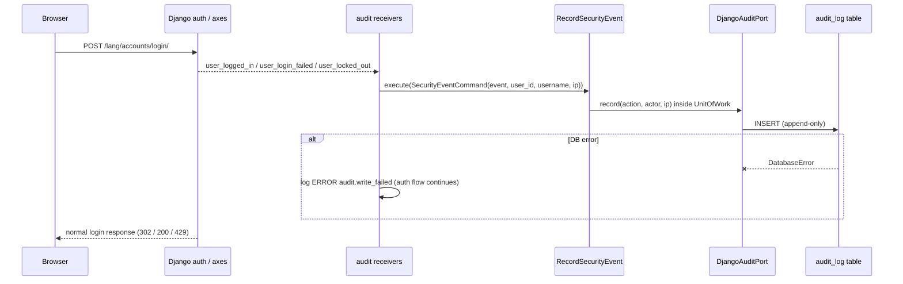

### Story 1.8: Audit Log

**BUILDID**: CYCLE-1 | **GitHub**: LOCAL | **AzureDevOps**: LOCAL | **Epic**: 1 - Foundation | **ID**: 1.8 | **Date**: 2026-10-19
**File**: `docs/plans/stories/epic-1-story-1.8-Audit-Log.md`
**Build Ref**: `docs/plans/builds/cycle-1/cycle-plan.md` — CYCLE-1 Foundation & Access (Workshop Day 2: audit log entries for logins and account actions)
**Wave**: 2
**Requires**: [1.0]
**Enables**: [1.9]
**Files Touched**:
  - src/application/common/audit.py
  - src/application/common/unit_of_work.py
  - src/application/accounts/record_security_event.py
  - src/infrastructure/persistence/audit/**
  - src/infrastructure/persistence/common/unit_of_work.py
  - src/infrastructure/container.py
  - src/config/settings/base.py
  - tests/fakes/**
  - tests/unit/application/accounts/test_record_security_event.py
  - tests/integration/persistence/audit/**
**Roles Ref**: docs/requirements.md#roles--permissions-matrix — single-actor — no role variation (security events are recorded identically for Student, Teacher, Parent/Guardian and Admin; *viewing* the log is added by Story 1.9 for the Admin role)
**QA Candidate**: Yes — **Observable:** after a sign-in, sign-out, failed sign-in or lockout, exactly one matching row appears in `audit_log`, with action, actor (id + username), IP and UTC timestamp. Rows can't be edited or deleted through the application. **Mechanism:**
- `RecordSecurityEvent` (application) writes through `AuditPort` inside a `UnitOfWork`.
- `DjangoAuditPort` stores `AuditLogModel` rows using the injected `Clock`.
- Receivers in `persistence/audit/receivers.py` (connected in `AuditConfig.ready`) translate Django's `user_logged_in` / `user_logged_out` / `user_login_failed` and axes' `user_locked_out` into commands.
- `AuditLogModel.save()` refuses updates and `delete()` raises; the custom queryset blocks `update()`/`delete()`.
- `DjangoUnitOfWork` becomes the shared transaction boundary (and the container switches Story 1.4's use case to it).

**Authz & preconditions:** none to *record* (system actor); nothing is readable through any route in this story. **Edge & idempotency:**
- Each event fires once per real occurrence (no dedup is needed; a second login is a second row).
- A failed login for an unknown username records `(unknown):<fingerprint>` with no actor id, never the typed text (owner decision 2026-10-22).
- The password is never read (Django passes cleansed credentials; only `username` is used).
- When the audit write fails (e.g. a locked DB), the auth flow continues and an `ERROR` `audit.write_failed` log line is emitted. Authentication events are best-effort by decision; business actions in later stories audit inside their own transaction (fail-closed).

**Regression:** one row per event type, no password or DOB in any row, append-only enforcement, actor `SET_NULL` on account deletion keeping `actor_username`. Compliance-relevant: this is the platform's who-did-what record for children's data.

---

#### 👤 User Reference

**Description**:
The platform holds children's personal data, so the team needs a reliable record of security-relevant events: who signed in and when, who signed out, failed sign-in attempts, and when an account got locked after too many wrong passwords. This story creates that record, the "audit log".

**What it records:**
- each entry: what happened, who did it (when known), from which network address, and exactly when (in universal time)
- **sign-in events now;** later stories add account changes, parent links, content moderation and test submissions to the same log

**How it's protected:**
- **Append-only:** entries can only be added, never changed or deleted through the platform, so the record can be trusted.
- **No sensitive values:** passwords, dates of birth and answers are never written to it.
- **Survives deletion:** if an account is later deleted, its past entries remain with the username they had.

**What this story doesn't do:**
- There's no screen to view the log here. Story 1.9 lets administrators read it (read-only) in the administration area.
- The log doesn't change anyone's experience. If the log can't be written for a moment, people can still sign in, and the team is alerted through the server's error records.

**Acceptance Criteria** (plain-English):
- Every successful sign-in and sign-out creates one audit entry naming the person.
- Every failed sign-in creates one audit entry with the username that was tried, even if no such account exists.
- Every lockout after too many failed attempts creates one audit entry.
- Each entry records the action, the person (if known), the network address and the time.
- Entries never contain passwords, dates of birth, test answers or other sensitive content.
- Entries can't be edited or deleted through the platform.
- When an account is deleted, its earlier entries stay, still showing the username.
- If writing an entry fails, signing in still works and the failure is reported in the server's error records.

**User Flow**:
Actor: system — no role variation.

**Flow Diagram**:



---

#### 🤖 AI Agent Reference

**Must Read**:
- `docs/architecture/design/00-system-architecture-greenfield.md` — Security Design (Audit row), Data Model (`AUDIT_LOG`), Observability ("logs vs audit")
- `docs/architecture/design/01-patterns-and-standards-greenfield.md` — §5 (use case + UoW + composition root), §6.3 (repositories, UoW code), §9 (never-log list; logs vs audit), §12.2 (fakes, `FixedClock`)
- `docs/plans/stories/epic-1-story-1.2-Login-and-Session-Security.md` — axes configuration (`user_locked_out` signal), login/logout views
- `docs/plans/stories/epic-1-story-1.4-Internationalization.md` — container entry to switch to `DjangoUnitOfWork`
- `docs/plans/stories/epic-1-story-1.1-Error-Handling-and-Observability.md` — `Clock` port, `SystemClock`, JSON logging

**Description**:
1. **Shared application ports** (`application/common/`):
   - `UnitOfWork` Protocol (patterns §5)
   - `AuditPort` Protocol: `record(action, *, actor_id=None, actor_username="", target=None, metadata=None, ip_address=None) -> None`. Every later story that must audit depends on it.
2. **Use case** `RecordSecurityEvent` with `SecurityEvent` StrEnum (`auth.login`, `auth.logout`, `auth.login_failed`, `auth.lockout`).
3. **Infrastructure:**
   - `persistence/common/unit_of_work.py::DjangoUnitOfWork`
   - `persistence/audit/` app (label `audit`) with `AuditLogModel` (append-only), `DjangoAuditPort(clock)` and `receivers.py`
   - migration `0001`
4. **Composition root:**
   - `record_security_event()` factory
   - switch `update_preferred_language()` from `transaction.atomic` to `DjangoUnitOfWork` (Story 1.4 note)
5. **Test fakes** shared by every later application test: `FakeUnitOfWork`, `FakeAuditPort`, `FixedClock`.

> **Best-effort vs fail-closed decision:** authentication signals fire inside Django's auth flow. A transient audit failure (SQLite busy beyond the 20 s timeout) must not stop a child from signing in or out, so receivers catch `DatabaseError`, log `ERROR audit.write_failed` with the event name (no PII), and continue. The exception isn't swallowed silently: it becomes an alertable log line. Business use cases (moderation, submissions, links) call `AuditPort.record` **inside** their own UoW, so a failure rolls the business change back.

> **Owner decision (2026-10-22, review v1 ISS-003):** a failed sign-in or lockout stores the typed username **only if it belongs to an existing account**; otherwise `(unknown):<8-hex HMAC-SHA256 fingerprint keyed with SECRET_KEY>`, so a password mistyped into the username field is never stored, while repeated attempts with the same text stay correlatable. `RecordSecurityEvent` takes two extra ports for this: `UsernameDirectory.exists()` and a `Fingerprint` callable. Also from review v1: sensitive metadata keys are matched as case-insensitive fragments (ISS-001), and SQLite triggers (migration `audit 0002`) make `audit_log` append-only in the database itself (ISS-002).

**Acceptance Criteria**:
1. `application/common/unit_of_work.py` defines `UnitOfWork(Protocol)` with `__enter__`/`__exit__`. `application/common/audit.py` defines `AuditPort(Protocol)` with the `record` signature above, where `target: tuple[str, str] | None` is `(target_type, target_id)` and `metadata: Mapping[str, str | int | bool] | None`.
2. `RecordSecurityEvent(audit, uow).execute(cmd)` with `SecurityEventCommand(event: SecurityEvent, username: str, user_id: int | None, ip_address: str | None)` writes exactly one `audit.record(event.value, actor_id=…, actor_username=…, ip_address=…)` inside the UoW. An empty `username` for `LOGIN_FAILED` and `LOCKOUT` is recorded as `"(empty)"`. Usernames are truncated to 150 chars.
3. `AuditLogModel` (`db_table="audit_log"`):
   - `actor` FK → `AUTH_USER_MODEL`, `null=True`, `on_delete=SET_NULL`, `related_name="+"`
   - `actor_username` CharField(150)
   - `action` CharField(64, db_index)
   - `target_type` CharField(32, blank)
   - `target_id` CharField(64, blank)
   - `metadata` JSONField(default=dict)
   - `ip_address` GenericIPAddressField(null)
   - `created_at` DateTimeField(db_index)
   - `Meta.ordering = ["-created_at"]`
   - indexes on `(action, created_at)` and `(actor, created_at)`
4. Append-only:
   - `AuditLogModel.save()` raises `PermissionError("audit_log is append-only")` when `self.pk` is set and `_state.adding` is False
   - `AuditLogModel.delete()` raises
   - `AuditLogModel.objects` is a queryset whose `update()` and `delete()` raise
   - user deletion still works, because the FK uses `SET_NULL` via a direct DB update, which the test proves
5. `DjangoAuditPort(clock)` stores `created_at = clock.now()` (aware UTC). It rejects metadata containing any key in `FORBIDDEN_METADATA_KEYS = {"password", "date_of_birth", "dob", "answer", "answers", "response", "token"}` with `ValueError`.
6. Receivers (connected in `AuditConfig.ready()` with `dispatch_uid`s so they never double-connect):
   - `user_logged_in` → `auth.login` (actor = user)
   - `user_logged_out` → `auth.logout` (actor = user, or skipped when `user is None`)
   - `user_login_failed` → `auth.login_failed` (`credentials.get("username", "")`, actor None)
   - `axes.signals.user_locked_out` → `auth.lockout` (username, ip)

   IP comes from `axes.helpers.get_client_ip_address(request)` (honours the axes proxy settings) or `None` without a request.
7. Receivers catch `django.db.DatabaseError` from the use case, log `ERROR` `audit.write_failed` with `{"audit_action": <event>}` and re-raise nothing. Any **other** exception propagates.
8. `DjangoUnitOfWork` per patterns §6.3. `container.py` exposes `record_security_event()` and rewires `update_preferred_language()` to `DjangoUnitOfWork`.
9. `INSTALLED_APPS` gains `"infrastructure.persistence.audit"` (uses `apps.AuditConfig`); `makemigrations --check` is clean.
10. `tests/fakes/` provides `FakeUnitOfWork` (counts enters/commits/rollbacks), `FakeAuditPort` (stores records in a list), `FixedClock(at)`. They're importable as `from tests.fakes import FakeAuditPort, FakeUnitOfWork, FixedClock`.
11. Coverage: `application/common` and `application/accounts/record_security_event.py` 100%; overall ≥85%.

**RBAC Enforcement**:
No role-differentiated access — single actor.
- No route reads or writes the audit log in this story. The actor identity recorded is taken from the signal's `user` (server-side auth) or, for failures, the attempted username only when it matches an existing account (otherwise a keyed fingerprint); it's never inferred from other request input. Read access for the Admin role is Story 1.9.

**System responses + error cases**:

| Trigger | Response | Side-effect |
|---------|----------|-------------|
| Successful login (any role) | unchanged login response (302) | +1 row `auth.login`, actor = user, `actor_username`, IP, `created_at` |
| Second successful login later (repeat) | 302 | +1 more row (each occurrence recorded) |
| Logout | unchanged (302) | +1 row `auth.logout` |
| Logout when signal sends `user=None` | unchanged | no row |
| Wrong password for existing user | unchanged (200 form) | +1 row `auth.login_failed`, actor NULL, `actor_username` = typed username |
| Unknown username | unchanged (200) | +1 row `auth.login_failed`, `actor_username` = `(unknown):<8-hex fingerprint>` (typed text never stored) |
| 5th failure → lockout | unchanged (429) | +1 `auth.login_failed` **and** +1 `auth.lockout` |
| Audit insert raises `DatabaseError` | login response unchanged | no row; `ERROR audit.write_failed` JSON log line with `audit_action` |
| Code calls `entry.save()` on an existing row | `PermissionError` | none |
| Code calls `AuditLogModel.objects.all().delete()` / `.update(...)` | exception | none |
| Account deleted | — | its audit rows remain; `actor_id` → NULL, `actor_username` preserved |
| `record(..., metadata={"password": "x"})` | `ValueError` | none |

**QA-observable behaviour**:
- After one login + one logout by `ana`, `audit_log` has exactly two rows for her: `auth.login`, `auth.logout`. Both have `actor_id = ana.id`, `actor_username = "ana"`, a non-null `ip_address` (127.0.0.1 in tests) and `created_at` in UTC.
- After 5 wrong passwords, there are 5 `auth.login_failed` rows and 1 `auth.lockout` row for that username.
- `SELECT metadata FROM audit_log` contains no `password`, `date_of_birth` or answer keys.
- After deleting a user, their rows remain with `actor_id IS NULL` and the original `actor_username`.
- **What does NOT change**: the login/logout/lockout HTTP responses (status, redirects, cookies) are identical to Story 1.2. No user rows change. No audit row is ever updated or deleted by the application.

**Prerequisites**:
- Story 1.0 merged. `application/accounts/__init__.py` exists (seed).
- Story 1.1's `Clock`/`SystemClock` and Story 1.2's axes setup are created in the **same wave**. Unit tests use `FixedClock` and dispatch the signals directly (`user_locked_out.send(...)`), so they don't depend on 1.2's settings. Integration through the real login view is asserted in Story 1.10.
- `django-axes` is installed (locked in the seed), so `axes.signals` and `axes.helpers` are importable even before 1.2 adds `axes` to `INSTALLED_APPS`.

**Context**: `docs/architecture/design/00-system-architecture-greenfield.md`, `docs/architecture/design/01-patterns-and-standards-greenfield.md`, `src/infrastructure/container.py`, `src/config/settings/base.py`

**Patterns**: Application use case (§5), Repository & Unit of Work (§6.3), Logging vs audit (§9), Fakes & FixedClock (§12.2), Adapter pattern for `DjangoAuditPort` (§15) — see `docs/architecture/design/01-patterns-and-standards-greenfield.md`

**Steps**:

1. **Fakes and unit tests first** (`tests/fakes/__init__.py` re-exporting from `audit.py`, `uow.py`, `clock.py`).
   ```python
   # tests/fakes/clock.py
   from datetime import UTC, datetime


   class FixedClock:
       def __init__(self, at: datetime = datetime(2026, 11, 2, 9, 0, tzinfo=UTC)) -> None:
           self.at = at

       def now(self) -> datetime:
           return self.at
   ```
   ```python
   # tests/fakes/audit.py
   class FakeAuditPort:
       def __init__(self) -> None:
           self.records: list[dict] = []

       def record(self, action, *, actor_id=None, actor_username="", target=None, metadata=None, ip_address=None):
           self.records.append({"action": action, "actor_id": actor_id, "actor_username": actor_username,
                                "target": target, "metadata": dict(metadata or {}), "ip_address": ip_address})
   ```
   ```python
   # tests/fakes/uow.py
   class FakeUnitOfWork:
       def __init__(self) -> None:
           self.entered = self.committed = self.rolled_back = 0

       def __enter__(self):
           self.entered += 1
           return self

       def __exit__(self, exc_type, exc, tb):
           if exc_type is None:
               self.committed += 1
           else:
               self.rolled_back += 1
           return False
   ```

2. **Ports and use case** (application layer; stdlib + domain only):
   ```python
   # src/application/common/audit.py
   from collections.abc import Mapping
   from typing import Protocol


   class AuditPort(Protocol):
       def record(self, action: str, *, actor_id: int | None = None, actor_username: str = "",
                  target: tuple[str, str] | None = None,
                  metadata: Mapping[str, str | int | bool] | None = None,
                  ip_address: str | None = None) -> None: ...
   ```
   ```python
   # src/application/accounts/record_security_event.py
   from dataclasses import dataclass
   from enum import StrEnum

   from application.common.audit import AuditPort
   from application.common.unit_of_work import UnitOfWork

   MAX_USERNAME = 150


   class SecurityEvent(StrEnum):
       LOGIN = "auth.login"
       LOGOUT = "auth.logout"
       LOGIN_FAILED = "auth.login_failed"
       LOCKOUT = "auth.lockout"


   @dataclass(frozen=True)
   class SecurityEventCommand:
       event: SecurityEvent
       username: str
       user_id: int | None = None
       ip_address: str | None = None


   class RecordSecurityEvent:
       def __init__(self, audit: AuditPort, uow: UnitOfWork) -> None:
           self._audit, self._uow = audit, uow

       def execute(self, cmd: SecurityEventCommand) -> None:
           username = (cmd.username or "(empty)")[:MAX_USERNAME]
           with self._uow:
               self._audit.record(cmd.event.value, actor_id=cmd.user_id, actor_username=username,
                                  ip_address=cmd.ip_address)
   ```

3. **Model (append-only) and port implementation:**
   ```python
   # src/infrastructure/persistence/audit/models.py
   from django.conf import settings
   from django.db import models


   class _AppendOnlyQuerySet(models.QuerySet):
       def update(self, **kwargs):
           raise PermissionError("audit_log is append-only")

       def delete(self):
           raise PermissionError("audit_log is append-only")


   class AuditLogModel(models.Model):
       actor = models.ForeignKey(settings.AUTH_USER_MODEL, null=True, on_delete=models.SET_NULL, related_name="+")
       actor_username = models.CharField(max_length=150)
       action = models.CharField(max_length=64, db_index=True)
       target_type = models.CharField(max_length=32, blank=True)
       target_id = models.CharField(max_length=64, blank=True)
       metadata = models.JSONField(default=dict)
       ip_address = models.GenericIPAddressField(null=True)
       created_at = models.DateTimeField(db_index=True)

       objects = _AppendOnlyQuerySet.as_manager()

       class Meta:
           db_table = "audit_log"
           ordering = ["-created_at"]
           indexes = [models.Index(fields=["action", "created_at"]), models.Index(fields=["actor", "created_at"])]

       def save(self, *args, **kwargs):
           if not self._state.adding:
               raise PermissionError("audit_log is append-only")
           super().save(*args, **kwargs)

       def delete(self, *args, **kwargs):
           raise PermissionError("audit_log is append-only")
   ```
   > **Why user deletion still works:** Django's deletion collector finds related rows through the model's `_base_manager`, a plain `Manager` with the default `QuerySet`, not through `objects`. So `SET_NULL` updates bypass `_AppendOnlyQuerySet`, while application code using `AuditLogModel.objects` is blocked. **Don't** set `Meta.base_manager_name`. `test_deleting_user_keeps_rows_with_username` guards this.
   ```python
   # src/infrastructure/persistence/audit/repositories.py
   from collections.abc import Mapping

   from domain.common.clock import Clock
   from infrastructure.persistence.audit.models import AuditLogModel

   FORBIDDEN_METADATA_KEYS = frozenset({"password", "date_of_birth", "dob", "answer", "answers", "response", "token"})


   class DjangoAuditPort:
       def __init__(self, clock: Clock) -> None:
           self._clock = clock

       def record(self, action, *, actor_id=None, actor_username="", target=None, metadata=None, ip_address=None):
           data: Mapping = metadata or {}
           if leaked := FORBIDDEN_METADATA_KEYS & set(data):
               raise ValueError(f"Forbidden audit metadata keys: {sorted(leaked)}")
           target_type, target_id = target or ("", "")
           AuditLogModel.objects.create(
               actor_id=actor_id, actor_username=actor_username, action=action, target_type=target_type,
               target_id=str(target_id), metadata=dict(data), ip_address=ip_address,
               created_at=self._clock.now())
   ```

4. **Receivers** (`persistence/audit/receivers.py`) and `apps.py`:
   ```python
   import logging

   from axes.helpers import get_client_ip_address
   from axes.signals import user_locked_out
   from django.contrib.auth.signals import user_logged_in, user_logged_out, user_login_failed
   from django.db import DatabaseError
   from django.dispatch import receiver

   from application.accounts.record_security_event import SecurityEvent, SecurityEventCommand
   from infrastructure import container

   logger = logging.getLogger(__name__)


   def _record(event: SecurityEvent, username: str, user_id=None, request=None) -> None:
       ip = get_client_ip_address(request) if request is not None else None
       try:
           container.record_security_event().execute(SecurityEventCommand(event, username, user_id, ip))
       except DatabaseError:
           # Auth must not fail because the audit write failed; this line is alertable.
           logger.error("audit.write_failed", extra={"audit_action": event.value})


   @receiver(user_logged_in, dispatch_uid="audit.login")
   def on_login(sender, request, user, **kwargs):
       _record(SecurityEvent.LOGIN, user.get_username(), user.pk, request)


   @receiver(user_logged_out, dispatch_uid="audit.logout")
   def on_logout(sender, request, user, **kwargs):
       if user is not None:
           _record(SecurityEvent.LOGOUT, user.get_username(), user.pk, request)


   @receiver(user_login_failed, dispatch_uid="audit.login_failed")
   def on_login_failed(sender, credentials, request=None, **kwargs):
       _record(SecurityEvent.LOGIN_FAILED, credentials.get("username", ""), None, request)


   @receiver(user_locked_out, dispatch_uid="audit.lockout")
   def on_lockout(sender, request, username, ip_address, **kwargs):
       _record(SecurityEvent.LOCKOUT, username or "", None, request)
   ```
   ```python
   # src/infrastructure/persistence/audit/apps.py
   from django.apps import AppConfig


   class AuditConfig(AppConfig):
       name = "infrastructure.persistence.audit"
       label = "audit"

       def ready(self) -> None:
           from infrastructure.persistence.audit import receivers  # noqa: F401 — connects signals
   ```

5. **Container** (append an `audit` block; edit the `accounts` block entry):
   ```python
   from application.accounts.record_security_event import RecordSecurityEvent
   from infrastructure.persistence.audit.repositories import DjangoAuditPort
   from infrastructure.persistence.common.unit_of_work import DjangoUnitOfWork
   from infrastructure.system_clock import SystemClock


   def record_security_event() -> RecordSecurityEvent:
       return RecordSecurityEvent(DjangoAuditPort(SystemClock()), DjangoUnitOfWork())


   def update_preferred_language() -> UpdatePreferredLanguage:  # rewired from transaction.atomic
       return UpdatePreferredLanguage(DjangoUserPreferences(), DjangoUnitOfWork)
   ```

6. **Settings and migration:** add `"infrastructure.persistence.audit"` to `INSTALLED_APPS`, then `makemigrations audit`.

7. **Run all gates.**

**Tests**:

```python
# tests/unit/application/accounts/test_record_security_event.py
import pytest

from application.accounts.record_security_event import (
    RecordSecurityEvent, SecurityEvent, SecurityEventCommand)
from tests.fakes import FakeAuditPort, FakeUnitOfWork


@pytest.fixture
def setup():
    audit, uow = FakeAuditPort(), FakeUnitOfWork()
    return RecordSecurityEvent(audit, uow), audit, uow


@pytest.mark.parametrize("event", list(SecurityEvent))
def test_each_event_records_one_entry_in_a_unit_of_work(setup, event):
    use_case, audit, uow = setup

    use_case.execute(SecurityEventCommand(event, "ana", 7, "10.0.0.1"))

    assert audit.records == [{"action": event.value, "actor_id": 7, "actor_username": "ana",
                              "target": None, "metadata": {}, "ip_address": "10.0.0.1"}]
    assert (uow.entered, uow.committed) == (1, 1)


def test_empty_username_is_recorded_explicitly(setup):
    use_case, audit, _ = setup

    use_case.execute(SecurityEventCommand(SecurityEvent.LOGIN_FAILED, ""))

    assert audit.records[0]["actor_username"] == "(empty)"


def test_long_username_is_truncated(setup):
    use_case, audit, _ = setup

    use_case.execute(SecurityEventCommand(SecurityEvent.LOGIN_FAILED, "x" * 500))

    assert len(audit.records[0]["actor_username"]) == 150
```

```python
# tests/integration/persistence/audit/test_audit_log.py
import pytest
from axes.signals import user_locked_out
from django.contrib.auth.signals import user_logged_in, user_logged_out, user_login_failed
from django.db import DatabaseError

from infrastructure.persistence.audit.models import AuditLogModel
from infrastructure.persistence.audit.repositories import DjangoAuditPort
from tests.factories.accounts import UserFactory
from tests.fakes import FixedClock

pytestmark = pytest.mark.django_db


def test_login_and_logout_signals_write_rows(rf):
    user = UserFactory(username="ana")
    request = rf.get("/", REMOTE_ADDR="127.0.0.1")

    user_logged_in.send(sender=type(user), request=request, user=user)
    user_logged_out.send(sender=type(user), request=request, user=user)

    rows = list(AuditLogModel.objects.order_by("created_at", "id").values_list("action", "actor_id", "actor_username"))
    assert rows == [("auth.login", user.pk, "ana"), ("auth.logout", user.pk, "ana")]


def test_failed_login_records_attempted_username_never_password(rf):
    user_login_failed.send(sender=None, credentials={"username": "ghost", "password": "********"},
                           request=rf.post("/"))

    row = AuditLogModel.objects.get()
    assert (row.action, row.actor_id, row.actor_username) == ("auth.login_failed", None, "ghost")
    assert "password" not in row.metadata


def test_lockout_signal_records_lockout(rf):
    user_locked_out.send(sender="axes", request=rf.post("/"), username="ana", ip_address="127.0.0.1")

    assert AuditLogModel.objects.get().action == "auth.lockout"


def test_rows_are_append_only():
    DjangoAuditPort(FixedClock()).record("auth.login", actor_username="ana")
    row = AuditLogModel.objects.get()

    with pytest.raises(PermissionError):
        row.save()
    with pytest.raises(PermissionError):
        row.delete()


def test_deleting_user_keeps_rows_with_username():
    user = UserFactory(username="ana")
    DjangoAuditPort(FixedClock()).record("auth.login", actor_id=user.pk, actor_username="ana")

    user.delete()

    row = AuditLogModel.objects.get()
    assert (row.actor_id, row.actor_username) == (None, "ana")


def test_forbidden_metadata_is_rejected():
    with pytest.raises(ValueError, match="password"):
        DjangoAuditPort(FixedClock()).record("x", metadata={"password": "secret"})


def test_audit_failure_does_not_break_login_signal(rf, monkeypatch, capfd):
    def boom(*args, **kwargs):
        raise DatabaseError("database is locked")

    monkeypatch.setattr(DjangoAuditPort, "record", boom)
    user = UserFactory()

    user_logged_in.send(sender=type(user), request=rf.get("/"), user=user)  # must not raise

    assert "audit.write_failed" in capfd.readouterr().out


def test_created_at_comes_from_injected_clock():
    clock = FixedClock()
    DjangoAuditPort(clock).record("auth.login", actor_username="ana")

    assert AuditLogModel.objects.get().created_at == clock.at
```

Manual:
- Sign in, sign out, fail a sign-in and trigger a lockout, then inspect `audit_log` (`uv run python manage.py dbshell` → `SELECT action, actor_username, ip_address, created_at FROM audit_log ORDER BY id;`). Confirm one row per event and no sensitive columns or values.
- Delete a test user in the Django shell and confirm their rows keep `actor_username`.

**Quality**: ruff 0; mypy strict for `application.*`; lint-imports kept (application imports no Django); coverage 100% for the new application modules, ≥85% overall; `makemigrations --check` clean; no PII in logs; no `TODO`.

**OUT**:
- ❌ Viewing the audit log (read-only admin screen in Story 1.9, Admin role only).
- ❌ Audit entries for account changes and parent links (Story 1.9), moderation (CYCLE-3) and test submissions (CYCLE-3). Those stories call `AuditPort` inside their own UoW.
- ❌ Log shipping or retention tooling (DevOps).
- ❌ Any route or API reading audit rows.

**Evidence**: pytest output (unit + integration), coverage for `application/common` and `record_security_event.py` (100%), a `dbshell` excerpt showing login/logout/failed/lockout rows, and the JSON `audit.write_failed` log line from the failure test, all recorded in `docs/stories-implemented/story-1.8-review.md` under "## DoD Evidence".
