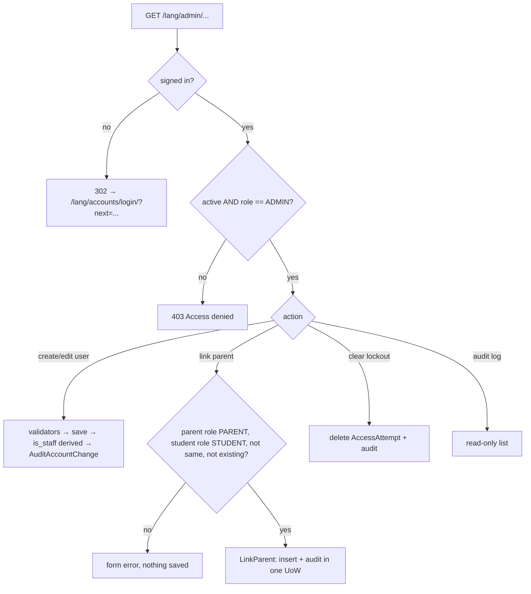

### Story 1.9: Admin Account Management & Parent–Child Links

**BUILDID**: CYCLE-1 | **GitHub**: LOCAL | **AzureDevOps**: LOCAL | **Epic**: 1 - Foundation | **ID**: 1.9 | **Date**: 2026-10-19
**File**: `docs/plans/stories/epic-1-story-1.9-Admin-Accounts-and-Parent-Links.md`
**Build Ref**: `docs/plans/builds/cycle-1/cycle-plan.md` — CYCLE-1 Foundation & Access (Workshop Day 2: Django admin for accounts and parent links, with audit)
**Wave**: 3
**Requires**: [1.3, 1.8]
**Enables**: [1.10]
**Files Touched**:
  - src/application/accounts/link_parent.py
  - src/application/accounts/manage_account.py
  - src/infrastructure/persistence/accounts/models.py
  - src/infrastructure/persistence/accounts/migrations/**
  - src/infrastructure/persistence/accounts/repositories.py
  - src/infrastructure/persistence/accounts/admin.py
  - src/infrastructure/container.py
  - src/config/urls.py
  - src/infrastructure/i18n/locale/ro/LC_MESSAGES/django.po
  - src/infrastructure/i18n/locale/en/LC_MESSAGES/django.po
  - tests/conftest.py
  - tests/factories/accounts.py
  - tests/unit/application/accounts/test_link_parent.py
  - tests/integration/persistence/accounts/test_parent_child_link.py
  - tests/integration/web/admin/**
**Roles Ref**: docs/requirements.md#roles--permissions-matrix — personas this story differentiates: Admin, Student, Teacher, Parent/Guardian
**QA Candidate**: Yes — **Observable:** the Admin opens `/<lang>/admin/` and can:
- create, edit, deactivate and delete Student/Teacher/Parent/Admin accounts (name, date of birth, role, language, password)
- reset passwords
- link a Parent to a Student and unlink them
- clear login lockouts
- read the audit log (read-only)

Any other role gets 403; anonymous users are sent to the platform sign-in. **Mechanism:**
- `PlatformAdminSite` (custom `AdminSite`): `has_permission` = active + role ADMIN; `login()` redirects anonymous users to `accounts:login`, and raises 403 for signed-in non-admins.
- `UserModel.save()` derives `is_staff`/`is_superuser` from `role == ADMIN`.
- `ParentChildLinkModel` (migration `0002`, unique + no-self-link constraints).
- `LinkParent`/`UnlinkParent` use cases (role validation, `ConflictError` on duplicates, audit inside the UoW) called from the link admin's form/`save_model`/`delete_model`.
- `AuditAccountChange` records account create/update/delete/password-change with **field names only** (never values).
- axes `AccessAttempt` is registered (deleting = unlock, audited).
- `AuditLogModel` is registered read-only.

**Authz & preconditions:** `accounts:manage` + `parents:link` (Admin only, per the matrix); `admin` namespace exempt from the URL-coverage test because the site itself enforces the role. **Edge & idempotency:**
- Linking the same pair twice gives a form error "This parent is already linked to this student." and no second row.
- Linking a Teacher as parent or a Parent as student gives a form error.
- Changing a linked student's role to non-Student is refused while links exist.
- Unlinking an already-removed link is a no-op.
- Deleting a user cascades their links (retention per requirements: data kept until the admin deletes the account).
- Demoting the last active Admin is refused (lock-out guard).

**Regression:** the 403 boundary for every non-admin role, link validation rules, the audit trail for every admin change, and no DOB/password values in audit metadata (privacy).

---

#### 👤 User Reference

**Description**:
The requirements put the administrator in charge of every account: there's no self-registration. This story gives the administrator a management area where they can:
- **Create accounts** for students, teachers, parents and other administrators, entering each person's name, date of birth, role, preferred language and starting password.
- **Edit and deactivate:** correct details, reset a forgotten password, or deactivate an account so it can't sign in.
- **Delete accounts:** deleting removes the person's data, which is how the platform's retention rule works ("kept until an administrator deletes the account").
- **Link parents to children:** a parent can only ever see the progress of children linked here. A parent can have several children, and a child can have several parents or guardians. The area prevents mistakes such as linking a teacher as a "parent", linking a child to themselves, or creating the same link twice.
- **Unlock accounts:** clear a lockout caused by too many wrong passwords, so a child doesn't have to wait 15 minutes.
- **Read the audit log:** read-only.

Every change made here is recorded in the audit log: who changed which account, and which fields. Values such as dates of birth or passwords are never recorded.

Only administrators can enter this area. Students, teachers and parents who open it see "Access denied".

**Acceptance Criteria** (plain-English):
- Only administrators can open the management area; everyone else sees "Access denied", and visitors who aren't signed in are sent to the normal sign-in page.
- The administrator can create an account with name, date of birth, role, preferred language and password; weak passwords are refused with a clear reason.
- The administrator can edit details, reset passwords, deactivate and delete accounts.
- Giving someone the Administrator role automatically gives them access to this area; removing it removes access.
- The last remaining active administrator can't be demoted or deactivated.
- The administrator can link a parent account to a student account and remove that link.
- Linking is refused when the "parent" isn't a Parent/Guardian, the "child" isn't a Student, both are the same account, or the link already exists.
- A student who has parents linked can't be switched to another role until the links are removed.
- Deleting an account also removes its parent–child links; earlier audit entries remain.
- The administrator can unlock an account locked by too many wrong passwords.
- The administrator can read the audit log but can't change or delete its entries.
- Every account change, password reset, link, unlink and unlock is recorded in the audit log without recording dates of birth or passwords.
- The area works in Romanian and English.

**User Flow** (role-differentiated):

### Admin
**Scenario / narrative**: As the pilot Admin preparing for launch, I open "Accounts" from my home page and land in the management area in Romanian. I create Ana (Student, born 2018-03-02, Romanian) with a starting password. The form refuses "12345678" as too common, so I choose a stronger one. I then create her mother as a Parent/Guardian and link them under "Parent–child links". When I accidentally pick a Teacher in the parent field, the form tells me the account isn't a Parent/Guardian. Later, Ana's teacher tells me she's locked out after mistyping her password; I clear her lockout and she can sign in at once. Every action I take appears in the read-only audit log.
**Steps**:
1. Admin opens `/ro/admin/`. `PlatformAdminSite.has_permission` checks `is_active and role == "ADMIN"` and shows the index.
2. "Add user" form: username, full name, date of birth, role, preferred language, password ×2. Django's password validators run (min 8, common, numeric).
3. Save → `UserModel.save()` sets `is_staff = is_superuser = (role == ADMIN)` → `AuditAccountChange` writes `accounts.created` with `{"fields": [...]}` (names only).
4. "Add parent–child link": the form limits `parent` choices to role PARENT and `student` to role STUDENT. `clean()` calls `LinkParent.validate(cmd)`; save calls `LinkParent.execute(cmd)`, which inserts the link and writes an `accounts.parent_linked` audit row in one UoW.
5. "Access attempts": deleting Ana's row clears the lockout and writes an `auth.lockout_cleared` audit row.
6. "Audit log": list and filter only; no add, change or delete buttons.

### Student
**Scenario / narrative**: As a Student, I can't reach the management area. If I type `/ro/admin/` I see the friendly "Access denied" page, not a second sign-in form. The menu never shows me the link.
**Steps**:
1. `GET /ro/admin/` → `PlatformAdminSite.admin_view` → `has_permission` False → `login()` → user is authenticated → `PermissionDenied` → 403 (Story 1.1 page).

### Teacher
**Scenario / narrative**: As a Teacher, I manage content, not accounts. Opening the management area gives me "Access denied". If a student needs a password reset, I ask the Admin.
**Steps**:
1. Same as Student → 403.

### Parent/Guardian
**Scenario / narrative**: As a Parent, I can't link myself to a child or see the account list. Only the Admin creates links. Opening `/en/admin/` shows "Access denied".
**Steps**:
1. Same as Student → 403.

**Flow Diagram**:



---

#### 🤖 AI Agent Reference

**Must Read**:
- `docs/requirements.md` — Roles & Permissions Matrix (`accounts:manage`, `parents:link`), "Accounts, roles, and progress visibility" feature (retention, DOB, generic avatar)
- `docs/architecture/design/00-system-architecture-greenfield.md` — Roles & Authorization ("Django admin limited to Admin… only account CRUD, password resets, parent–child links"), Data Model (`PARENT_CHILD_LINK`), Integrity rules (link roles, account deletion cascade)
- `docs/architecture/design/01-patterns-and-standards-greenfield.md` — §5 use cases, §6 models/constraints/migrations, §8 errors, §9 never-log list
- `docs/plans/stories/epic-1-story-1.3-RBAC-Core.md` — `EXEMPT_NAMESPACES = {"admin"}` in the URL-coverage test
- `docs/plans/stories/epic-1-story-1.8-Audit-Log.md` — `AuditPort`, `DjangoUnitOfWork`, `FakeAuditPort`/`FakeUnitOfWork`, `AuditLogModel`

**Description**:
1. **Admin site and roles:**
   - `PlatformAdminSite` replaces the default admin site **without** touching `INSTALLED_APPS`: all registrations target `platform_admin_site`, and `config/urls.py` routes `path("admin/", platform_admin_site.urls)` inside `i18n_patterns`.
   - `UserModel.save()` derives `is_staff`/`is_superuser` from the role.
2. **Admin registrations:**
   - `UserAdmin` subclass with platform fields (no groups or user permissions)
   - `ParentChildLinkAdmin` backed by the `LinkParent`/`UnlinkParent` use cases
   - axes `AccessAttempt` (unlock, audited)
   - read-only `AuditLogModel`
3. **Data:** `ParentChildLinkModel` with constraints; migration `0002_parentchildlink`.
4. **Use cases** (application layer, stdlib-only; ports declared in-module, as in Story 1.4):
   - `LinkParent`, `UnlinkParent` (`link_parent.py`)
   - `AuditAccountChange` (`manage_account.py`)
5. **Repository:** `DjangoParentLinks` added to `persistence/accounts/repositories.py` (which Story 1.4 created).
6. **Test fixtures:** `linked_parent` (Parent linked to `student`) and `unlinked_parent`, used by CYCLE-3 scoping tests.

**Design Tokens** (FE):
- The Django admin keeps its own stylesheet. The only branding is `site_header`/`site_title`/`index_title` text (translated) and the language follows the URL prefix. No custom admin CSS (keeps the 1-month timeline; admin is staff-only).
- Validation: on submit | Error: Django admin inline field errors + top error note (admin default).

**Acceptance Criteria**:
1. `UserModel.save()` sets `is_staff = is_superuser = (self.role == "ADMIN")` on every save. Changing role from ADMIN to anything else revokes admin access immediately (next request).
2. `PlatformAdminSite(name="admin")`:
   - `site_header`/`site_title` = "Learning Platform administration" (translated)
   - `has_permission(request)` = `request.user.is_active and request.user.role == "ADMIN"`
   - `login(request)`: if authenticated → `PermissionDenied` (403); else redirect to `accounts:login` with `next`
   - `config/urls.py` adds `path("admin/", platform_admin_site.urls)` inside `i18n_patterns`
3. `UserAdmin`:
   - list `username, full_name, role, preferred_language, is_active, last_login`
   - filters `role, is_active, preferred_language`; search `username, full_name`
   - add form `username, full_name, date_of_birth, role, preferred_language, password1, password2`, with `AUTH_PASSWORD_VALIDATORS` applied
   - change form: same fields + `is_active`, password-change link; `date_joined`/`last_login` read-only
   - excludes `groups`, `user_permissions`, `is_staff`, `is_superuser` from all forms
4. Guards in `UserAdmin`:
   - demoting or deactivating the **last** active Admin raises a form error "There must be at least one active administrator."
   - changing a Student's role while `ParentChildLink` rows reference them as student gives the form error "Remove this student's parent links before changing the role."
   - same rule for a Parent with links
5. `ParentChildLinkModel` (`db_table="accounts_parent_child_link"`):
   - `parent` FK (CASCADE, `related_name="child_links"`)
   - `student` FK (CASCADE, `related_name="parent_links"`)
   - `created_by` FK (SET_NULL, null)
   - `created_at`
   - `UniqueConstraint(parent, student, name="uniq_parent_student")`
   - `CheckConstraint(~Q(parent=F("student")), name="parent_not_student")`
6. `LinkParent(links, audit, uow, clock)`:
   - `validate(cmd)` returns a list of `Violation`s:
     - `parent_not_parent_role` (parent not found or role ≠ PARENT)
     - `student_not_student_role` (student not found or role ≠ STUDENT)
     - `self_link` (same account)
     - `link_exists`, a `ConflictError` case reported as a violation for the form
   - `execute(cmd)` re-validates inside the UoW (race-safe), inserts the link (`IntegrityError` → `ConflictError("link_exists")`) and audits `accounts.parent_linked` with target `("parent_child_link", id)` and metadata `{"parent_id", "student_id"}`
7. `UnlinkParent.execute(link_id, actor_id)` deletes and audits `accounts.parent_unlinked`. A missing link → no-op returning `False` (idempotent).
8. `ParentChildLinkAdmin`:
   - its form limits choices (`parent`: role PARENT, active; `student`: role STUDENT)
   - `clean()` maps `LinkParent.validate` violations to field/non-field errors with translated messages
   - `save_model` → `LinkParent.execute`; `delete_model`/`delete_queryset` → `UnlinkParent`
   - change view is read-only (links are created or deleted, never edited)
9. `AuditAccountChange.execute(action, actor_id, target_user_id, target_username, changed_fields)`:
   - actions `accounts.created | accounts.updated | accounts.deleted | accounts.password_changed | accounts.role_changed`
   - metadata `{"fields": sorted(changed_fields)}` holding **names only**; field values are never passed in
   - `UserAdmin.save_model`/`delete_model`/`delete_queryset` call it with `form.changed_data`; the password-change view triggers `accounts.password_changed`
10. `AccessAttemptAdmin` (axes model on `platform_admin_site`): list `username, ip_address, failures_since_start, attempt_time`; deleting = unlock, audited as `auth.lockout_cleared` (target username).
11. `AuditLogAdmin`: `has_add_permission`, `has_change_permission`, `has_delete_permission` → False; list `created_at, action, actor_username, target_type, target_id, ip_address`; filters `action`; search `actor_username`; date hierarchy `created_at`.
12. Container factories: `link_parent()`, `unlink_parent()`, `audit_account_change()`, all with `DjangoAuditPort(SystemClock())` + `DjangoUnitOfWork()`.
13. Fixtures in `tests/conftest.py`: `linked_parent(parent, student)` creates the link and returns the parent; `unlinked_parent` is a fresh Parent with no links. Factory `ParentChildLinkFactory` in `tests/factories/accounts.py`.
14. Role-access rows for `/ro/admin/`: anonymous 302, Student/Teacher/Parent 403, Admin 200. Added in this story's own admin test module (`tests/integration/web/admin/`) because the matrix file isn't in this story's files; 1.10's E2E covers the browser journey.
15. RO/EN translations for all new strings (field labels, the 6 error messages, admin titles).

**RBAC Enforcement**:

| Persona | Permission key | Guarded route/endpoint | Allowed | Denied behavior | UI when denied |
|---------|----------------|------------------------|---------|-----------------|----------------|
| Admin | `accounts:manage` | `/<lang>/admin/accounts/usermodel/…` | yes | n/a | n/a |
| Admin | `parents:link` | `/<lang>/admin/accounts/parentchildlinkmodel/…` | yes | n/a | n/a |
| Admin | `accounts:manage` | `/<lang>/admin/axes/accessattempt/…`, `/<lang>/admin/audit/auditlogmodel/` (read-only) | yes | n/a | n/a |
| Student | — | `/<lang>/admin/…` | no | `PermissionDenied` → 403 | 403 page; no menu link (Story 1.7 registry needs `accounts:manage`) |
| Teacher | — | `/<lang>/admin/…` | no | 403 | 403 page; no link |
| Parent/Guardian | — | `/<lang>/admin/…` | no | 403 | 403 page; no link |
| Anonymous | — | `/<lang>/admin/…` | no | 302 → `/<lang>/accounts/login/?next=…` | platform sign-in (never Django's admin login form) |

- **Enforcement point(s):** `PlatformAdminSite.has_permission` / `login` in `src/infrastructure/persistence/accounts/admin.py`; `is_staff` derivation in `UserModel.save()`.
- **Denied-access contract:** non-admin signed-in users get 403 via Story 1.1's handler, not Django's admin login screen, which would wrongly suggest signing in as someone else.
- **Scope derivation:** the acting admin is `request.user` (session) and is passed as `actor_id` / `created_by`. Link parties are chosen from server-filtered querysets; posted ids outside those querysets fail form validation (`ModelChoiceField`), and the use case re-checks roles inside the transaction.

**System responses + error cases**:

| Trigger | Response | Side-effect |
|---------|----------|-------------|
| Admin `GET /ro/admin/` | `200` admin index | none |
| Student/Teacher/Parent `GET /ro/admin/` | `403` | none |
| Anonymous `GET /ro/admin/` | `302 /ro/accounts/login/?next=/ro/admin/` | none |
| Admin creates a Student with valid data | `302` to the changelist + success message | user row; `accounts.created` audit `{"fields":[…names…]}` |
| Admin creates a user with password `12345678` | `200` form with validator errors | nothing saved |
| Admin sets role ADMIN on a Teacher | `302` | `is_staff=is_superuser=True`; `accounts.updated` + `accounts.role_changed` audit |
| Admin demotes the last active Admin (incl. self) | `200` form error "There must be at least one active administrator." | nothing saved |
| Admin links Parent→Student (new) | `302` | link row; `accounts.parent_linked` audit |
| Admin repeats the same link | `200` form error "This parent is already linked to this student." | no new row |
| Concurrent duplicate link (race) | `200` form error (IntegrityError → `ConflictError`) | one row only |
| Admin links a Teacher as parent / a Parent as student / same account | `200` form error naming the rule | nothing saved |
| Admin changes a linked Student's role to TEACHER | `200` form error "Remove this student's parent links before changing the role." | nothing saved |
| Admin deletes a link / deletes it again | `302`; second time a no-op | link removed once; one `accounts.parent_unlinked` audit |
| Admin deletes a user with links | `302` | user + links deleted (CASCADE); `accounts.deleted` audit; earlier audit rows keep `actor_username` |
| Admin deletes an axes `AccessAttempt` | `302` | lockout cleared; `auth.lockout_cleared` audit |
| Admin tries to add/change/delete an audit row | no buttons; direct POST → `403` | none |

**QA-observable behaviour**:
- `accounts_user.is_staff` and `is_superuser` are 1 only for rows with `role='ADMIN'`.
- `accounts_parent_child_link` contains exactly one row per linked pair. Attempted duplicates and invalid pairs leave the row count unchanged.
- Every admin save, delete or link produces exactly one corresponding `audit_log` row whose `metadata` contains field **names** only (e.g. `{"fields": ["date_of_birth", "full_name"]}`), never values.
- After unlocking, the user's next correct login returns 302 (no 429).
- A Student, Teacher or Parent receives 403 for every `/ro/admin/…` URL tried (index, user list, link add, audit list).
- **What does NOT change**: no account or link changes outside admin actions; audit rows are never modified; role permissions (`ROLE_PERMISSIONS`) are unaffected; the platform's own login page remains the only sign-in UI.

**Prerequisites**:
- Stories 1.3 (roles, `EXEMPT_NAMESPACES`) and 1.8 (`AuditPort`, `DjangoUnitOfWork`, fakes, `AuditLogModel`) merged. Stories 1.1, 1.2 and 1.4 are merged as part of wave 2 (403 page, validators, axes, `repositories.py`).

**Context**: `docs/requirements.md`, `docs/architecture/design/00-system-architecture-greenfield.md`, `docs/architecture/design/01-patterns-and-standards-greenfield.md`, `src/infrastructure/persistence/accounts/models.py`, `src/infrastructure/persistence/accounts/repositories.py`, `src/infrastructure/persistence/audit/models.py`, `src/infrastructure/container.py`

**Patterns**: Application use case + UoW (§5), Models & constraints & migrations (§6.2, §6.4), Repository with IntegrityError mapping (§6.3), Error handling (§8), Audit (§9), Testing with fakes (§12.2) — see `docs/architecture/design/01-patterns-and-standards-greenfield.md`

**Steps**:

1. **Tests first:** use-case unit tests with fakes, then model constraint tests, then admin integration tests.

2. **Model changes** (`models.py`), then `makemigrations accounts` → `0002_parentchildlink`:
   ```python
   class UserModel(AbstractUser):
       ...  # Story 1.0 fields unchanged

       def save(self, *args, **kwargs):
           # Django admin access follows the platform role (architecture: admin limited to Admin role).
           self.is_staff = self.is_superuser = self.role == "ADMIN"
           super().save(*args, **kwargs)


   class ParentChildLinkModel(models.Model):
       parent = models.ForeignKey(UserModel, on_delete=models.CASCADE, related_name="child_links")
       student = models.ForeignKey(UserModel, on_delete=models.CASCADE, related_name="parent_links")
       created_by = models.ForeignKey(UserModel, null=True, on_delete=models.SET_NULL, related_name="+")
       created_at = models.DateTimeField()

       class Meta:
           db_table = "accounts_parent_child_link"
           constraints = [
               models.UniqueConstraint(fields=["parent", "student"], name="uniq_parent_student"),
               models.CheckConstraint(condition=~models.Q(parent=models.F("student")), name="parent_not_student"),
           ]
   ```

3. **Use cases:**
   ```python
   # src/application/accounts/link_parent.py
   from dataclasses import dataclass
   from typing import Protocol

   from application.common.audit import AuditPort
   from application.common.unit_of_work import UnitOfWork
   from domain.common.clock import Clock
   from domain.common.errors import ConflictError, PolicyViolation, Violation


   class LinkExists(ConflictError):
       code = "link_exists"


   class ParentLinkPort(Protocol):
       def role_of(self, user_id: int) -> str | None: ...
       def exists(self, parent_id: int, student_id: int) -> bool: ...
       def add(self, parent_id: int, student_id: int, created_by: int, at) -> int: ...  # raises LinkExists
       def remove(self, link_id: int) -> tuple[int, int] | None: ...


   @dataclass(frozen=True)
   class LinkParentCommand:
       parent_id: int
       student_id: int
       actor_id: int  # request.user.pk


   class LinkParent:
       def __init__(self, links: ParentLinkPort, audit: AuditPort, uow: UnitOfWork, clock: Clock) -> None:
           self._links, self._audit, self._uow, self._clock = links, audit, uow, clock

       def validate(self, cmd: LinkParentCommand) -> list[Violation]:
           violations = []
           if self._links.role_of(cmd.parent_id) != "PARENT":
               violations.append(Violation("parent_not_parent_role"))
           if self._links.role_of(cmd.student_id) != "STUDENT":
               violations.append(Violation("student_not_student_role"))
           if cmd.parent_id == cmd.student_id:
               violations.append(Violation("self_link"))
           if not violations and self._links.exists(cmd.parent_id, cmd.student_id):
               violations.append(Violation("link_exists"))
           return violations

       def execute(self, cmd: LinkParentCommand) -> int:
           with self._uow:
               violations = self.validate(cmd)
               if [v for v in violations if v.code == "link_exists"]:
                   raise LinkExists()
               if violations:
                   raise PolicyViolation(violations)
               link_id = self._links.add(cmd.parent_id, cmd.student_id, cmd.actor_id, self._clock.now())
               self._audit.record("accounts.parent_linked", actor_id=cmd.actor_id,
                                  target=("parent_child_link", str(link_id)),
                                  metadata={"parent_id": cmd.parent_id, "student_id": cmd.student_id})
           return link_id
   ```
   `UnlinkParent` (same module) and `AuditAccountChange` (`manage_account.py`) follow the same pattern. `AuditAccountChange` takes `changed_fields: Iterable[str]` and records `{"fields": sorted(set(changed_fields) - {"password1", "password2"})}`; a password change is its own action.

4. **Repository** (append to `repositories.py`):
   ```python
   from django.db import IntegrityError

   from application.accounts.link_parent import LinkExists
   from infrastructure.persistence.accounts.models import ParentChildLinkModel, UserModel


   class DjangoParentLinks:
       def role_of(self, user_id):
           return UserModel.objects.filter(pk=user_id).values_list("role", flat=True).first()

       def exists(self, parent_id, student_id):
           return ParentChildLinkModel.objects.filter(parent_id=parent_id, student_id=student_id).exists()

       def add(self, parent_id, student_id, created_by, at):
           try:
               return ParentChildLinkModel.objects.create(
                   parent_id=parent_id, student_id=student_id, created_by_id=created_by, created_at=at).pk
           except IntegrityError as exc:
               raise LinkExists() from exc

       def remove(self, link_id):
           link = ParentChildLinkModel.objects.filter(pk=link_id).values_list("parent_id", "student_id").first()
           if link:
               ParentChildLinkModel.objects.filter(pk=link_id).delete()
           return link
   ```

5. **Admin** (`admin.py`): `PlatformAdminSite`, `platform_admin_site = PlatformAdminSite(name="admin")`, then register `UserModel` (`PlatformUserAdmin`), `ParentChildLinkModel` (`ParentChildLinkAdmin`), `axes.models.AccessAttempt` (`AccessAttemptAdmin`) and `infrastructure.persistence.audit.models.AuditLogModel` (`AuditLogAdmin`).
   ```python
   class PlatformAdminSite(admin.AdminSite):
       site_header = site_title = _("Learning Platform administration")
       index_title = _("Accounts and links")

       def has_permission(self, request) -> bool:
           user = request.user
           return bool(user.is_active and getattr(user, "role", "") == "ADMIN")

       def login(self, request, extra_context=None):
           if request.user.is_authenticated:
               raise PermissionDenied  # signed in but not Admin → 403, never a second login form
           return redirect_to_login(request.get_full_path(), resolve_url("accounts:login"))
   ```
   ```python
   class ParentChildLinkForm(forms.ModelForm):
       parent = forms.ModelChoiceField(UserModel.objects.filter(role="PARENT", is_active=True), label=_("Parent/Guardian"))
       student = forms.ModelChoiceField(UserModel.objects.filter(role="STUDENT"), label=_("Student"))

       class Meta:
           model = ParentChildLinkModel
           fields = ["parent", "student"]

       def clean(self):
           data = super().clean()
           if self.errors:
               return data
           cmd = LinkParentCommand(data["parent"].pk, data["student"].pk, actor_id=self.actor_id)
           for violation in container.link_parent().validate(cmd):
               self.add_error(None, LINK_MESSAGES[violation.code])
           return data
   ```
   `ParentChildLinkAdmin.get_form` sets `form.actor_id = request.user.pk`. `save_model` calls `container.link_parent().execute(...)` and sets `obj.pk` from the returned id, so the admin redirect works. `has_change_permission` returns False for existing objects, so links are add/delete only.

6. **URLs:** in `config/urls.py`, inside `i18n_patterns`, `path("admin/", platform_admin_site.urls)` (alphabetical block "admin").

7. **Container, fixtures and factory,** then **translations** and **all gates**.

**Tests**:

```python
# tests/unit/application/accounts/test_link_parent.py
import pytest

from application.accounts.link_parent import LinkExists, LinkParent, LinkParentCommand
from domain.common.errors import PolicyViolation
from tests.fakes import FakeAuditPort, FakeUnitOfWork, FixedClock


class FakeLinks:
    def __init__(self, roles):
        self.roles, self.links = roles, {}

    def role_of(self, user_id):
        return self.roles.get(user_id)

    def exists(self, parent_id, student_id):
        return (parent_id, student_id) in self.links.values()

    def add(self, parent_id, student_id, created_by, at):
        if self.exists(parent_id, student_id):
            raise LinkExists()
        link_id = len(self.links) + 1
        self.links[link_id] = (parent_id, student_id)
        return link_id

    def remove(self, link_id):
        return self.links.pop(link_id, None)


ROLES = {1: "PARENT", 2: "STUDENT", 3: "TEACHER", 4: "STUDENT"}


def make():
    links, audit = FakeLinks(ROLES), FakeAuditPort()
    return LinkParent(links, audit, FakeUnitOfWork(), FixedClock()), links, audit


def test_links_parent_to_student_and_audits():
    use_case, links, audit = make()

    link_id = use_case.execute(LinkParentCommand(1, 2, actor_id=99))

    assert links.links[link_id] == (1, 2)
    assert audit.records[0]["action"] == "accounts.parent_linked"
    assert audit.records[0]["metadata"] == {"parent_id": 1, "student_id": 2}


@pytest.mark.parametrize(("parent", "student", "code"), [
    (3, 2, "parent_not_parent_role"), (1, 3, "student_not_student_role"),
    (2, 2, "parent_not_parent_role"), (1, 404, "student_not_student_role"),
])
def test_invalid_pairs_are_rejected(parent, student, code):
    use_case, links, audit = make()

    with pytest.raises(PolicyViolation) as error:
        use_case.execute(LinkParentCommand(parent, student, actor_id=99))

    assert code in [v.code for v in error.value.violations]
    assert links.links == {} and audit.records == []


def test_duplicate_link_raises_conflict_and_adds_nothing():
    use_case, links, audit = make()
    use_case.execute(LinkParentCommand(1, 2, actor_id=99))

    with pytest.raises(LinkExists):
        use_case.execute(LinkParentCommand(1, 2, actor_id=99))

    assert len(links.links) == 1 and len(audit.records) == 1


def test_parent_can_have_several_children():
    use_case, links, _ = make()

    use_case.execute(LinkParentCommand(1, 2, actor_id=99))
    use_case.execute(LinkParentCommand(1, 4, actor_id=99))

    assert sorted(links.links.values()) == [(1, 2), (1, 4)]
```

```python
# tests/integration/web/admin/test_admin_access.py
import pytest

from infrastructure.persistence.accounts.models import ParentChildLinkModel
from infrastructure.persistence.audit.models import AuditLogModel
from tests.factories.accounts import AdminFactory, ParentFactory, StudentFactory, TeacherFactory

pytestmark = pytest.mark.django_db


@pytest.mark.parametrize(("fixture", "status"), [
    ("student_client", 403), ("teacher_client", 403), ("parent_client", 403), ("admin_client", 200),
])
def test_only_admin_role_enters_admin(request, fixture, status):
    assert request.getfixturevalue(fixture).get("/ro/admin/").status_code == status


def test_anonymous_goes_to_platform_login(client):
    assert client.get("/ro/admin/")["Location"].startswith("/ro/accounts/login/?next=")


def test_role_drives_staff_flags():
    teacher = TeacherFactory()
    teacher.role = "ADMIN"
    teacher.save()
    assert teacher.is_staff and teacher.is_superuser

    teacher.role = "TEACHER"
    teacher.save()
    assert not teacher.is_staff and not teacher.is_superuser


def test_admin_links_parent_and_duplicate_is_refused(admin_client):
    parent, student = ParentFactory(), StudentFactory()
    url = "/en/admin/accounts/parentchildlinkmodel/add/"

    first = admin_client.post(url, {"parent": parent.pk, "student": student.pk})
    second = admin_client.post(url, {"parent": parent.pk, "student": student.pk})

    assert first.status_code == 302
    assert second.status_code == 200
    assert "This parent is already linked to this student." in second.content.decode()
    assert ParentChildLinkModel.objects.count() == 1
    assert AuditLogModel.objects.filter(action="accounts.parent_linked").count() == 1


def test_teacher_cannot_be_chosen_as_parent(admin_client):
    response = admin_client.post("/en/admin/accounts/parentchildlinkmodel/add/",
                                 {"parent": TeacherFactory().pk, "student": StudentFactory().pk})

    assert response.status_code == 200
    assert ParentChildLinkModel.objects.count() == 0


def test_account_change_audit_has_field_names_only(admin_client):
    student = StudentFactory(full_name="Ana Pop")

    admin_client.post(f"/en/admin/accounts/usermodel/{student.pk}/change/", {
        "username": student.username, "full_name": "Ana Popescu", "date_of_birth": "2018-03-03",
        "role": "STUDENT", "preferred_language": "ro", "is_active": "on"})

    entry = AuditLogModel.objects.get(action="accounts.updated")
    assert entry.metadata == {"fields": ["date_of_birth", "full_name"]}
    assert "2018-03-03" not in str(entry.metadata) and "Popescu" not in str(entry.metadata)


def test_last_active_admin_cannot_be_demoted(admin_client, admin_user):
    response = admin_client.post(f"/en/admin/accounts/usermodel/{admin_user.pk}/change/", {
        "username": admin_user.username, "full_name": admin_user.full_name,
        "date_of_birth": admin_user.date_of_birth.isoformat(), "role": "TEACHER",
        "preferred_language": "ro", "is_active": "on"})

    assert response.status_code == 200
    assert "There must be at least one active administrator." in response.content.decode()


def test_deleting_user_cascades_links_but_keeps_audit(admin_client, linked_parent, student):
    admin_client.post(f"/en/admin/accounts/usermodel/{student.pk}/delete/", {"post": "yes"})

    assert ParentChildLinkModel.objects.count() == 0
    assert AuditLogModel.objects.filter(action="accounts.deleted").exists()


def test_audit_log_is_read_only_in_admin(admin_client):
    assert admin_client.get("/en/admin/audit/auditlogmodel/").status_code == 200
    assert admin_client.get("/en/admin/audit/auditlogmodel/add/").status_code == 403
```

```python
# tests/integration/persistence/accounts/test_parent_child_link.py
import pytest
from django.db import IntegrityError, transaction

from infrastructure.persistence.accounts.models import ParentChildLinkModel
from tests.factories.accounts import ParentFactory, StudentFactory

pytestmark = pytest.mark.django_db(transaction=True)


def test_database_rejects_duplicate_and_self_links():
    parent, student = ParentFactory(), StudentFactory()
    ParentChildLinkModel.objects.create(parent=parent, student=student, created_at="2026-10-20T08:00Z")

    with pytest.raises(IntegrityError), transaction.atomic():
        ParentChildLinkModel.objects.create(parent=parent, student=student, created_at="2026-10-20T08:00Z")
    with pytest.raises(IntegrityError), transaction.atomic():
        ParentChildLinkModel.objects.create(parent=parent, student=parent, created_at="2026-10-20T08:00Z")
```

Manual:
- As Admin in the browser (RO and EN): create one account per role; try a weak password; link a parent; try a duplicate and a Teacher-as-parent; unlink; lock a student out with 5 wrong passwords in another browser and clear it from "Access attempts"; open the audit log and confirm one entry per action with field names only.
- As Student, Teacher and Parent: open `/ro/admin/` and confirm 403.

**Quality**: ruff 0; mypy strict for `application.accounts`; lint-imports kept; tests pass; application ≥95%, overall ≥85%; `makemigrations --check` clean (migration `0002` committed); no PII values in audit metadata; no `TODO`.

**OUT**:
- ❌ Custom admin styling or a bespoke account-management UI (Django admin is the architecture's choice).
- ❌ Bulk import of pilot accounts (not required; 10 students + 2 teachers are entered by hand).
- ❌ Parents seeing their children's progress (CYCLE-3 uses `RecordAccessPolicy` + these links).
- ❌ Self-service password reset or email (not required).
- ❌ Moderation fields in admin (CYCLE-3; read-only when added).

**Evidence**: pytest output (unit, persistence, admin integration), coverage %, screenshots of the admin user form (RO), the duplicate-link error, the audit-log list, and the 403 page for a Teacher on `/ro/admin/`, all recorded in `docs/stories-implemented/story-1.9-review.md` under "## DoD Evidence".
