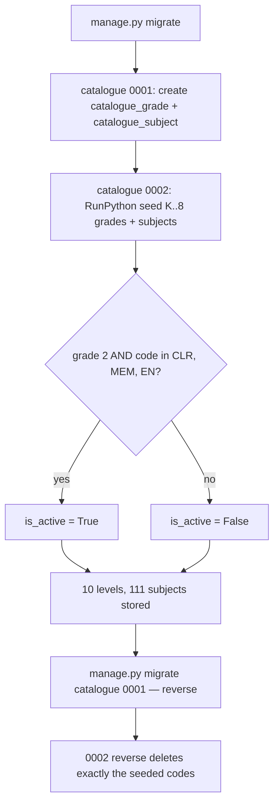

### Story 2.1: Catalogue Data

**BUILDID**: CYCLE-1 | **GitHub**: LOCAL | **AzureDevOps**: LOCAL | **Epic**: 2 - Grade & Subject Catalogue | **ID**: 2.1 | **Date**: 2026-10-19
**File**: `docs/plans/stories/epic-2-story-2.1-Catalogue-Data.md`
**Build Ref**: `docs/plans/builds/cycle-1/cycle-plan.md` — CYCLE-1 Foundation & Access (Workshop Day 4: seeded K–8 catalogue with active/inactive behaviour)
**Wave**: 2
**Requires**: [1.0]
**Enables**: [2.2]
**Files Touched**:
  - src/infrastructure/persistence/catalogue/**
  - src/config/settings/base.py
  - tests/factories/catalogue.py
  - tests/integration/persistence/catalogue/**
**Roles Ref**: docs/requirements.md#roles--permissions-matrix — single-actor — no role variation (reference data; who may *see* it is decided by Story 2.2)
**QA Candidate**: No — data and schema only, with nothing user-observable until Story 2.2 renders it. QA verifies it through Epic 2 QA Group 1 (stories 2.1 `[backend]` + 2.2).

---

#### 👤 User Reference

**Description**:
The requirements ask the platform to show the full school structure (kindergarten through grade 8, each with its subjects) so students and families see the bigger picture, while only grade 2's three pilot subjects can actually be used:
- Comunicare în limba română (CLR)
- Matematică și explorarea mediului (MEM)
- Limba engleză (EN)

This story stores that structure in the database, with every grade and subject name in Romanian and English, and marks exactly those three subjects as active. It loads automatically when the platform is installed, with no manual data entry. It also survives restarts and can be undone cleanly if a release is rolled back.

The list of subjects for grades other than grade 2 isn't spelled out in the requirements. This story uses a **proposed list based on the Romanian national curriculum framework**, which the project owner must confirm before release (see the table and open items below). The project owner decided (2026-10-21) that **"kindergarten" means Grădiniță** (preschool), which is *not* Clasa pregătitoare. The catalogue therefore shows **both**: Grădiniță (code `K`, listing the 5 preschool *domenii experiențiale*) and Clasa pregătitoare (code `P`, the preparatory school year before grade 1), followed by grades 1–8. The owner also confirmed the subject lists below. Changing the list later is a small, safe update.

**Acceptance Criteria** (plain-English):
- After installation, the platform knows 10 levels in this order: Grădiniță (K), Clasa pregătitoare (P) and grades 1 to 8, with names in both languages.
- Each grade has its subjects, with names in both languages, in a fixed display order.
- Only grade 2's CLR, MEM and English subjects are active; every other subject is stored as inactive.
- The same subject can't appear twice in one grade.
- The data loads automatically on installation and survives restarts.
- Undoing this release removes exactly this data and nothing else.
- The subject lists for grades other than 2, and the meaning of "kindergarten", are confirmed by the project owner before release (confirmed 2026-10-21: kindergarten = Grădiniță; Clasa pregătitoare added as its own level).

**User Flow**:
Actor: system — no role variation.

**Flow Diagram**:



---

#### 🤖 AI Agent Reference

**Must Read**:
- `docs/requirements.md` — Feature "Grade and subject catalogue" (K–8, only grade 2 CLR/MEM/EN active, others visible and non-interactive)
- `docs/architecture/design/00-system-architecture-greenfield.md` — Data Model (`GRADE`, `SUBJECT`), `catalogue` module, ADR-006 (paired `_ro`/`_en` columns)
- `docs/architecture/design/01-patterns-and-standards-greenfield.md` — §6.2 models (`<Entity>Model`, explicit `db_table`, `Meta.constraints`), §6.4 migrations (seed via reversible `RunPython`, no fixtures)
- `docs/plans/builds/cycle-1/cycle-plan.md` — open item "subject categories for non-pilot grades"

**Description**:
Creates the `infrastructure.persistence.catalogue` Django app (label `catalogue`):
- `GradeModel(code, sort_order, name_ro, name_en)`
- `SubjectModel(grade, code, sort_order, name_ro, name_en, is_active)` with constraints
- migration `0001` (schema)
- migration `0002_seed_catalogue` (reversible `RunPython`) with the data **inlined in the migration**, because migrations must not import live application modules that may change later

The catalogue holds no business rules, so there's no domain package. Read access comes through Story 2.2's query service.

> **Data-model refinement:** `SubjectModel.sort_order` is added (not in the architecture ER) to give a stable, curriculum-conventional display order. It's additive and doesn't affect the architecture's contracts.

**Seed (confirmed by the project owner 2026-10-21):**

| Grade code | Grade (RO / EN) | Subject codes (display order) |
|---|---|---|
| K | Grădiniță / Kindergarten | DLC, DS, DOS, DEC, DPM (preschool experiential domains) |
| P | Clasa pregătitoare / Preparatory grade | CLR, MEM, EN, DP, MM, AVAP, EF, REL |
| 1 | Clasa I / Grade 1 | CLR, MEM, EN, DP, MM, AVAP, EF, REL |
| 2 | Clasa a II-a / Grade 2 | **CLR, MEM, EN (active)**, DP, MM, AVAP, EF, REL |
| 3 | Clasa a III-a / Grade 3 | LLR, MAT, SN, EN, EC, MM, AVAP, EF, REL |
| 4 | Clasa a IV-a / Grade 4 | LLR, MAT, SN, EN, EC, IST, GEO, MM, AVAP, EF, REL |
| 5 | Clasa a V-a / Grade 5 | LLR, MAT, EN, ML2, BIO, IST, GEO, ES, TIC, ET, EP, EM, EF, REL |
| 6 | Clasa a VI-a / Grade 6 | LLR, MAT, EN, ML2, BIO, FIZ, IST, GEO, ES, TIC, ET, EP, EM, EF, REL |
| 7 | Clasa a VII-a / Grade 7 | LLR, MAT, EN, ML2, BIO, FIZ, CHI, LAT, IST, GEO, ES, TIC, ET, EP, EM, EF, REL |
| 8 | Clasa a VIII-a / Grade 8 | LLR, MAT, EN, ML2, BIO, FIZ, CHI, IST, GEO, ES, TIC, ET, EP, EM, EF, REL |

| Code | Romanian | English |
|---|---|---|
| CLR | Comunicare în limba română | Communication in Romanian |
| MEM | Matematică și explorarea mediului | Mathematics and Environmental Exploration |
| EN | Limba engleză | English |
| DLC | Domeniul Limbă și comunicare | Language and communication |
| DS | Domeniul Științe | Sciences |
| DOS | Domeniul Om și societate | People and society |
| DEC | Domeniul Estetic și creativ | Aesthetic and creative |
| DPM | Domeniul Psihomotric | Psychomotor |
| DP | Dezvoltare personală | Personal Development |
| MM | Muzică și mișcare | Music and Movement |
| AVAP | Arte vizuale și abilități practice | Visual Arts and Practical Skills |
| EF | Educație fizică | Physical Education |
| REL | Religie | Religion |
| LLR | Limba și literatura română | Romanian Language and Literature |
| MAT | Matematică | Mathematics |
| SN | Științe ale naturii | Natural Sciences |
| EC | Educație civică | Civic Education |
| IST | Istorie | History |
| GEO | Geografie | Geography |
| ML2 | Limba modernă 2 | Second Modern Language |
| BIO | Biologie | Biology |
| FIZ | Fizică | Physics |
| CHI | Chimie | Chemistry |
| LAT | Limba latină | Latin |
| ES | Educație socială | Social Education |
| TIC | Informatică și TIC | Computer Science and ICT |
| ET | Educație tehnologică și aplicații practice | Technology Education and Practical Applications |
| EP | Educație plastică | Art Education |
| EM | Educație muzicală | Music Education |

**Acceptance Criteria**:
1. App `infrastructure.persistence.catalogue` (`apps.CatalogueConfig`, `label="catalogue"`) is added to `INSTALLED_APPS`.
2. `GradeModel` (`db_table="catalogue_grade"`): `code` CharField(2, unique), `sort_order` PositiveSmallIntegerField(unique), `name_ro`/`name_en` CharField(80). `Meta.ordering = ["sort_order"]`.
3. `SubjectModel` (`db_table="catalogue_subject"`): `grade` FK → `GradeModel` (`PROTECT`, `related_name="subjects"`), `code` CharField(8), `sort_order` PositiveSmallIntegerField, `name_ro`/`name_en` CharField(120), `is_active` BooleanField(default False). Constraints: `UniqueConstraint(grade, code, name="uniq_subject_code_per_grade")` and `UniqueConstraint(grade, sort_order, name="uniq_subject_order_per_grade")`. `Meta.ordering = ["grade__sort_order", "sort_order"]`.
4. Migration `0002_seed_catalogue` inlines the two tables above. Its forward function creates 10 levels (`K`=0, `P`=1, `1`…`8`=2…9) and every listed subject in listed order (`sort_order` = position, starting at 1). It sets `is_active=True` **only** for grade `2` subjects `CLR`, `MEM`, `EN`.
5. The reverse function deletes subjects then grades whose codes are in the seed. Rows added later by other means are untouched; if any subject is referenced by later content (CYCLE-2 FKs use `PROTECT`), the reverse fails loudly rather than orphaning data.
6. The migration uses `apps.get_model(...)` (historical models), never imports from `models.py`, and is idempotent in effect: `get_or_create` keyed on codes, so a partially failed run can be re-applied.
7. After `migrate`: `GradeModel.objects.count() == 10` and `SubjectModel.objects.count() == 111`; `SubjectModel.objects.filter(is_active=True)` returns exactly the three grade-2 subjects; every name field is non-empty in both languages.
8. `makemigrations --check` is clean; `migrate catalogue zero` followed by `migrate` succeeds (round-trip).
9. `tests/factories/catalogue.py` provides `GradeFactory` and `SubjectFactory` (`django_get_or_create` on codes) for Story 2.2 and CYCLE-2 tests.
10. The review doc records the owner's confirmation (or requested changes) of the proposed subject lists and the meaning of "kindergarten" **before** this story is marked Done. If changes arrive after merge, a follow-up data migration `0003_…` applies them.

**RBAC Enforcement**:
No role-differentiated access — single actor.
- No route is added. Data is reference information without personal data. Story 2.2 decides who sees it.

**System responses + error cases**:

| Trigger | Response | Side-effect |
|---------|----------|-------------|
| `manage.py migrate` on an empty DB | "Applying catalogue.0001… OK", "Applying catalogue.0002… OK" | 10 levels + 111 subjects; 3 active |
| `manage.py migrate` again (repeat) | "No migrations to apply." | none |
| Re-running the forward seed function after a partial failure | completes without duplicates (`get_or_create`) | missing rows created only |
| `manage.py migrate catalogue zero` | reverse 0002 then 0001 | seeded rows then tables removed |
| Reverse while CYCLE-2 content references a subject | `ProtectedError` → migration aborts | no data removed |
| Insert of a duplicate `(grade, code)` | `IntegrityError` | none |
| Insert of a duplicate `(grade, sort_order)` | `IntegrityError` | none |
| Deleting a grade that still has subjects | `ProtectedError` | none |

**Prerequisites**:
- Story 1.0 merged (settings, migrations layout).
- **Owner confirmation** of the proposed lists (AC 10). The story can be implemented with the proposal; confirmation gates *Done*.

**Context**: `docs/requirements.md`, `docs/architecture/design/00-system-architecture-greenfield.md`, `docs/architecture/design/01-patterns-and-standards-greenfield.md`, `src/config/settings/base.py`

**Patterns**: Models & constraints (§6.2), Migrations — reversible data migration, no fixtures (§6.4), Naming (§1.2) — see `docs/architecture/design/01-patterns-and-standards-greenfield.md`

**Steps**:

1. **Tests first** (`tests/integration/persistence/catalogue/test_catalogue_seed.py`, `test_catalogue_constraints.py`).

2. **Models:**
   ```python
   # src/infrastructure/persistence/catalogue/models.py
   from django.db import models


   class GradeModel(models.Model):
       code = models.CharField(max_length=2, unique=True)
       sort_order = models.PositiveSmallIntegerField(unique=True)
       name_ro = models.CharField(max_length=80)
       name_en = models.CharField(max_length=80)

       class Meta:
           db_table = "catalogue_grade"
           ordering = ["sort_order"]


   class SubjectModel(models.Model):
       grade = models.ForeignKey(GradeModel, on_delete=models.PROTECT, related_name="subjects")
       code = models.CharField(max_length=8)
       sort_order = models.PositiveSmallIntegerField()
       name_ro = models.CharField(max_length=120)
       name_en = models.CharField(max_length=120)
       is_active = models.BooleanField(default=False)

       class Meta:
           db_table = "catalogue_subject"
           ordering = ["grade__sort_order", "sort_order"]
           constraints = [
               models.UniqueConstraint(fields=["grade", "code"], name="uniq_subject_code_per_grade"),
               models.UniqueConstraint(fields=["grade", "sort_order"], name="uniq_subject_order_per_grade"),
           ]
   ```
   Run `makemigrations catalogue` (→ `0001_initial`), then `makemigrations catalogue --empty -n seed_catalogue`.

3. **Seed migration** (data inlined; excerpt):
   ```python
   # src/infrastructure/persistence/catalogue/migrations/0002_seed_catalogue.py
   from django.db import migrations

   GRADES = [  # (code, sort_order, name_ro, name_en)
       ("K", 0, "Grădiniță", "Kindergarten"), ("P", 1, "Clasa pregătitoare", "Preparatory grade"),
       ("1", 2, "Clasa I", "Grade 1"), ("2", 3, "Clasa a II-a", "Grade 2"),
       ("3", 4, "Clasa a III-a", "Grade 3"), ("4", 5, "Clasa a IV-a", "Grade 4"),
       ("5", 6, "Clasa a V-a", "Grade 5"), ("6", 7, "Clasa a VI-a", "Grade 6"),
       ("7", 8, "Clasa a VII-a", "Grade 7"), ("8", 9, "Clasa a VIII-a", "Grade 8"),
   ]
   SUBJECT_NAMES = {  # code: (name_ro, name_en)
       "CLR": ("Comunicare în limba română", "Communication in Romanian"),
       "MEM": ("Matematică și explorarea mediului", "Mathematics and Environmental Exploration"),
       "EN": ("Limba engleză", "English"),
       # … every code from the story's code table …
   }
   PRIMARY_EARLY = ["CLR", "MEM", "EN", "DP", "MM", "AVAP", "EF", "REL"]
   SUBJECTS_BY_GRADE = {
       "K": ["DLC", "DS", "DOS", "DEC", "DPM"],  # Grădiniță: preschool experiential domains
       "P": PRIMARY_EARLY, "1": PRIMARY_EARLY, "2": PRIMARY_EARLY,
       "3": ["LLR", "MAT", "SN", "EN", "EC", "MM", "AVAP", "EF", "REL"],
       "4": ["LLR", "MAT", "SN", "EN", "EC", "IST", "GEO", "MM", "AVAP", "EF", "REL"],
       "5": ["LLR", "MAT", "EN", "ML2", "BIO", "IST", "GEO", "ES", "TIC", "ET", "EP", "EM", "EF", "REL"],
       "6": ["LLR", "MAT", "EN", "ML2", "BIO", "FIZ", "IST", "GEO", "ES", "TIC", "ET", "EP", "EM", "EF", "REL"],
       "7": ["LLR", "MAT", "EN", "ML2", "BIO", "FIZ", "CHI", "LAT", "IST", "GEO", "ES", "TIC", "ET", "EP", "EM",
             "EF", "REL"],
       "8": ["LLR", "MAT", "EN", "ML2", "BIO", "FIZ", "CHI", "IST", "GEO", "ES", "TIC", "ET", "EP", "EM", "EF", "REL"],
   }
   ACTIVE = {("2", "CLR"), ("2", "MEM"), ("2", "EN")}  # requirements: only these in the MVP


   def seed(apps, schema_editor):
       grade_model = apps.get_model("catalogue", "GradeModel")
       subject_model = apps.get_model("catalogue", "SubjectModel")
       for code, order, name_ro, name_en in GRADES:
           grade, _ = grade_model.objects.get_or_create(
               code=code, defaults={"sort_order": order, "name_ro": name_ro, "name_en": name_en})
           for position, subject_code in enumerate(SUBJECTS_BY_GRADE[code], start=1):
               name_ro_s, name_en_s = SUBJECT_NAMES[subject_code]
               subject_model.objects.get_or_create(grade=grade, code=subject_code, defaults={
                   "sort_order": position, "name_ro": name_ro_s, "name_en": name_en_s,
                   "is_active": (code, subject_code) in ACTIVE})


   def unseed(apps, schema_editor):
       grade_model = apps.get_model("catalogue", "GradeModel")
       subject_model = apps.get_model("catalogue", "SubjectModel")
       codes = [code for code, *_ in GRADES]
       subject_model.objects.filter(grade__code__in=codes).delete()  # PROTECT from later content aborts here
       grade_model.objects.filter(code__in=codes).delete()


   class Migration(migrations.Migration):
       dependencies = [("catalogue", "0001_initial")]
       operations = [migrations.RunPython(seed, unseed)]
   ```

4. **Factories:**
   ```python
   # tests/factories/catalogue.py
   import factory

   from infrastructure.persistence.catalogue.models import GradeModel, SubjectModel


   class GradeFactory(factory.django.DjangoModelFactory):
       class Meta:
           model = GradeModel
           django_get_or_create = ("code",)

       code = "2"
       sort_order = 2
       name_ro = "Clasa a II-a"
       name_en = "Grade 2"


   class SubjectFactory(factory.django.DjangoModelFactory):
       class Meta:
           model = SubjectModel
           django_get_or_create = ("grade", "code")

       grade = factory.SubFactory(GradeFactory)
       code = "MEM"
       sort_order = 2
       name_ro = "Matematică și explorarea mediului"
       name_en = "Mathematics and Environmental Exploration"
       is_active = True
   ```

5. **Settings:** add the app to `INSTALLED_APPS`. **Migrate**, round-trip (`migrate catalogue zero && migrate`), then **run all gates**.

**Tests**:

```python
# tests/integration/persistence/catalogue/test_catalogue_seed.py
import pytest

from infrastructure.persistence.catalogue.models import GradeModel, SubjectModel

pytestmark = pytest.mark.django_db  # pytest-django applies all migrations, incl. the seed


def test_ten_levels_in_order():
    assert list(GradeModel.objects.values_list("code", flat=True)) == [
        "K", "P", "1", "2", "3", "4", "5", "6", "7", "8"]


def test_only_grade_two_clr_mem_en_are_active():
    active = set(SubjectModel.objects.filter(is_active=True).values_list("grade__code", "code"))

    assert active == {("2", "CLR"), ("2", "MEM"), ("2", "EN")}


def test_every_name_is_bilingual():
    assert not GradeModel.objects.filter(name_ro="").exists()
    assert not GradeModel.objects.filter(name_en="").exists()
    assert not SubjectModel.objects.filter(name_ro="").exists()
    assert not SubjectModel.objects.filter(name_en="").exists()


def test_grade_two_subjects_display_order():
    codes = list(SubjectModel.objects.filter(grade__code="2").values_list("code", flat=True))

    assert codes[:3] == ["CLR", "MEM", "EN"]


def test_romanian_diacritics_are_stored_intact():
    assert SubjectModel.objects.get(grade__code="2", code="MEM").name_ro == "Matematică și explorarea mediului"
```

```python
# tests/integration/persistence/catalogue/test_catalogue_constraints.py
import pytest
from django.db import IntegrityError, transaction
from django.db.models import ProtectedError

from infrastructure.persistence.catalogue.models import GradeModel, SubjectModel

pytestmark = pytest.mark.django_db


def test_duplicate_subject_code_in_grade_is_rejected():
    grade = GradeModel.objects.get(code="2")

    with pytest.raises(IntegrityError), transaction.atomic():
        SubjectModel.objects.create(grade=grade, code="MEM", sort_order=99, name_ro="x", name_en="x")


def test_duplicate_sort_order_in_grade_is_rejected():
    grade = GradeModel.objects.get(code="2")

    with pytest.raises(IntegrityError), transaction.atomic():
        SubjectModel.objects.create(grade=grade, code="NEW", sort_order=1, name_ro="x", name_en="x")


def test_grade_with_subjects_cannot_be_deleted():
    with pytest.raises(ProtectedError):
        GradeModel.objects.get(code="2").delete()
```

Manual:
- `uv run python manage.py migrate` on a fresh DB, then `uv run python manage.py shell -c "from infrastructure.persistence.catalogue.models import SubjectModel as S; print(S.objects.filter(is_active=True).values_list('grade__code','code'))"` prints the three grade-2 subjects.
- `uv run python manage.py migrate catalogue zero` then `migrate` (round-trip) succeeds.
- Send the two proposal tables to the project owner and record the answer in the review doc.

**Quality**: ruff 0 (migrations excluded from lint per seed config, but the seed migration is reviewed by hand); `makemigrations --check` clean; tests pass; coverage ≥85%; no fixtures; no imports from `models.py` inside migrations; no `TODO`.

**OUT**:
- ❌ Catalogue and subject pages, query service, navigation (Story 2.2).
- ❌ Chapters, lessons and other content models (CYCLE-2).
- ❌ Admin screens to edit grades or subjects (not required; changes go through data migrations).
- ❌ Activating any subject beyond grade 2 CLR/MEM/EN (out of scope per requirements).

**Evidence**: pytest output, `migrate` and round-trip console output, the shell check printing the three active subjects, and the project owner's confirmation of the proposed subject lists and the "K" interpretation, all recorded in `docs/stories-implemented/story-2.1-review.md` under "## DoD Evidence".
