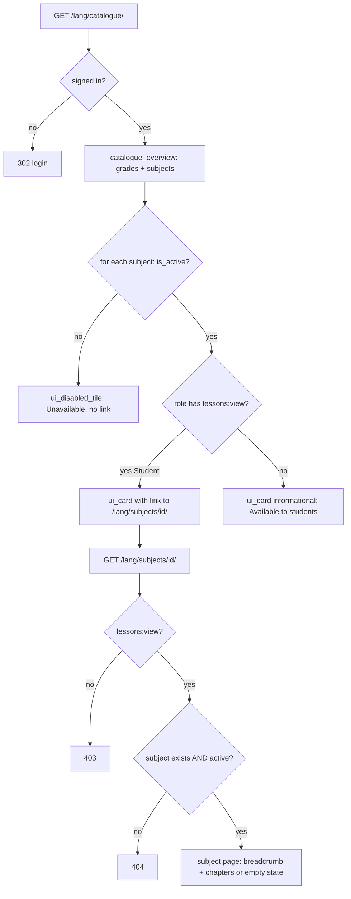

### Story 2.2: Catalogue & Subject Pages

**BUILDID**: CYCLE-1 | **GitHub**: LOCAL | **AzureDevOps**: LOCAL | **Epic**: 2 - Grade & Subject Catalogue | **ID**: 2.2 | **Date**: 2026-10-19
**File**: `docs/plans/stories/epic-2-story-2.2-Catalogue-and-Subject-Pages.md`
**Build Ref**: `docs/plans/builds/cycle-1/cycle-plan.md` — CYCLE-1 Foundation & Access (Workshop Day 4: catalogue with active/inactive behaviour; inactive URLs return 404)
**Wave**: 4
**Requires**: [1.2, 1.3, 1.6, 2.1]
**Enables**: [1.10]
**Files Touched**:
  - src/infrastructure/persistence/catalogue/queries.py
  - src/infrastructure/web/catalogue/**
  - src/infrastructure/web/templates/catalogue/**
  - src/infrastructure/web/static/css/catalogue.css
  - src/config/urls.py
  - src/infrastructure/i18n/locale/ro/LC_MESSAGES/django.po
  - src/infrastructure/i18n/locale/en/LC_MESSAGES/django.po
  - tests/integration/web/test_role_access_matrix.py
  - tests/integration/web/catalogue/**
**Roles Ref**: docs/requirements.md#roles--permissions-matrix — personas this story differentiates: Student, Teacher, Parent/Guardian, Admin
**QA Candidate**: Yes — **Observable:** `/<lang>/catalogue/` lists all 10 levels (Grădiniță, Clasa pregătitoare, grades 1–8) with their subjects. Grade 2's CLR, MEM and EN are active cards: links for Students, informational cards for other roles. Every other subject is an "Unavailable" tile with no link. `/<lang>/subjects/<id>/` opens an active subject's chapter-list page (empty state until CYCLE-2 adds chapters) for Students; inactive or unknown subjects return 404; non-students get 403. **Mechanism:**
- query service `catalogue_overview()` (2 queries: grades + prefetched subjects) and `active_subject(subject_id)` (raises `NotFound` for missing or inactive) in `persistence/catalogue/queries.py`, returning frozen DTOs
- views `catalogue:index` (`@require_authenticated`) and `catalogue:subject` (`@require_permission(lessons:view)`)
- names via ``; cards via `ui_card`, tiles via `ui_disabled_tile`, empty state via `ui_empty_state`
- the Student "Learn" menu item (Story 1.7 registry) appears automatically once `catalogue:index` resolves

**Authz & preconditions:** catalogue for any signed-in role; subject page requires `lessons:view` (Student only, per the matrix); anonymous → login. **Edge & idempotency:** an inactive subject's URL → 404 identical to a non-existent id (no hint it exists); a non-numeric id → 404 (route converter); reloads are read-only and identical; a missing seed (empty catalogue) shows an empty state instead of a crash. **Regression:** active vs unavailable rendering for all 10 levels, the 404 for every inactive subject, the 403 for non-students on subject pages, RO/EN names with diacritics, no link from any unavailable tile, keyboard access to active cards.

---

#### 👤 User Reference

**Description**:
This is the first page about learning. Opening "Learn" shows the whole school structure: every grade from the preparatory year (K) to grade 8, each with its subjects, in Romanian or English.
- **Grade 2:** the three pilot subjects (Comunicare în limba română, Matematică și explorarea mediului, and English) are bright, usable cards.
- **Everything else:** clearly marked "Unavailable". It can't be clicked, and typing its address directly just shows "page not found".

**Students** can open a pilot subject and see its chapter list. Until teachers publish chapters (next cycle), that page says no chapters are published yet.

**Teachers, parents and administrators** can view the catalogue to understand what students see. The subject cards are informational for them, because opening a subject's learning pages is a student activity in the requirements. Teachers get their own authoring area in the next cycle.

**Acceptance Criteria** (plain-English):
- Every signed-in person can open the catalogue; visitors who aren't signed in are asked to sign in.
- The catalogue shows all 10 levels in order (Grădiniță, Clasa pregătitoare, grades 1 to 8), each with its subjects, in the language in use.
- Only grade 2's CLR, MEM and English are active; they're highlighted as the pilot subjects.
- Every other subject shows as "Unavailable" and can't be clicked or reached with the keyboard.
- Typing the address of an unavailable or non-existent subject shows "Page not found".
- Students can open an active subject and see its chapter list, or a friendly "No chapters published yet" message.
- Teachers, parents and administrators see active subjects as information only; if they open a subject's address directly they get "Access denied".
- The "Learn" item appears in students' menus and on their home page.
- Romanian names display their special letters correctly.

**User Flow** (role-differentiated):

### Student
**Scenario / narrative**: As a grade-2 Student, I click "Learn" on my home page and see colourful sections for each grade. In my grade's section, three big cards light up: Comunicare în limba română, Matematică și explorarea mediului and Limba engleză. The other grades' subjects are greyed out with a small lock and the word "Indisponibil", and clicking them does nothing. I open Mathematics and see its page with a "back to the catalogue" trail and a message that no chapters are published yet. When my classmate tells me the address of a grade 5 subject and I type it in, I see "Page not found".
**Steps**:
1. `GET /ro/catalogue/` → `@require_authenticated` → `catalogue_overview()` reads 10 levels + subjects (2 queries) → renders the grade sections; active subjects as `ui_card` with `href=/ro/subjects/<id>/` (the role holds `lessons:view`); inactive as `ui_disabled_tile`.
2. Click a card → `GET /ro/subjects/<id>/` → `@require_permission(lessons:view)` passes → `active_subject(id)` → page header with breadcrumb (Catalogue › Clasa a II-a › Matematică…) + `ui_empty_state("No chapters are published yet.")`.
3. Typed URL of an inactive subject → `active_subject` raises `NotFound` → 404 page.

### Teacher
**Scenario / narrative**: As a Teacher, I open the catalogue from a link a colleague shared, to check how it looks to students. I see the same grades, subjects and pilot highlights, but the three active subjects are informational cards with "Available to students", not links. If I paste a subject page address, I get "Access denied", because my content work happens in the teacher area coming next cycle.
**Steps**:
1. `GET /ro/catalogue/` → 200; active subjects rendered with `ui_card` **without** `href` plus the note "Available to students" (the role lacks `lessons:view`).
2. `GET /ro/subjects/<id>/` → `PermissionDenied` → 403.

### Parent/Guardian
**Scenario / narrative**: As a Parent, I open the catalogue to see what my child will study. Grade 2's subjects are highlighted; everything else is unavailable. I can't open learning pages myself (403), and my children's progress comes next cycle.
**Steps**:
1. `GET /en/catalogue/` → 200, English names, informational cards.
2. `GET /en/subjects/<id>/` → 403.

### Admin
**Scenario / narrative**: As the Admin, I use the catalogue to confirm the pilot configuration before launch: exactly three active subjects in grade 2, everything else unavailable. The subject pages are for students, so they're denied to me.
**Steps**:
1. `GET /ro/catalogue/` → 200; the same view as teachers.
2. `GET /ro/subjects/<id>/` → 403.

**Flow Diagram**:



---

#### 🤖 AI Agent Reference

**Must Read**:
- `docs/requirements.md` — Feature "Grade and subject catalogue"; Roles & Permissions Matrix (`lessons:view` = Student)
- `docs/architecture/design/00-system-architecture-greenfield.md` — route catalogue (`/catalogue/` any authenticated, `/subjects/<id>/` `lessons:view`, 404 if inactive), ADR-005 (query services for reads)
- `docs/architecture/design/01-patterns-and-standards-greenfield.md` — §6.3 query services (DTOs, `select_related`/`prefetch_related`), §7.1–7.2 thin views + decorators, §11.2–11.3 primitives and `localized`
- `docs/ui-ux/ui-ux-spec.md`, `docs/ui-ux/08-visual-foundation.md` — `catalogue_grid` organism, student 3-column card grid, disabled tile tokens
- `docs/plans/stories/epic-2-story-2.1-Catalogue-Data.md` — models, seed, factories
- `docs/plans/stories/epic-1-story-1.6-Molecule-Primitives.md` — `ui_card`, `ui_disabled_tile`, `ui_empty_state`, `ui_page_header`

**Description**:
1. **Read side** (`persistence/catalogue/queries.py`): `GradeDTO` / `SubjectDTO` frozen dataclasses carrying `name_ro`/`name_en` (so `` works on them), `catalogue_overview()` and `active_subject(subject_id)`.
2. **Web** (`web/catalogue/`):
   - `views.py` with `index` and `subject`
   - `urls.py` (`app_name = "catalogue"`): `catalogue/` and `subjects/<int:subject_id>/`, included in `i18n_patterns`
3. **Templates:** `catalogue/index.html`, `catalogue/_grade_section.html`, `catalogue/subject.html`.
4. **Styling:** `static/css/catalogue.css` (grid organism; tokens only), linked from the catalogue templates via ``. Story 1.7 adds this block to `base.html` in the same wave. If 1.7 merges later, the integrator adds the block (one line); see Prerequisites.
5. **Matrix rows** for `/ro/catalogue/` in the role-access matrix. Subject-page access is tested in this story's own module, because ids come from the seed.

The subject page is the CYCLE-2 extension point: its chapter list will come from the content query service. In this story it renders `ui_empty_state` because no chapters exist yet. That's real behaviour, not a placeholder.

**Design Tokens** (FE):
- Page: student theme `#FFF8EC` bg (Students) or staff `#F5F7FA`, depending on body class (Story 1.7).
- Grade section: heading h2 24px/700 (student) or 20px/700 (staff) `#1F2937`; grade 2 section gets a `ui_badge`-style "Pilot" label with accent fill `#FBBF24` + text `#1F2937` (8.79:1).
- Grid: 3 columns (student, 24px gap) / 4 columns (staff, 16px gap) of the 12-column grid; max width 960px (student) / 1200px (staff).
- Active card: `ui_card` surface `#FFFFFF`, radius 16px (student) / 8px (staff), elevation-1 → elevation-2 on hover; icon Phosphor `book-open` 32px (duotone for student); title 20px/600 (student) or 16px/600 (staff); whole card clickable via stretched link; min height 120px (student).
- Informational card (non-students): same card without a link; meta text "Available to students" 14px `#4B5563`.
- Unavailable tile: bg `#F3F4F6`, text `#4B5563`, dashed 1px `#6B7280` border, `lock-simple` 20px, label "Unavailable" (Story 1.6 primitive).
- Subject page: `ui_page_header` (h1 32px/700 student), breadcrumb 14px `#4B5563`; `ui_empty_state` with `list-checks` 32px duotone.
- Focus: 3px `#C2410C` outline on active cards. Unavailable tiles aren't focusable.

**Acceptance Criteria**:
1. `catalogue_overview() -> tuple[GradeDTO, ...]` returns grades ordered by `sort_order`, each with `subjects: tuple[SubjectDTO, ...]` ordered by `sort_order`, using exactly **2** SQL queries (`assertNumQueries(2)`).
2. `active_subject(subject_id) -> SubjectDTO` (with its `grade_name_ro`/`grade_name_en` for the breadcrumb) raises `domain.common.errors.NotFound` when the id doesn't exist **or** `is_active=False`. Both cases produce an identical 404 page.
3. `catalogue:index` → `GET /<lang>/catalogue/`, `@require_authenticated`. `catalogue:subject` → `GET /<lang>/subjects/<int:subject_id>/`, `@require_permission(Permission.LESSONS_VIEW)`. Both GET only (`@require_safe`); POST → 405.
4. The catalogue renders one `<section aria-labelledby>` per level (10), with the localized grade name as `<h2>`. Active subjects are rendered with `ui_card`: with `href` = `catalogue:subject` URL when the viewer has `lessons:view`, otherwise without `href` and with meta "Available to students". Inactive subjects are rendered with `ui_disabled_tile`. The grade containing active subjects shows a "Pilot" label.
5. No `<a>` element points to an inactive subject anywhere in the catalogue HTML (test-proven for every inactive subject id).
6. The subject page shows `ui_page_header` with breadcrumb `[Catalogue → /<lang>/catalogue/, <grade name>, <subject name>]` (last item `aria-current="page"`) and `ui_empty_state("No chapters are published yet.")`.
7. An empty catalogue (no grades) renders `ui_empty_state("The catalogue is not available yet.")` with status 200.
8. Names render through ``. The EN page shows English names; the RO page shows Romanian with diacritics intact.
9. Matrix rows appended: `("anonymous", "/ro/catalogue/", 302)` and `(role, "/ro/catalogue/", 200)` for all four roles.
10. Subject-page access (in this story's tests): Student active → 200; Student inactive / unknown → 404; Teacher, Parent, Admin active → 403; anonymous → 302.
11. With Story 1.7 merged, the Student's main navigation includes "Learn" linking to `/<lang>/catalogue/` (registry auto-resolution; asserted in Story 1.10's journey).
12. RO/EN translations for "Catalogue", "Pilot", "Available to students", "No chapters are published yet.", "The catalogue is not available yet.", "Grades and subjects".

**RBAC Enforcement**:

| Persona | Permission key | Guarded route/endpoint | Allowed | Denied behavior | UI when denied |
|---------|----------------|------------------------|---------|-----------------|----------------|
| Student | (authenticated) | `GET /<lang>/catalogue/` | yes | n/a | active subjects are links |
| Student | `lessons:view` | `GET /<lang>/subjects/<id>/` | active subjects only | inactive/unknown → `NotFound` → 404 | unavailable tiles have no link |
| Teacher | (authenticated) | `GET /<lang>/catalogue/` | yes (read-only view) | n/a | active subjects informational, no links |
| Teacher | — (`lessons:view` missing) | `GET /<lang>/subjects/<id>/` | no | `PermissionDenied` → 403 | no link rendered |
| Parent/Guardian | (authenticated) / — | catalogue / subject page | catalogue yes; subject no | 403 on subject page | no link rendered |
| Admin | (authenticated) / — | catalogue / subject page | catalogue yes; subject no | 403 on subject page | no link rendered |
| Anonymous | — | both | no | 302 → login with `next` | sign-in page |

- **Enforcement point(s):** `@require_authenticated` / `@require_permission(Permission.LESSONS_VIEW)` in `src/infrastructure/web/catalogue/views.py`; `active_subject()` in `src/infrastructure/persistence/catalogue/queries.py` filters `is_active=True` **inside** the query (scope in the query, not after loading).
- **Denied-access contract:** role denial → 403; inactive or non-existent subject → 404 (identical page). Links are **not rendered** for roles lacking `lessons:view` or for inactive subjects.
- **Scope derivation:** "can follow links" comes from `has_permission(Role(request.user.role), LESSONS_VIEW)` computed in the view from the session user, never from request input. Activity is decided only by the database flag, never by URL parameters.

**System responses + error cases**:

| Trigger | Response | Side-effect |
|---------|----------|-------------|
| Student `GET /ro/catalogue/` | `200`, 10 level sections, 3 linked active cards | none (2 SQL queries) |
| Teacher/Parent/Admin `GET /en/catalogue/` | `200`, 3 informational active cards, English names | none |
| Same GET repeated | identical `200` | none |
| Anonymous `GET /ro/catalogue/` | `302 /ro/accounts/login/?next=/ro/catalogue/` | none |
| Student `GET /ro/subjects/<active id>/` | `200` subject page with breadcrumb + empty state | none |
| Student `GET /ro/subjects/<inactive id>/` | `404` | `domain_error` INFO log `not_found` |
| Student `GET /ro/subjects/999999/` | `404` (same page) | same log |
| Student `GET /ro/subjects/abc/` | `404` (no route match) | none |
| Teacher `GET /ro/subjects/<active id>/` | `403` | none |
| `POST /ro/catalogue/` | `405` | none |
| Catalogue tables empty (no seed) | `200` with "The catalogue is not available yet." | none |

**QA-observable behaviour**:
- On the Student catalogue page, exactly 3 subject links match `/ro/subjects/\d+/`, and they belong to grade 2's CLR, MEM, EN. For non-students, 0 such links.
- Every inactive subject renders `aria-disabled="true"` and its id appears in no `href`.
- Every inactive subject id returns 404 for a Student. Every active id returns 200 for a Student and 403 for the other roles.
- `<h2>` level headings appear in order K (Grădiniță), P (Clasa pregătitoare), 1 … 8 (10 headings); the grade-2 section carries the "Pilot" label.
- The EN catalogue shows "Mathematics and Environmental Exploration"; the RO one shows "Matematică și explorarea mediului".
- **What does NOT change**: no writes of any kind (pure read). Catalogue data and `is_active` flags are untouched. The other roles' home pages and menus are unaffected except for the Student "Learn" item appearing.

**Prerequisites**:
- Stories 1.2 (role fixtures), 1.3 (decorators, matrix harness), 1.6 (`ui_card`, `ui_disabled_tile`, `ui_empty_state`, `ui_page_header`) and 2.1 (models, seed, factories) merged.
- Story 1.7 runs in the same wave. This story's templates extend `layouts/base.html` and use `` for `catalogue.css`. If 1.7 hasn't merged yet, the block doesn't exist and the stylesheet isn't loaded (no error, unstyled grid); the integration after wave 4 confirms styling. No file overlap.

**Context**: `docs/requirements.md`, `docs/architecture/design/00-system-architecture-greenfield.md`, `docs/architecture/design/01-patterns-and-standards-greenfield.md`, `docs/ui-ux/ui-ux-spec.md`, `src/infrastructure/persistence/catalogue/models.py`, `src/infrastructure/web/templatetags/ui.py`

**Patterns**: Query services / CQRS-lite (§6.3, ADR-005), Thin views + decorators (§7.1–7.2), Response conventions (§7.5), Primitives & i18n (§11.2–11.3), Testing (§12) — see `docs/architecture/design/01-patterns-and-standards-greenfield.md`

**Steps**:

1. **Tests first** (`tests/integration/web/catalogue/test_catalogue_pages.py`, `test_catalogue_queries.py`).

2. **Query service:**
   ```python
   # src/infrastructure/persistence/catalogue/queries.py
   from dataclasses import dataclass

   from django.db.models import Prefetch

   from domain.common.errors import NotFound
   from infrastructure.persistence.catalogue.models import GradeModel, SubjectModel


   @dataclass(frozen=True)
   class SubjectDTO:
       id: int
       code: str
       name_ro: str
       name_en: str
       is_active: bool
       grade_name_ro: str = ""
       grade_name_en: str = ""


   @dataclass(frozen=True)
   class GradeDTO:
       code: str
       name_ro: str
       name_en: str
       subjects: tuple[SubjectDTO, ...]

       @property
       def has_active(self) -> bool:
           return any(subject.is_active for subject in self.subjects)


   def catalogue_overview() -> tuple[GradeDTO, ...]:
       grades = GradeModel.objects.prefetch_related(
           Prefetch("subjects", queryset=SubjectModel.objects.order_by("sort_order")))
       return tuple(
           GradeDTO(g.code, g.name_ro, g.name_en,
                    tuple(SubjectDTO(s.pk, s.code, s.name_ro, s.name_en, s.is_active) for s in g.subjects.all()))
           for g in grades)


   def active_subject(subject_id: int) -> SubjectDTO:
       subject = (SubjectModel.objects.select_related("grade")
                  .filter(pk=subject_id, is_active=True).first())  # inactive == not found
       if subject is None:
           raise NotFound("subject")
       return SubjectDTO(subject.pk, subject.code, subject.name_ro, subject.name_en, True,
                         subject.grade.name_ro, subject.grade.name_en)
   ```

3. **Views and URLs:**
   ```python
   # src/infrastructure/web/catalogue/views.py
   from django.shortcuts import render
   from django.views.decorators.http import require_safe

   from domain.accounts.permissions import Permission, has_permission
   from domain.accounts.roles import Role
   from infrastructure.persistence.catalogue.queries import active_subject, catalogue_overview
   from infrastructure.web.common.decorators import require_authenticated, require_permission


   @require_safe
   @require_authenticated
   def index(request):
       """GET /<lang>/catalogue/ — any signed-in user; links only for roles with lessons:view."""
       can_open = has_permission(Role(request.user.role), Permission.LESSONS_VIEW)
       return render(request, "catalogue/index.html", {"grades": catalogue_overview(), "can_open": can_open})


   @require_safe
   @require_permission(Permission.LESSONS_VIEW)
   def subject(request, subject_id: int):
       """GET /<lang>/subjects/<id>/ — lessons:view; inactive or unknown → NotFound (404)."""
       return render(request, "catalogue/subject.html", {"subject": active_subject(subject_id)})
   ```
   ```python
   # src/infrastructure/web/catalogue/urls.py
   from django.urls import path

   from infrastructure.web.catalogue import views

   app_name = "catalogue"
   urlpatterns = [
       path("catalogue/", views.index, name="index"),
       path("subjects/<int:subject_id>/", views.subject, name="subject"),
   ]
   ```
   Append `path("", include("infrastructure.web.catalogue.urls"))` inside `i18n_patterns` in `config/urls.py` (alphabetical block "catalogue").

4. **Templates:**
   ```django
   {# catalogue/_grade_section.html #}
   
   <section class="catalogue__grade" aria-labelledby="grade-{{ grade.code }}">
     <h2 id="grade-{{ grade.code }}">
       <span class="catalogue__pilot"></span></h2>
     <div class="catalogue__grid">
       
         
         
           
           
         
           
           
         
           
         
       
     </div>
   </section>
   ```
   > `` requires the Story 1.4 `simple_tag` (simple tags support `as` natively).

   `catalogue/index.html` extends `layouts/base.html`, adds `<link rel="stylesheet" href="">`, renders a `ui_page_header` titled "Catalogue", then includes `_grade_section.html` per grade, or `ui_empty_state` when `grades` is empty. `catalogue/subject.html` renders the breadcrumb header + empty state (AC 6).

5. **CSS** (`static/css/catalogue.css`, tokens only): `.catalogue__grid { display: grid; grid-template-columns: repeat(3, 1fr); gap: var(--space-6); }`, `.theme-staff .catalogue__grid { grid-template-columns: repeat(4, 1fr); gap: var(--space-4); }`, `.catalogue__pilot { background: var(--color-accent); color: var(--color-text); border-radius: var(--radius-pill); … }`.

6. **Matrix rows:**
   ```python
   # Story 2.2 — catalogue
   ROWS += [("anonymous", "/ro/catalogue/", 302)] + [
       (r, "/ro/catalogue/", 200) for r in ("Student", "Teacher", "Parent/Guardian", "Admin")]
   ```

7. **Translations,** then **run all gates.**

**Tests**:

```python
# tests/integration/web/catalogue/test_catalogue_pages.py
import re

import pytest

from infrastructure.persistence.catalogue.models import SubjectModel

pytestmark = pytest.mark.django_db  # seed migration from Story 2.1 is applied


def _active_ids():
    return set(SubjectModel.objects.filter(is_active=True).values_list("pk", flat=True))


def _inactive_ids():
    return set(SubjectModel.objects.filter(is_active=False).values_list("pk", flat=True))


def test_student_sees_ten_levels_and_three_subject_links(student_client):
    html = student_client.get("/ro/catalogue/").content.decode()

    assert html.count("<h2 id=\"grade-") == 10
    linked = {int(i) for i in re.findall(r'href="/ro/subjects/(\d+)/"', html)}
    assert linked == _active_ids()


@pytest.mark.parametrize("fixture", ["teacher_client", "parent_client", "admin_client"])
def test_other_roles_see_catalogue_without_subject_links(request, fixture):
    html = request.getfixturevalue(fixture).get("/en/catalogue/").content.decode()

    assert re.findall(r'href="/en/subjects/\d+/"', html) == []
    assert html.count("Available to students") == 3


def test_no_link_to_any_inactive_subject(student_client):
    html = student_client.get("/ro/catalogue/").content.decode()

    for subject_id in _inactive_ids():
        assert f"/subjects/{subject_id}/" not in html
    assert html.count('aria-disabled="true"') == len(_inactive_ids())


def test_names_are_localized(student_client):
    assert "Mathematics and Environmental Exploration" in student_client.get("/en/catalogue/").content.decode()
    assert "Matematică și explorarea mediului" in student_client.get("/ro/catalogue/").content.decode()


def test_student_opens_active_subject_with_breadcrumb_and_empty_state(student_client):
    subject_id = min(_active_ids())

    response = student_client.get(f"/en/subjects/{subject_id}/")

    html = response.content.decode()
    assert response.status_code == 200
    assert 'aria-label="Breadcrumb"' in html and 'aria-current="page"' in html
    assert "No chapters are published yet." in html


def test_inactive_and_unknown_subjects_are_identical_404s(student_client):
    inactive = student_client.get(f"/ro/subjects/{min(_inactive_ids())}/")
    unknown = student_client.get("/ro/subjects/999999/")

    assert inactive.status_code == unknown.status_code == 404
    assert [t.name for t in inactive.templates][:1] == [t.name for t in unknown.templates][:1]


@pytest.mark.parametrize("fixture", ["teacher_client", "parent_client", "admin_client"])
def test_non_students_get_403_on_subject_page(request, fixture):
    subject_id = min(_active_ids())

    assert request.getfixturevalue(fixture).get(f"/ro/subjects/{subject_id}/").status_code == 403


def test_anonymous_subject_page_redirects_to_login(client):
    response = client.get(f"/ro/subjects/{min(_active_ids())}/")

    assert response.status_code == 302 and "/ro/accounts/login/" in response["Location"]


def test_catalogue_rejects_post(student_client):
    assert student_client.post("/ro/catalogue/").status_code == 405


def test_empty_catalogue_shows_empty_state(student_client):
    SubjectModel.objects.all().delete()
    from infrastructure.persistence.catalogue.models import GradeModel
    GradeModel.objects.all().delete()

    response = student_client.get("/en/catalogue/")

    assert response.status_code == 200
    assert "The catalogue is not available yet." in response.content.decode()
```

```python
# tests/integration/web/catalogue/test_catalogue_queries.py
import pytest

from domain.common.errors import NotFound
from infrastructure.persistence.catalogue.models import SubjectModel
from infrastructure.persistence.catalogue.queries import active_subject, catalogue_overview

pytestmark = pytest.mark.django_db


def test_overview_uses_two_queries(django_assert_num_queries):
    with django_assert_num_queries(2):
        grades = catalogue_overview()

    assert [g.code for g in grades] == ["K", "P", "1", "2", "3", "4", "5", "6", "7", "8"]
    assert [g.code for g in grades if g.has_active] == ["2"]


def test_active_subject_carries_grade_names():
    subject = SubjectModel.objects.get(grade__code="2", code="EN")

    dto = active_subject(subject.pk)

    assert (dto.code, dto.grade_name_en) == ("EN", "Grade 2")


def test_inactive_subject_is_not_found():
    subject = SubjectModel.objects.filter(is_active=False).first()

    with pytest.raises(NotFound):
        active_subject(subject.pk)
```

Manual:
- As a Student (RO and EN): open Learn → catalogue → check 10 level sections (Grădiniță first, then Clasa pregătitoare), the "Pilot" label on grade 2, three clickable cards, the unavailable tiles with the lock and "Indisponibil"/"Unavailable". Tab through the page and confirm unavailable tiles are skipped. Open MEM and check the breadcrumb and empty state.
- Type an inactive subject's URL (find an id in the Django shell) and confirm 404.
- As Teacher/Parent/Admin: catalogue shows informational cards; subject URL gives 403.

**Quality**: ruff 0; mypy passes; lint-imports kept; tests pass; overview = 2 queries; coverage ≥85%; reuses primitives (no duplicated card or tile markup); no inline `style`/`script`; no `TODO`.

**OUT**:
- ❌ Chapters, lessons, exercises and the chapter list content (CYCLE-2, Epics 3–4); the subject page shows the empty state until then.
- ❌ Teacher authoring entry points from the catalogue (CYCLE-2 teacher dashboard).
- ❌ Editing grades or subjects, or activating more subjects (out of scope).
- ❌ Search or filtering of the catalogue (not required; 10 levels).

**Evidence**: pytest output (pages + queries, incl. the 2-query assertion), coverage %, screenshots of the Student catalogue (RO), a Teacher catalogue (EN), the subject page with breadcrumb and empty state, and the 404 for an inactive subject, all recorded in `docs/stories-implemented/story-2.2-review.md` under "## DoD Evidence".
