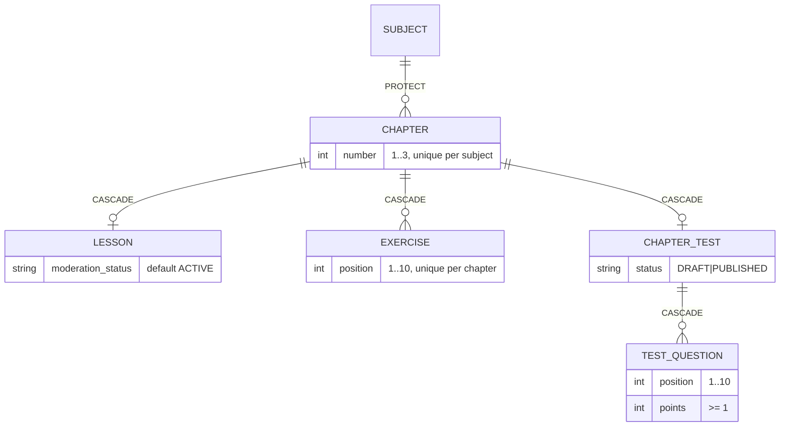

### Story 3.2: Content Data Model

**BUILDID**: CYCLE-2 | **GitHub**: LOCAL | **AzureDevOps**: LOCAL | **Epic**: 3 - Teacher Content Authoring | **ID**: 3.2 | **Date**: 2026-10-19
**File**: `docs/plans/stories/epic-3-story-3.2-Content-Data-Model.md`
**Build Ref**: `docs/plans/builds/cycle-2/cycle-plan.md` — CYCLE-2 (Workshop Day 1: Chapter/Lesson/Exercise/ChapterTest/TestQuestion models with constraints and `ModeratedModel`)
**Wave**: 6
**Requires**: [1.10]
**Enables**: [3.5, 3.6, 3.7, 3.8, 4.1, 5.1]
**Files Touched**:
  - src/infrastructure/persistence/common/managers.py
  - src/infrastructure/persistence/content/__init__.py
  - src/infrastructure/persistence/content/apps.py
  - src/infrastructure/persistence/content/models.py
  - src/infrastructure/persistence/content/migrations/**
  - src/infrastructure/persistence/content/repositories/__init__.py
  - src/infrastructure/persistence/content/queries/__init__.py
  - src/config/settings/base.py
  - tests/factories/content.py
  - tests/integration/persistence/content/**
**Roles Ref**: docs/requirements.md#roles--permissions-matrix — single-actor — no role variation (schema and data integrity only)
**QA Candidate**: No — schema, constraints and factories with no route or UI. It becomes observable through Stories 3.5–3.8, 4.2–4.3 and 5.1, where QA checks it. Integrity is proven here by persistence tests.

---

#### 👤 User Reference

**Description**:
This story creates the places in the database where teachers' content is stored:
- **Chapters:** up to three per pilot subject, with titles in both languages.
- **Lessons:** one per chapter, with the lesson text in Romanian and English.
- **Exercises:** up to 10 per chapter, each with its question, answer options, correct answer and explanation in both languages.
- **Chapter tests:** one per chapter, with exactly 10 questions and their points.

The database itself also enforces the most important limits, as a safety net behind the rules in Story 3.1:
- no chapter numbers outside 1–3 and no duplicates
- no more than 10 exercises
- every test question worth at least one point
- one lesson and one test per chapter

Every lesson, exercise and test also gets a **moderation status**, starting as "active" so content is visible to students as soon as a teacher saves it (as the requirements state). Next cycle, administrators can flag or block items. The one sanctioned way to ask the database for "content students may see" is created here, so no later page can accidentally show blocked content. Each content item also records which teacher created it and who last changed it, which is needed to notify the right teacher when content gets blocked.

Nothing changes on screen yet.

**Acceptance Criteria** (plain-English):
- Chapters, lessons, exercises, chapter tests and test questions can be stored with all their bilingual text.
- A subject can't have a chapter numbered outside 1–3 or two chapters with the same number.
- A chapter has at most one lesson, at most one test and at most 10 exercises (numbered 1–10).
- A test has at most 10 questions (numbered 1–10), each worth at least 1 point.
- New lessons, exercises and tests start as "active", visible to students immediately.
- There's a single, shared way to fetch only student-visible content; for tests, that also requires the test to be published.
- Each content item remembers which teacher created and last changed it, and when. If a teacher's account is deleted, their content stays.
- A subject that has chapters can't be deleted, and deleting a chapter removes its lesson, exercises and test.
- The structure can be installed and removed cleanly.

**User Flow**:
Actor: system — no role variation.

**Flow Diagram**:



---

#### 🤖 AI Agent Reference

**Must Read**:
- `docs/architecture/design/00-system-architecture-greenfield.md` — Data Model (`CHAPTER`, `LESSON`, `EXERCISE`, `CHAPTER_TEST`, `TEST_QUESTION`), Integrity rules, Answer key formats, Moderation visibility rule
- `docs/architecture/design/01-patterns-and-standards-greenfield.md` — §6.2 models (`ModeratedModel`, `ModeratedQuerySet.visible_to_learners()` reference code), §6.4 migrations, §12.3 factories
- `docs/plans/stories/epic-3-story-3.1-Content-Domain-Rules.md` — `QuestionKind`, `ModerationStatus` values (mirrored as literal choices here)
- `docs/plans/stories/epic-2-story-2.1-Catalogue-Data.md` — `SubjectModel` (FK target, `PROTECT`)

**Description**:
1. **Shared manager:** `persistence/common/managers.py` gets `ModeratedQuerySet` (with `visible_to_learners()`) and the abstract `ModeratedModel` (patterns §6.2) plus `AuthoredModel` (`created_by`, `updated_by`, `created_at`, `updated_at`).
2. **Content app:** `infrastructure.persistence.content` (label `content`) with:
   - `ChapterModel`, `LessonModel`, `ExerciseModel`, `ChapterTestModel` (its own `ChapterTestQuerySet.visible_to_learners()` also requiring `status="PUBLISHED"`), `TestQuestionModel`
   - migration `0001`
   - empty `repositories/` and `queries/` packages, so the wave-8 stories add one module each without creating the package concurrently
3. **Factories** for all five models, plus `published_test(chapter)` and `complete_chapter(subject)` helpers used by later tests and E2E seeds.

Choices are **literal strings** equal to the domain enums of Story 3.1 (same wave, not importable yet). Story 3.5 adds the equality test (`test_choices_match_domain.py`).

**Acceptance Criteria**:
1. `managers.py`:
   - `ModeratedQuerySet.visible_to_learners()` filters `moderation_status="ACTIVE"`
   - `ModeratedModel` (abstract): `moderation_status` CharField(12, choices ACTIVE/FLAGGED/BLOCKED/RESUBMITTED, default ACTIVE, db_index), `moderation_reason` TextField(blank), `moderation_updated_at` DateTimeField(null)
   - `AuthoredModel` (abstract): `created_by`/`updated_by` FK → user (`SET_NULL`, null, `related_name="+"`), `created_at`/`updated_at` DateTimeField (set by use cases from `Clock`, **not** `auto_now`)
2. `ChapterModel` (`content_chapter`):
   - `subject` FK → `catalogue.SubjectModel` (`PROTECT`, `related_name="chapters"`)
   - `number` PositiveSmallIntegerField
   - `title_ro`/`title_en` CharField(160)
   - `AuthoredModel` fields
   - constraints `UniqueConstraint(subject, number)` and `CheckConstraint(number BETWEEN 1 AND 3)`; ordering `["subject_id", "number"]`
3. `LessonModel` (`content_lesson`): `chapter` OneToOneField (`CASCADE`, `related_name="lesson"`), `body_ro`/`body_en` TextField, `ModeratedModel` + `AuthoredModel`.
4. `ExerciseModel` (`content_exercise`):
   - `chapter` FK (`CASCADE`, `related_name="exercises"`)
   - `position` PositiveSmallIntegerField; `kind` CharField(12, choices MCQ/TRUE_FALSE/NUMERIC)
   - `prompt_ro`/`prompt_en` TextField; `options` JSONField(default=list); `answer_key` JSONField
   - `explanation_ro`/`explanation_en` TextField
   - Moderated + Authored
   - constraints `UniqueConstraint(chapter, position)` and `CheckConstraint(position BETWEEN 1 AND 10)`; ordering `["chapter_id", "position"]`
5. `ChapterTestModel` (`content_chapter_test`):
   - `chapter` OneToOneField (`CASCADE`, `related_name="test"`)
   - `status` CharField(10, choices DRAFT/PUBLISHED, default DRAFT); `published_at` DateTimeField(null)
   - Moderated + Authored
   - `objects = ChapterTestQuerySet.as_manager()`, whose `visible_to_learners()` = ACTIVE **and** PUBLISHED
6. `TestQuestionModel` (`content_test_question`):
   - `test` FK (`CASCADE`, `related_name="questions"`)
   - `position`, `kind`, `prompt_ro`/`prompt_en`, `options` JSON, `answer_key` JSON, `points` PositiveSmallIntegerField
   - constraints `UniqueConstraint(test, position)`, `CheckConstraint(position BETWEEN 1 AND 10)`, `CheckConstraint(points >= 1)`
   - no moderation fields (moderated as part of its test)
7. `INSTALLED_APPS` gains `"infrastructure.persistence.content"`; migration `0001_initial` depends on `catalogue 0002` and `accounts 0002`; `makemigrations --check` clean; `migrate content zero` round-trips.
8. Deleting a `SubjectModel` that has chapters raises `ProtectedError` (the catalogue reverse migration stays safe). Deleting a chapter cascades to its lesson, exercises, test and questions. Deleting a teacher sets `created_by`/`updated_by` to NULL and keeps the content.
9. `tests/factories/content.py`:
   - `ChapterFactory` (grade-2 MEM subject via `SubjectFactory`, number sequence 1–3), `LessonFactory`, `ExerciseFactory` (valid MCQ by default; traits `true_false`, `numeric`), `ChapterTestFactory` (DRAFT), `TestQuestionFactory`
   - `published_test(chapter, points=(10,)*10)` → PUBLISHED test with 10 valid questions
   - `complete_chapter(subject, number)` → chapter + lesson + 5 exercises + published test

**RBAC Enforcement**:
No role-differentiated access — single actor.
- No route. The `visible_to_learners()` querysets are the persistence half of the moderation visibility rule. Learner query services (Stories 4.2–4.3) must use them (patterns §6.3 DO/DON'T).

**System responses + error cases**:

| Trigger | Response | Side-effect |
|---------|----------|-------------|
| `migrate` on CYCLE-1 DB | "Applying content.0001_initial… OK" | 5 tables + indexes |
| `migrate` repeated | "No migrations to apply." | none |
| Insert chapter number 4 / 0 | `IntegrityError` (check) | none |
| Second chapter with the same `(subject, number)` | `IntegrityError` | none |
| Second lesson or test for a chapter | `IntegrityError` (one-to-one) | none |
| Exercise position 11 or duplicate position | `IntegrityError` | none |
| Test question with `points=0` | `IntegrityError` | none |
| New lesson/exercise/test without explicit status | stored as `moderation_status="ACTIVE"` | none |
| `LessonModel.objects.visible_to_learners()` with one ACTIVE, one BLOCKED | returns only the ACTIVE one | none |
| `ChapterTestModel.objects.visible_to_learners()` with ACTIVE+DRAFT | empty (must be PUBLISHED) | none |
| Delete subject with chapters | `ProtectedError` | none |
| Delete chapter | — | lesson, exercises, test, questions deleted |
| Delete teacher user | — | content kept; `created_by`/`updated_by` = NULL |

**Prerequisites**:
- CYCLE-1 complete (catalogue tables + seed from 2.1; user model; `ParentChildLink` migration `accounts 0002` from 1.9).

**Context**: `docs/architecture/design/00-system-architecture-greenfield.md`, `docs/architecture/design/01-patterns-and-standards-greenfield.md`, `src/infrastructure/persistence/catalogue/models.py`, `tests/factories/catalogue.py`

**Patterns**: Models & constraints (§6.2), Migrations (§6.4), Factories (§12.3) — see `docs/architecture/design/01-patterns-and-standards-greenfield.md`

**Steps**:

1. **Persistence tests first** (`tests/integration/persistence/content/test_constraints.py`, `test_visibility.py`, `test_deletion.py`).

2. **Shared abstracts** (`persistence/common/managers.py`):
   ```python
   from django.conf import settings
   from django.db import models

   MODERATION_CHOICES = [("ACTIVE", "Active"), ("FLAGGED", "Flagged"),
                         ("BLOCKED", "Blocked"), ("RESUBMITTED", "Resubmitted")]  # == domain ModerationStatus


   class ModeratedQuerySet(models.QuerySet):
       def visible_to_learners(self) -> "ModeratedQuerySet":
           """The ONLY sanctioned filter for Student/Parent-facing content (patterns §6.2)."""
           return self.filter(moderation_status="ACTIVE")


   class ModeratedModel(models.Model):
       moderation_status = models.CharField(max_length=12, choices=MODERATION_CHOICES, default="ACTIVE", db_index=True)
       moderation_reason = models.TextField(blank=True)
       moderation_updated_at = models.DateTimeField(null=True, blank=True)

       objects = ModeratedQuerySet.as_manager()

       class Meta:
           abstract = True


   class AuthoredModel(models.Model):
       created_by = models.ForeignKey(settings.AUTH_USER_MODEL, null=True, on_delete=models.SET_NULL, related_name="+")
       updated_by = models.ForeignKey(settings.AUTH_USER_MODEL, null=True, on_delete=models.SET_NULL, related_name="+")
       created_at = models.DateTimeField()
       updated_at = models.DateTimeField()

       class Meta:
           abstract = True
   ```

3. **Models** (`persistence/content/models.py`, excerpt):
   ```python
   from django.db import models
   from django.db.models import Q

   from infrastructure.persistence.common.managers import AuthoredModel, ModeratedModel, ModeratedQuerySet

   KIND_CHOICES = [("MCQ", "Multiple choice"), ("TRUE_FALSE", "True/false"), ("NUMERIC", "Number")]  # == QuestionKind


   class ChapterModel(AuthoredModel):
       subject = models.ForeignKey("catalogue.SubjectModel", on_delete=models.PROTECT, related_name="chapters")
       number = models.PositiveSmallIntegerField()
       title_ro = models.CharField(max_length=160)
       title_en = models.CharField(max_length=160)

       class Meta:
           db_table = "content_chapter"
           ordering = ["subject_id", "number"]
           constraints = [
               models.UniqueConstraint(fields=["subject", "number"], name="uniq_chapter_number_per_subject"),
               models.CheckConstraint(condition=Q(number__gte=1, number__lte=3), name="chapter_number_1_3"),
           ]


   class ChapterTestQuerySet(ModeratedQuerySet):
       def visible_to_learners(self):
           return super().visible_to_learners().filter(status="PUBLISHED")


   class ChapterTestModel(ModeratedModel, AuthoredModel):
       chapter = models.OneToOneField(ChapterModel, on_delete=models.CASCADE, related_name="test")
       status = models.CharField(max_length=10, choices=[("DRAFT", "Draft"), ("PUBLISHED", "Published")], default="DRAFT")
       published_at = models.DateTimeField(null=True, blank=True)

       objects = ChapterTestQuerySet.as_manager()

       class Meta:
           db_table = "content_chapter_test"
   ```
   `LessonModel`, `ExerciseModel` and `TestQuestionModel` follow AC 3, 4 and 6 (constraints named `uniq_exercise_position`, `exercise_position_1_10`, `uniq_question_position`, `question_position_1_10`, `question_points_min_1`).

4. **App, settings, migration:** `apps.py` (`label = "content"`), add to `INSTALLED_APPS`, `makemigrations content`, round-trip.

5. **Factories** (`tests/factories/content.py`, excerpt):
   ```python
   import datetime

   import factory

   from infrastructure.persistence.content.models import (
       ChapterModel, ChapterTestModel, ExerciseModel, LessonModel, TestQuestionModel)
   from tests.factories.catalogue import SubjectFactory

   NOW = datetime.datetime(2026, 10, 28, 9, 0, tzinfo=datetime.UTC)


   class ChapterFactory(factory.django.DjangoModelFactory):
       class Meta:
           model = ChapterModel

       subject = factory.SubFactory(SubjectFactory)
       number = factory.Sequence(lambda n: n % 3 + 1)
       title_ro = factory.Sequence(lambda n: f"Capitolul {n}")
       title_en = factory.Sequence(lambda n: f"Chapter {n}")
       created_at = updated_at = NOW


   class ExerciseFactory(factory.django.DjangoModelFactory):
       class Meta:
           model = ExerciseModel

       chapter = factory.SubFactory(ChapterFactory)
       position = factory.Sequence(lambda n: n % 10 + 1)
       kind = "MCQ"
       prompt_ro, prompt_en = "Cât face 2+2?", "What is 2+2?"
       options = [{"id": "a", "ro": "3", "en": "3"}, {"id": "b", "ro": "4", "en": "4"}]
       answer_key = {"option_id": "b"}
       explanation_ro, explanation_en = "2+2=4.", "2+2=4."
       created_at = updated_at = NOW

       class Params:
           true_false = factory.Trait(kind="TRUE_FALSE", options=[], answer_key={"value": True})
           numeric = factory.Trait(kind="NUMERIC", options=[], answer_key={"value": "2.5"})


   def published_test(chapter, points=(10,) * 10):
       test = ChapterTestFactory(chapter=chapter, status="PUBLISHED", published_at=NOW)
       for position, value in enumerate(points, start=1):
           TestQuestionFactory(test=test, position=position, points=value)
       return test


   def complete_chapter(subject, number):
       chapter = ChapterFactory(subject=subject, number=number)
       LessonFactory(chapter=chapter)
       for position in range(1, 6):
           ExerciseFactory(chapter=chapter, position=position)
       published_test(chapter)
       return chapter
   ```

6. **Run all gates.**

**Tests**:

```python
# tests/integration/persistence/content/test_constraints.py
import pytest
from django.db import IntegrityError, transaction

from tests.factories.content import (
    ChapterFactory, ChapterTestFactory, ExerciseFactory, LessonFactory, TestQuestionFactory)

pytestmark = pytest.mark.django_db


@pytest.mark.parametrize("number", [0, 4])
def test_chapter_number_must_be_1_to_3(number):
    with pytest.raises(IntegrityError), transaction.atomic():
        ChapterFactory(number=number)


def test_chapter_number_unique_per_subject():
    chapter = ChapterFactory(number=1)

    with pytest.raises(IntegrityError), transaction.atomic():
        ChapterFactory(subject=chapter.subject, number=1)


def test_one_lesson_and_one_test_per_chapter():
    chapter = ChapterFactory()
    LessonFactory(chapter=chapter)
    ChapterTestFactory(chapter=chapter)

    with pytest.raises(IntegrityError), transaction.atomic():
        LessonFactory(chapter=chapter)
    with pytest.raises(IntegrityError), transaction.atomic():
        ChapterTestFactory(chapter=chapter)


@pytest.mark.parametrize("position", [0, 11])
def test_exercise_position_1_to_10(position):
    with pytest.raises(IntegrityError), transaction.atomic():
        ExerciseFactory(position=position)


def test_question_points_at_least_one():
    with pytest.raises(IntegrityError), transaction.atomic():
        TestQuestionFactory(points=0)


def test_new_content_defaults_to_active():
    assert LessonFactory().moderation_status == "ACTIVE"
    assert ExerciseFactory().moderation_status == "ACTIVE"
    assert ChapterTestFactory().moderation_status == "ACTIVE"
```

```python
# tests/integration/persistence/content/test_visibility.py
import pytest

from infrastructure.persistence.content.models import ChapterTestModel, LessonModel
from tests.factories.content import ChapterTestFactory, LessonFactory

pytestmark = pytest.mark.django_db


@pytest.mark.parametrize("hidden", ["FLAGGED", "BLOCKED", "RESUBMITTED"])
def test_only_active_lessons_are_visible(hidden):
    visible = LessonFactory()
    LessonFactory(moderation_status=hidden)

    assert list(LessonModel.objects.visible_to_learners()) == [visible]


def test_tests_must_be_active_and_published():
    published = ChapterTestFactory(status="PUBLISHED")
    ChapterTestFactory(status="DRAFT")
    ChapterTestFactory(status="PUBLISHED", moderation_status="BLOCKED")

    assert list(ChapterTestModel.objects.visible_to_learners()) == [published]
```

```python
# tests/integration/persistence/content/test_deletion.py
import pytest
from django.db.models import ProtectedError

from infrastructure.persistence.content.models import ExerciseModel, LessonModel, TestQuestionModel
from tests.factories.accounts import TeacherFactory
from tests.factories.catalogue import SubjectFactory
from tests.factories.content import complete_chapter

pytestmark = pytest.mark.django_db


def test_subject_with_chapters_is_protected():
    subject = SubjectFactory()
    complete_chapter(subject, 1)

    with pytest.raises(ProtectedError):
        subject.delete()


def test_deleting_chapter_cascades_content():
    chapter = complete_chapter(SubjectFactory(), 1)

    chapter.delete()

    assert (LessonModel.objects.count(), ExerciseModel.objects.count(), TestQuestionModel.objects.count()) == (0, 0, 0)


def test_deleting_teacher_keeps_content():
    teacher = TeacherFactory()
    chapter = complete_chapter(SubjectFactory(), 1)
    LessonModel.objects.filter(chapter=chapter).update(created_by=teacher, updated_by=teacher)

    teacher.delete()

    lesson = LessonModel.objects.get(chapter=chapter)
    assert (lesson.created_by_id, lesson.updated_by_id) == (None, None)
```

Manual:
- `uv run python manage.py migrate`, then `migrate content zero`, then `migrate` (round-trip).
- `uv run python manage.py dbshell` → `.schema content_exercise` shows the unique and check constraints.

**Quality**: ruff 0; mypy passes; `makemigrations --check` clean; tests pass; coverage ≥85%; no `auto_now` (timestamps come from `Clock` via use cases); no `TODO`.

**OUT**:
- ❌ Repositories and use cases (Stories 3.5–3.8 add one module each under `repositories/`).
- ❌ Query services (3.5 teacher, 4.2/4.3 learner, 5.1 reporting).
- ❌ Moderation events, notifications and state transitions (CYCLE-3).
- ❌ Test attempts and answers (CYCLE-3, `assessment`).
- ❌ Django admin registration of content (not in architecture; teachers use `/teach/`).

**Evidence**: pytest output (constraints, visibility, deletion), `migrate` + round-trip output, the `.schema` excerpt, and the coverage %, all recorded in `docs/stories-implemented/story-3.2-review.md` under "## DoD Evidence".
