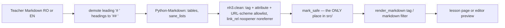

### Story 3.3: Markdown Rendering

**BUILDID**: CYCLE-2 | **GitHub**: LOCAL | **AzureDevOps**: LOCAL | **Epic**: 3 - Teacher Content Authoring | **ID**: 3.3 | **Date**: 2026-10-19
**File**: `docs/plans/stories/epic-3-story-3.3-Markdown-Rendering.md`
**Build Ref**: `docs/plans/builds/cycle-2/cycle-plan.md` — CYCLE-2 (Workshop Day 1: lesson Markdown rendered via Markdown + nh3)
**Wave**: 6
**Requires**: [1.10]
**Enables**: [3.6, 4.2]
**Files Touched**:
  - src/infrastructure/rendering/**
  - src/infrastructure/web/templatetags/markdown.py
  - tests/unit/infrastructure/test_markdown.py
  - tests/integration/web/test_no_unsafe_html.py
**Roles Ref**: docs/requirements.md#roles--permissions-matrix — single-actor — no role variation (a rendering utility; the editor and reader pages that use it are role-guarded)
**QA Candidate**: Yes — **Observable:** teacher-written lesson text with headings, bold/italic, lists, tables, quotes, code and links shows formatted. Scripts, styles, iframes, images, event handlers and `javascript:` links never reach a page. A top-level `#` heading becomes a second-level heading, so each page keeps one `<h1>`. **Mechanism:** `render_markdown(text) -> SafeString`: Python-Markdown (`tables`, `sane_lists`, `fenced_code`) → `nh3.clean` with an explicit tag/attribute/URL-scheme allowlist and `rel="noopener noreferrer"` on links. Template tags `` (localized field) and `{{ text|markdown }}` (preview). `test_no_unsafe_html` greps `src/` so `mark_safe` / `|safe` / `format_html` with user data exist only in the renderer. **Authz & preconditions:** none in the utility; callers are guarded views. **Edge & idempotency:** empty or whitespace input → empty string; `None` → empty string; rendering is pure and deterministic, so the same input gives byte-identical output; malformed Markdown never raises; 50,000+ character input renders without error. **Regression:** the XSS payload corpus (OWASP-style vectors) must render inert; this is the only place HTML is trusted, so it's security-critical for children's devices.

---

#### 👤 User Reference

**Description**:
Teachers write lessons in a simple formatting language (Markdown), using `##` for headings, `**bold**`, `-` for bullet lists and so on, in both Romanian and English. This story turns that text into nicely formatted lesson pages.

Because the platform is used by children, it's also a safety filter. Whatever a teacher types or pastes, nothing that could run a program or pull in outside content ever reaches a student's screen:
- **Allowed:** headings, emphasis, lists, quotes, tables, code and ordinary links. Links open safely and are labelled as external.
- **Removed:** anything else (scripts, hidden frames, styles, pictures, tricky link types). Pictures in lessons aren't part of this pilot, as agreed in the architecture.
- **Heading levels:** a top-level heading written by a teacher is shown one level smaller, so every page keeps exactly one main title for screen readers.

An automatic check also makes sure no other part of the platform ever outputs raw HTML. All formatted content must pass through this filter.

**Acceptance Criteria** (plain-English):
- Lesson text with headings, bold, italics, bullet and numbered lists, tables, quotes, inline code and links is displayed formatted.
- A heading written with a single `#` is shown as a second-level heading.
- Scripts, styles, frames, images, forms and event handlers are removed; the text around them still shows.
- Links work only for web addresses (http/https) and email; other link types are removed; links get safe-opening attributes.
- Romanian letters (ș ț ă â î) display correctly.
- Empty lesson text shows nothing rather than an error.
- The same text always produces the same result.
- An automatic check fails if any other part of the platform outputs unfiltered HTML.

**User Flow** (no role variation — a shared utility):

**User Journey** (as experienced through lesson pages built in Stories 3.6 and 4.2):
- **Entry**: a teacher types Markdown into the lesson editor (preview), or a student opens a lesson.
- **Load**: the page calls `` for the active language (or `{{ text|markdown }}` for the editor preview).
- **Render**: Markdown → HTML → allowlist sanitising → safe HTML inserted under the page's `<h1>`.
- **Interact**: links open in the same tab with `rel="noopener noreferrer"`; tables keep header cells for screen readers.
- **Empty/error**: empty text gives an empty block; malformed Markdown renders as text; dangerous markup disappears silently while surrounding text stays.
- **Responsive**: desktop-only; tables scroll horizontally within the content column if wide (CSS from the reader/editor stories).

**Flow Diagram**:



---

#### 🤖 AI Agent Reference

**Must Read**:
- `docs/architecture/design/00-system-architecture-greenfield.md` — ADR-010 (Markdown + nh3; no images in MVP), Security Design (XSS row, CSP)
- `docs/architecture/design/01-patterns-and-standards-greenfield.md` — §11.3 (`render_markdown` is the only `mark_safe`), §12.4 (`test_no_unsafe_html_outside_renderer`), §13
- `docs/plans/stories/epic-1-story-1.4-Internationalization.md` — `localized()` helper used by the tag

**Description**:
1. **`src/infrastructure/rendering/markdown.py`:** `render_markdown(text: str | None) -> SafeString`. It demotes ATX level-1 headings (`# x` → `## x`, outside fenced code), converts with `markdown.markdown(text, extensions=["tables", "sane_lists", "fenced_code"], output_format="html")`, sanitises with `nh3.clean(...)` and an explicit allowlist, then `mark_safe`s the result. The allowlist lives in constants.
2. **`src/infrastructure/web/templatetags/markdown.py`:**
   - `@register.simple_tag render_markdown(obj, field)`, which uses `localized(obj, field)` for the active language
   - `@register.filter markdown(text)` for raw text (editor preview)
3. **`tests/integration/web/test_no_unsafe_html.py`:** the mandatory cross-cutting guard from patterns §12.4. It scans `src/**/*.py` and `src/**/*.html` for `mark_safe(`, `|safe`, `SafeString(` and `format_html(` (the last allowed only with literal format strings and no request data). It fails for any occurrence outside `rendering/markdown.py`, with a small allowlist for Django-generated widget markup that's already escaped (none expected).

**Acceptance Criteria**:
1. Allowed tags: `p, br, h2, h3, h4, h5, h6, strong, em, ul, ol, li, blockquote, code, pre, hr, a, table, thead, tbody, tr, th, td`. Attributes: `a: href, title`; `th/td: align` (values `left|center|right`). URL schemes: `http, https, mailto`. `link_rel="noopener noreferrer"`. Everything else is stripped, keeping the text content (except `script`/`style`, removed with their content: `nh3` default `clean_content_tags`).
2. Lines beginning with exactly `# ` (level-1 ATX heading) outside fenced code blocks are rewritten to `## ` before conversion. `##`+ headings are untouched. Setext `===` headings are also demoted (convert to `h2` via a regex on `<h1>` → `<h2>` before sanitising).
3. `render_markdown("")`, `render_markdown("   ")` and `render_markdown(None)` return `""`.
4. The XSS corpus in the tests (≥ 12 vectors: `<script>`, ``, `<svg onload>`, `javascript:` link, `data:` link, `vbscript:` link, `<iframe>`, `<style>`, `<form>`, `<a href="x" onclick>`, `[x](javascript:alert(1))`, HTML entity-encoded `javascript&#58;`) renders without any `<script`, `on…=` attribute, `javascript:`, `data:`, `<iframe`, `<style`, `<form` or `Adunarea</h2>\n<p><strong>2 + 2 = 4</strong></p>` | none |
| Same input again (idempotent) | byte-identical output | none |
| `"# Titlu"` | `<h2>Titlu</h2>` | none |
| `"Text <script>alert(1)</script> after"` | `<p>Text  after</p>` (script and its content removed) | none |
| `"[click](javascript:alert(1))"` | `<p><a rel="noopener noreferrer">click</a></p>` (href dropped) | none |
| `"[site](https://manuale.edu.ro)"` | `<a href="https://manuale.edu.ro" rel="noopener noreferrer">site</a>` | none |
| `""` | image removed; alt text not rendered as `` | none |
| Table with header row | `<table><thead>…<th>…</th>` preserved | none |
| `""` / `None` | `""` | none |
| Unclosed `**bold` | literal text, no exception | none |
| `|safe` added to any template | `test_no_unsafe_html` fails naming the file:line | CI red |

**QA-observable behaviour**:
- For each XSS vector in the corpus, the rendered HTML contains none of the forbidden substrings (AC 4).
- Every rendered `<a>` carries `rel="noopener noreferrer"`; no `<a>` has a non-http(s)/mailto `href`.
- No rendered output contains `<h1`.
- **What does NOT change**: the stored Markdown is never modified (rendering is read-only); the CSP header is unchanged (no inline styles or scripts are produced).

**Prerequisites**:
- CYCLE-1 complete. `markdown` and `nh3` are already locked (Story 1.0); `localized` exists (Story 1.4); `infrastructure.web` is registered for template tags (Story 1.0).

**Context**: `docs/architecture/design/00-system-architecture-greenfield.md`, `docs/architecture/design/01-patterns-and-standards-greenfield.md`, `src/infrastructure/web/common/i18n.py`

**Patterns**: i18n & Markdown (§11.3), Security (§13), Mandatory cross-cutting tests (§12.4) — see `docs/architecture/design/01-patterns-and-standards-greenfield.md`

**Steps**:

1. **Tests first** (XSS corpus, formatting, headings, determinism, performance, tag localisation, no-unsafe-HTML guard).

2. **Renderer:**
   ```python
   # src/infrastructure/rendering/markdown.py
   import re

   import markdown
   import nh3
   from django.utils.safestring import SafeString, mark_safe

   ALLOWED_TAGS = frozenset({
       "p", "br", "h2", "h3", "h4", "h5", "h6", "strong", "em", "ul", "ol", "li", "blockquote",
       "code", "pre", "hr", "a", "table", "thead", "tbody", "tr", "th", "td",
   })
   ALLOWED_ATTRIBUTES = {"a": {"href", "title"}, "th": {"align"}, "td": {"align"}}
   URL_SCHEMES = frozenset({"http", "https", "mailto"})
   _H1_LINE = re.compile(r"^# (?=\S)", re.MULTILINE)
   _FENCE = re.compile(r"^```.*?^```", re.MULTILINE | re.DOTALL)
   _H1_TAG = re.compile(r"<(/?)h1>")


   def _demote_h1(text: str) -> str:
       """Keep exactly one <h1> per page: teacher '# ' headings become '## ' (outside fenced code)."""
       parts, last = [], 0
       for fence in _FENCE.finditer(text):
           parts.append(_H1_LINE.sub("## ", text[last:fence.start()]))
           parts.append(fence.group(0))
           last = fence.end()
       parts.append(_H1_LINE.sub("## ", text[last:]))
       return "".join(parts)


   def render_markdown(text: str | None) -> SafeString:
       """Teacher Markdown → sanitised HTML. The ONLY trusted-HTML producer in the codebase."""
       if not text or not text.strip():
           return mark_safe("")  # noqa: S308 — empty string
       html = markdown.markdown(_demote_h1(text), extensions=["tables", "sane_lists", "fenced_code"], output_format="html")
       html = _H1_TAG.sub(r"<\1h2>", html)  # setext '===' headings
       cleaned = nh3.clean(html, tags=set(ALLOWED_TAGS), attributes=ALLOWED_ATTRIBUTES,
                           url_schemes=set(URL_SCHEMES), link_rel="noopener noreferrer")
       return mark_safe(cleaned)  # noqa: S308 — sanitised by nh3 allowlist above
   ```

3. **Template tags:**
   ```python
   # src/infrastructure/web/templatetags/markdown.py
   from django import template

   from infrastructure.rendering.markdown import render_markdown as _render
   from infrastructure.web.common.i18n import localized

   register = template.Library()


   @register.simple_tag
   def render_markdown(obj: object, field: str):
       """ → sanitised HTML of body_<active language>."""
       return _render(localized(obj, field))


   @register.filter(name="markdown")
   def markdown_filter(text: str | None):
       """{{ draft_text|markdown }} for the editor preview."""
       return _render(text)
   ```

4. **Guard test** (Step 1 code below) and a manual negative check (AC 9).

5. **Run gates**, recording the 50k-character render time.

**Tests**:

```python
# tests/unit/infrastructure/test_markdown.py
import time
from types import SimpleNamespace

import pytest
from django.template import Context, Template
from django.utils import translation

from infrastructure.rendering.markdown import render_markdown

XSS = [
    "<script>alert(1)</script>", "", "<svg onload=alert(1)>",
    "[a](javascript:alert(1))", "[a](data:text/html;base64,PHNjcmlwdD4=)", "[a](vbscript:msgbox(1))",
    "<iframe src='https://evil'></iframe>", "<style>body{display:none}</style>", "<form action=x><input></form>",
    '<a href="https://ok" onclick="alert(1)">x</a>', "[a](JaVaScRiPt:alert(1))", "[a](javascript&#58;alert(1))",
]
FORBIDDEN = ["<script", "onerror", "onload", "onclick", "javascript:", "data:", "vbscript:", "<iframe",
             "<style", "<form", " citat\n\n`2+2`"))

    for fragment in ("<h2>Adunarea</h2>", "<strong>bold</strong>", "<em>it</em>", "<li>unu</li>",
                     "<blockquote>", "<code>2+2</code>"):
        assert fragment in html


def test_tables_keep_header_cells():
    html = str(render_markdown("| a | b |\n|---|---|\n| 1 | 2 |"))

    assert "<thead>" in html and "<th>a</th>" in html


@pytest.mark.parametrize("source", ["# Titlu", "Titlu\n====="])
def test_level_one_headings_are_demoted(source):
    html = str(render_markdown(source))

    assert "<h1" not in html and "<h2>Titlu</h2>" in html


def test_heading_marker_inside_code_fence_is_untouched():
    assert "# comment" in str(render_markdown("```\n# comment\n```"))


def test_links_are_safe_and_external_rel_added():
    html = str(render_markdown("[manuale](https://manuale.edu.ro)"))

    assert 'href="https://manuale.edu.ro"' in html and 'rel="noopener noreferrer"' in html


@pytest.mark.parametrize("text", ["", "   ", None])
def test_empty_input_renders_empty(text):
    assert str(render_markdown(text)) == ""


def test_diacritics_and_determinism():
    source = "Știința și țara: ă â î ș ț"

    assert str(render_markdown(source)) == str(render_markdown(source))
    assert "Știința și țara: ă â î ș ț" in str(render_markdown(source))


def test_large_lesson_renders_quickly():
    source = ("Paragraf cu **text** și o listă.\n\n- a\n- b\n\n" * 1500)[:50_000]

    started = time.perf_counter()
    render_markdown(source)

    assert time.perf_counter() - started < 1.0


@pytest.mark.parametrize(("lang", "expected"), [("ro", "Româna"), ("en", "English")])
def test_tag_renders_active_language(lang, expected):
    lesson = SimpleNamespace(body_ro="## Româna", body_en="## English")

    with translation.override(lang):
        html = Template('').render(Context({"lesson": lesson}))

    assert f"<h2>{expected}</h2>" in html
```

```python
# tests/integration/web/test_no_unsafe_html.py
import re
from pathlib import Path

RENDERER = Path("src/infrastructure/rendering/markdown.py")
PATTERNS = [re.compile(r"mark_safe\("), re.compile(r"\|\s*safe\b"), re.compile(r"SafeString\("),
            re.compile(r"format_html\(")]


def test_no_unsafe_html_outside_renderer():
    offenders = []
    for path in [*Path("src").rglob("*.py"), *Path("src").rglob("*.html")]:
        if path == RENDERER:
            continue
        for number, line in enumerate(path.read_text(encoding="utf-8").splitlines(), start=1):
            if any(p.search(line) for p in PATTERNS):
                offenders.append(f"{path}:{number}: {line.strip()}")
    assert offenders == [], "Trusted-HTML outside the Markdown renderer:\n" + "\n".join(offenders)
```

Manual:
- Locally (not committed), add `{{ x|safe }}` to any template and confirm `test_no_unsafe_html` fails naming it, then revert.
- Render a sample Romanian lesson (headings, list, table, link) in a Django shell and paste the HTML into the review doc.

**Quality**: ruff 0 (the two `S308` suppressions carry their justification comments); mypy passes; tests pass; 100% coverage for the renderer and tags; no `TODO`.

**OUT**:
- ❌ The lesson editor UI and preview endpoint (Story 3.6) and the lesson reader page (Story 4.2).
- ❌ Images, file uploads or embedded media (ADR-010; future enhancement).
- ❌ Markdown in exercise/test prompts and explanations (plain text by design: short, autoescaped).
- ❌ A WYSIWYG editor or any JS editor dependency.

**Evidence**: pytest output (incl. all 12 XSS vectors), 100% coverage for the renderer and tags, the recorded 50k-character render time, and the manual negative check of the guard test, all recorded in `docs/stories-implemented/story-3.3-review.md` under "## DoD Evidence".
