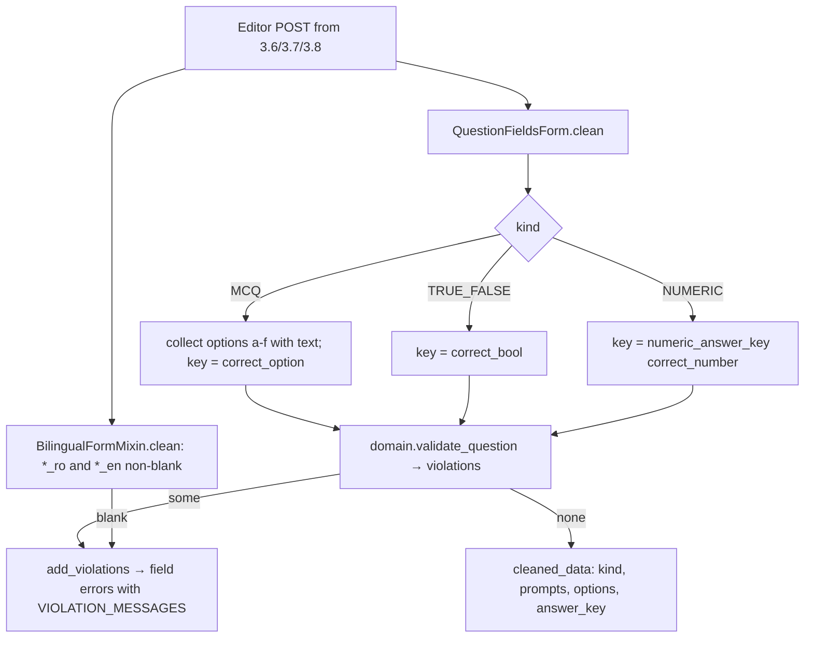

### Story 3.4: Authoring Web Kit

**BUILDID**: CYCLE-2 | **GitHub**: LOCAL | **AzureDevOps**: LOCAL | **Epic**: 3 - Teacher Content Authoring | **ID**: 3.4 | **Date**: 2026-10-19
**File**: `docs/plans/stories/epic-3-story-3.4-Authoring-Web-Kit.md`
**Build Ref**: `docs/plans/builds/cycle-2/cycle-plan.md` — CYCLE-2 (Workshop Day 1–2: shared pieces for the lesson, exercise and test editors)
**Wave**: 7
**Requires**: [3.1]
**Enables**: [3.5, 3.6, 3.7, 3.8]
**Files Touched**:
  - src/infrastructure/web/content/__init__.py
  - src/infrastructure/web/content/urls.py
  - src/infrastructure/web/content/views/__init__.py
  - src/infrastructure/web/content/forms/__init__.py
  - src/infrastructure/web/content/forms/bilingual.py
  - src/infrastructure/web/content/forms/question.py
  - src/infrastructure/web/templates/content/_question_fields.html
  - src/infrastructure/web/static/css/content/editor.css
  - src/config/urls.py
  - src/infrastructure/i18n/locale/ro/LC_MESSAGES/django.po
  - src/infrastructure/i18n/locale/en/LC_MESSAGES/django.po
  - tests/integration/web/content/test_form_kit.py
**Roles Ref**: docs/requirements.md#roles--permissions-matrix — single-actor — no role variation (shared form/URL scaffolding with no route of its own; the editors that use it are Teacher-only)
**QA Candidate**: No — scaffolding (URL include with no routes, form classes, a template partial, CSS). It has no user-observable surface until Stories 3.5–3.8 mount it. It's verified by integration tests on the forms here and by QA on the editors.

---

#### 👤 User Reference

**Description**:
The teacher's area has three editors (lessons, exercises, tests) that share a lot:
- **Bilingual fields:** every text is entered in Romanian and English side by side, and both are required.
- **Question block:** exercises and test questions use the same three question types (multiple choice, true/false, number).

This story builds those shared pieces once, so the three editors behave identically and a fix in one place fixes all of them:
- **Side-by-side language check:** refuses to save when one language is missing.
- **Question block:** the question type, wording in both languages, up to six answer options in both languages, and the correct answer. The page only shows the parts that matter for the chosen type, and number answers like "2,50" are stored as "2.5".
- **Friendly messages:** every rule from Story 3.1 (e.g. "option C is missing its English text", "the points total 95, it must be 100") has a clear Romanian and English message.
- **Teacher area address:** the entry point for all teacher pages, under `/teach/`.
- **Editor styles:** shared by all three editors.

There's nothing new for teachers to click yet; the editors arrive in Stories 3.5–3.8.

**Acceptance Criteria** (plain-English):
- Teacher pages live under `/ro/teach/…` and `/en/teach/…`.
- Any editor using the bilingual check refuses to save when the Romanian or English text is empty, and says which one is missing.
- The question block supports multiple choice (2–6 options), true/false and number questions, with wording and options in both languages.
- Only the inputs relevant to the chosen question type are shown; the others are hidden but harmless.
- Number answers written with a comma or extra zeros are stored in one standard form ("2,50" → "2.5"); text that isn't a number is refused.
- Every rule violation has a clear message in Romanian and English, pointing at the right field or question.
- Editing an existing question shows its saved values filled in.

**User Flow**:
Actor: system — no role variation.

**Flow Diagram**:



---

#### 🤖 AI Agent Reference

**Must Read**:
- `docs/plans/stories/epic-3-story-3.1-Content-Domain-Rules.md` — `QuestionKind`, `Option`, `validate_question`, `numeric_answer_key`, every violation code
- `docs/architecture/design/01-patterns-and-standards-greenfield.md` — §7.3 forms (shape in forms, rules from domain, `BilingualFieldsMixin`, no `fields="__all__"`), §11.2 primitives (`ui_field`, `ui_field_pair`), §11.3 i18n
- `docs/ui-ux/ui-ux-spec.md` / `08-visual-foundation.md` — `editors: ro_en_side_by_side`, staff density, tokens
- `docs/plans/stories/epic-1-story-1.6-Molecule-Primitives.md` — `ui_field`, `ui_field_pair`, `ui_alert`

**Description**:
1. **URL scaffold:** `web/content/urls.py` (`app_name = "content"`, empty `urlpatterns`) included in `config/urls.py` inside `i18n_patterns` at `teach/`. `urls.py` becomes a shared file that 3.5–3.8 append to. Also the empty packages `web/content/views/` and `web/content/forms/`.
2. **`forms/bilingual.py`:** `BilingualFormMixin` with `bilingual_fields: tuple[str, ...]`. In `clean()`, each `<name>_ro`/`<name>_en` must be non-blank after `strip()` (values are stored stripped). It adds field errors "Romanian text is required." / "English text is required." and offers `bilingual_pairs()` for templates.
3. **`forms/question.py`:**
   - `QuestionFieldsForm`: kind, prompts, 6 option pairs, `correct_option`, `correct_bool`, `correct_number`. It builds `options`/`answer_key` per kind, validates with `domain.content.questions.validate_question`, and maps violations to fields.
   - `QuestionFieldsForm.initial_from(...)` for edit screens.
   - `VIOLATION_MESSAGES` (every code from Story 3.1, translated, with `{param}` placeholders) and `add_violations(form, violations, field_map, prefix="")` used by all editors.
4. **`templates/content/_question_fields.html`:** renders the kit with `ui_field`/`ui_field_pair`. Kind-specific inputs sit in `<fieldset data-kind="MCQ|TRUE_FALSE|NUMERIC">`, hidden with CSS `:has()` based on the checked kind radio (no JS; without `:has()` support all fieldsets stay visible and the irrelevant ones are ignored on save).
5. **`static/css/content/editor.css`:** editor layout shared by 3.6–3.8 (RO | EN grid, question card, option table, sticky action bar, kind visibility rules).

**Design Tokens** (FE — staff theme):
- Layout: 12-col grid; RO | EN pairs 6+6 columns, 24px gap; question card = `ui_card` styling (surface `#FFFFFF`, radius 8px, elevation-1, padding 24px); option table rows 8px/12px padding, header bg `#F5F7FA`.
- Typography: staff base 16px; question card heading 20px/600; field labels 16px/600; help text 14px `#4B5563`.
- Inputs: border 1px `#6B7280`, radius 8px, min-height 32px; invalid 2px `#B91C1C` + error text `#B91C1C` with Phosphor `warning-circle` 20px; focus 3px `#C2410C`.
- Kind selector: radio group as segmented buttons (selected bg `#0E7490`, text `#FFFFFF`; others text `#0E7490`, border `#6B7280`), each ≥32px high.
- Sticky action bar: bottom of the viewport, bg `#FFFFFF`, top border `#F3F4F6`, elevation-2, padding 12px 24px; primary "Save" (`ui_button` primary), secondary "Cancel" link.
- Validation: on submit | Error: inline under fields + top `ui_alert "error"` summary listing every problem.

**Acceptance Criteria**:
1. `config/urls.py` includes `path("teach/", include("infrastructure.web.content.urls"))` inside `i18n_patterns` (alphabetical block "content"). With zero routes, `test_url_protection` still passes.
2. `BilingualFormMixin(bilingual_fields=("title",))`:
   - blank or whitespace `title_ro` gives the field error "Romanian text is required." (and the same for `title_en`)
   - stripped values in `cleaned_data`
   - `bilingual_pairs()` returns `[(form["title_ro"], form["title_en"])]`
   - works with `forms.Form` and `forms.ModelForm`
3. `QuestionFieldsForm` fields:
   - `kind` (ChoiceField, `RadioSelect`, choices from `QuestionKind`, labels "Multiple choice" / "True or false" / "Number")
   - `prompt_ro`, `prompt_en` (Textarea, max 1000)
   - `option_{a..f}_ro`, `option_{a..f}_en` (CharField, max 200, optional)
   - `correct_option` (ChoiceField a–f, optional)
   - `correct_bool` (ChoiceField `true`/`false`, optional)
   - `correct_number` (CharField, max 30, optional)
4. `QuestionFieldsForm.clean()` builds:
   - MCQ: `options` = `Option`s for each letter where either language is non-blank, in a–f order; `answer_key = {"option_id": correct_option}`
   - TRUE_FALSE: `options = ()`, `answer_key = {"value": correct_bool == "true"}` (missing → `{}`)
   - NUMERIC: `options = ()`, `answer_key = numeric_answer_key(correct_number) or {"value": correct_number}`, so invalid input still reaches `validate_question`, which reports `answer_key_invalid`

   It then calls `validate_question` and maps violations to fields:
   - `prompt_missing_ro` → `prompt_ro`
   - `option_text_missing{option:c}` → `option_c_ro`/`option_c_en`, whichever is blank
   - `options_count` → non-field
   - `answer_key_invalid` → `correct_option` / `correct_bool` / `correct_number` by kind
   - `options_not_allowed` can't occur from this form (ignored option inputs)

   `cleaned_data` gains `options` and `answer_key`.
5. `QuestionFieldsForm.initial_from(kind, prompt_ro, prompt_en, options, answer_key)` returns an `initial` dict that round-trips: a form bound with that initial, then cleaned, yields identical `options`/`answer_key`.
6. Forms work with `prefix=` (the test editor uses `q1`…`q10`), and error ids include the prefix.
7. `VIOLATION_MESSAGES` covers **every** code produced by Story 3.1:
   - `prompt_missing_ro`, `prompt_missing_en`
   - `options_count`, `option_text_missing`, `answer_key_invalid`, `options_not_allowed`
   - `explanation_missing_ro`, `explanation_missing_en`
   - `questions_count`, `positions_invalid`, `points_below_minimum`, `points_total_not_100`
   - `chapter_number_out_of_range`, `chapter_number_taken`, `exercises_limit`

   Each has RO + EN translations with `{param}` placeholders, e.g. "Question {position}: the correct answer is missing or invalid." / "Points total {total}; it must be exactly 100." A test asserts coverage against a literal list of the 15 codes.
8. `add_violations(form, violations, field_map, prefix="")` adds each violation to `field_map.get(code)` or as a non-field error, formatting params, and never raises for unknown codes (falls back to the code, logs `WARNING form.unmapped_violation`).
9. `_question_fields.html` renders with `ui_field`/`ui_field_pair` only (no hand-written inputs). Options appear as a table with columns "Option", "Română", "English", "Correct" (the radio for `correct_option`). The three answer fieldsets carry `data-kind`, and `editor.css` hides non-selected fieldsets with `.question:has(input[name$="kind"][value="MCQ"]:checked) fieldset[data-kind]:not([data-kind="MCQ"]) { display: none; }` (and equivalents).
10. No inline `style`/`script`; tokens only in `editor.css`; RO/EN translations for every label and message.

**RBAC Enforcement**:
No role-differentiated access — single actor.
- No route is added; `/teach/` is an empty include. Every route mounted later is guarded by `@require_permission` (`content:create` / `content:edit` / `tests:configure`) in Stories 3.5–3.8; `test_url_protection` enforces it.

**System responses + error cases** (form contract):

| Trigger | Response | Side-effect |
|---------|----------|-------------|
| `QuestionFieldsForm` MCQ with options a–c in both languages, correct `b` | valid; `options` = 3 `Option`s, `answer_key={"option_id":"b"}` | none |
| Same data bound again (idempotent) | identical `cleaned_data` | none |
| MCQ with option `c` missing English | invalid; error on `option_c_en` | none |
| MCQ with only option `a` | invalid; non-field "A multiple-choice question needs 2 to 6 options." | none |
| MCQ with correct option `d` that has no text | invalid; error on `correct_option` | none |
| TRUE_FALSE with `correct_bool=""` | invalid; error on `correct_bool` | none |
| NUMERIC `correct_number="2,50"` | valid; `answer_key={"value":"2.5"}` | none |
| NUMERIC `correct_number="doi"` | invalid; error on `correct_number` | none |
| NUMERIC with option texts typed in (ignored inputs) | valid; `options=()` | none |
| Bilingual form with `title_en="   "` | invalid; "English text is required." on `title_en` | none |
| `add_violations` with unknown code `zzz` | non-field error "zzz" | `WARNING form.unmapped_violation` log |

**Prerequisites**:
- Story 3.1 merged (domain rules and codes).
- CYCLE-1 primitives (`ui_field`, `ui_field_pair`) from Story 1.6.

**Context**: `docs/plans/stories/epic-3-story-3.1-Content-Domain-Rules.md`, `docs/architecture/design/01-patterns-and-standards-greenfield.md`, `docs/ui-ux/08-visual-foundation.md`, `src/infrastructure/web/templatetags/ui.py`, `src/config/urls.py`

**Patterns**: Forms — shape in forms, rules in domain (§7.3), Primitives (§11.2), i18n (§11.3), No duplicate code (implementation rulebook) — see `docs/architecture/design/01-patterns-and-standards-greenfield.md`

**Steps**:

1. **Tests first** (`tests/integration/web/content/test_form_kit.py`).

2. **Bilingual mixin:**
   ```python
   # src/infrastructure/web/content/forms/bilingual.py
   from django.utils.translation import gettext_lazy as _

   _MISSING = {"ro": _("Romanian text is required."), "en": _("English text is required.")}


   class BilingualFormMixin:
       """Requires every <name>_ro / <name>_en pair (architecture ADR-006: both languages mandatory)."""

       bilingual_fields: tuple[str, ...] = ()

       def clean(self):
           cleaned = super().clean()
           for name in self.bilingual_fields:
               for lang in ("ro", "en"):
                   key = f"{name}_{lang}"
                   value = (cleaned.get(key) or "").strip()
                   cleaned[key] = value
                   if not value and key not in self.errors:
                       self.add_error(key, _MISSING[lang])
           return cleaned

       def bilingual_pairs(self):
           return [(self[f"{name}_ro"], self[f"{name}_en"]) for name in self.bilingual_fields]
   ```

3. **Question kit** (`forms/question.py`, excerpt):
   ```python
   import logging

   from django import forms
   from django.utils.translation import gettext_lazy as _

   from domain.content.questions import OPTION_IDS, Option, QuestionKind, numeric_answer_key, validate_question

   logger = logging.getLogger(__name__)
   VIOLATION_MESSAGES = {
       "prompt_missing_ro": _("The Romanian wording is required."),
       "prompt_missing_en": _("The English wording is required."),
       "options_count": _("A multiple-choice question needs 2 to 6 options."),
       "option_text_missing": _("Option {option} needs text in both languages."),
       "answer_key_invalid": _("The correct answer is missing or invalid."),
       "options_not_allowed": _("This question type has no answer options."),
       "explanation_missing_ro": _("The Romanian explanation is required."),
       "explanation_missing_en": _("The English explanation is required."),
       "questions_count": _("A test needs exactly 10 questions; it has {count}."),
       "positions_invalid": _("Questions must be numbered 1 to 10."),
       "points_below_minimum": _("Question {position} must be worth at least 1 point."),
       "points_total_not_100": _("Points total {total}; it must be exactly 100."),
       "chapter_number_out_of_range": _("Chapter number must be 1, 2 or 3."),
       "chapter_number_taken": _("Chapter {number} already exists for this subject."),
       "exercises_limit": _("A chapter can have at most {limit} exercises."),
   }
   QUESTION_PREFIX_MESSAGE = _("Question {position}: {message}")


   def violation_text(violation) -> str:
       template = VIOLATION_MESSAGES.get(violation.code)
       if template is None:
           logger.warning("form.unmapped_violation", extra={"code": violation.code})
           return violation.code
       text = str(template).format(**violation.params)
       if "position" in violation.params and violation.code not in {"points_below_minimum"}:
           return str(QUESTION_PREFIX_MESSAGE).format(position=violation.params["position"], message=text)
       return text


   def add_violations(form, violations, field_map, prefix=""):
       for violation in violations:
           field = field_map(violation) if callable(field_map) else field_map.get(violation.code)
           form.add_error(field if field in form.fields else None, violation_text(violation))


   class QuestionFieldsForm(forms.Form):
       kind = forms.ChoiceField(choices=[(QuestionKind.MCQ, _("Multiple choice")),
                                         (QuestionKind.TRUE_FALSE, _("True or false")),
                                         (QuestionKind.NUMERIC, _("Number"))], widget=forms.RadioSelect,
                                label=_("Question type"))
       prompt_ro = forms.CharField(label=_("Question"), max_length=1000, widget=forms.Textarea(attrs={"rows": 3}))
       prompt_en = forms.CharField(label=_("Question"), max_length=1000, widget=forms.Textarea(attrs={"rows": 3}))
       correct_option = forms.ChoiceField(choices=[(i, i.upper()) for i in OPTION_IDS], required=False,
                                          widget=forms.RadioSelect, label=_("Correct option"))
       correct_bool = forms.ChoiceField(choices=[("true", _("True")), ("false", _("False"))], required=False,
                                        widget=forms.RadioSelect, label=_("Correct answer"))
       correct_number = forms.CharField(max_length=30, required=False, label=_("Correct number"))

       def __init__(self, *args, **kwargs):
           super().__init__(*args, **kwargs)
           for option_id in OPTION_IDS:
               for lang in ("ro", "en"):
                   self.fields[f"option_{option_id}_{lang}"] = forms.CharField(
                       max_length=200, required=False, label=_("Option %(id)s") % {"id": option_id.upper()})

       def clean(self):
           data = super().clean()
           kind = data.get("kind")
           if not kind:
               return data
           options, key = self._answer_parts(QuestionKind(kind), data)
           data["options"], data["answer_key"] = options, key
           violations = validate_question(QuestionKind(kind), data.get("prompt_ro", ""), data.get("prompt_en", ""),
                                          options, key)
           add_violations(self, violations, lambda v: self._field_for(v, kind, data))
           return data

       def _answer_parts(self, kind, data):
           if kind is QuestionKind.MCQ:
               options = tuple(Option(i, (data.get(f"option_{i}_ro") or "").strip(), (data.get(f"option_{i}_en") or "").strip())
                               for i in OPTION_IDS if data.get(f"option_{i}_ro") or data.get(f"option_{i}_en"))
               return options, {"option_id": data.get("correct_option")}
           if kind is QuestionKind.TRUE_FALSE:
               value = data.get("correct_bool")
               return (), ({"value": value == "true"} if value in {"true", "false"} else {})
           raw = data.get("correct_number") or ""
           return (), (numeric_answer_key(raw) or {"value": raw})
   ```
   `_field_for` implements the AC 4 mapping. `initial_from` is the inverse of `_answer_parts`.

4. **Template partial and CSS** per AC 9–10 (render options as a table with `ui_field` cells; Correct column = the `correct_option` radio for that letter).

5. **Scaffold:** `urls.py` (`app_name = "content"`, `urlpatterns: list = []`), package `__init__` files, include in `config/urls.py`. **Translations,** then **run all gates.**

**Tests**:

```python
# tests/integration/web/content/test_form_kit.py
import pytest
from django import forms

from infrastructure.web.content.forms.bilingual import BilingualFormMixin
from infrastructure.web.content.forms.question import VIOLATION_MESSAGES, QuestionFieldsForm

DOMAIN_CODES = {
    "prompt_missing_ro", "prompt_missing_en", "options_count", "option_text_missing", "answer_key_invalid",
    "options_not_allowed", "explanation_missing_ro", "explanation_missing_en", "questions_count",
    "positions_invalid", "points_below_minimum", "points_total_not_100", "chapter_number_out_of_range",
    "chapter_number_taken", "exercises_limit",
}


class TitleForm(BilingualFormMixin, forms.Form):
    bilingual_fields = ("title",)
    title_ro = forms.CharField(required=False)
    title_en = forms.CharField(required=False)


def mcq(**overrides):
    data = {"kind": "MCQ", "prompt_ro": "Cât face 2+2?", "prompt_en": "What is 2+2?",
            "option_a_ro": "3", "option_a_en": "3", "option_b_ro": "4", "option_b_en": "4",
            "option_c_ro": "5", "option_c_en": "5", "correct_option": "b"}
    return {**data, **overrides}


def test_bilingual_mixin_requires_both_languages_and_strips():
    form = TitleForm(data={"title_ro": "  Adunarea ", "title_en": "   "})

    assert not form.is_valid()
    assert form.errors["title_en"] == ["English text is required."]
    assert form.cleaned_data["title_ro"] == "Adunarea"


def test_valid_mcq_builds_options_and_key():
    form = QuestionFieldsForm(data=mcq())

    assert form.is_valid(), form.errors
    assert [o.id for o in form.cleaned_data["options"]] == ["a", "b", "c"]
    assert form.cleaned_data["answer_key"] == {"option_id": "b"}


def test_mcq_option_missing_english_flags_that_field():
    form = QuestionFieldsForm(data=mcq(option_c_en=""))

    assert not form.is_valid()
    assert "option_c_en" in form.errors


def test_mcq_with_single_option_is_a_non_field_error():
    data = mcq(option_b_ro="", option_b_en="", option_c_ro="", option_c_en="", correct_option="a")

    form = QuestionFieldsForm(data=data)

    assert not form.is_valid()
    assert "2 to 6 options" in " ".join(form.non_field_errors())


@pytest.mark.parametrize(("raw", "valid", "key"), [("2,50", True, {"value": "2.5"}), ("doi", False, None)])
def test_numeric_answers_are_canonical_or_rejected(raw, valid, key):
    form = QuestionFieldsForm(data={"kind": "NUMERIC", "prompt_ro": "p", "prompt_en": "p", "correct_number": raw})

    assert form.is_valid() is valid
    if valid:
        assert form.cleaned_data["answer_key"] == key and form.cleaned_data["options"] == ()
    else:
        assert "correct_number" in form.errors


def test_true_false_requires_an_answer():
    form = QuestionFieldsForm(data={"kind": "TRUE_FALSE", "prompt_ro": "p", "prompt_en": "p", "correct_bool": ""})

    assert not form.is_valid() and "correct_bool" in form.errors


def test_initial_from_round_trips():
    first = QuestionFieldsForm(data=mcq())
    first.is_valid()
    c = first.cleaned_data

    initial = QuestionFieldsForm.initial_from(c["kind"], c["prompt_ro"], c["prompt_en"], c["options"], c["answer_key"])
    again = QuestionFieldsForm(data=initial)

    assert again.is_valid()
    assert (again.cleaned_data["options"], again.cleaned_data["answer_key"]) == (c["options"], c["answer_key"])


def test_prefixed_forms_keep_independent_errors():
    form = QuestionFieldsForm(data={f"q4-{k}": v for k, v in mcq(option_c_en="").items()}, prefix="q4")

    assert not form.is_valid()
    assert 'id="id_q4-option_c_en"' in form["option_c_en"].as_widget()


def test_every_domain_violation_code_has_a_message():
    assert DOMAIN_CODES <= set(VIOLATION_MESSAGES)
```

Manual:
- Render `_question_fields.html` in the styleguide-like scratch view (local only), switch the kind radio, and confirm only the matching answer fieldset is visible (Chrome/Safari/Firefox current).
- Check RO/EN messages in a Django shell with `translation.override("ro")`.

**Quality**: ruff 0; mypy passes; lint-imports kept (web imports domain; domain imports nothing new); tests pass; coverage ≥85%; primitives reused (no hand-written field markup); no inline `style`/`script`; no `TODO`.

**OUT**:
- ❌ Any teacher route or page (Stories 3.5–3.8 mount them under `/teach/`).
- ❌ Exercise explanations and test points fields (added by the exercise and test forms in 3.7/3.8).
- ❌ Client-side validation or JS-driven field toggling (CSS `:has()` only).
- ❌ Markdown in prompts (plain text by design).

**Evidence**: pytest output for the form kit, coverage %, and a screenshot of the question partial with each kind selected (local scratch view), all recorded in `docs/stories-implemented/story-3.4-review.md` under "## DoD Evidence".
