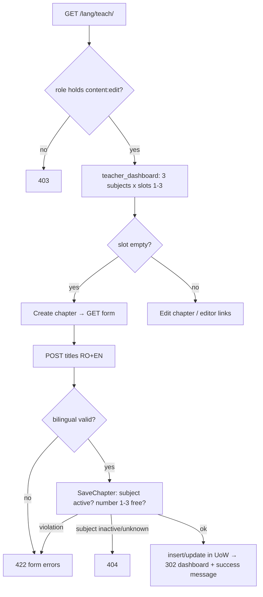

### Story 3.5: Teacher Dashboard & Chapters

**BUILDID**: CYCLE-2 | **GitHub**: LOCAL | **AzureDevOps**: LOCAL | **Epic**: 3 - Teacher Content Authoring | **ID**: 3.5 | **Date**: 2026-10-19
**File**: `docs/plans/stories/epic-3-story-3.5-Teacher-Dashboard-and-Chapters.md`
**Build Ref**: `docs/plans/builds/cycle-2/cycle-plan.md` — CYCLE-2 (Workshop Day 4: teacher dashboard; chapters create/edit, exactly 3 per active subject)
**Wave**: 8
**Requires**: [3.1, 3.2, 3.4]
**Enables**: [3.9]
**Files Touched**:
  - src/application/content/save_chapter.py
  - src/infrastructure/persistence/content/repositories/chapters.py
  - src/infrastructure/persistence/content/queries/teacher.py
  - src/infrastructure/web/content/views/dashboard.py
  - src/infrastructure/web/content/views/chapters.py
  - src/infrastructure/web/content/forms/chapter.py
  - src/infrastructure/web/templates/content/dashboard/**
  - src/infrastructure/web/templates/content/chapter/**
  - src/infrastructure/web/static/css/content/dashboard.css
  - src/infrastructure/web/content/urls.py
  - src/infrastructure/container.py
  - src/infrastructure/i18n/locale/ro/LC_MESSAGES/django.po
  - src/infrastructure/i18n/locale/en/LC_MESSAGES/django.po
  - tests/integration/web/test_role_access_matrix.py
  - docs/architecture/design/00-system-architecture-greenfield.md
  - tests/unit/application/content/test_save_chapter.py
  - tests/integration/web/content/dashboard/**
**Roles Ref**: docs/requirements.md#roles--permissions-matrix — personas this story differentiates: Teacher, Student, Parent/Guardian, Admin
**QA Candidate**: Yes — **Observable:** "Dashboard" in the Teacher menu opens `/<lang>/teach/`, showing the three pilot subjects, each with chapter slots 1–3. Every chapter row shows its title, lesson presence and status, exercise count against 5–10, and test status (none/draft/published), with a "Complete" marker when all three are launch-ready. Teachers create a chapter in an empty slot and edit titles; a fourth chapter, a duplicate number or a missing language is refused. **Mechanism:**
- `GET /teach/` (`content:teacher_dashboard`, `content:edit`) → `teacher_dashboard()` query (≤ 4 SQL queries) → DTO slots
- `GET/POST /teach/subjects/<id>/chapters/new/` (`content:chapter_create`, `content:create`) and `GET/POST /teach/chapters/<id>/edit/` (`content:chapter_edit`, `content:edit`) → `ChapterForm` (bilingual) → `SaveChapter` use case (domain `validate_chapter_number`, subject must be active) → `DjangoChapterRepository` inside `DjangoUnitOfWork`, `created_by`/`updated_by` = `request.user.pk`, timestamps from `Clock`
- success → 302 to the dashboard + success message

**Authz & preconditions:** Teacher only (Student/Parent/Admin → 403; anonymous → login); the subject must be an active pilot subject (inactive/unknown → 404). **Edge & idempotency:**
- Resubmitting the same create after success gives "Chapter N already exists" (no duplicate row).
- An unchanged edit is accepted and only `updated_at`/`updated_by` change.
- A concurrent duplicate create is caught by the DB unique constraint → same form error.
- The dashboard is read-only and repeatable.
- Links to editors not yet merged (3.6–3.8 run in parallel) are omitted rather than erroring.

**Regression:** 403 for every non-teacher role on all three routes, the 3-chapter cap, bilingual titles, dashboard completeness flags matching the readiness rules (SC-2), query-count bound.

---

#### 👤 User Reference

**Description**:
This story gives teachers their home base: the **Dashboard**, reachable from "Dashboard" in the teacher menu.
- **What it shows:** the three pilot subjects (Comunicare în limba română, Matematică și explorarea mediului and English for grade 2), each with three chapter slots.
- **For each chapter:** whether the lesson is written, how many exercises exist (5 to 10 are needed), and whether the chapter test is a draft or published.
- **"Complete" marker:** a chapter gets a clear "Complete" marker once it has everything needed for launch. Teachers can see at a glance what's left before the pilot starts.

Teachers also create and rename chapters here:
- **Creating:** each empty slot has a "Create chapter" button; the teacher enters the chapter's title in Romanian and English.
- **Limits:** a subject can't get a fourth chapter or two chapters with the same number, and both titles are required.
- **Editing:** existing titles can be edited at any time.

The lesson, exercise and test editors open from the chapter's row (Stories 3.6–3.8). Both pilot teachers can work on all three subjects. Students, parents and administrators can't open any of these pages.

**Acceptance Criteria** (plain-English):
- Teachers see "Dashboard" in their menu; it lists the three pilot subjects with chapter slots 1, 2 and 3.
- For each chapter the dashboard shows the title (in the current language), lesson status, exercise count with the 5–10 target, and test status.
- A chapter is marked "Complete" only when it has an active lesson, 5–10 active exercises and a published, active 10-question test.
- Teachers can create a chapter in an empty slot with Romanian and English titles.
- Creating a fourth chapter, reusing a number, or leaving either title empty is refused with a clear message.
- Teachers can edit a chapter's titles; after saving they return to the dashboard with a confirmation message.
- Chapters can only be created for the three pilot subjects.
- Students, parents and administrators get "Access denied" on all teacher pages; visitors who aren't signed in are asked to sign in.
- Each chapter row links to the lesson, exercises and test editors once those exist.

**User Flow** (role-differentiated):

### Teacher
**Scenario / narrative**: As a pilot Teacher on 2026-11-05, I sign in and click "Dashboard". I see grade 2's three subjects; all slots are empty. Under MEM, slot 1, I click "Create chapter", type "Adunarea și scăderea până la 100" and "Addition and subtraction up to 100", and save. The dashboard shows chapter 1 with "Lesson: missing", "Exercises: 0/5–10", "Test: none". My colleague already created MEM chapter 2 a minute ago. When I try to create chapter 2 too (from a stale tab), I get "Chapter 2 already exists for this subject" and nothing is duplicated. Later I correct a typo in a title; after saving I'm back on the dashboard with "Chapter saved".
**Steps**:
1. `GET /ro/teach/` → `@require_permission(content:edit)` → `teacher_dashboard()` loads active subjects, chapters, lesson/exercise/test aggregates (≤ 4 queries) → renders boards with slots.
2. "Create chapter" → `GET /ro/teach/subjects/<id>/chapters/new/?number=1` → empty `ChapterForm` (number preselected).
3. POST → `ChapterForm.is_valid()` (bilingual) → `SaveChapter.execute(SaveChapterCommand(None, subject_id, 1, ro, en, actor_id=request.user.pk))` → checks the subject is active → `validate_chapter_number(1, taken)` → `repo.add(...)` in UoW → 302 `/ro/teach/` + `messages.success`.
4. Duplicate → `PolicyViolation([chapter_number_taken])` (or `IntegrityError` → same violation) → 422 form with the error.

### Student
**Scenario / narrative**: As a Student, I never see "Dashboard" in my menu. If an older sibling shows me `/ro/teach/`, I get the friendly "Access denied" page.
**Steps**:
1. `GET /ro/teach/` → role lacks `content:edit` → 403.

### Parent/Guardian
**Scenario / narrative**: As a Parent, I can't author content; typing a teacher URL shows "Access denied".
**Steps**:
1. `GET /ro/teach/subjects/<id>/chapters/new/` → lacks `content:create` → 403.

### Admin
**Scenario / narrative**: As the Admin, I moderate content (next cycle) but don't write it, so teacher pages are denied to me. I follow content completeness on the Pilot page (Story 5.1).
**Steps**:
1. `GET /ro/teach/` → lacks `content:edit` → 403.

**Flow Diagram**:



---

#### 🤖 AI Agent Reference

**Must Read**:
- `docs/requirements.md` — Teacher permissions (`content:create`, `content:edit`); SC-2 completeness definition
- `docs/architecture/design/00-system-architecture-greenfield.md` — route catalogue (`/teach/`, `/teach/subjects/<id>/chapters/new/`, `/teach/chapters/<id>/edit/`), Integrity rules
- `docs/architecture/design/01-patterns-and-standards-greenfield.md` — §5 use cases, §6.3 repositories + query services, §7 thin views/forms/responses
- `docs/plans/stories/epic-3-story-3.1-Content-Domain-Rules.md` — `ChapterRepository` port, `validate_chapter_number`, `MIN_EXERCISES_FOR_READY`, `MAX_EXERCISES_PER_CHAPTER`
- `docs/plans/stories/epic-3-story-3.2-Content-Data-Model.md` — models, `visible_to_learners()`, factories (`complete_chapter`)
- `docs/plans/stories/epic-3-story-3.4-Authoring-Web-Kit.md` — `BilingualFormMixin`, `add_violations`, `content/urls.py`
- `docs/ui-ux/ui-ux-spec.md` — staff density, status pills, empty states

**Description**:
1. **Use case** `application/content/save_chapter.py`: `SaveChapterCommand(chapter_id | None, subject_id, number, title_ro, title_en, actor_id)` → `SaveChapter(chapters: ChapterRepository, uow, clock).execute(cmd) -> int`. Raises `NotFound` (inactive/unknown subject, unknown chapter) and `PolicyViolation` (number rules). When editing, `subject_id` comes from the stored chapter (`chapters.subject_of`), never from input.
2. **Repository** `persistence/content/repositories/chapters.py`: `DjangoChapterRepository` implementing the port. `IntegrityError` on `(subject, number)` → `PolicyViolation([chapter_number_taken])`.
3. **Query** `persistence/content/queries/teacher.py`: `teacher_dashboard() -> tuple[SubjectBoardDTO, ...]` and `chapter_for_edit(chapter_id) -> ChapterEditDTO` (`NotFound` if missing). Teachers see content in **every** moderation state, so this query deliberately doesn't use `visible_to_learners()` for listing. "Complete" counts only visible content.
4. **Views** `views/dashboard.py` and `views/chapters.py`; form `forms/chapter.py` (`ChapterForm(BilingualFormMixin, forms.Form)`: `title_ro`, `title_en`, `number` hidden for create, displayed read-only on edit). Routes appended to `content/urls.py`.
5. **Templates** `content/dashboard/index.html` (+ `_subject_board.html`, `_chapter_row.html`) and `content/chapter/form.html`; CSS `static/css/content/dashboard.css`.
6. **Container factory** `save_chapter()`; matrix rows; route catalogue updated in the architecture doc. The test `test_choices_match_domain.py` (dashboard test folder) asserts model choices == domain enums (Story 3.2 note).

**Design Tokens** (FE — staff theme):
- Page: `ui_page_header` "Dashboard" (h1 24px/700), staff bg `#F5F7FA`, max 1200px.
- Subject board: `<section aria-labelledby="board-{subject_id}">` (accessible name = the localized subject heading; Story 3.9 locates boards by it), `ui_card`-styled section per subject (surface `#FFFFFF`, radius 8px, elevation-1, padding 24px, 16px gap). Heading h2 20px/600 (localized subject name) + muted grade name 14px `#4B5563`.
- Chapter rows: `ui_table`-styled grid (columns: Chapter · Lesson · Exercises · Test · Actions), row padding 8px 12px.
- Status cells use `ui_status_pill` (ACTIVE/FLAGGED/BLOCKED/RESUBMITTED/DRAFT/PUBLISHED). The exercise count uses `ui_progress done=count total=10` with label "5–10 needed"; out-of-range counts are flagged with text "needs 5–10" in `#B45309`.
- "Complete" marker: Phosphor `check-circle` 20px `#15803D` + text "Complete" (never colour alone); incomplete: `x-circle` 20px `#4B5563` + "Incomplete".
- Empty slot: `ui_empty_state` compact variant "No chapter {n} yet" + `ui_button` secondary "Create chapter" (icon `pencil-simple`).
- Chapter form: RO | EN `ui_field_pair` (6+6 columns, 24px gap), sticky action bar from `editor.css`.
- Validation: on submit | Error: inline + top `ui_alert "error"`; success: `messages.success` banner "Chapter saved."

**Acceptance Criteria**:
1. Routes (appended to `content/urls.py`):
   - `""` → `dashboard` (`content:teacher_dashboard`), `@require_safe` + `@require_permission(CONTENT_EDIT)`
   - `"subjects/<int:subject_id>/chapters/new/"` → `chapter_create` (`content:chapter_create`), GET/POST, `@require_permission(CONTENT_CREATE)`
   - `"chapters/<int:chapter_id>/edit/"` → `chapter_edit` (`content:chapter_edit`), GET/POST, `@require_permission(CONTENT_EDIT)`
2. `teacher_dashboard()` returns one `SubjectBoardDTO(subject_id, code, name_ro, name_en, grade_name_ro, grade_name_en, slots)` per **active** subject (ordered by grade then subject `sort_order`), each with exactly 3 `ChapterSlotDTO`s (numbers 1–3; `chapter_id=None` for empty slots). Each slot has:
   - `title_ro/en`
   - `lesson_status` (`None` or moderation status)
   - `exercise_count` (all) and `visible_exercise_count` (ACTIVE)
   - `test_status` (`None`/`DRAFT`/`PUBLISHED`), `test_moderation_status`, `test_question_count`
   - `is_complete`
   - at most **4** SQL queries regardless of chapter count
3. `is_complete = chapter_is_ready(lesson ACTIVE, visible exercise count, test PUBLISHED and ACTIVE, question count)`. This is the single domain rule from Story 3.1, also used by Story 5.1, so dashboard and readiness can never disagree.
4. `SaveChapter`:
   - create → subject must exist and be active (else `NotFound`); `validate_chapter_number(number, numbers_taken(subject))`; `add(...)` with `actor_id` and `clock.now()`
   - edit → `subject_of(chapter_id)` (else `NotFound`); number unchanged (editing the number is not offered); update titles + `updated_by/at` The use case runs inside the UoW and returns the chapter id.
5. Create form: `number` comes from `?number=` (1–3) on GET, posted as a hidden field. If omitted, the lowest free number is used; if none are free, the page shows "This subject already has 3 chapters." with a link back (409 → Story 1.1 page variant).
6. Validation failures re-render the form with status **422**, field errors from `BilingualFormMixin`, violation errors via `add_violations`, and a top `ui_alert "error"` summary. Success → 302 to `content:teacher_dashboard` with `messages.success(_("Chapter saved."))`.
7. Editor links on chapter rows are built in the view with a `reverse_if_available(name, kwargs)` helper (returns `None` on `NoReverseMatch`): `content:lesson_edit`, `content:exercise_list`, `content:test_edit`. Links render only when available, so parallel wave-8 stories can merge in any order.
8. Role-access-matrix rows: `/ro/teach/` → Teacher 200, Student/Parent/Admin 403, anonymous 302. Create/edit route access is asserted in this story's tests (ids are dynamic).
9. `test_choices_match_domain.py`: `KIND_CHOICES` values == `QuestionKind` values; `MODERATION_CHOICES` values == `ModerationStatus` values.
10. Route catalogue in `00-system-architecture-greenfield.md` updated with the three routes and their names.
11. RO/EN translations for all strings ("Dashboard", "Create chapter", "Chapter saved.", "Complete", "Incomplete", "5–10 needed", "No chapter %(n)s yet", "This subject already has 3 chapters.", column headers).

**RBAC Enforcement**:

| Persona | Permission key | Guarded route/endpoint | Allowed | Denied behavior | UI when denied |
|---------|----------------|------------------------|---------|-----------------|----------------|
| Teacher | `content:edit` | `GET /<lang>/teach/` | yes | n/a | n/a |
| Teacher | `content:create` | `GET/POST /<lang>/teach/subjects/<id>/chapters/new/` | yes (active subjects) | inactive/unknown subject → 404 | — |
| Teacher | `content:edit` | `GET/POST /<lang>/teach/chapters/<id>/edit/` | yes | unknown chapter → 404 | — |
| Student | — | all three | no | 403 | "Dashboard" not in menu (Story 1.7 registry) |
| Parent/Guardian | — | all three | no | 403 | not in menu |
| Admin | — | all three | no | 403 | not in menu |
| Anonymous | — | all three | no | 302 → login with `next` | sign-in page |

- **Enforcement point(s):** `@require_permission` in `views/dashboard.py` and `views/chapters.py`; subject activity checked inside `SaveChapter` via the repository.
- **Denied-access contract:** role denial → 403; unknown/inactive subject or unknown chapter → 404 (identical page).
- **Scope derivation:** both pilot teachers may edit all pilot content (requirements: "Teacher may manage all three pilot subjects"), so there's no per-teacher ownership scope. `actor_id` for `created_by`/`updated_by` comes from `request.user.pk`. When editing, the subject is read from the stored chapter, never from the form.

**System responses + error cases**:

| Trigger | Response | Side-effect |
|---------|----------|-------------|
| Teacher `GET /ro/teach/` | `200` dashboard, 3 boards × 3 slots | none (≤ 4 queries) |
| Same GET repeated | identical `200` | none |
| Teacher POST create (MEM, number 1, both titles) | `302 /ro/teach/` + "Chapter saved." | `content_chapter` row; `created_by`=`updated_by`=teacher; timestamps = clock |
| Same POST resubmitted (idempotent repeat) | `422` form: "Chapter 1 already exists for this subject." | none |
| Concurrent duplicate create (race) | `422` (IntegrityError mapped) | one row |
| POST create with `title_en` blank | `422` "English text is required." | none |
| POST create number 4 (tampered hidden field) | `422` "Chapter number must be 1, 2 or 3." | none |
| GET create when 3 chapters exist | `409` "This subject already has 3 chapters." | none |
| Create for inactive subject (e.g. grade 5 MAT id) | `404` | none |
| Teacher POST edit with new titles | `302` + "Chapter saved." | titles + `updated_by/at` changed; `created_*` unchanged |
| POST edit unchanged | `302` | only `updated_by/at` change |
| Edit unknown chapter id | `404` | none |
| Student/Parent/Admin any route | `403` | none |
| Anonymous any route | `302` login | none |

**QA-observable behaviour**:
- `/ro/teach/` lists exactly 3 subject boards (grade 2 CLR, MEM, EN), each with slots 1–3. A seeded `complete_chapter` shows "Complete"; removing one exercise below 5 (or blocking the lesson via DB) flips it to "Incomplete".
- After creating MEM chapter 1, `content_chapter` has one row `(subject=MEM, number=1)`, with `created_by_id` = the teacher's id.
- A duplicate create leaves the row count unchanged.
- The dashboard shows the localized title (RO under `/ro/`, EN under `/en/`).
- **What does NOT change**: lessons, exercises and tests are untouched by chapter edits; moderation fields are never modified by teacher actions; no other subject's chapters change; no audit rows are written (content edits aren't audited per architecture).

**Prerequisites**:
- Stories 3.1, 3.2 and 3.4 merged; CYCLE-1 complete.
- Stories 3.6–3.8 run in parallel (same wave). Their editor links appear automatically via `reverse_if_available` (AC 7).

**Context**: `docs/architecture/design/00-system-architecture-greenfield.md`, `docs/architecture/design/01-patterns-and-standards-greenfield.md`, `src/domain/content/ports.py`, `src/domain/content/chapters.py`, `src/infrastructure/persistence/content/models.py`, `src/infrastructure/web/content/forms/bilingual.py`, `src/infrastructure/web/content/urls.py`

**Patterns**: Use case + UoW + Clock (§5), Repository with IntegrityError mapping (§6.3), Query services/DTOs (§6.3), Thin views + decorators (§7.1–7.2), Forms (§7.3), Responses 422/409 (§7.5), Primitives (§11.2) — see `docs/architecture/design/01-patterns-and-standards-greenfield.md`

**Steps**:

1. **Tests first:** use-case unit tests with fakes; dashboard query tests (incl. `django_assert_max_num_queries(4)`); view tests per role and per System-responses row.

2. **Use case:**
   ```python
   # src/application/content/save_chapter.py
   from dataclasses import dataclass

   from application.common.unit_of_work import UnitOfWork
   from domain.common.clock import Clock
   from domain.common.errors import NotFound, PolicyViolation
   from domain.content.chapters import validate_chapter_number
   from domain.content.ports import ChapterRepository


   @dataclass(frozen=True)
   class SaveChapterCommand:
       chapter_id: int | None
       subject_id: int | None  # ignored on edit: the stored chapter's subject is authoritative
       number: int
       title_ro: str
       title_en: str
       actor_id: int  # request.user.pk


   class SaveChapter:
       def __init__(self, chapters: ChapterRepository, uow: UnitOfWork, clock: Clock) -> None:
           self._chapters, self._uow, self._clock = chapters, uow, clock

       def execute(self, cmd: SaveChapterCommand) -> int:
           with self._uow:
               if cmd.chapter_id is not None:
                   if self._chapters.subject_of(cmd.chapter_id) is None:
                       raise NotFound("chapter")
                   self._chapters.update(cmd.chapter_id, cmd.number, cmd.title_ro, cmd.title_en,
                                         cmd.actor_id, self._clock.now())
                   return cmd.chapter_id
               if cmd.subject_id is None or not self._chapters.subject_is_active(cmd.subject_id):
                   raise NotFound("subject")
               if violations := validate_chapter_number(cmd.number, self._chapters.numbers_taken(cmd.subject_id)):
                   raise PolicyViolation(violations)
               return self._chapters.add(cmd.subject_id, cmd.number, cmd.title_ro, cmd.title_en,
                                         cmd.actor_id, self._clock.now())
   ```
   > On edit, `update` keeps the stored number (the repository ignores a changed number for an existing chapter; renumbering isn't offered in the UI).

3. **Repository** (`repositories/chapters.py`): implement the port. `add` wraps `ChapterModel.objects.create(...)` in `try/except IntegrityError → raise PolicyViolation([Violation("chapter_number_taken", {"number": number})])`. `subject_is_active` queries `SubjectModel.objects.filter(pk=…, is_active=True).exists()`.

4. **Query service** (`queries/teacher.py`):
   ```python
   def teacher_dashboard() -> tuple[SubjectBoardDTO, ...]:
       subjects = list(SubjectModel.objects.filter(is_active=True).select_related("grade")
                       .order_by("grade__sort_order", "sort_order"))                               # 1
       chapters = list(ChapterModel.objects.filter(subject__in=subjects)
                       .select_related("lesson", "test")
                       .annotate(exercise_count=Count("exercises", distinct=True),
                                 visible_exercise_count=Count("exercises", filter=Q(exercises__moderation_status="ACTIVE"),
                                                              distinct=True),
                                 test_question_count=Count("test__questions", distinct=True)))     # 2
       return tuple(_board(subject, [c for c in chapters if c.subject_id == subject.pk]) for subject in subjects)
   ```
   `select_related("lesson", "test")` on reverse one-to-ones resolves in the same query. Keep within 4 queries (asserted).

5. **Views** (thin; errors via middleware):
   ```python
   # src/infrastructure/web/content/views/chapters.py (excerpt)
   @require_http_methods(["GET", "POST"])
   @require_permission(Permission.CONTENT_CREATE)
   def chapter_create(request, subject_id: int):
       """GET/POST /<lang>/teach/subjects/<id>/chapters/new/ — content:create."""
       form = ChapterForm(request.POST or None, initial={"number": request.GET.get("number")})
       if request.method == "POST" and form.is_valid():
           try:
               container.save_chapter().execute(SaveChapterCommand(
                   None, subject_id, form.cleaned_data["number"], form.cleaned_data["title_ro"],
                   form.cleaned_data["title_en"], actor_id=request.user.pk))
           except PolicyViolation as error:
               add_violations(form, error.violations, {"chapter_number_taken": None,
                                                       "chapter_number_out_of_range": None})
           else:
               messages.success(request, _("Chapter saved."))
               return redirect("content:teacher_dashboard")
       status = 422 if request.method == "POST" else 200
       return render(request, "content/chapter/form.html", {"form": form, "mode": "create"}, status=status)
   ```
   > Catching `PolicyViolation` in the view is the sanctioned exception to "map errors in one place" (patterns §7.3): violations are rendered **into the form**, not as an error page. `NotFound` still propagates to `DomainErrorMiddleware`.

6. **Templates and CSS** per Design Tokens. **Container**, **URLs**, **matrix rows**, **route catalogue**, **translations**, then **all gates**.

**Tests**:

```python
# tests/unit/application/content/test_save_chapter.py
import pytest

from application.content.save_chapter import SaveChapter, SaveChapterCommand
from domain.common.errors import NotFound, PolicyViolation
from tests.fakes import FakeUnitOfWork, FixedClock


class FakeChapters:
    def __init__(self, active_subjects, existing=None):
        self.active, self.rows = set(active_subjects), dict(existing or {})  # id -> (subject, number, ro, en)

    def subject_is_active(self, subject_id):
        return subject_id in self.active

    def subject_of(self, chapter_id):
        return self.rows.get(chapter_id, (None,))[0]

    def numbers_taken(self, subject_id, excluding_chapter_id=None):
        return {n for cid, (s, n, *_rest) in self.rows.items() if s == subject_id and cid != excluding_chapter_id}

    def add(self, subject_id, number, title_ro, title_en, actor_id, at):
        new_id = len(self.rows) + 1
        self.rows[new_id] = (subject_id, number, title_ro, title_en)
        return new_id

    def update(self, chapter_id, number, title_ro, title_en, actor_id, at):
        subject, stored_number, *_ = self.rows[chapter_id]
        self.rows[chapter_id] = (subject, stored_number, title_ro, title_en)


def run(repo, cmd):
    return SaveChapter(repo, FakeUnitOfWork(), FixedClock()).execute(cmd)


def test_creates_chapter_in_active_subject():
    repo = FakeChapters({7})

    chapter_id = run(repo, SaveChapterCommand(None, 7, 1, "Adunarea", "Addition", actor_id=3))

    assert repo.rows[chapter_id] == (7, 1, "Adunarea", "Addition")


def test_duplicate_number_is_rejected():
    repo = FakeChapters({7}, {1: (7, 2, "x", "x")})

    with pytest.raises(PolicyViolation) as error:
        run(repo, SaveChapterCommand(None, 7, 2, "y", "y", actor_id=3))

    assert error.value.violations[0].code == "chapter_number_taken"


def test_fourth_chapter_is_out_of_range():
    with pytest.raises(PolicyViolation):
        run(FakeChapters({7}), SaveChapterCommand(None, 7, 4, "y", "y", actor_id=3))


@pytest.mark.parametrize("subject_id", [99, None])
def test_inactive_or_missing_subject_is_not_found(subject_id):
    with pytest.raises(NotFound):
        run(FakeChapters({7}), SaveChapterCommand(None, subject_id, 1, "y", "y", actor_id=3))


def test_edit_uses_stored_subject_and_number():
    repo = FakeChapters({7}, {1: (7, 2, "old", "old")})

    run(repo, SaveChapterCommand(1, 999, 3, "nou", "new", actor_id=3))

    assert repo.rows[1] == (7, 2, "nou", "new")
```

```python
# tests/integration/web/content/dashboard/test_dashboard_and_chapters.py
import pytest

from infrastructure.persistence.catalogue.models import SubjectModel
from infrastructure.persistence.content.models import ChapterModel, ExerciseModel
from infrastructure.persistence.content.queries.teacher import teacher_dashboard
from tests.factories.content import complete_chapter

pytestmark = pytest.mark.django_db


@pytest.fixture
def mem():
    return SubjectModel.objects.get(grade__code="2", code="MEM")


def test_dashboard_lists_three_active_subjects_with_three_slots(teacher_client):
    boards = teacher_dashboard()

    assert [b.code for b in boards] == ["CLR", "MEM", "EN"]
    assert all([s.number for s in b.slots] == [1, 2, 3] for b in boards)
    assert teacher_client.get("/ro/teach/").status_code == 200


def test_dashboard_query_count_is_bounded(django_assert_max_num_queries, mem):
    for number in (1, 2, 3):
        complete_chapter(mem, number)

    with django_assert_max_num_queries(4):
        teacher_dashboard()


def test_completeness_follows_visible_content(mem):
    chapter = complete_chapter(mem, 1)
    assert _slot(mem, 1).is_complete

    ExerciseModel.objects.filter(chapter=chapter, position=5).delete()

    assert not _slot(mem, 1).is_complete


def _slot(subject, number):
    board = next(b for b in teacher_dashboard() if b.subject_id == subject.pk)
    return next(s for s in board.slots if s.number == number)


def test_teacher_creates_chapter_and_duplicate_is_refused(teacher_client, teacher, mem):
    url = f"/en/teach/subjects/{mem.pk}/chapters/new/"
    data = {"number": 1, "title_ro": "Adunarea", "title_en": "Addition"}

    first = teacher_client.post(url, data)
    second = teacher_client.post(url, data)

    assert first.status_code == 302 and first["Location"] == "/en/teach/"
    assert second.status_code == 422
    assert "Chapter 1 already exists for this subject." in second.content.decode()
    chapter = ChapterModel.objects.get()
    assert chapter.created_by_id == teacher.pk


def test_missing_english_title_is_422(teacher_client, mem):
    response = teacher_client.post(f"/en/teach/subjects/{mem.pk}/chapters/new/",
                                   {"number": 1, "title_ro": "Adunarea", "title_en": " "})

    assert response.status_code == 422
    assert "English text is required." in response.content.decode()


def test_inactive_subject_is_404(teacher_client):
    inactive = SubjectModel.objects.filter(is_active=False).first()

    assert teacher_client.post(f"/ro/teach/subjects/{inactive.pk}/chapters/new/",
                               {"number": 1, "title_ro": "a", "title_en": "a"}).status_code == 404


def test_create_page_when_full_is_409(teacher_client, mem):
    for number in (1, 2, 3):
        complete_chapter(mem, number)

    assert teacher_client.get(f"/ro/teach/subjects/{mem.pk}/chapters/new/").status_code == 409


@pytest.mark.parametrize("fixture", ["student_client", "parent_client", "admin_client"])
def test_non_teachers_get_403_everywhere(request, fixture, mem):
    client = request.getfixturevalue(fixture)
    chapter = complete_chapter(mem, 1)

    for url in ("/ro/teach/", f"/ro/teach/subjects/{mem.pk}/chapters/new/", f"/ro/teach/chapters/{chapter.pk}/edit/"):
        assert client.get(url).status_code == 403
```

```python
# tests/integration/web/content/dashboard/test_choices_match_domain.py
from domain.content.questions import QuestionKind
from domain.moderation.status import ModerationStatus
from infrastructure.persistence.common.managers import MODERATION_CHOICES
from infrastructure.persistence.content.models import KIND_CHOICES


def test_persisted_choices_equal_domain_enums():
    assert [v for v, _ in KIND_CHOICES] == [k.value for k in QuestionKind]
    assert [v for v, _ in MODERATION_CHOICES] == [s.value for s in ModerationStatus]
```

Manual:
- As Teacher (RO and EN): open Dashboard; create chapters 1–3 for MEM; try a 4th (409 page) and a duplicate (422); edit a title; check the success banner and that the localized titles switch with the language.
- As Student, Parent and Admin: open `/ro/teach/` and confirm 403.
- Seed a complete chapter in the shell (`complete_chapter`) and confirm the "Complete" marker.

**Quality**: ruff 0; mypy strict for `application.content`; lint-imports kept; tests pass; application ≥95%, overall ≥85%; dashboard ≤ 4 queries; primitives reused; no inline `style`/`script`; no `TODO`.

**OUT**:
- ❌ Lesson/exercise/test editors (3.6–3.8); this story only links to them.
- ❌ Deleting or renumbering chapters (not required; chapters are a fixed 1–3 structure).
- ❌ Moderation status changes or block reasons display beyond the status pill (CYCLE-3 adds reasons and notifications).
- ❌ Per-teacher ownership of chapters (both pilot teachers manage all subjects).

**Evidence**: pytest output (unit, query, views), coverage %, the query-count assertion, screenshots of the dashboard (RO, with one complete and one incomplete chapter), the duplicate-chapter 422 and the 403 for a Student, all recorded in `docs/stories-implemented/story-3.5-review.md` under "## DoD Evidence".
