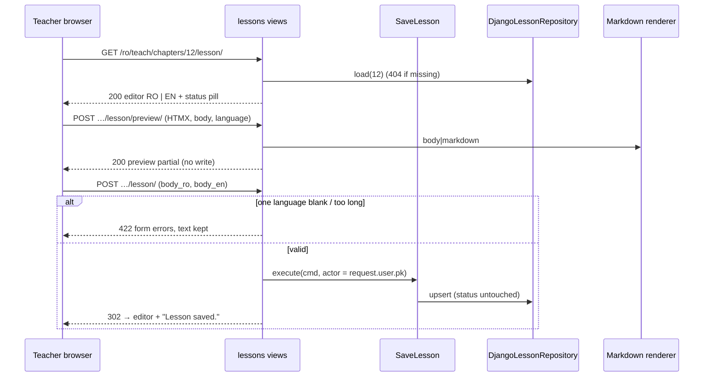

### Story 3.6: Lesson Editor

**BUILDID**: CYCLE-2 | **GitHub**: LOCAL | **AzureDevOps**: LOCAL | **Epic**: 3 - Teacher Content Authoring | **ID**: 3.6 | **Date**: 2026-10-19
**File**: `docs/plans/stories/epic-3-story-3.6-Lesson-Editor.md`
**Build Ref**: `docs/plans/builds/cycle-2/cycle-plan.md` — CYCLE-2 (Workshop Day 1: lesson editor with sanitized Markdown preview, RO+EN required)
**Wave**: 8
**Requires**: [3.2, 3.3, 3.4]
**Enables**: [3.9]
**Files Touched**:
  - src/application/content/save_lesson.py
  - src/infrastructure/persistence/content/repositories/lessons.py
  - src/infrastructure/web/content/views/lessons.py
  - src/infrastructure/web/content/forms/lesson.py
  - src/infrastructure/web/templates/content/lesson/**
  - src/infrastructure/web/content/urls.py
  - src/infrastructure/container.py
  - src/infrastructure/i18n/locale/ro/LC_MESSAGES/django.po
  - src/infrastructure/i18n/locale/en/LC_MESSAGES/django.po
  - tests/integration/web/test_role_access_matrix.py
  - docs/architecture/design/00-system-architecture-greenfield.md
  - tests/unit/application/content/test_save_lesson.py
  - tests/integration/web/content/lesson/**
**Roles Ref**: docs/requirements.md#roles--permissions-matrix — personas this story differentiates: Teacher, Student, Parent/Guardian, Admin
**QA Candidate**: Yes — **Observable:** from a chapter row, a Teacher opens "Lesson" and gets a side-by-side Romanian | English Markdown editor with a formatting help panel and a "Preview" per language that shows the formatted result in place. Saving with both languages stores the lesson, which is visible to students immediately (ACTIVE), and returns to the editor with "Lesson saved." Saving with one language empty is refused. **Mechanism:**
- `GET/POST /<lang>/teach/chapters/<id>/lesson/` (`content:lesson_edit`, requires `content:create` + `content:edit`) → `LessonForm(BilingualFormMixin)` → `SaveLesson` use case → `DjangoLessonRepository.upsert` in UoW (creates on first save with `created_by`; later saves set `updated_by/at`; **moderation status untouched**)
- `POST /<lang>/teach/chapters/<id>/lesson/preview/` (`content:lesson_preview`, `content:edit`, HTMX) renders `{{ body|markdown }}` without saving

**Authz & preconditions:** Teacher only (others 403); the chapter must exist (else 404). **Edge & idempotency:**
- Saving identical text again is accepted and changes only `updated_*`.
- Preview never writes.
- Text over 50,000 characters per language is refused.
- `<script>` in the text is stored as typed but never rendered (Story 3.3).
- Editing a lesson that an admin later flags or blocks (CYCLE-3) keeps its status.

**Regression:** bilingual requirement, sanitised preview, 403 for non-teachers, status preserved on edit, PRG pattern (no double submit on refresh).

---

#### 👤 User Reference

**Description**:
Every chapter has one main lesson, written by the teachers in Romanian and English.

**The editor:**
- **Side by side:** two large text areas, Romanian on the left and English on the right.
- **Formatting:** simple marks such as `##` for headings, `**` for bold and `-` for lists; a small help panel explains them.
- **Preview:** "Preview" under each text area shows exactly how students will see the lesson, without saving.
- **Safety:** anything unsafe a teacher pastes, like a script from a website, never shows up for students.

**Saving:**
- Both languages are required.
- Once saved, the lesson is immediately available to students, as the requirements state, unless an administrator later flags it.
- Teachers can come back and edit at any time.
- The editor shows the lesson's current status: "Active" now; next cycle, a blocked lesson shows its status here too.

Only teachers can use the editor.

**Acceptance Criteria** (plain-English):
- Teachers open the lesson editor from the chapter's row on the Dashboard.
- The editor shows the Romanian and English text side by side, with a short formatting guide.
- "Preview" shows the formatted lesson for that language without saving; unsafe content never appears in the preview.
- Saving requires both languages; if one is empty, the editor says which one and keeps the typed text.
- A saved lesson is shown to students straight away and the editor confirms "Lesson saved."
- Editing an existing lesson shows the saved text and keeps the lesson's current status.
- Very long text (over 50,000 characters per language) is refused with a clear message.
- Refreshing the page after saving doesn't save twice.
- Students, parents and administrators get "Access denied"; an unknown chapter shows "Page not found".

**User Flow** (role-differentiated):

### Teacher
**Scenario / narrative**: As a Teacher, I click "Lesson" on MEM chapter 1. The editor opens empty with a "No lesson yet" note. I paste my Romanian draft (prepared offline), click "Preview (RO)" and see the headings and the list formatted; one `#` title shows as a sub-heading, as the help says. I save without English by mistake and see "English text is required" with my Romanian text still there. I add the English version, save, and see "Lesson saved." with an "Active" status pill. Back on the Dashboard, the chapter row shows the lesson as present.
**Steps**:
1. `GET /ro/teach/chapters/<id>/lesson/` → `@require_permission(CONTENT_CREATE, CONTENT_EDIT)` → `DjangoLessonRepository.load(chapter_id)` (chapter title, subject, existing bodies, status; `NotFound` if no chapter) → form with initial bodies.
2. "Preview (RO)" → `hx-post` `/ro/teach/chapters/<id>/lesson/preview/` with `body` + `language=ro` (`hx-include` of the RO textarea) → 200 partial `content/lesson/_preview.html` (`{{ body|markdown }}`) swapped into the RO preview pane; nothing saved.
3. POST save → `LessonForm` (bilingual `body`, max 50,000) → `SaveLesson.execute(SaveLessonCommand(chapter_id, body_ro, body_en, actor_id=request.user.pk))` → `upsert` in UoW → 302 back to the editor + `messages.success("Lesson saved.")`.
4. Invalid → 422 with field errors; text preserved.

### Student
**Scenario / narrative**: As a Student, I read lessons (Story 4.2) but can never open the editor; the URL gives "Access denied".
**Steps**:
1. `GET /ro/teach/chapters/<id>/lesson/` → 403. `POST …/preview/` → 403.

### Parent/Guardian
**Scenario / narrative**: As a Parent, I can't edit lessons; teacher URLs answer "Access denied".
**Steps**:
1. Any editor route → 403.

### Admin
**Scenario / narrative**: As the Admin, I review content (next cycle) but don't author it, so the editor is denied to me.
**Steps**:
1. Any editor route → 403.

**Flow Diagram**:



---

#### 🤖 AI Agent Reference

**Must Read**:
- `docs/requirements.md` — "Teacher-created or edited content becomes available immediately unless an admin flags it", "Learning content is available in Romanian and English"
- `docs/architecture/design/00-system-architecture-greenfield.md` — route catalogue (`/teach/chapters/<id>/lesson/`, "Markdown, RO+EN, preview via HTMX"), Moderation rule "Teacher edits allowed in every state; editing does not change state"
- `docs/architecture/design/01-patterns-and-standards-greenfield.md` — §5, §6.3, §7.4 HTMX (`is_htmx`, partials, CSRF via `hx-headers`), §7.5 responses, §11.3 Markdown
- `docs/plans/stories/epic-3-story-3.3-Markdown-Rendering.md` — `|markdown` filter
- `docs/plans/stories/epic-3-story-3.4-Authoring-Web-Kit.md` — `BilingualFormMixin`, `editor.css`, `content/urls.py`
- `docs/plans/stories/epic-3-story-3.1-Content-Domain-Rules.md` — `LessonRepository` port

**Description**:
1. **Use case** `application/content/save_lesson.py`: `SaveLessonCommand(chapter_id, body_ro, body_en, actor_id)` → `SaveLesson(lessons: LessonRepository, uow, clock).execute(cmd) -> int`. It raises `NotFound` for an unknown chapter, and `PolicyViolation` for a blank body (`body_missing_ro` / `body_missing_en`) or one over `MAX_LESSON_CHARS = 50_000` (`body_too_long` {language}). The form catches these first; the use-case checks are defence in depth for any other caller.
2. **Repository** `repositories/lessons.py`: `DjangoLessonRepository` implementing `LessonRepository` (`chapter_exists`, `upsert`) plus a read helper `load(chapter_id) -> LessonEditDTO` for the editor header (chapter number and titles, subject and grade names, current bodies, `moderation_status` or `None`). Upsert uses `update_or_create(chapter_id=…, defaults={body_ro, body_en, updated_by_id, updated_at})`, setting `created_by_id`/`created_at` only on create. It never touches `moderation_*`.
3. **Form** `forms/lesson.py`: `LessonForm(BilingualFormMixin, forms.Form)` with `bilingual_fields = ("body",)`, `body_ro`/`body_en` `CharField(widget=Textarea(rows=24), max_length=50_000, required=False)`. `LESSON_MESSAGES` maps the use-case codes to translated texts (for completeness).
4. **Views** `views/lessons.py`: `lesson_edit` (GET/POST) and `lesson_preview` (POST, HTMX partial; also works without HTMX by returning the same partial).
5. **Templates** `content/lesson/edit.html`, `_preview.html`, `_markdown_help.html` (a `<details>` with the allowed syntax).

**Design Tokens** (FE — staff theme, `editor.css` from 3.4):
- Page header: breadcrumb Dashboard › {subject} › Chapter {n} › Lesson; h1 24px/700 "Lesson: {chapter title}"; status `ui_status_pill` (or the text "No lesson yet" in `#4B5563`).
- Two columns 6+6 (24px gap), each: label "Română"/"English" 16px/600 with `lang` on the textarea; textarea min-height 480px, monospace-free (Atkinson), 16px, border 1px `#6B7280`, radius 8px; character counter 14px `#4B5563` ("12,345 / 50,000").
- Preview pane below each textarea: surface `#FFFFFF`, border 1px dashed `#6B7280`, radius 8px, padding 16px, `aria-live="polite"`, heading "Preview" 14px/600; content uses student reading styles (18px base) so teachers see what children see.
- Buttons: "Preview (RO)" / "Preview (EN)" = `ui_button` secondary with icon `book-open` and `hx_post`, `hx_target`, `hx_include`, `hx_disabled_elt="this"` (spinner during the request); "Save lesson" = primary in the sticky action bar.
- Help: `<details>` "Formatting help" listing `##`, `###`, `**bold**`, `*italic*`, `-` lists, `1.` lists, `> quote`, tables, links; note "Images are not supported in the pilot."
- Validation: on submit | Error: inline under the textarea + top `ui_alert "error"`; success banner after redirect.

**Acceptance Criteria**:
1. Routes appended to `content/urls.py`:
   - `"chapters/<int:chapter_id>/lesson/"` → `lesson_edit` (`content:lesson_edit`), GET/POST, `@require_permission(CONTENT_CREATE, CONTENT_EDIT)`
   - `"chapters/<int:chapter_id>/lesson/preview/"` → `lesson_preview` (`content:lesson_preview`), POST only, `@require_permission(CONTENT_EDIT)`
2. GET for an existing chapter without a lesson → 200 with empty textareas and "No lesson yet". With a lesson → initial bodies + status pill. Unknown chapter → 404.
3. POST valid → `SaveLesson` → 302 to `content:lesson_edit` (same chapter) with "Lesson saved." The first save creates the row (`created_by=updated_by=request.user`, `created_at=updated_at=clock`); later saves change only bodies + `updated_*`.
4. POST invalid (blank language, > 50,000 chars) → **422** with field errors and the typed text preserved; nothing written.
5. Saving never changes `moderation_status`, `moderation_reason` or `moderation_updated_at` (test with a FLAGGED lesson: still FLAGGED after save).
6. Preview: POST `body` (≤ 50,000) + `language ∈ {ro, en}` → 200 `_preview.html` containing `{{ body|markdown }}` inside `<div class="lesson-preview" lang="{{ language }}">`. Invalid language → 400. No DB writes (asserted with `django_assert_num_queries(0)` beyond session/auth lookups: assert no INSERT/UPDATE via `CaptureQueriesContext`). CSRF required.
7. Dashboard integration: `content:lesson_edit` resolves, so Story 3.5's chapter rows show the "Lesson" link automatically.
8. Route catalogue updated; RO/EN translations ("Lesson", "No lesson yet", "Preview (RO)", "Preview (EN)", "Formatting help", "Lesson saved.", "Images are not supported in the pilot.", the length message).

**RBAC Enforcement**:

| Persona | Permission key | Guarded route/endpoint | Allowed | Denied behavior | UI when denied |
|---------|----------------|------------------------|---------|-----------------|----------------|
| Teacher | `content:create` + `content:edit` | `GET/POST /<lang>/teach/chapters/<id>/lesson/` | yes | unknown chapter → 404 | — |
| Teacher | `content:edit` | `POST /<lang>/teach/chapters/<id>/lesson/preview/` | yes | — | — |
| Student | — | both | no | 403 | no link anywhere in learner UI |
| Parent/Guardian | — | both | no | 403 | — |
| Admin | — | both | no | 403 | — |
| Anonymous | — | both | no | 302 login (preview POST: 302) | sign-in |

- **Enforcement point(s):** `@require_permission` on both views in `views/lessons.py`.
- **Denied-access contract:** 403 page/partial for roles; 404 for unknown chapters.
- **Scope derivation:** no per-teacher ownership (both pilot teachers edit all content); `actor_id` = `request.user.pk`; `chapter_id` from the URL is the subject of the action, validated to exist.

**System responses + error cases**:

| Trigger | Response | Side-effect |
|---------|----------|-------------|
| Teacher GET editor, no lesson | `200` empty editor + "No lesson yet" | none |
| Teacher POST both languages | `302` editor + "Lesson saved." | `content_lesson` row created, ACTIVE, `created_by`=teacher |
| Same POST again (refresh-safe: GET after redirect) | GET `200` (no resubmission) | none |
| Teacher re-POSTs identical text | `302` + "Lesson saved." | only `updated_by/at` change |
| POST with `body_en` blank | `422` "English text is required."; RO text kept | none |
| POST with 50,001 chars in RO | `422` length message | none |
| POST on a FLAGGED lesson | `302` | bodies updated; status stays FLAGGED |
| HTMX preview POST `language=en` | `200` partial (sanitised HTML) | none |
| Preview with `<script>` in body | `200` partial without the script | none |
| Preview `language=de` | `400` | none |
| POST unknown chapter | `404` | none |
| Student/Parent/Admin any route | `403` | none |
| POST without CSRF | `403` | none |

**QA-observable behaviour**:
- After the first save, `content_lesson` has exactly one row for the chapter with `moderation_status='ACTIVE'`, both bodies stored exactly as typed (stripped), and `created_by_id = updated_by_id =` the teacher.
- A second save by the other teacher changes `updated_by_id` to that teacher and keeps `created_by_id`.
- The preview HTML for the XSS corpus from Story 3.3 contains no forbidden substrings.
- The Dashboard row for the chapter shows the lesson status pill after saving.
- **What does NOT change**: moderation fields, exercises and tests of the chapter, the chapter titles, and other chapters' lessons. Preview creates no rows.

**Prerequisites**:
- Stories 3.2 (models, factories), 3.3 (renderer) and 3.4 (form kit, `content/urls.py`, `editor.css`) merged.
- Story 3.5 runs in parallel; its dashboard links to this editor once both are merged.

**Context**: `docs/architecture/design/00-system-architecture-greenfield.md`, `docs/architecture/design/01-patterns-and-standards-greenfield.md`, `src/domain/content/ports.py`, `src/infrastructure/rendering/markdown.py`, `src/infrastructure/web/content/forms/bilingual.py`, `src/infrastructure/web/static/css/content/editor.css`

**Patterns**: Use case + UoW (§5), Repository (§6.3), Thin views (§7.1), Forms (§7.3), HTMX partials (§7.4), Responses 422/400 (§7.5), Markdown (§11.3) — see `docs/architecture/design/01-patterns-and-standards-greenfield.md`

**Steps**:

1. **Tests first** (unit for the use case with a fake repository; integration per System-responses row).

2. **Use case:**
   ```python
   # src/application/content/save_lesson.py
   from dataclasses import dataclass

   from application.common.unit_of_work import UnitOfWork
   from domain.common.clock import Clock
   from domain.common.errors import NotFound, PolicyViolation, Violation
   from domain.content.ports import LessonRepository

   MAX_LESSON_CHARS = 50_000


   @dataclass(frozen=True)
   class SaveLessonCommand:
       chapter_id: int
       body_ro: str
       body_en: str
       actor_id: int


   class SaveLesson:
       def __init__(self, lessons: LessonRepository, uow: UnitOfWork, clock: Clock) -> None:
           self._lessons, self._uow, self._clock = lessons, uow, clock

       def execute(self, cmd: SaveLessonCommand) -> int:
           violations = [Violation(f"body_missing_{lang}") for lang, body in (("ro", cmd.body_ro), ("en", cmd.body_en))
                         if not body.strip()]
           violations += [Violation("body_too_long", {"language": lang}) for lang, body
                          in (("ro", cmd.body_ro), ("en", cmd.body_en)) if len(body) > MAX_LESSON_CHARS]
           if violations:
               raise PolicyViolation(violations)
           with self._uow:
               if not self._lessons.chapter_exists(cmd.chapter_id):
                   raise NotFound("chapter")
               return self._lessons.upsert(cmd.chapter_id, cmd.body_ro.strip(), cmd.body_en.strip(),
                                           cmd.actor_id, self._clock.now())
   ```

3. **Repository** (`repositories/lessons.py`):
   ```python
   class DjangoLessonRepository:
       def chapter_exists(self, chapter_id: int) -> bool:
           return ChapterModel.objects.filter(pk=chapter_id).exists()

       def upsert(self, chapter_id, body_ro, body_en, actor_id, at) -> int:
           lesson, created = LessonModel.objects.get_or_create(
               chapter_id=chapter_id,
               defaults={"body_ro": body_ro, "body_en": body_en, "created_by_id": actor_id,
                         "updated_by_id": actor_id, "created_at": at, "updated_at": at})
           if not created:
               # Teacher edits never change moderation state (architecture: moderation rules).
               LessonModel.objects.filter(pk=lesson.pk).update(
                   body_ro=body_ro, body_en=body_en, updated_by_id=actor_id, updated_at=at)
           return lesson.pk

       def load(self, chapter_id: int) -> LessonEditDTO:
           chapter = (ChapterModel.objects.select_related("subject__grade")
                      .filter(pk=chapter_id).first())
           if chapter is None:
               raise NotFound("chapter")
           lesson = LessonModel.objects.filter(chapter=chapter).first()  # reverse one-to-one may not exist
           return LessonEditDTO(chapter.pk, chapter.number, chapter.title_ro, chapter.title_en,
                                chapter.subject.name_ro, chapter.subject.name_en,
                                lesson.body_ro if lesson else "", lesson.body_en if lesson else "",
                                lesson.moderation_status if lesson else None)
   ```

4. **Views:**
   ```python
   # src/infrastructure/web/content/views/lessons.py (excerpt)
   @require_http_methods(["GET", "POST"])
   @require_permission(Permission.CONTENT_CREATE, Permission.CONTENT_EDIT)
   def lesson_edit(request, chapter_id: int):
       """GET/POST /<lang>/teach/chapters/<id>/lesson/ — content:create + content:edit."""
       header = DjangoLessonRepository().load(chapter_id)  # NotFound → 404
       form = LessonForm(request.POST or None, initial={"body_ro": header.body_ro, "body_en": header.body_en})
       if request.method == "POST" and form.is_valid():
           container.save_lesson().execute(SaveLessonCommand(
               chapter_id, form.cleaned_data["body_ro"], form.cleaned_data["body_en"], actor_id=request.user.pk))
           messages.success(request, _("Lesson saved."))
           return redirect("content:lesson_edit", chapter_id=chapter_id)
       return render(request, "content/lesson/edit.html", {"form": form, "header": header},
                     status=422 if request.method == "POST" else 200)


   @require_POST
   @require_permission(Permission.CONTENT_EDIT)
   def lesson_preview(request, chapter_id: int):
       """POST /<lang>/teach/chapters/<id>/lesson/preview/ — HTMX partial; never writes."""
       language = request.POST.get("language")
       if language not in {"ro", "en"}:
           return HttpResponseBadRequest()
       body = (request.POST.get(f"body_{language}") or "")[:MAX_LESSON_CHARS]
       return render(request, "content/lesson/_preview.html", {"body": body, "language": language})
   ```
   > The read via `DjangoLessonRepository().load` in a view is a **read**, allowed per CQRS-lite (ADR-005). Writes go through `SaveLesson`.

5. **Templates.** The view passes `columns`, a list of two dicts built in Python, one per language: `{"lang": "ro", "field": form["body_ro"], "preview_label": _("Preview (RO)"), "target": "#preview-ro", "include": "[name='body_ro']", "vals": '{"language": "ro"}'}`. The template stays free of string building:
   ```django
   {# content/lesson/edit.html (form excerpt) #}
   
   <form method="post" class="editor" novalidate>
     
     <div class="editor__pair">
       
         <div class="editor__column">
           
           
           <div id="preview-{{ column.lang }}" class="lesson-preview-pane" aria-live="polite"></div>
         </div>
       
     </div>
     
     <div class="editor__actions"></div>
   </form>
   ```

6. **Container** (`save_lesson()`), **URLs**, **route catalogue**, **translations**, then **all gates**.

**Tests**:

```python
# tests/unit/application/content/test_save_lesson.py
import pytest

from application.content.save_lesson import MAX_LESSON_CHARS, SaveLesson, SaveLessonCommand
from domain.common.errors import NotFound, PolicyViolation
from tests.fakes import FakeUnitOfWork, FixedClock


class FakeLessons:
    def __init__(self, chapters):
        self.chapters, self.saved = set(chapters), {}

    def chapter_exists(self, chapter_id):
        return chapter_id in self.chapters

    def upsert(self, chapter_id, body_ro, body_en, actor_id, at):
        self.saved[chapter_id] = (body_ro, body_en, actor_id)
        return chapter_id


def run(repo, cmd):
    return SaveLesson(repo, FakeUnitOfWork(), FixedClock()).execute(cmd)


def test_saves_stripped_bilingual_bodies():
    repo = FakeLessons({5})

    run(repo, SaveLessonCommand(5, "  ## Adunarea ", "## Addition", actor_id=2))

    assert repo.saved[5] == ("## Adunarea", "## Addition", 2)


@pytest.mark.parametrize(("ro", "en", "code"), [(" ", "x", "body_missing_ro"), ("x", "", "body_missing_en"),
                                                ("x" * (MAX_LESSON_CHARS + 1), "x", "body_too_long")])
def test_invalid_bodies_are_rejected(ro, en, code):
    with pytest.raises(PolicyViolation) as error:
        run(FakeLessons({5}), SaveLessonCommand(5, ro, en, actor_id=2))

    assert error.value.violations[0].code == code


def test_unknown_chapter_is_not_found():
    with pytest.raises(NotFound):
        run(FakeLessons(set()), SaveLessonCommand(9, "x", "y", actor_id=2))
```

```python
# tests/integration/web/content/lesson/test_lesson_editor.py
import pytest
from django.db import connection
from django.test.utils import CaptureQueriesContext

from infrastructure.persistence.content.models import LessonModel
from tests.factories.accounts import TeacherFactory
from tests.factories.content import ChapterFactory, LessonFactory

pytestmark = pytest.mark.django_db


def url(chapter, suffix=""):
    return f"/en/teach/chapters/{chapter.pk}/lesson/{suffix}"


def test_first_save_creates_active_lesson(teacher_client, teacher):
    chapter = ChapterFactory()

    response = teacher_client.post(url(chapter), {"body_ro": "## Adunarea", "body_en": "## Addition"})

    assert response.status_code == 302 and response["Location"] == url(chapter)
    lesson = LessonModel.objects.get(chapter=chapter)
    assert (lesson.moderation_status, lesson.created_by_id, lesson.body_en) == ("ACTIVE", teacher.pk, "## Addition")


def test_missing_language_is_422_and_text_is_kept(teacher_client):
    chapter = ChapterFactory()

    response = teacher_client.post(url(chapter), {"body_ro": "## Adunarea", "body_en": ""})

    assert response.status_code == 422
    html = response.content.decode()
    assert "English text is required." in html and "## Adunarea" in html
    assert not LessonModel.objects.exists()


def test_edit_by_other_teacher_keeps_creator_and_status(client, teacher):
    lesson = LessonFactory(created_by=teacher, updated_by=teacher, moderation_status="FLAGGED")
    other = TeacherFactory()
    client.force_login(other)

    client.post(url(lesson.chapter), {"body_ro": "nou", "body_en": "new"})

    lesson.refresh_from_db()
    assert (lesson.created_by_id, lesson.updated_by_id, lesson.moderation_status) == (teacher.pk, other.pk, "FLAGGED")


def test_preview_renders_sanitised_html_without_writing(teacher_client):
    chapter = ChapterFactory()

    with CaptureQueriesContext(connection) as queries:
        response = teacher_client.post(url(chapter, "preview/"), {"language": "en", "body_en": "## Hi <script>x()</script>"},
                                       headers={"HX-Request": "true"})

    assert response.status_code == 200
    assert "<h2>Hi" in response.content.decode() and "<script" not in response.content.decode()
    assert not [q for q in queries if q["sql"].lstrip().upper().startswith(("INSERT", "UPDATE", "DELETE"))
                and "django_session" not in q["sql"]]


def test_preview_rejects_unknown_language(teacher_client):
    assert teacher_client.post(url(ChapterFactory(), "preview/"), {"language": "de"}).status_code == 400


def test_unknown_chapter_is_404(teacher_client):
    assert teacher_client.get("/en/teach/chapters/999999/lesson/").status_code == 404


@pytest.mark.parametrize("fixture", ["student_client", "parent_client", "admin_client"])
def test_non_teachers_are_denied(request, fixture):
    client, chapter = request.getfixturevalue(fixture), ChapterFactory()

    assert client.get(url(chapter)).status_code == 403
    assert client.post(url(chapter, "preview/"), {"language": "ro"}).status_code == 403
```

Manual:
- As Teacher: write a lesson with headings, a list, a table and a link; preview both languages; save; check the Dashboard row; edit again; refresh after saving (no duplicate submission).
- Paste `` and confirm the preview shows no image and no alert.
- As Student, Parent and Admin: the editor URL gives 403.

**Quality**: ruff 0; mypy strict for `application.content`; tests pass; application ≥95%, overall ≥85%; no `|safe` (the guard test from 3.3 passes); primitives reused; no inline `style`/`script`; no `TODO`.

**OUT**:
- ❌ Students reading the lesson (Story 4.2).
- ❌ Images or attachments (ADR-010).
- ❌ Autosave, draft versions or revision history (not required).
- ❌ Moderation changes or resubmission (CYCLE-3).
- ❌ Deleting a lesson (not required; a chapter always needs its lesson for completeness).

**Evidence**: pytest output, coverage %, screenshots of the editor with both previews (RO/EN), the 422 for a missing language, and the "Lesson saved." banner with the status pill, all recorded in `docs/stories-implemented/story-3.6-review.md` under "## DoD Evidence".
