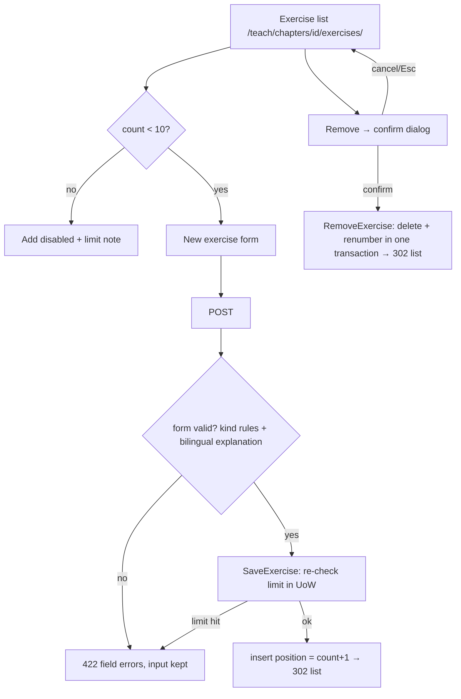

### Story 3.7: Exercise Editor

**BUILDID**: CYCLE-2 | **GitHub**: LOCAL | **AzureDevOps**: LOCAL | **Epic**: 3 - Teacher Content Authoring | **ID**: 3.7 | **Date**: 2026-10-19
**File**: `docs/plans/stories/epic-3-story-3.7-Exercise-Editor.md`
**Build Ref**: `docs/plans/builds/cycle-2/cycle-plan.md` — CYCLE-2 (Workshop Day 2: exercise editor, 3 kinds, max 10 per chapter)
**Wave**: 8
**Requires**: [3.1, 3.2, 3.4]
**Enables**: [3.9]
**Files Touched**:
  - src/application/content/save_exercise.py
  - src/application/content/remove_exercise.py
  - src/infrastructure/persistence/content/repositories/exercises.py
  - src/infrastructure/web/content/views/exercises.py
  - src/infrastructure/web/content/forms/exercise.py
  - src/infrastructure/web/templates/content/exercises/**
  - src/infrastructure/web/content/urls.py
  - src/infrastructure/container.py
  - src/infrastructure/i18n/locale/ro/LC_MESSAGES/django.po
  - src/infrastructure/i18n/locale/en/LC_MESSAGES/django.po
  - tests/integration/web/test_role_access_matrix.py
  - docs/architecture/design/00-system-architecture-greenfield.md
  - tests/unit/application/content/test_save_exercise.py
  - tests/unit/application/content/test_remove_exercise.py
  - tests/integration/web/content/exercises/**
**Roles Ref**: docs/requirements.md#roles--permissions-matrix — personas this story differentiates: Teacher, Student, Parent/Guardian, Admin
**QA Candidate**: Yes — **Observable:** from a chapter row, "Exercises" lists the chapter's exercises (number, type, question in the current language, status). A Teacher adds exercises of any of the three types (bilingual question, options, correct answer, bilingual explanation), edits them, and removes one after a confirmation dialog, after which the remaining exercises are renumbered without gaps. The 11th exercise is refused. **Mechanism:**
- `GET /teach/chapters/<id>/exercises/` (`content:exercise_list`, `content:edit`)
- `GET/POST /teach/chapters/<id>/exercises/new/` (`content:exercise_create`, `content:create`)
- `GET/POST /teach/exercises/<id>/edit/` (`content:exercise_edit`, `content:edit`)
- `POST /teach/exercises/<id>/remove/` (`content:exercise_remove`, `content:edit`)
- `ExerciseForm` = `QuestionFieldsForm` + bilingual explanation → `SaveExercise` (domain `validate_exercise` + `exercise_limit_violation` on create) / `RemoveExercise` (delete + renumber in one transaction) → `DjangoExerciseRepository`

**Authz & preconditions:** Teacher only; chapter/exercise must exist (404). **Edge & idempotency:**
- Removing an already-removed exercise → 404 for the URL, and the use case reports `False` (no error page loop).
- Concurrent adds at 9 exercises: the DB unique `(chapter, position)` + limit re-check inside the transaction allow exactly one.
- Edits keep position and moderation status.
- Removal deletes that exercise's student completion marks (CASCADE, Story 4.1), which is intended.

**Regression:** the 10-exercise cap, kind-specific validation, bilingual explanation, renumbering, 403 for non-teachers, confirm dialog keyboard behaviour (Story 1.6).

---

#### 👤 User Reference

**Description**:
Each chapter needs 5 to 10 extra practice exercises, harder than the lesson. This story gives teachers the tools to manage them.

**The exercise list:** opened from the chapter's row, it shows every exercise with its number, type (multiple choice, true/false or number), question and status.

**Adding or editing an exercise:**
- the type and the question, in Romanian and English
- for multiple choice, the answer options (2 to 6) in both languages, and which one is correct
- for true/false, whether the right answer is true or false
- for number questions, the right number ("2,5" and "2.5" both work)
- an explanation in both languages, which students see after they finish the exercise

**Limits and removal:**
- A chapter can't have more than 10 exercises; the "Add exercise" button explains why when the limit is reached.
- Teachers can remove an exercise after confirming in a dialog. The rest are renumbered, so numbering never has gaps.

Saved exercises are visible to students immediately. Exercises are never scored.

**Acceptance Criteria** (plain-English):
- Teachers open a chapter's exercise list from the Dashboard; it shows each exercise's number, type, question (current language) and status.
- Teachers can add an exercise of any of the three types with the question, answers and explanation in both languages.
- Each type checks its own answer rules; problems are shown next to the right field, and everything typed is kept.
- The explanation is required in both languages.
- A chapter can hold at most 10 exercises; when it's full, adding is refused with a clear message.
- Editing keeps the exercise's number and status.
- Removing asks for confirmation first; afterwards the remaining exercises are renumbered 1, 2, 3…
- Saved exercises appear to students straight away; nothing is scored.
- Students, parents and administrators get "Access denied"; unknown chapters or exercises show "Page not found".

**User Flow** (role-differentiated):

### Teacher
**Scenario / narrative**: As a Teacher, I open MEM chapter 1's "Exercises" from the Dashboard. The list says "No exercises yet". I add a multiple-choice question "Cât face 27 + 15?" with options 32, 42, 52 and mark 42 as correct, with a short explanation in both languages. Then I add a number question ("12,5 + 2,5 = ?", answer "15") and a true/false one. When I forget the English explanation, the form tells me exactly that and keeps my typing. After adding seven exercises I decide number 3 is too easy. I click "Remove", confirm in the dialog, and the list shows 1–6 again. Later, with ten exercises, the "Add exercise" button is disabled with the note "A chapter can have at most 10 exercises."
**Steps**:
1. `GET /ro/teach/chapters/<id>/exercises/` → `@require_permission(CONTENT_EDIT)` → `DjangoExerciseRepository.list_for_chapter(id)` (`NotFound` if no chapter) → table of exercises + "Add exercise" (disabled at 10).
2. `GET …/exercises/new/` → empty `ExerciseForm`; POST → `ExerciseForm.is_valid()` (question kit + bilingual explanation) → `SaveExercise.execute(SaveExerciseCommand(None, chapter_id, draft, actor_id))` → limit check + `validate_exercise` → `add` (position = count + 1) in UoW → 302 list + "Exercise saved."
3. `GET/POST /ro/teach/exercises/<eid>/edit/` → initial from the stored exercise (`QuestionFieldsForm.initial_from`) → `SaveExercise` update path (position and status kept).
4. "Remove" → `ui_dialog_trigger` → dialog form POST `…/remove/` → `RemoveExercise.execute(eid)` → delete + renumber positions above it (−1, ascending) in one transaction → 302 list + "Exercise removed."

### Student
**Scenario / narrative**: As a Student, I only practise exercises (Story 4.3). Teacher exercise URLs give me "Access denied".
**Steps**:
1. Any of the four routes → 403.

### Parent/Guardian
**Scenario / narrative**: As a Parent, I can't create or change exercises; teacher URLs show "Access denied".
**Steps**:
1. Any route → 403.

### Admin
**Scenario / narrative**: As the Admin, I'll moderate exercises next cycle but can't author them; these URLs are denied.
**Steps**:
1. Any route → 403.

**Flow Diagram**:



---

#### 🤖 AI Agent Reference

**Must Read**:
- `docs/requirements.md` — "Each chapter contains a main lesson and 5–10 additional higher-difficulty exercises", "Exercises are not scored… show correct answers and explanations"
- `docs/architecture/design/00-system-architecture-greenfield.md` — Answer key formats, Integrity rules (≤ 10 exercises, positions 1–10), route catalogue (`/teach/chapters/<id>/exercises/new/`, `/teach/exercises/<id>/edit/`)
- `docs/architecture/design/01-patterns-and-standards-greenfield.md` — §5, §6.3 (IntegrityError mapping), §7.3 forms, §7.5, §11.2 (`ui_confirm_dialog`, `ui_table`)
- `docs/plans/stories/epic-3-story-3.1-Content-Domain-Rules.md` — `ExerciseDraft`, `validate_exercise`, `exercise_limit_violation`, `ExerciseRepository`
- `docs/plans/stories/epic-3-story-3.4-Authoring-Web-Kit.md` — `QuestionFieldsForm`, `BilingualFormMixin`, `add_violations`, `_question_fields.html`

**Description**:
1. **Use cases:**
   - `save_exercise.py`: `SaveExerciseCommand(exercise_id | None, chapter_id | None, draft: ExerciseDraft, actor_id)`. Create: chapter exists (else `NotFound`), `exercise_limit_violation(count)`, `validate_exercise(draft)`, then `add`. Update: `chapter_of(exercise_id)` (else `NotFound`), `validate_exercise`, then `update`. Raises `PolicyViolation` with all violations.
   - `remove_exercise.py`: `RemoveExercise(exercises, uow).execute(exercise_id) -> bool`.
2. **Repository** `repositories/exercises.py`: `DjangoExerciseRepository` (port methods + read helpers `list_for_chapter(chapter_id) -> ExerciseListDTO` and `load(exercise_id) -> ExerciseEditDTO`):
   - `add` computes `position = count + 1` inside the transaction; an `IntegrityError` on `(chapter, position)` (a concurrent add, or position 11 hitting the check constraint) → `PolicyViolation([exercises_limit])`; the teacher reloads and resubmits (no automatic retry; see the Step 3 note)
   - `remove` deletes and decrements `position` for siblings above it in ascending order (no unique-constraint clash)
   - `update` never touches `position` or `moderation_*`
   - options are stored as `[{"id","ro","en"}]` and the answer key as JSON (architecture formats)
3. **Form** `forms/exercise.py`: `ExerciseForm(BilingualFormMixin, QuestionFieldsForm)` with `bilingual_fields = ("explanation",)` and `explanation_ro/en` (Textarea, max 2,000). `to_draft()` builds an `ExerciseDraft`.
4. **Views** `views/exercises.py`: list, create, edit, remove. Routes appended to `content/urls.py`.
5. **Templates** `content/exercises/list.html`, `form.html` (includes `content/_question_fields.html` + explanation pair).

**Design Tokens** (FE — staff theme, `editor.css`):
- List: `ui_page_header` (breadcrumb Dashboard › {subject} › Chapter {n} › Exercises; actions: "Add exercise" primary with icon `pencil-simple`, disabled at 10 with helper text in `#B45309`). `ui_table` columns: No. · Type · Question · Status · Actions; question truncated to 80 chars; status `ui_status_pill`; actions "Edit" (link) and "Remove" (`ui_dialog_trigger`, danger variant).
- Count indicator: `ui_progress done=count total=10 label="Exercises (5–10 needed)"`.
- Empty: `ui_empty_state` "No exercises yet." + "Add exercise".
- Form: `_question_fields.html` (kind segmented control, RO|EN prompts, option table, answer fieldsets) + RO|EN explanation pair (`ui_field_pair`); sticky action bar "Save exercise" (primary) / "Cancel".
- Remove dialog: `ui_confirm_dialog` title "Remove exercise {n}?", body "Students' completion marks for this exercise will also be removed.", confirm "Remove" (danger `#B91C1C`).
- Validation: on submit | Error: inline + top `ui_alert "error"`; success banners "Exercise saved." / "Exercise removed."

**Acceptance Criteria**:
1. Routes appended to `content/urls.py`:
   - `"chapters/<int:chapter_id>/exercises/"` → `exercise_list` (`content:exercise_list`), GET, `CONTENT_EDIT`
   - `"chapters/<int:chapter_id>/exercises/new/"` → `exercise_create` (`content:exercise_create`), GET/POST, `CONTENT_CREATE`
   - `"exercises/<int:exercise_id>/edit/"` → `exercise_edit` (`content:exercise_edit`), GET/POST, `CONTENT_EDIT`
   - `"exercises/<int:exercise_id>/remove/"` → `exercise_remove` (`content:exercise_remove`), POST, `CONTENT_EDIT`
2. The list shows exercises ordered by position with type label, localized prompt (truncated), status pill, Edit and Remove. "Add exercise" is a link when count < 10, otherwise a disabled button + "A chapter can have at most 10 exercises."
3. Create POST valid → `SaveExercise` → 302 to the list + "Exercise saved." The new row has `position = count + 1`, `moderation_status = "ACTIVE"`, and `created_by = updated_by = request.user`.
4. Create when count = 10 (e.g. stale tab) → 422 with "A chapter can have at most 10 exercises." and nothing written. GET of the create page at 10 → 302 to the list with a warning message.
5. Kind-specific validation errors (Story 3.4 mapping) and a missing explanation language → 422, with all input kept.
6. Edit GET pre-fills from storage (`initial_from` + explanations). POST valid → 302 list; `position`, `moderation_*` and `created_*` unchanged; `updated_*` = editor + clock.
7. Remove POST → 302 list + "Exercise removed." Remaining positions become `1..n-1` without gaps; dependent `ExerciseCompletion` rows (Story 4.1) are deleted by CASCADE. Remove of an unknown id → 404.
8. Numeric answers are stored canonical (`"2,50"` → `{"value": "2.5"}`); MCQ options are stored only for letters with text, in a–f order.
9. Dashboard integration: `content:exercise_list` resolves, so Story 3.5's chapter rows show "Exercises" automatically.
10. Route catalogue updated; RO/EN translations for all strings.

**RBAC Enforcement**:

| Persona | Permission key | Guarded route/endpoint | Allowed | Denied behavior | UI when denied |
|---------|----------------|------------------------|---------|-----------------|----------------|
| Teacher | `content:edit` | list, edit, remove | yes | unknown chapter/exercise → 404 | — |
| Teacher | `content:create` | create | yes (count < 10) | full chapter → 422 / redirect | Add disabled at 10 |
| Student | — | all four | no | 403 | no link in learner UI |
| Parent/Guardian | — | all four | no | 403 | — |
| Admin | — | all four | no | 403 | — |
| Anonymous | — | all four | no | 302 login | sign-in |

- **Enforcement point(s):** `@require_permission` on each view in `views/exercises.py`.
- **Denied-access contract:** 403 for roles; 404 for unknown ids.
- **Scope derivation:** no per-teacher ownership; `actor_id` = `request.user.pk`; on edit/remove the chapter is derived from the stored exercise (`chapter_of`), never from posted data.

**System responses + error cases**:

| Trigger | Response | Side-effect |
|---------|----------|-------------|
| Teacher GET list (0 exercises) | `200` empty state + Add | none |
| Teacher POST valid MCQ | `302` list + "Exercise saved." | row position 1, ACTIVE |
| POST valid NUMERIC "2,50" | `302` | `answer_key={"value":"2.5"}`, `options=[]` |
| POST MCQ with option C missing EN | `422`; error on option C (EN) | none |
| POST missing `explanation_en` | `422` "English text is required." | none |
| POST create when 10 exist | `422` limit message | none |
| Two concurrent creates at 9 | one `302`, one `422` limit | exactly 10 rows |
| Teacher POST edit (change answer) | `302` | answer updated; position/status unchanged |
| Re-POST identical edit | `302` | only `updated_*` |
| POST remove exercise 3 of 7 | `302` + "Exercise removed." | 6 rows, positions 1–6; its completions deleted |
| POST remove same id again | `404` | none |
| GET edit unknown id | `404` | none |
| Student/Parent/Admin any route | `403` | none |
| POST remove without CSRF | `403` | none |

**QA-observable behaviour**:
- After adding 7 exercises and removing #3, `SELECT position FROM content_exercise WHERE chapter_id=… ORDER BY position` returns `1,2,3,4,5,6`. The former #4 is now #3 with its content unchanged.
- An MCQ saved with options a, b, c and correct b stores `options` with exactly 3 objects and `answer_key = {"option_id": "b"}`.
- An edited exercise keeps `created_by_id`, `position` and `moderation_status`.
- With 10 exercises, the "Add exercise" control is disabled and a forged POST returns 422 without a new row.
- **What does NOT change**: the lesson, the test and other chapters' exercises; moderation fields; nothing is scored or stored about student answers here.

**Prerequisites**:
- Stories 3.1, 3.2 and 3.4 merged; Story 1.6 (`ui_confirm_dialog`, `ui_table`).
- Story 4.1's `ExerciseCompletion` FK uses CASCADE (same wave). If 4.1 hasn't merged yet, AC 7's completion-deletion check is asserted in Story 4.4's journey instead.

**Context**: `docs/architecture/design/00-system-architecture-greenfield.md`, `docs/architecture/design/01-patterns-and-standards-greenfield.md`, `src/domain/content/questions.py`, `src/domain/content/chapters.py`, `src/domain/content/ports.py`, `src/infrastructure/web/content/forms/question.py`, `src/infrastructure/web/templates/content/_question_fields.html`

**Patterns**: Use case + UoW (§5), Repository (§6.3), Forms (§7.3), Responses (§7.5), Primitives — table, dialog (§11.2) — see `docs/architecture/design/01-patterns-and-standards-greenfield.md`

**Steps**:

1. **Tests first** (use cases with fakes; repository renumbering; views per System-responses row).

2. **Use cases:**
   ```python
   # src/application/content/save_exercise.py
   from dataclasses import dataclass

   from application.common.unit_of_work import UnitOfWork
   from domain.common.clock import Clock
   from domain.common.errors import NotFound, PolicyViolation
   from domain.content.chapters import exercise_limit_violation
   from domain.content.ports import ExerciseRepository
   from domain.content.questions import ExerciseDraft, validate_exercise


   @dataclass(frozen=True)
   class SaveExerciseCommand:
       exercise_id: int | None
       chapter_id: int | None
       draft: ExerciseDraft
       actor_id: int


   class SaveExercise:
       def __init__(self, exercises: ExerciseRepository, uow: UnitOfWork, clock: Clock) -> None:
           self._exercises, self._uow, self._clock = exercises, uow, clock

       def execute(self, cmd: SaveExerciseCommand) -> int:
           with self._uow:
               if cmd.exercise_id is not None:
                   if self._exercises.chapter_of(cmd.exercise_id) is None:
                       raise NotFound("exercise")
                   self._raise_if(validate_exercise(cmd.draft))
                   self._exercises.update(cmd.exercise_id, cmd.draft, cmd.actor_id, self._clock.now())
                   return cmd.exercise_id
               if cmd.chapter_id is None or not self._exercises.chapter_exists(cmd.chapter_id):
                   raise NotFound("chapter")
               limit = exercise_limit_violation(self._exercises.count(cmd.chapter_id))
               self._raise_if(([limit] if limit else []) + validate_exercise(cmd.draft))
               return self._exercises.add(cmd.chapter_id, cmd.draft, cmd.actor_id, self._clock.now())

       @staticmethod
       def _raise_if(violations) -> None:
           if violations:
               raise PolicyViolation(violations)
   ```
   ```python
   # src/application/content/remove_exercise.py
   class RemoveExercise:
       def __init__(self, exercises: ExerciseRepository, uow: UnitOfWork) -> None:
           self._exercises, self._uow = exercises, uow

       def execute(self, exercise_id: int) -> bool:
           """Delete and renumber; False when it no longer exists (idempotent)."""
           with self._uow:
               return self._exercises.remove(exercise_id)
   ```

3. **Repository** (excerpt):
   ```python
   class DjangoExerciseRepository:
       def add(self, chapter_id, draft, actor_id, at) -> int:
           position = ExerciseModel.objects.filter(chapter_id=chapter_id).count() + 1
           try:
               return ExerciseModel.objects.create(chapter_id=chapter_id, position=position,
                                                   **_fields(draft), created_by_id=actor_id, updated_by_id=actor_id,
                                                   created_at=at, updated_at=at).pk
           except IntegrityError as exc:  # concurrent add took this position, or position 11 (check constraint)
               raise PolicyViolation([Violation("exercises_limit", {"limit": MAX_EXERCISES_PER_CHAPTER})]) from exc

       def remove(self, exercise_id) -> bool:
           row = ExerciseModel.objects.filter(pk=exercise_id).values_list("chapter_id", "position").first()
           if row is None:
               return False
           chapter_id, position = row
           ExerciseModel.objects.filter(pk=exercise_id).delete()
           for sibling in ExerciseModel.objects.filter(chapter_id=chapter_id, position__gt=position).order_by("position"):
               ExerciseModel.objects.filter(pk=sibling.pk).update(position=sibling.position - 1)
           return True


   def _fields(draft: ExerciseDraft) -> dict:
       return {"kind": draft.kind.value, "prompt_ro": draft.prompt_ro, "prompt_en": draft.prompt_en,
               "options": [{"id": o.id, "ro": o.ro, "en": o.en} for o in draft.options],
               "answer_key": dict(draft.answer_key), "explanation_ro": draft.explanation_ro,
               "explanation_en": draft.explanation_en}
   ```
   > **Decision:** no automatic retry. With 2 pilot teachers a collision is rare; it reports the limit message, and the reloaded list shows the real count. Record this in the review doc.

4. **Form:**
   ```python
   # src/infrastructure/web/content/forms/exercise.py
   class ExerciseForm(BilingualFormMixin, QuestionFieldsForm):
       bilingual_fields = ("explanation",)
       explanation_ro = forms.CharField(label=_("Explanation"), max_length=2000, required=False,
                                        widget=forms.Textarea(attrs={"rows": 3}))
       explanation_en = forms.CharField(label=_("Explanation"), max_length=2000, required=False,
                                        widget=forms.Textarea(attrs={"rows": 3}))

       def to_draft(self) -> ExerciseDraft:
           data = self.cleaned_data
           return ExerciseDraft(QuestionKind(data["kind"]), data["prompt_ro"], data["prompt_en"],
                                tuple(data["options"]), data["answer_key"], data["explanation_ro"], data["explanation_en"])
   ```

5. **Views** follow Story 3.5's pattern: catch `PolicyViolation` only to render it into the form (`add_violations` with a map `{"exercises_limit": None, "explanation_missing_ro": "explanation_ro", "explanation_missing_en": "explanation_en"}` plus the question-field map from 3.4). `NotFound` propagates (404). Remove uses `@require_POST`.

6. **Templates, container (`save_exercise()`, `remove_exercise()`), URLs, route catalogue, translations,** then **all gates**.

**Tests**:

```python
# tests/unit/application/content/test_save_exercise.py
import pytest

from application.content.save_exercise import SaveExercise, SaveExerciseCommand
from domain.common.errors import NotFound, PolicyViolation
from domain.content.questions import ExerciseDraft, QuestionKind
from tests.fakes import FakeUnitOfWork, FixedClock

VALID = ExerciseDraft(QuestionKind.TRUE_FALSE, "2>1?", "2>1?", (), {"value": True}, "Da.", "Yes.")


class FakeExercises:
    def __init__(self, chapters, counts=None):
        self.chapters, self.counts, self.rows = set(chapters), dict(counts or {}), {}

    def chapter_exists(self, chapter_id):
        return chapter_id in self.chapters

    def count(self, chapter_id):
        return self.counts.get(chapter_id, 0)

    def chapter_of(self, exercise_id):
        return self.rows.get(exercise_id, (None,))[0]

    def add(self, chapter_id, draft, actor_id, at):
        new_id = len(self.rows) + 1
        self.rows[new_id] = (chapter_id, draft)
        self.counts[chapter_id] = self.count(chapter_id) + 1
        return new_id

    def update(self, exercise_id, draft, actor_id, at):
        self.rows[exercise_id] = (self.rows[exercise_id][0], draft)

    def remove(self, exercise_id):
        return self.rows.pop(exercise_id, None) is not None


def run(repo, cmd):
    return SaveExercise(repo, FakeUnitOfWork(), FixedClock()).execute(cmd)


def test_adds_valid_exercise():
    repo = FakeExercises({1})

    exercise_id = run(repo, SaveExerciseCommand(None, 1, VALID, actor_id=2))

    assert repo.rows[exercise_id] == (1, VALID)


def test_eleventh_exercise_is_refused():
    with pytest.raises(PolicyViolation) as error:
        run(FakeExercises({1}, {1: 10}), SaveExerciseCommand(None, 1, VALID, actor_id=2))

    assert error.value.violations[0].code == "exercises_limit"


def test_invalid_draft_reports_all_violations():
    bad = ExerciseDraft(QuestionKind.NUMERIC, "", "p", (), {"value": "x"}, "", "e")

    with pytest.raises(PolicyViolation) as error:
        run(FakeExercises({1}), SaveExerciseCommand(None, 1, bad, actor_id=2))

    assert [v.code for v in error.value.violations] == ["prompt_missing_ro", "answer_key_invalid", "explanation_missing_ro"]


@pytest.mark.parametrize(("exercise_id", "chapter_id"), [(None, 99), (42, None)])
def test_unknown_chapter_or_exercise_is_not_found(exercise_id, chapter_id):
    with pytest.raises(NotFound):
        run(FakeExercises({1}), SaveExerciseCommand(exercise_id, chapter_id, VALID, actor_id=2))
```

```python
# tests/unit/application/content/test_remove_exercise.py
from application.content.remove_exercise import RemoveExercise
from tests.fakes import FakeUnitOfWork
from tests.unit.application.content.test_save_exercise import VALID, FakeExercises


def test_remove_is_idempotent():
    repo = FakeExercises({1})
    repo.rows[5] = (1, VALID)
    use_case = RemoveExercise(repo, FakeUnitOfWork())

    assert use_case.execute(5) is True
    assert use_case.execute(5) is False
```

```python
# tests/integration/web/content/exercises/test_exercise_editor.py
import pytest

from infrastructure.persistence.content.models import ExerciseModel
from tests.factories.content import ChapterFactory, ExerciseFactory

pytestmark = pytest.mark.django_db
MCQ = {"kind": "MCQ", "prompt_ro": "Cât face 27+15?", "prompt_en": "What is 27+15?",
       "option_a_ro": "32", "option_a_en": "32", "option_b_ro": "42", "option_b_en": "42",
       "option_c_ro": "52", "option_c_en": "52", "correct_option": "b",
       "explanation_ro": "27+15=42.", "explanation_en": "27+15=42."}


def test_teacher_adds_mcq_exercise(teacher_client, teacher):
    chapter = ChapterFactory()

    response = teacher_client.post(f"/en/teach/chapters/{chapter.pk}/exercises/new/", MCQ)

    assert response.status_code == 302
    exercise = ExerciseModel.objects.get(chapter=chapter)
    assert (exercise.position, exercise.moderation_status, exercise.answer_key) == (1, "ACTIVE", {"option_id": "b"})
    assert [o["id"] for o in exercise.options] == ["a", "b", "c"]


def test_numeric_answer_is_stored_canonically(teacher_client):
    chapter = ChapterFactory()
    data = {"kind": "NUMERIC", "prompt_ro": "12,5+2,5?", "prompt_en": "12.5+2.5?", "correct_number": "15,00",
            "explanation_ro": "15.", "explanation_en": "15."}

    teacher_client.post(f"/en/teach/chapters/{chapter.pk}/exercises/new/", data)

    assert ExerciseModel.objects.get(chapter=chapter).answer_key == {"value": "15"}


def test_missing_explanation_language_is_422(teacher_client):
    chapter = ChapterFactory()

    response = teacher_client.post(f"/en/teach/chapters/{chapter.pk}/exercises/new/", {**MCQ, "explanation_en": ""})

    assert response.status_code == 422 and "English text is required." in response.content.decode()


def test_eleventh_exercise_is_refused(teacher_client):
    chapter = ChapterFactory()
    for position in range(1, 11):
        ExerciseFactory(chapter=chapter, position=position)

    response = teacher_client.post(f"/en/teach/chapters/{chapter.pk}/exercises/new/", MCQ)

    assert response.status_code == 422
    assert "at most 10 exercises" in response.content.decode()
    assert ExerciseModel.objects.filter(chapter=chapter).count() == 10


def test_remove_renumbers_without_gaps(teacher_client):
    chapter = ChapterFactory()
    exercises = [ExerciseFactory(chapter=chapter, position=p, prompt_en=f"Q{p}") for p in range(1, 8)]

    assert teacher_client.post(f"/en/teach/exercises/{exercises[2].pk}/remove/").status_code == 302

    rows = list(ExerciseModel.objects.filter(chapter=chapter).order_by("position").values_list("position", "prompt_en"))
    assert rows == [(1, "Q1"), (2, "Q2"), (3, "Q4"), (4, "Q5"), (5, "Q6"), (6, "Q7")]
    assert teacher_client.post(f"/en/teach/exercises/{exercises[2].pk}/remove/").status_code == 404


def test_edit_keeps_position_and_status(teacher_client):
    exercise = ExerciseFactory(position=4, moderation_status="FLAGGED")

    teacher_client.post(f"/en/teach/exercises/{exercise.pk}/edit/", MCQ)

    exercise.refresh_from_db()
    assert (exercise.position, exercise.moderation_status, exercise.prompt_en) == (4, "FLAGGED", "What is 27+15?")


@pytest.mark.parametrize("fixture", ["student_client", "parent_client", "admin_client"])
def test_non_teachers_are_denied(request, fixture):
    client, exercise = request.getfixturevalue(fixture), ExerciseFactory()

    assert client.get(f"/ro/teach/chapters/{exercise.chapter_id}/exercises/").status_code == 403
    assert client.post(f"/ro/teach/exercises/{exercise.pk}/remove/").status_code == 403
```

Manual:
- As Teacher: add one exercise of each type in RO/EN, trigger each validation error once, fill to 10 and confirm Add is disabled, remove one via the dialog (keyboard: Enter to open, Esc to cancel, then confirm), and check renumbering.
- As Student, Parent and Admin: confirm 403 on the list URL.

**Quality**: ruff 0; mypy strict for `application.content`; tests pass; application ≥95%, overall ≥85%; primitives reused (table, dialog, pills); no inline `style`/`script`; no `TODO`.

**OUT**:
- ❌ Students answering exercises and seeing explanations (Story 4.3).
- ❌ Reordering exercises by drag-and-drop (not required; removal renumbers).
- ❌ Markdown or images in exercises (plain text by design).
- ❌ Scoring exercises (requirements: unscored).
- ❌ Moderation actions (CYCLE-3).

**Evidence**: pytest output, coverage %, screenshots of the exercise list (with status pills and the 10/10 disabled state), the form with a kind-specific error, and the remove dialog, all recorded in `docs/stories-implemented/story-3.7-review.md` under "## DoD Evidence".
