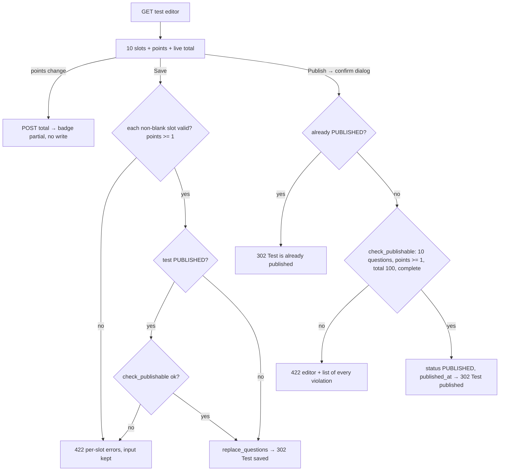

### Story 3.8: Test Editor & Publishing

**BUILDID**: CYCLE-2 | **GitHub**: LOCAL | **AzureDevOps**: LOCAL | **Epic**: 3 - Teacher Content Authoring | **ID**: 3.8 | **Date**: 2026-10-19
**File**: `docs/plans/stories/epic-3-story-3.8-Test-Editor-and-Publishing.md`
**Build Ref**: `docs/plans/builds/cycle-2/cycle-plan.md` — CYCLE-2 (Workshop Day 2: test editor with live total; publish blocked until every rule passes)
**Wave**: 8
**Requires**: [3.1, 3.2, 3.4]
**Enables**: [3.9]
**Files Touched**:
  - src/application/content/save_chapter_test.py
  - src/application/content/publish_chapter_test.py
  - src/infrastructure/persistence/content/repositories/chapter_tests.py
  - src/infrastructure/web/content/views/chapter_tests.py
  - src/infrastructure/web/content/forms/chapter_test.py
  - src/infrastructure/web/templates/content/chapter_test/**
  - src/infrastructure/web/content/urls.py
  - src/infrastructure/container.py
  - src/infrastructure/i18n/locale/ro/LC_MESSAGES/django.po
  - src/infrastructure/i18n/locale/en/LC_MESSAGES/django.po
  - tests/integration/web/test_role_access_matrix.py
  - docs/architecture/design/00-system-architecture-greenfield.md
  - tests/unit/application/content/test_save_chapter_test.py
  - tests/unit/application/content/test_publish_chapter_test.py
  - tests/integration/web/content/chapter_test/**
**Roles Ref**: docs/requirements.md#roles--permissions-matrix — personas this story differentiates: Teacher, Student, Parent/Guardian, Admin
**QA Candidate**: Yes — **Observable:** from a chapter row, "Test" opens a 10-slot question editor. Each slot uses the shared question block plus a "Points" field, and a live "Total: N / 100" badge updates as points change. "Save" stores a draft (blank slots skipped). "Publish" opens a confirmation dialog and succeeds only when there are exactly 10 complete bilingual questions, each worth ≥ 1 point, totalling exactly 100; otherwise every reason is listed. A published test shows the PUBLISHED pill and stays editable as long as every save keeps it publishable. **Mechanism:**
- `GET/POST /teach/chapters/<id>/test/` (`content:test_edit`, `tests:configure`): 10 `TestQuestionForm`s (prefixes `q1`…`q10`) → `SaveChapterTest` (per-question `validate_question` + points ≥ 1; if PUBLISHED, `check_publishable` too) → `DjangoChapterTestRepository.replace_questions` in UoW
- `POST /teach/chapters/<id>/test/total/` (`content:test_total`, HTMX) returns the badge partial without writing
- `POST /teach/tests/<test_id>/publish/` (`content:test_publish`) → `PublishChapterTest` (`check_publishable` → `mark_published`)

**Authz & preconditions:** `tests:configure` (Teacher only); chapter/test must exist (404). **Edge & idempotency:**
- Publishing an already-published test is a no-op ("Test is already published", 302).
- The total endpoint ignores non-numeric points and never writes.
- Clearing every field of a slot removes that question on save.
- A save that would break a published test's rules is refused, keeping it publishable.
- The scoring lock after the first student attempt is CYCLE-3 (no attempts exist in CYCLE-2).

**Regression:** the publish rule set (count, points ≥ 1, total = 100, completeness, bilingual), the live total, the confirm-before-publish dialog, 403 for non-teachers, published-test invariants.

---

#### 👤 User Reference

**Description**:
Every chapter ends with a 10-question test. This story gives teachers the test editor.

**Building the test:**
- **Ten question slots**, each using the same question block as the exercises (multiple choice, true/false or number, in Romanian and English) plus a **points** box.
- **Custom weights:** teachers give each question its own number of points (the requirements call these custom weights), and the points must add up to exactly 100.
- **Live total:** a counter at the bottom ("Total: 95 / 100") updates as they type, so they can balance the points without guessing.

**Saving and publishing:**
- **Saving as a draft:** teachers can save unfinished work at any time; empty slots are simply skipped.
- **Publishing:** when ready, teachers click "Publish". A confirmation explains that the test will be ready for students. Publishing only works when all 10 questions are complete in both languages, each is worth at least 1 point, and the total is exactly 100. If anything is missing, every problem is listed so it can be fixed in one pass.
- **After publishing:** the test shows "Published". Teachers can still correct it, but any change must keep it valid; the editor won't let a published test fall below the rules.

Students take tests in the next cycle; this cycle prepares and publishes them. Only teachers can use the test editor.

**Acceptance Criteria** (plain-English):
- Teachers open a chapter's test editor from the Dashboard; it shows 10 question slots with points boxes.
- A live counter shows the total points and whether it equals 100.
- Saving keeps the filled questions as a draft; completely empty slots are skipped; incomplete slots show what's missing.
- Each saved question must be worth at least 1 point.
- Publishing asks for confirmation and then succeeds only with exactly 10 complete bilingual questions totalling exactly 100 points.
- When publishing fails, all reasons are listed, each naming its question number where relevant.
- A published test shows "Published"; publishing it again changes nothing.
- A published test can be edited, but a change that breaks the rules is refused and the published version stays intact.
- Students, parents and administrators get "Access denied"; unknown chapters or tests show "Page not found".

**User Flow** (role-differentiated):

### Teacher
**Scenario / narrative**: As a Teacher, I open MEM chapter 1's "Test". I type eight questions tonight and click "Save"; the draft keeps them, and the two empty slots are ignored. The next day I add questions 9 and 10 and set points: eight questions at 10, two at 15. The counter shows "Total: 110 / 100" in amber, so I change two of the 10s to 5 and it turns green at 100. I click "Publish", read the dialog ("Students will be able to take this test… once published"), and confirm. Earlier, when I tried to publish with only nine questions, I got a list: "A test needs exactly 10 questions; it has 9." and "Points total 90; it must be exactly 100." Now the editor shows "Published".
**Steps**:
1. `GET /ro/teach/chapters/<id>/test/` → `@require_permission(TESTS_CONFIGURE)` → `DjangoChapterTestRepository.load_for_edit(chapter_id)` (`NotFound` if no chapter; test may not exist yet) → 10 `TestQuestionForm`s pre-filled from stored questions by position.
2. Typing points → `hx-post` `/ro/teach/chapters/<id>/test/total/` (`hx-trigger="input changed delay:300ms"`, `hx-include` of all `qN-points`) → 200 badge partial (`aria-live="polite"`).
3. "Save" POST → each non-blank form validated → `SaveChapterTest.execute(SaveChapterTestCommand(chapter_id, drafts, actor_id))` → `draft_or_existing` (creates a DRAFT test on first save) → per-question checks (+ `check_publishable` if PUBLISHED) → `replace_questions` in UoW → 302 editor + "Test saved."
4. "Publish" (dialog form) POST `/ro/teach/tests/<test_id>/publish/` → `PublishChapterTest.execute(test_id)` → `check_publishable(load_questions)` → `mark_published(at)` → 302 editor + "Test published." On violations → 422 editor with a top alert listing every violation.

### Student
**Scenario / narrative**: As a Student, I'll take tests next cycle. I can't open the editor; teacher URLs answer "Access denied".
**Steps**:
1. Any of the three routes → 403.

### Parent/Guardian
**Scenario / narrative**: As a Parent, I can't see or change test answers; the editor URLs show "Access denied".
**Steps**:
1. Any route → 403.

### Admin
**Scenario / narrative**: As the Admin, I don't configure tests (that's `tests:configure`, a teacher permission); the editor is denied to me. I track published tests on the Pilot page (Story 5.1).
**Steps**:
1. Any route → 403.

**Flow Diagram**:



---

#### 🤖 AI Agent Reference

**Must Read**:
- `docs/requirements.md` — Feature "Chapter tests" (10 questions; MCQ/TF/numeric; teacher configures custom points totalling 100 before sending to students)
- `docs/architecture/design/00-system-architecture-greenfield.md` — `TestPublicationPolicy`, route catalogue (`/teach/chapters/<id>/test/`, `POST /teach/tests/<id>/publish/` contract: 422 with violation list), ADR-009, "Scoring lock" (CYCLE-3)
- `docs/architecture/design/01-patterns-and-standards-greenfield.md` — §5, §6.3, §7.3–7.5 (HTMX partials, 422), §11.2 (`ui_confirm_dialog`, `ui_badge`)
- `docs/ui-ux/ui-ux-spec.md` — `confirm: [publish]`, live points total in the test editor
- `docs/plans/stories/epic-3-story-3.1-Content-Domain-Rules.md` — `QuestionDraft`, `check_publishable`, `ChapterTestRepository`
- `docs/plans/stories/epic-3-story-3.4-Authoring-Web-Kit.md` — `QuestionFieldsForm`, `violation_text`, `_question_fields.html`

**Description**:
1. **Use cases:**
   - `save_chapter_test.py`: `SaveChapterTestCommand(chapter_id, questions: tuple[QuestionDraft, ...], actor_id)` → `SaveChapterTest(tests, uow, clock).execute(cmd) -> int` (test id). It raises `NotFound` (chapter) and `PolicyViolation` (per-question violations with `position`, `points_below_minimum`; for PUBLISHED tests also `check_publishable`).
   - `publish_chapter_test.py`: `PublishChapterTest(tests, uow, clock).execute(test_id) -> bool`. It returns `False` when already published, and raises `NotFound` for an unknown test and `PolicyViolation` from `check_publishable`.
2. **Repository** `repositories/chapter_tests.py`: `DjangoChapterTestRepository` implements the port plus a read helper `load_for_edit(chapter_id) -> TestEditDTO` (chapter header, test id/status/`published_at`/moderation status or `None`, questions by position):
   - `draft_or_existing` = `get_or_create(chapter, defaults={status: DRAFT, created/updated_by, timestamps})`
   - `replace_questions` = delete all questions of the test + `bulk_create`, then set the test's `updated_*`, all in the caller's UoW
   - `mark_published` sets `status`, `published_at`, `updated_at`
   - `moderation_*` is never touched
3. **Form** `forms/chapter_test.py`: `TestQuestionForm(QuestionFieldsForm)` + `points = IntegerField(min_value=1, max_value=100, required=False)`; `is_blank(data, prefix)` (every field of the slot empty) and `to_draft(position)`. `build_slot_forms(data=None, initial_by_position)` returns 10 forms with prefixes `q1`…`q10`.
4. **Views** `views/chapter_tests.py`: `test_edit` (GET/POST), `test_total` (POST, HTMX), `test_publish` (POST).
5. **Templates** `content/chapter_test/edit.html`, `_slot.html` (question card = `_question_fields.html` + points), `_total.html` (badge), `_publish_dialog.html`.

**Design Tokens** (FE — staff theme, `editor.css`):
- Header: breadcrumb Dashboard › {subject} › Chapter {n} › Test; h1 24px/700 "Test: {chapter title}"; status pill (DRAFT/PUBLISHED + moderation pill when not ACTIVE); `published_at` 14px `#4B5563`.
- Slots: 10 question cards (`editor.css` `.question` card; header "Question {n}" 20px/600 + points input 96px wide, label "Points").
- Live total badge in the sticky action bar: "Total: {n} / 100". Exactly 100 → bg `#DCFCE7`, text `#14532D`, icon `check-circle`; otherwise bg `#FEF3C7`, text `#78350F`, icon `warning-circle`. Text always states the number (never colour alone). Container `role="status" aria-live="polite"`.
- Actions: "Save" (primary); "Publish" (`ui_dialog_trigger`, secondary with icon `exam`); dialog title "Publish this test?", body "Students will be able to take this test once their test page opens (next cycle). Make sure all answers are correct.", confirm "Publish" (primary).
- Validation: on submit | Error: per-slot inline + top `ui_alert "error"` listing violations (`violation_text`), success banners "Test saved." / "Test published." / info "Test is already published."

**Acceptance Criteria**:
1. Routes appended to `content/urls.py`:
   - `"chapters/<int:chapter_id>/test/"` → `test_edit` (`content:test_edit`), GET/POST, `TESTS_CONFIGURE`
   - `"chapters/<int:chapter_id>/test/total/"` → `test_total` (`content:test_total`), POST, `TESTS_CONFIGURE`
   - `"tests/<int:test_id>/publish/"` → `test_publish` (`content:test_publish`), POST, `TESTS_CONFIGURE`
2. GET shows exactly 10 slots. Stored questions fill slots by position (via `initial_from` + points); others are empty. With no test yet, the status shows "Not created".
3. Save POST:
   - blank slots (every field empty) are skipped
   - every non-blank slot must pass `TestQuestionForm` (question kit) **and** have `points ≥ 1` (blank points → "Question {n} must be worth at least 1 point.")
   - drafts are stored with `position` = slot number
   - success → 302 editor + "Test saved."
   - failure → 422 with per-slot errors and all input kept
4. If the stored test is PUBLISHED, a save must also satisfy `check_publishable` over the submitted set; otherwise 422 with the violation list, and the stored questions remain unchanged (transaction rollback).
5. Total POST: sums integer values of `q1-points`…`q10-points`, ignoring blank/non-integer values. It returns `_total.html` with the number and an ok/warn state. Status 200; no DB writes.
6. Publish POST:
   - test exists (else 404)
   - already PUBLISHED → 302 + info "Test is already published." (no change)
   - `check_publishable` violations → **422**, re-rendering the editor with stored data and a top alert listing every `violation_text`
   - success → `status=PUBLISHED`, `published_at=clock.now()`, 302 + "Test published."
   - `moderation_status` unchanged (ACTIVE)
7. A published test isn't shown to students in CYCLE-2 (no learner route). `ChapterTestModel.objects.visible_to_learners()` includes it (ACTIVE + PUBLISHED) for CYCLE-3.
8. Dashboard integration: `content:test_edit` resolves, so Story 3.5's chapter rows show the "Test" link; the row's test status reflects DRAFT/PUBLISHED.
9. Route catalogue updated (note the publish route uses the **test id**, matching the architecture contract); RO/EN translations for all strings.

**RBAC Enforcement**:

| Persona | Permission key | Guarded route/endpoint | Allowed | Denied behavior | UI when denied |
|---------|----------------|------------------------|---------|-----------------|----------------|
| Teacher | `tests:configure` | edit, total, publish | yes | unknown chapter/test → 404 | — |
| Student | — | all three | no | 403 | no link in learner UI |
| Parent/Guardian | — | all three | no | 403 | — |
| Admin | — | all three | no | 403 (Admin lacks `tests:configure`) | — |
| Anonymous | — | all three | no | 302 login | sign-in |

- **Enforcement point(s):** `@require_permission(Permission.TESTS_CONFIGURE)` on the three views in `views/chapter_tests.py`.
- **Denied-access contract:** 403 for roles; 404 for unknown ids. Answer keys are never sent to any non-teacher route.
- **Scope derivation:** no per-teacher ownership; `actor_id` = `request.user.pk`; for publish the chapter comes from the stored test; for save the test comes from `draft_or_existing(chapter_id)`, never from posted ids.

**System responses + error cases**:

| Trigger | Response | Side-effect |
|---------|----------|-------------|
| GET editor, no test yet | `200` 10 empty slots, status "Not created" | none |
| POST save with 8 valid slots + 2 blank | `302` + "Test saved." | DRAFT test created; 8 questions positions 1–8 |
| POST save, slot 3 has a prompt but no answer | `422` slot 3 error; input kept | none |
| POST save, slot 5 points blank | `422` "Question 5 must be worth at least 1 point." | none |
| POST total with points 10×8, 15, 15 | `200` badge "Total: 110 / 100" (warn) | none |
| POST total with "abc" in one box | `200` total ignoring it | none |
| POST publish with 9 questions | `422` editor: "A test needs exactly 10 questions; it has 9." + "Points total 90; it must be exactly 100." | none |
| POST publish with 10 valid questions, total 100 | `302` + "Test published." | `status=PUBLISHED`, `published_at` set |
| POST publish again | `302` + "Test is already published." | none |
| POST save on a PUBLISHED test keeping total 100 | `302` + "Test saved." | questions replaced; still PUBLISHED |
| POST save on a PUBLISHED test making total 95 | `422` violation list | stored questions unchanged |
| POST publish unknown test id | `404` | none |
| Student/Parent/Admin any route | `403` | none |
| POST publish without CSRF | `403` | none |

**QA-observable behaviour**:
- After the first save, one `content_chapter_test` row exists (`status='DRAFT'`, `moderation_status='ACTIVE'`) with exactly the non-blank slots as `content_test_question` rows (positions = slot numbers).
- After a successful publish, `status='PUBLISHED'`, `published_at` is set, there are 10 question rows and their `points` sum is 100.
- A failed publish or a failed save on a published test leaves the row counts and values byte-identical.
- The total badge text always contains the numeric total. Its colour class is "ok" only at exactly 100.
- **What does NOT change**: lesson and exercises; moderation fields; nothing visible to students in CYCLE-2; no audit rows (test configuration isn't an audited action per architecture).

**Prerequisites**:
- Stories 3.1, 3.2 and 3.4 merged; Story 1.6 dialog and badge primitives.

**Context**: `docs/architecture/design/00-system-architecture-greenfield.md`, `docs/architecture/design/01-patterns-and-standards-greenfield.md`, `src/domain/content/publication.py`, `src/domain/content/ports.py`, `src/infrastructure/web/content/forms/question.py`

**Patterns**: Use case + UoW (§5), Repository (§6.3), Forms with prefixes (§7.3), HTMX partial (§7.4), 422 contract (§7.5), Dialog primitive (§11.2) — see `docs/architecture/design/01-patterns-and-standards-greenfield.md`

**Steps**:

1. **Tests first** (use cases with fakes; views per System-responses row).

2. **Use cases:**
   ```python
   # src/application/content/save_chapter_test.py
   from dataclasses import dataclass

   from application.common.unit_of_work import UnitOfWork
   from domain.common.clock import Clock
   from domain.common.errors import NotFound, PolicyViolation, Violation
   from domain.content.ports import ChapterTestRepository
   from domain.content.publication import MIN_POINTS, check_publishable
   from domain.content.questions import QuestionDraft, validate_question


   @dataclass(frozen=True)
   class SaveChapterTestCommand:
       chapter_id: int
       questions: tuple[QuestionDraft, ...]
       actor_id: int


   class SaveChapterTest:
       def __init__(self, tests: ChapterTestRepository, uow: UnitOfWork, clock: Clock) -> None:
           self._tests, self._uow, self._clock = tests, uow, clock

       def execute(self, cmd: SaveChapterTestCommand) -> int:
           violations = [v for q in cmd.questions for v in _question_violations(q)]
           with self._uow:
               if not self._tests.chapter_exists(cmd.chapter_id):
                   raise NotFound("chapter")
               test_id = self._tests.draft_or_existing(cmd.chapter_id, cmd.actor_id, self._clock.now())
               if self._tests.status(test_id) == "PUBLISHED":
                   violations += [v for v in check_publishable(cmd.questions) if v not in violations]
               if violations:
                   raise PolicyViolation(violations)  # UoW rolls back a just-created draft too
               self._tests.replace_questions(test_id, cmd.questions, cmd.actor_id, self._clock.now())
           return test_id


   def _question_violations(question: QuestionDraft) -> list[Violation]:
       found = [Violation("points_below_minimum", {"position": question.position})] if question.points < MIN_POINTS else []
       return found + [Violation(v.code, {**v.params, "position": question.position})
                       for v in validate_question(question.kind, question.prompt_ro, question.prompt_en,
                                                  question.options, question.answer_key)]
   ```
   ```python
   # src/application/content/publish_chapter_test.py
   class PublishChapterTest:
       def __init__(self, tests: ChapterTestRepository, uow: UnitOfWork, clock: Clock) -> None:
           self._tests, self._uow, self._clock = tests, uow, clock

       def execute(self, test_id: int) -> bool:
           """Publish when every rule passes; False if it was already published (idempotent)."""
           with self._uow:
               status = self._tests.status(test_id)
               if status is None:
                   raise NotFound("test")
               if status == "PUBLISHED":
                   return False
               if violations := check_publishable(self._tests.load_questions(test_id)):
                   raise PolicyViolation(violations)
               self._tests.mark_published(test_id, self._clock.now())
               return True
   ```

3. **Repository** per Description item 2 (`replace_questions` uses `TestQuestionModel.objects.filter(test_id=…).delete()` then `bulk_create`, in the caller's UoW).

4. **Form and slot helpers:**
   ```python
   # src/infrastructure/web/content/forms/chapter_test.py
   SLOTS = range(1, 11)


   class TestQuestionForm(QuestionFieldsForm):
       points = forms.IntegerField(label=_("Points"), min_value=1, max_value=100, required=False)

       def clean(self):
           data = super().clean()
           if data.get("points") is None and not self.has_error("points"):
               self.add_error("points", _("Question %(n)s must be worth at least 1 point.") % {"n": self.position})
           return data


   def is_blank(data, prefix: str) -> bool:
       return not any((value or "").strip() for key, value in data.items() if key.startswith(f"{prefix}-"))


   def build_slot_forms(data=None, initial_by_position=None):
       forms_ = []
       for position in SLOTS:
           prefix = f"q{position}"
           form = TestQuestionForm(data if data and not is_blank(data, prefix) else None,
                                   prefix=prefix, initial=(initial_by_position or {}).get(position))
           form.position = position
           forms_.append(form)
       return forms_
   ```

5. **Views** (excerpt):
   ```python
   @require_POST
   @require_permission(Permission.TESTS_CONFIGURE)
   def test_total(request, chapter_id: int):
       """POST /<lang>/teach/chapters/<id>/test/total/ — HTMX badge; never writes."""
       total = 0
       for position in SLOTS:
           try:
               total += int(request.POST.get(f"q{position}-points", ""))
           except ValueError:
               continue
       return render(request, "content/chapter_test/_total.html", {"total": total, "ok": total == TOTAL_POINTS})
   ```
   `test_edit` mirrors Story 3.5: bound forms for non-blank slots (blank slots are unbound and skipped), `container.save_chapter_test().execute(...)`, and `PolicyViolation` rendered as the top alert (`violation_text`) + per-slot errors where `position` is present. `test_publish` catches `PolicyViolation` and re-renders `edit.html` with stored data and the violation list (422).

6. **Templates, container (`save_chapter_test()`, `publish_chapter_test()`), URLs, route catalogue, translations,** then **all gates**.

**Tests**:

```python
# tests/unit/application/content/test_publish_chapter_test.py
import pytest

from application.content.publish_chapter_test import PublishChapterTest
from domain.common.errors import NotFound, PolicyViolation
from domain.content.questions import QuestionDraft, QuestionKind
from tests.fakes import FakeUnitOfWork, FixedClock


def q(position, points=10):
    return QuestionDraft(position, QuestionKind.TRUE_FALSE, "ro", "en", (), {"value": True}, points)


class FakeTests:
    def __init__(self, status, questions):
        self._status, self.questions, self.published_at = status, list(questions), None

    def status(self, test_id):
        return self._status

    def load_questions(self, test_id):
        return self.questions

    def mark_published(self, test_id, at):
        self._status, self.published_at = "PUBLISHED", at


def run(repo):
    return PublishChapterTest(repo, FakeUnitOfWork(), FixedClock()).execute(1)


def test_publishes_valid_test():
    repo = FakeTests("DRAFT", [q(i) for i in range(1, 11)])

    assert run(repo) is True and repo._status == "PUBLISHED" and repo.published_at is not None


def test_already_published_is_a_no_op():
    assert run(FakeTests("PUBLISHED", [])) is False


def test_unknown_test_is_not_found():
    with pytest.raises(NotFound):
        run(FakeTests(None, []))


def test_invalid_test_lists_every_violation():
    with pytest.raises(PolicyViolation) as error:
        run(FakeTests("DRAFT", [q(i) for i in range(1, 10)]))

    assert [v.code for v in error.value.violations] == ["questions_count", "positions_invalid", "points_total_not_100"]
```

```python
# tests/unit/application/content/test_save_chapter_test.py
import pytest

from application.content.save_chapter_test import SaveChapterTest, SaveChapterTestCommand
from domain.common.errors import PolicyViolation
from tests.fakes import FakeUnitOfWork, FixedClock
from tests.unit.application.content.test_publish_chapter_test import q


class FakeTests:
    def __init__(self, status="DRAFT"):
        self._status, self.saved = status, None

    def chapter_exists(self, chapter_id):
        return True

    def draft_or_existing(self, chapter_id, actor_id, at):
        return 7

    def status(self, test_id):
        return self._status

    def replace_questions(self, test_id, questions, actor_id, at):
        self.saved = list(questions)


def run(repo, questions):
    return SaveChapterTest(repo, FakeUnitOfWork(), FixedClock()).execute(SaveChapterTestCommand(1, tuple(questions), 2))


def test_draft_accepts_partial_valid_questions():
    repo = FakeTests()

    run(repo, [q(1), q(2)])

    assert [x.position for x in repo.saved] == [1, 2]


def test_points_below_one_are_rejected_with_position():
    with pytest.raises(PolicyViolation) as error:
        run(FakeTests(), [q(1), q(2, points=0)])

    assert (error.value.violations[0].code, error.value.violations[0].params["position"]) == ("points_below_minimum", 2)


def test_published_test_must_stay_publishable():
    repo = FakeTests(status="PUBLISHED")

    with pytest.raises(PolicyViolation):
        run(repo, [q(i) for i in range(1, 10)] + [q(10, points=5)])

    assert repo.saved is None
```

```python
# tests/integration/web/content/chapter_test/test_test_editor.py
import pytest

from infrastructure.persistence.content.models import ChapterTestModel, TestQuestionModel
from tests.factories.content import ChapterFactory, ChapterTestFactory, TestQuestionFactory

pytestmark = pytest.mark.django_db


def slot(position, points=10):
    p = f"q{position}"
    return {f"{p}-kind": "TRUE_FALSE", f"{p}-prompt_ro": f"Întrebarea {position}", f"{p}-prompt_en": f"Question {position}",
            f"{p}-correct_bool": "true", f"{p}-points": str(points)}


def payload(positions, **points):
    data = {}
    for position in positions:
        data |= slot(position, points.get(f"p{position}", 10))
    return data


def test_save_draft_skips_blank_slots(teacher_client):
    chapter = ChapterFactory()

    response = teacher_client.post(f"/en/teach/chapters/{chapter.pk}/test/", payload(range(1, 9)))

    assert response.status_code == 302
    test = ChapterTestModel.objects.get(chapter=chapter)
    assert test.status == "DRAFT"
    assert list(test.questions.order_by("position").values_list("position", flat=True)) == list(range(1, 9))


def test_slot_without_points_is_422(teacher_client):
    chapter = ChapterFactory()
    data = payload([1]) | {"q1-points": ""}

    response = teacher_client.post(f"/en/teach/chapters/{chapter.pk}/test/", data)

    assert response.status_code == 422
    assert "Question 1 must be worth at least 1 point." in response.content.decode()


def test_total_endpoint_sums_and_ignores_garbage(teacher_client):
    chapter = ChapterFactory()
    data = {f"q{i}-points": "10" for i in range(1, 9)} | {"q9-points": "15", "q10-points": "abc"}

    response = teacher_client.post(f"/en/teach/chapters/{chapter.pk}/test/total/", data, headers={"HX-Request": "true"})

    assert response.status_code == 200 and "Total: 95 / 100" in response.content.decode()


def test_publish_lists_all_violations_then_succeeds(teacher_client):
    chapter = ChapterFactory()
    teacher_client.post(f"/en/teach/chapters/{chapter.pk}/test/", payload(range(1, 10)))
    test = ChapterTestModel.objects.get(chapter=chapter)

    failed = teacher_client.post(f"/en/teach/tests/{test.pk}/publish/")
    assert failed.status_code == 422
    assert "it has 9" in failed.content.decode() and "Points total 90" in failed.content.decode()

    teacher_client.post(f"/en/teach/chapters/{chapter.pk}/test/", payload(range(1, 11)))
    published = teacher_client.post(f"/en/teach/tests/{test.pk}/publish/")

    test.refresh_from_db()
    assert published.status_code == 302 and test.status == "PUBLISHED" and test.published_at is not None
    assert teacher_client.post(f"/en/teach/tests/{test.pk}/publish/").status_code == 302  # idempotent


def test_published_test_cannot_be_broken_by_a_save(teacher_client):
    test = ChapterTestFactory(status="PUBLISHED")
    for position in range(1, 11):
        TestQuestionFactory(test=test, position=position, points=10)

    response = teacher_client.post(f"/en/teach/chapters/{test.chapter_id}/test/", payload(range(1, 11), p10=5))

    assert response.status_code == 422
    assert sum(TestQuestionModel.objects.filter(test=test).values_list("points", flat=True)) == 100


@pytest.mark.parametrize("fixture", ["student_client", "parent_client", "admin_client"])
def test_non_teachers_are_denied(request, fixture):
    client, test = request.getfixturevalue(fixture), ChapterTestFactory()

    assert client.get(f"/ro/teach/chapters/{test.chapter_id}/test/").status_code == 403
    assert client.post(f"/ro/teach/tests/{test.pk}/publish/").status_code == 403
```

Manual:
- As Teacher: fill 10 questions mixing all three types, play with points and watch the badge (keyboard + screen reader announcement), try to publish at 95 (list shown), fix to 100, publish via the dialog (keyboard: Enter, Esc, Enter), then edit a wording and save (still published).
- As Student, Parent and Admin: confirm 403 on the editor URL.

**Quality**: ruff 0; mypy strict for `application.content`; tests pass; application ≥95%, overall ≥85%; primitives reused; no inline `style`/`script`; no `TODO`.

**OUT**:
- ❌ Students taking tests, scoring, results (CYCLE-3, Epic 6).
- ❌ Scoring lock after the first attempt (CYCLE-3; there are no attempts in CYCLE-2).
- ❌ Unpublishing a test (not required).
- ❌ Explanations on test questions (requirements: final score only).
- ❌ Random question order, timers or multiple attempts (not required / out of scope).

**Evidence**: pytest output, coverage %, screenshots of the editor with the live total at 95 (warn) and 100 (ok), the publish dialog, the 422 violation list, and the PUBLISHED status, all recorded in `docs/stories-implemented/story-3.8-review.md` under "## DoD Evidence".
