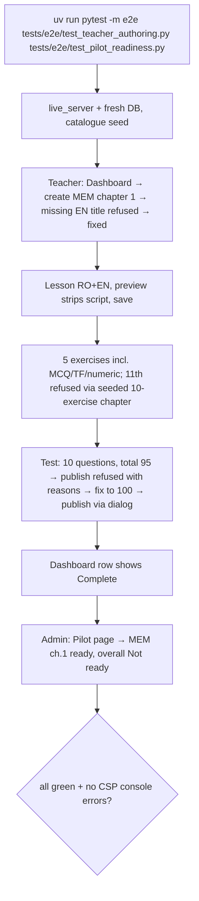

### Story 3.9: Authoring E2E Journeys

**BUILDID**: CYCLE-2 | **GitHub**: LOCAL | **AzureDevOps**: LOCAL | **Epic**: 3 - Teacher Content Authoring | **ID**: 3.9 | **Date**: 2026-10-19
**File**: `docs/plans/stories/epic-3-story-3.9-Authoring-E2E-Journeys.md`
**Build Ref**: `docs/plans/builds/cycle-2/cycle-plan.md` — CYCLE-2 (Workshop Day 4: Playwright journey "teacher authors and publishes a chapter")
**Wave**: 9
**Requires**: [3.5, 3.6, 3.7, 3.8, 5.1]
**Enables**: [6.1, 6.2, 8.1, 8.2]
**Files Touched**:
  - tests/e2e/test_teacher_authoring.py
  - tests/e2e/test_pilot_readiness.py
**Roles Ref**: docs/requirements.md#roles--permissions-matrix — single-actor — no role variation in *this story's code* (test-only; the journeys exercise the Teacher and Admin behaviour delivered by Stories 3.5–3.8 and 5.1)
**QA Candidate**: No — test-only story. It automates Epic 3 QA Groups 1–2 and Epic 5 Group 1, adds no product behaviour, and its green run is the CYCLE-2 authoring sign-off evidence.

---

#### 👤 User Reference

**Description**:
This story adds browser "robot user" tests proving the whole authoring flow works end to end, the way a teacher will use it during the content-entry weeks. The robot teacher:
- signs in and opens the Dashboard
- creates a chapter with Romanian and English titles
- writes a lesson in both languages and checks the preview
- adds five exercises (one of each type, plus two more)
- builds a 10-question test, watching the points counter reach exactly 100
- publishes it after the confirmation box

Along the way it checks that the safety rules stop mistakes:
- a missing English title or explanation
- an 11th exercise
- publishing at 95 points
- unsafe content pasted into a lesson

Then a robot administrator opens the Pilot page and sees that chapter marked ready, while the overall pilot still says "Not ready" until all nine chapters are complete. The tests run with one command and are used at the Cycle 2 review.

**Acceptance Criteria** (plain-English):
- One command runs the authoring journeys in a real browser against a fresh copy of the platform.
- The teacher journey creates and completes a full chapter: titles, lesson in both languages, 5 exercises, and a published 10-question test totalling 100 points.
- The journey proves each safety rule: missing language refused, 11th exercise refused, publishing at 95 refused with reasons, unsafe lesson content not shown in the preview.
- The confirmation dialog before publishing works with the keyboard.
- The admin journey shows the completed chapter as ready and the pilot as "Not ready" overall.
- No browser security-policy errors occur during the journeys.

**User Flow**:
Actor: system — no role variation.

**Flow Diagram**:



---

#### 🤖 AI Agent Reference

**Must Read**:
- `docs/plans/implementation-plan.md` — QA Manual Testing Groups (Epic 3 Groups 1–2, Epic 5 Group 1)
- `docs/plans/builds/cycle-2/cycle-plan.md` — CYCLE-2 acceptance criteria (each authoring and readiness criterion maps to a journey step)
- `docs/plans/stories/epic-1-story-1.10-Foundation-E2E-Journeys.md` — harness (`tests/e2e/conftest.py`: `login`, `logout`, `console_errors`, `base_url`, EN-first labels, transactional DB, no `time.sleep`)
- Stories 3.5–3.8 and 5.1: labels, roles, routes and messages under test

**Description**:
Adds two journey modules using the existing CYCLE-1 harness (no changes to `tests/e2e/conftest.py`):
1. **`test_teacher_authoring.py`:**
   - `test_teacher_authors_and_publishes_a_full_chapter`: the happy path with embedded negative checks
   - `test_eleventh_exercise_is_refused`: seeds a chapter with 10 exercises via factories, then tries to add one in the UI
   - `test_lesson_preview_strips_scripts`
2. **`test_pilot_readiness.py`:**
   - `test_admin_sees_completed_chapter_ready_and_pilot_not_ready`: seeds one complete chapter via `complete_chapter` and leaves the others empty, then asserts the readiness table and overall verdict
   - `test_teacher_cannot_open_pilot_page`: 403

Selectors are role/label/text based, written in EN (`/en/…`) for stability without compiled RO catalogues.

**Acceptance Criteria**:
1. `uv run pytest -m e2e tests/e2e/test_teacher_authoring.py tests/e2e/test_pilot_readiness.py` runs green three times in a row (no flakiness) in < 2 minutes total.
2. The happy path covers, in order:
   - Dashboard visible from the Teacher menu
   - create MEM chapter 1, with a missing EN title refused first ("English text is required.")
   - lesson saved in RO+EN, with "Lesson saved." and the ACTIVE pill
   - 5 exercises (MCQ, TF, NUMERIC with "2,5", +2 MCQ), each "Exercise saved."
   - test with 10 questions where the live total shows "Total: 95 / 100", then publish is refused listing "Points total 95"
   - one points value corrected, total "100 / 100", saved, published via the dialog using the keyboard (Enter to open, Enter to confirm), "Test published." and the PUBLISHED pill
   - Dashboard row shows "Complete"
3. Negative checks: the 11th exercise is refused ("at most 10 exercises"); the lesson preview of `## Hi <script>window.__x=1</script>` shows "Hi" and `window.__x` stays undefined.
4. Readiness: Admin opens "Pilot" from the menu; the MEM chapter 1 row shows "Ready"; the other 8 rows show "Not ready"; the overall verdict shows "Not ready (1 of 9 chapters ready)". A Teacher visiting `/en/manage/pilot/` sees "Access denied".
5. Every test uses `console_errors` (no CSP violations). No `time.sleep`; waits use `expect(...)`.

**RBAC Enforcement**:
No role-differentiated access — single actor.
- Test-only. The journeys sign in as Teacher and Admin through the real login page; no permission or route is added.

**System responses + error cases** (harness behaviour):

| Trigger | Response | Side-effect |
|---------|----------|-------------|
| `uv run pytest` (default) | e2e deselected | none |
| `-m e2e` with Chromium installed | journeys run against `live_server` | transactional test DB, discarded |
| A step's expected message is missing | test fails; trace + screenshot in `test-results/` | artefacts written |
| CSP violation logged in the console | `console_errors` fails the test | none |
| Re-run (idempotent) | same result (fresh DB per test) | none persisted |

**Prerequisites**:
- Stories 3.5, 3.6, 3.7, 3.8 and 5.1 merged; CYCLE-1 harness (Story 1.10); Chromium installed (`uv run playwright install chromium`).

**Context**: `docs/plans/stories/epic-1-story-1.10-Foundation-E2E-Journeys.md`, `tests/e2e/conftest.py`, `tests/factories/content.py`, Stories 3.5–3.8 and 5.1

**Patterns**: E2E tests (§12.5) — see `docs/architecture/design/01-patterns-and-standards-greenfield.md`

**Steps**:

1. **Teacher journey** (excerpt):
   ```python
   # tests/e2e/test_teacher_authoring.py
   import pytest
   from playwright.sync_api import Page, expect

   from tests.e2e.conftest import login
   from tests.factories.accounts import TeacherFactory

   pytestmark = pytest.mark.e2e


   def fill_true_false(page: Page, n: int, points: int) -> None:
       slot = page.get_by_role("group", name=f"Question {n}")
       slot.get_by_label("True or false").check()
       slot.get_by_label("Question").first.fill(f"Întrebarea {n}")
       slot.get_by_label("Question").nth(1).fill(f"Question {n}")
       slot.get_by_label("True", exact=True).check()
       slot.get_by_label("Points").fill(str(points))


   def test_teacher_authors_and_publishes_a_full_chapter(page: Page, base_url, console_errors):
       TeacherFactory(username="t-e2e", preferred_language="en")
       login(page, base_url, "t-e2e", lang="en")

       page.get_by_role("navigation", name="Main").get_by_role("link", name="Dashboard").click()
       board = page.get_by_role("region", name="Mathematics and Environmental Exploration")
       board.get_by_role("link", name="Create chapter").first.click()
       page.get_by_label("Title").first.fill("Adunarea")
       page.get_by_role("button", name="Save").click()
       expect(page.get_by_text("English text is required.")).to_be_visible()
       page.get_by_label("Title").nth(1).fill("Addition")
       page.get_by_role("button", name="Save").click()
       expect(page.get_by_text("Chapter saved.")).to_be_visible()
       # … lesson, 5 exercises, test at 95 → refused → 100 → publish via keyboard (see AC 2) …
       page.get_by_role("button", name="Publish").focus()
       page.keyboard.press("Enter")
       page.get_by_role("dialog", name="Publish this test?").get_by_role("button", name="Publish").press("Enter")
       expect(page.get_by_text("Test published.")).to_be_visible()
       page.get_by_role("navigation", name="Main").get_by_role("link", name="Dashboard").click()
       expect(board.get_by_text("Complete")).to_be_visible()
   ```
   > Implement every AC 2 step explicitly in the final test (the excerpt elides the middle with a comment for brevity in this story only; the test itself must contain no placeholder comments).

2. **Readiness journey:** seed with `complete_chapter(mem, 1)` in the test body (transactional DB), sign in as Admin, open "Pilot", and assert the 9 rows and the verdict text.

3. **Run three times**, record timings, attach traces of a deliberately broken run (e.g. temporarily rename "Test published." locally) to prove the failure artefacts work, then revert.

**Tests**: this story *is* tests (see Steps). Its correctness is proven by three consecutive green runs and one deliberate local failure.

Manual: `uv run pytest -m e2e tests/e2e/test_teacher_authoring.py --headed --slowmo=200` once, watching the journey.

**Quality**: ruff 0 on the new files; role/label/text locators only; no `time.sleep`; 3 consecutive green runs; < 2 minutes.

**OUT**:
- ❌ Student learning journeys (Story 4.4).
- ❌ Moderation journeys (CYCLE-3).
- ❌ Any production-code change; defects go through `aire-raise-defect` against the owning story.
- ❌ CI wiring of e2e (DevOps).

**Evidence**: output of 3 consecutive runs (counts, durations), a table mapping each CYCLE-2 authoring/readiness acceptance criterion to a journey step, and the deliberate-failure trace screenshot, all recorded in `docs/stories-implemented/story-3.9-review.md` under "## DoD Evidence".
