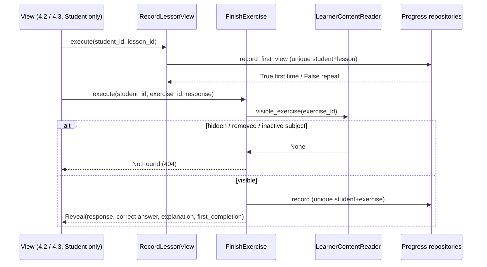

### Story 4.1: Progress Data & Use Cases

**BUILDID**: CYCLE-2 | **GitHub**: LOCAL | **AzureDevOps**: LOCAL | **Epic**: 4 - Student Lessons & Practice | **ID**: 4.1 | **Date**: 2026-10-19
**File**: `docs/plans/stories/epic-4-story-4.1-Progress-Data-and-Use-Cases.md`
**Build Ref**: `docs/plans/builds/cycle-2/cycle-plan.md` — CYCLE-2 (Workshop Day 3: lesson view and exercise completion recorded)
**Wave**: 7
**Requires**: [3.1, 3.2]
**Enables**: [4.2, 4.3]
**Files Touched**:
  - src/domain/progress/**
  - src/application/progress/**
  - src/infrastructure/persistence/progress/**
  - src/config/settings/base.py
  - src/infrastructure/container.py
  - tests/factories/progress.py
  - tests/unit/application/progress/**
  - tests/integration/persistence/progress/**
**Roles Ref**: docs/requirements.md#roles--permissions-matrix — single-actor — no role variation (backend records and use cases; the Student-only routes that call them are Stories 4.2/4.3)
**QA Candidate**: No — backend only (models, ports, use cases, repositories) with no route. Its effects (first lesson view, exercise completion, reveal content) are user-observable through Stories 4.2 and 4.3, where QA checks them, and feed CYCLE-3 progress pages.

---

#### 👤 User Reference

**Description**:
To show progress later (next cycle's "My progress" and the parents' view), the platform has to remember two simple facts for each student:
- **Opened lessons:** that they opened a chapter's lesson, and when they first did.
- **Finished exercises:** that they finished an exercise, and when they first did.

This story builds that memory and the two actions behind it:
- **"Record lesson view":** opening a lesson many times still counts once.
- **"Finish exercise":** checks that the exercise really is available to students (active, in a pilot subject), records it as finished, and returns what the student should see next: their own answer, the correct answer and the explanation in both languages.

As the requirements say, exercises aren't scored, so the student's answer isn't stored; only the fact that the exercise was finished.

**Removals:** if a teacher removes an exercise or an administrator deletes a student's account, the related records disappear with them.

**Acceptance Criteria** (plain-English):
- The first time a student opens a chapter's lesson, the platform records it with the time; opening it again doesn't create another record.
- The first time a student finishes an exercise, the platform records it with the time; finishing it again doesn't create another record but still shows the answers again.
- Finishing an exercise that's hidden (not active), removed, or outside the pilot subjects is refused as "not found".
- Finishing an exercise returns the student's answer, the correct answer and the explanation; nothing is scored and the answer itself isn't stored.
- Removing an exercise or deleting a student removes their related progress records.
- Opening a lesson or finishing an exercise never changes any content.

**User Flow**:
Actor: system — no role variation.

**Flow Diagram**:



---

#### 🤖 AI Agent Reference

**Must Read**:
- `docs/requirements.md` — "Exercises are not scored. After the student selects 'Finish exercise,' show correct answers and explanations."
- `docs/architecture/design/00-system-architecture-greenfield.md` — Data Model (`LESSON_VIEW`, `EXERCISE_COMPLETION`), Progress read model definition, route contract `POST /exercises/<id>/finish/` (idempotent completion), account-deletion cascade
- `docs/architecture/design/01-patterns-and-standards-greenfield.md` — §5 use cases, §6.2–6.3 models/repositories (IntegrityError mapping), §12.2 fakes
- `docs/plans/stories/epic-3-story-3.1-Content-Domain-Rules.md` — `QuestionKind`, `Option`
- `docs/plans/stories/epic-3-story-3.2-Content-Data-Model.md` — `LessonModel`, `ExerciseModel`, `visible_to_learners()`

**Description**:
1. **Domain** (`domain/progress/`):
   - `reveal.py`: `ExerciseReveal(exercise_id, chapter_id, kind, prompt_ro, prompt_en, options, answer_key, explanation_ro, explanation_en)` frozen dataclass
   - `ports.py`: Protocols `LessonViewRepository`, `ExerciseCompletionRepository`, `LearnerContentReader`
2. **Use cases** (`application/progress/`):
   - `record_lesson_view.py`: `RecordLessonView(views, uow, clock).execute(student_id, lesson_id) -> bool`
   - `finish_exercise.py`: `FinishExercise(reader, completions, uow, clock).execute(FinishExerciseCommand(student_id, exercise_id, response)) -> FinishExerciseResult(reveal, response, first_completion)`
3. **Persistence** (`persistence/progress/`, app label `progress`):
   - `LessonViewModel`, `ExerciseCompletionModel` (+ migration `0001`)
   - `repositories.py`: `DjangoLessonViews`, `DjangoExerciseCompletions`, `DjangoLearnerContentReader`, which uses `ExerciseModel.objects.visible_to_learners()` and an active subject
4. **Container** factories `record_lesson_view()`, `finish_exercise()`; settings `INSTALLED_APPS`; factories `LessonViewFactory`, `ExerciseCompletionFactory`.

Student role and identity are enforced by the calling views (`exercises:complete`, `lessons:view`); `student_id` is always `request.user.pk`.

**Acceptance Criteria**:
1. `LessonViewModel` (`progress_lesson_view`): `student` FK → user (`CASCADE`), `lesson` FK → `content.LessonModel` (`CASCADE`), `first_viewed_at` DateTimeField. `UniqueConstraint(student, lesson, name="uniq_lesson_view")`.
2. `ExerciseCompletionModel` (`progress_exercise_completion`): `student` FK (`CASCADE`), `exercise` FK → `content.ExerciseModel` (`CASCADE`), `completed_at`. `UniqueConstraint(student, exercise, name="uniq_exercise_completion")`.
3. `RecordLessonView.execute(student_id, lesson_id)` → `True` on the first record, `False` on repeats (no exception, no new row). The timestamp comes from `Clock`. Runs in the UoW.
4. `FinishExercise.execute(cmd)`:
   - `reader.visible_exercise(exercise_id)` → `None` ⇒ `NotFound("exercise")`, nothing recorded
   - else `completions.record(student_id, exercise_id, now)` → `first_completion` (True/False)
   - returns `FinishExerciseResult(reveal, response=cmd.response.strip()[:200], first_completion)`
   - the response is **not** persisted
5. `DjangoLearnerContentReader.visible_exercise(id)` returns an `ExerciseReveal` only when the exercise is `moderation_status="ACTIVE"` and its chapter's subject `is_active=True`; otherwise `None`. Options are converted to `Option` objects.
6. `record_first_view` / `record` use `get_or_create` semantics and map `IntegrityError` (race) to `False`.
7. Deleting an exercise or lesson deletes its progress rows. Deleting a student deletes theirs (architecture account-deletion cascade).
8. `INSTALLED_APPS` gains `"infrastructure.persistence.progress"`; migration `0001` depends on `content 0001`; `makemigrations --check` clean.
9. Coverage: `application/progress` 100%; `domain/progress` 100% (dataclass + protocols); overall ≥85%.

**RBAC Enforcement**:
No role-differentiated access — single actor.
- No route here. Callers must pass `student_id = request.user.pk` (Stories 4.2/4.3 guard with `lessons:view` / `exercises:complete`). Use cases never accept a student identity from request data, and the reader never returns hidden content (moderation visibility rule).

**System responses + error cases** (use-case contract):

| Trigger | Response | Side-effect |
|---------|----------|-------------|
| `RecordLessonView(student 5, lesson 9)` first time | `True` | 1 row `(5, 9, now)` |
| Same call repeated | `False` | none |
| Concurrent duplicate (race) | one `True`, one `False` | 1 row |
| `FinishExercise(5, ex 3, "42")`, exercise ACTIVE in active subject | `FinishExerciseResult(reveal, "42", True)` | 1 completion row |
| Same finish again | result with `first_completion=False` | none |
| Exercise BLOCKED / FLAGGED / RESUBMITTED | `NotFound` | none |
| Exercise in an inactive subject | `NotFound` | none |
| Unknown exercise id | `NotFound` | none |
| Response of 500 characters | response truncated to 200 in the result | none (never stored) |
| Exercise removed by teacher | — | completion rows deleted (CASCADE) |
| Student account deleted | — | lesson views and completions deleted |

**Prerequisites**:
- Stories 3.1 (domain types) and 3.2 (content models, `visible_to_learners()`, factories) merged; CYCLE-1 complete (user model, `DjangoUnitOfWork`, `FixedClock`, fakes).

**Context**: `docs/architecture/design/00-system-architecture-greenfield.md`, `docs/architecture/design/01-patterns-and-standards-greenfield.md`, `src/domain/content/questions.py`, `src/infrastructure/persistence/content/models.py`, `src/infrastructure/persistence/common/unit_of_work.py`

**Patterns**: Domain ports (§4), Use cases + UoW + Clock (§5), Models/constraints (§6.2), Repository with IntegrityError mapping (§6.3), Fakes (§12.2) — see `docs/architecture/design/01-patterns-and-standards-greenfield.md`

**Steps**:

1. **Tests first** (unit with fakes; persistence integration).

2. **Domain:**
   ```python
   # src/domain/progress/ports.py
   from datetime import datetime
   from typing import Protocol

   from domain.progress.reveal import ExerciseReveal


   class LessonViewRepository(Protocol):
       def record_first_view(self, student_id: int, lesson_id: int, at: datetime) -> bool: ...


   class ExerciseCompletionRepository(Protocol):
       def record(self, student_id: int, exercise_id: int, at: datetime) -> bool: ...


   class LearnerContentReader(Protocol):
       def visible_exercise(self, exercise_id: int) -> ExerciseReveal | None: ...
   ```

3. **Use cases:**
   ```python
   # src/application/progress/finish_exercise.py
   from dataclasses import dataclass

   from application.common.unit_of_work import UnitOfWork
   from domain.common.clock import Clock
   from domain.common.errors import NotFound
   from domain.progress.ports import ExerciseCompletionRepository, LearnerContentReader
   from domain.progress.reveal import ExerciseReveal

   MAX_RESPONSE_CHARS = 200


   @dataclass(frozen=True)
   class FinishExerciseCommand:
       student_id: int  # request.user.pk
       exercise_id: int
       response: str


   @dataclass(frozen=True)
   class FinishExerciseResult:
       reveal: ExerciseReveal
       response: str
       first_completion: bool


   class FinishExercise:
       """Unscored: reveal correct answer + explanation and record completion once (requirements)."""

       def __init__(self, reader: LearnerContentReader, completions: ExerciseCompletionRepository,
                    uow: UnitOfWork, clock: Clock) -> None:
           self._reader, self._completions, self._uow, self._clock = reader, completions, uow, clock

       def execute(self, cmd: FinishExerciseCommand) -> FinishExerciseResult:
           with self._uow:
               reveal = self._reader.visible_exercise(cmd.exercise_id)
               if reveal is None:
                   raise NotFound("exercise")
               first = self._completions.record(cmd.student_id, cmd.exercise_id, self._clock.now())
           return FinishExerciseResult(reveal, cmd.response.strip()[:MAX_RESPONSE_CHARS], first)
   ```
   `RecordLessonView` is the same shape (returns the repository's bool).

4. **Persistence** (`repositories.py` excerpt):
   ```python
   class DjangoExerciseCompletions:
       def record(self, student_id, exercise_id, at) -> bool:
           try:
               _, created = ExerciseCompletionModel.objects.get_or_create(
                   student_id=student_id, exercise_id=exercise_id, defaults={"completed_at": at})
           except IntegrityError:  # concurrent first completion
               return False
           return created


   class DjangoLearnerContentReader:
       def visible_exercise(self, exercise_id) -> ExerciseReveal | None:
           row = (ExerciseModel.objects.visible_to_learners()
                  .filter(pk=exercise_id, chapter__subject__is_active=True).first())
           if row is None:
               return None
           return ExerciseReveal(row.pk, row.chapter_id, QuestionKind(row.kind), row.prompt_ro, row.prompt_en,
                                 tuple(Option(o["id"], o["ro"], o["en"]) for o in row.options),
                                 dict(row.answer_key), row.explanation_ro, row.explanation_en)
   ```
   > `get_or_create` inside the UoW's `atomic` block: wrap the `create` attempt in a nested `transaction.atomic()` (savepoint) so an `IntegrityError` doesn't break the outer transaction. Django's `get_or_create` already does this internally; the explicit `except` covers the race between its get and create.

5. **App, migration, settings, container, factories,** then **all gates**.

**Tests**:

```python
# tests/unit/application/progress/test_finish_exercise.py
import pytest

from application.progress.finish_exercise import FinishExercise, FinishExerciseCommand
from domain.common.errors import NotFound
from domain.content.questions import QuestionKind
from domain.progress.reveal import ExerciseReveal
from tests.fakes import FakeUnitOfWork, FixedClock

REVEAL = ExerciseReveal(3, 1, QuestionKind.NUMERIC, "12,5+2,5?", "12.5+2.5?", (), {"value": "15"}, "15.", "15.")


class FakeReader:
    def __init__(self, visible):
        self.visible = visible

    def visible_exercise(self, exercise_id):
        return self.visible.get(exercise_id)


class FakeCompletions:
    def __init__(self):
        self.rows = set()

    def record(self, student_id, exercise_id, at):
        key = (student_id, exercise_id)
        first = key not in self.rows
        self.rows.add(key)
        return first


def make(visible):
    completions = FakeCompletions()
    return FinishExercise(FakeReader(visible), completions, FakeUnitOfWork(), FixedClock()), completions


def test_first_finish_reveals_and_records():
    use_case, completions = make({3: REVEAL})

    result = use_case.execute(FinishExerciseCommand(5, 3, " 15 "))

    assert (result.reveal, result.response, result.first_completion) == (REVEAL, "15", True)
    assert completions.rows == {(5, 3)}


def test_repeat_finish_reveals_again_without_new_record():
    use_case, completions = make({3: REVEAL})
    use_case.execute(FinishExerciseCommand(5, 3, "14"))

    result = use_case.execute(FinishExerciseCommand(5, 3, "15"))

    assert result.first_completion is False and len(completions.rows) == 1


def test_hidden_or_unknown_exercise_is_not_found_and_not_recorded():
    use_case, completions = make({})

    with pytest.raises(NotFound):
        use_case.execute(FinishExerciseCommand(5, 3, "15"))

    assert completions.rows == set()


def test_response_is_truncated():
    use_case, _ = make({3: REVEAL})

    assert len(use_case.execute(FinishExerciseCommand(5, 3, "9" * 500)).response) == 200
```

```python
# tests/integration/persistence/progress/test_progress_records.py
import pytest

from infrastructure.persistence.progress.models import ExerciseCompletionModel, LessonViewModel
from infrastructure.persistence.progress.repositories import (
    DjangoExerciseCompletions, DjangoLearnerContentReader, DjangoLessonViews)
from tests.factories.accounts import StudentFactory
from tests.factories.catalogue import SubjectFactory
from tests.factories.content import ExerciseFactory, LessonFactory
from tests.fakes import FixedClock

pytestmark = pytest.mark.django_db
NOW = FixedClock().now()


def test_lesson_view_recorded_once():
    student, lesson = StudentFactory(), LessonFactory()
    views = DjangoLessonViews()

    assert views.record_first_view(student.pk, lesson.pk, NOW) is True
    assert views.record_first_view(student.pk, lesson.pk, NOW) is False
    assert LessonViewModel.objects.count() == 1


def test_completion_recorded_once():
    student, exercise = StudentFactory(), ExerciseFactory()
    completions = DjangoExerciseCompletions()

    assert completions.record(student.pk, exercise.pk, NOW) is True
    assert completions.record(student.pk, exercise.pk, NOW) is False


@pytest.mark.parametrize("status", ["FLAGGED", "BLOCKED", "RESUBMITTED"])
def test_reader_hides_non_active_exercises(status):
    assert DjangoLearnerContentReader().visible_exercise(ExerciseFactory(moderation_status=status).pk) is None


def test_reader_hides_exercises_of_inactive_subjects():
    inactive = SubjectFactory(code="LLR", sort_order=99, is_active=False)  # unused slot: (grade, sort_order) is unique
    exercise = ExerciseFactory(chapter__subject=inactive)

    assert DjangoLearnerContentReader().visible_exercise(exercise.pk) is None


def test_reader_returns_reveal_with_options():
    reveal = DjangoLearnerContentReader().visible_exercise(ExerciseFactory().pk)

    assert reveal.answer_key == {"option_id": "b"} and [o.id for o in reveal.options] == ["a", "b"]


def test_cascades_on_exercise_and_student_deletion():
    student, exercise = StudentFactory(), ExerciseFactory()
    DjangoExerciseCompletions().record(student.pk, exercise.pk, NOW)

    exercise.delete()
    assert ExerciseCompletionModel.objects.count() == 0

    lesson = LessonFactory()
    DjangoLessonViews().record_first_view(student.pk, lesson.pk, NOW)
    student.delete()
    assert LessonViewModel.objects.count() == 0
```

Manual: `uv run python manage.py migrate` and a round-trip `migrate progress zero` / `migrate`. No UI.

**Quality**: ruff 0; mypy strict for `domain.progress` and `application.progress`; lint-imports kept; 100% coverage for the new application and domain modules; `makemigrations --check` clean; no `TODO`.

**OUT**:
- ❌ The lesson and exercise pages (Stories 4.2/4.3).
- ❌ Progress pages for students/parents and score lists (CYCLE-3, Epic 7).
- ❌ Storing student exercise answers or any scoring (requirements: unscored).
- ❌ Test attempts (CYCLE-3, Epic 6).

**Evidence**: pytest output (unit + persistence), 100% coverage for `application/progress` and `domain/progress`, and the migrate round-trip output, all recorded in `docs/stories-implemented/story-4.1-review.md` under "## DoD Evidence".
