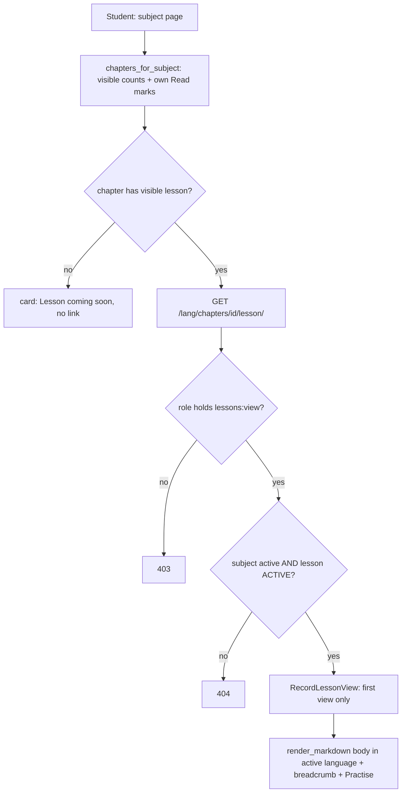

### Story 4.2: Chapter List & Lesson Reading

**BUILDID**: CYCLE-2 | **GitHub**: LOCAL | **AzureDevOps**: LOCAL | **Epic**: 4 - Student Lessons & Practice | **ID**: 4.2 | **Date**: 2026-10-19
**File**: `docs/plans/stories/epic-4-story-4.2-Chapter-List-and-Lesson-Reading.md`
**Build Ref**: `docs/plans/builds/cycle-2/cycle-plan.md` — CYCLE-2 (Workshop Day 3: subject → chapter list → lesson page, records LESSON_VIEW, only ACTIVE content)
**Wave**: 8
**Requires**: [3.3, 4.1]
**Enables**: [4.4]
**Files Touched**:
  - src/infrastructure/persistence/content/queries/learner.py
  - src/infrastructure/web/catalogue/views.py
  - src/infrastructure/web/templates/catalogue/subject.html
  - src/infrastructure/web/lessons/**
  - src/infrastructure/web/templates/lessons/**
  - src/infrastructure/web/static/css/lessons.css
  - src/config/urls.py
  - src/infrastructure/i18n/locale/ro/LC_MESSAGES/django.po
  - src/infrastructure/i18n/locale/en/LC_MESSAGES/django.po
  - tests/integration/web/test_role_access_matrix.py
  - docs/architecture/design/00-system-architecture-greenfield.md
  - tests/integration/web/lessons/**
**Roles Ref**: docs/requirements.md#roles--permissions-matrix — personas this story differentiates: Student, Teacher, Parent/Guardian, Admin
**QA Candidate**: Yes — **Observable:** a Student opening an active subject sees its chapters (number, title, whether the lesson is available, how many exercises, and a "Read" mark once opened). Opening a chapter's lesson shows the formatted lesson in the current language, with a breadcrumb and a "Practise" button. Switching RO/EN shows the other language version. Hidden (flagged, blocked or resubmitted) lessons and chapters of inactive subjects answer 404. **Mechanism:**
- Story 2.2's `catalogue:subject` view now passes `chapters_for_subject(subject_id, student_id)` (learner query: chapters of an active subject with *visible* lesson/exercise counts and the student's own lesson-view marks)
- new `lessons:lesson` route `GET /<lang>/chapters/<id>/lesson/` (`lessons:view`) → `lesson_for_chapter(chapter_id)` (`NotFound` unless the subject is active and the lesson is ACTIVE) → `RecordLessonView` (Story 4.1, first view only) → render with ``

**Authz & preconditions:** `lessons:view` (Student only); learner queries only use `visible_to_learners()`; the student's marks are derived from `request.user.pk`. **Edge & idempotency:**
- Re-opening a lesson renders the same page and records nothing new.
- A chapter without a visible lesson shows "Lesson coming soon" (no link); its URL → 404.
- Chapters with no exercises hide the practise button.
- The "Read" mark never reveals other students' data.

**Regression:** the moderation visibility rule on every learner query (FC-2 "content block handling"), bilingual rendering, 403 for non-students, IDOR-safe marks, sanitised Markdown.

---

#### 👤 User Reference

**Description**:
This is where children start learning.

**Choosing a chapter:**
- When a student opens one of the three grade-2 subjects from the catalogue, they now see its chapters (up to three), each with its number and title.
- Each chapter shows whether its lesson is ready and how many exercises it has.
- Once a student has opened a chapter's lesson, the chapter shows a small "Read" mark, so they can see what they've already covered.

**Reading the lesson:**
- Opening a chapter shows its lesson, formatted the way the teacher wrote it, in Romanian or English depending on the language the student uses. Switching language shows the other version.
- A "you are here" trail leads back to the subject and the catalogue.
- A big "Practise" button leads to the chapter's exercises.

**What students never see:** lessons that an administrator has flagged or blocked. Their address simply shows "page not found", as if they didn't exist. Teachers, parents and administrators don't use these student pages; they have their own areas.

**Acceptance Criteria** (plain-English):
- On a pilot subject's page, students see the subject's chapters in order with title, lesson availability and number of exercises.
- A chapter shows a "Read" mark after that student opened its lesson; other students' activity is never shown.
- Opening a chapter shows its lesson formatted, in the language currently in use; switching language shows the other version.
- The lesson page has a trail back to the subject and the catalogue, and a "Practise" button when the chapter has exercises.
- The platform remembers the first time each student opens each lesson (for progress next cycle); opening it again changes nothing.
- A lesson that isn't active (flagged, blocked, resubmitted) or has no content yet can't be opened by students: they see "Page not found".
- Teachers, parents and administrators get "Access denied" on student lesson pages.
- Lessons display Romanian letters correctly and never show unsafe content.

**User Flow** (role-differentiated):

### Student
**Scenario / narrative**: As a grade-2 Student, I open "Matematică și explorarea mediului" from the catalogue. I see "1. Adunarea și scăderea până la 100" with "Lecție disponibilă · 6 exerciții", and "2. Înmulțirea" with "Lecția va fi disponibilă în curând". I tap chapter 1 and read the lesson with its headings and a table of examples. I switch to English to check a word, and the same lesson appears in English. Back on the subject page, chapter 1 now shows "Citit". Tomorrow the administrator blocks chapter 2's lesson because it had a mistake. If I use an old link to it, I just see "Page not found".
**Steps**:
1. `GET /ro/subjects/<id>/` (Story 2.2 view, `lessons:view`) → `active_subject(id)` → `chapters_for_subject(id, request.user.pk)` → cards: number, localized title, `has_lesson` (visible lesson exists), `exercise_count` (visible), `viewed` (this student's `LessonViewModel` exists).
2. Click → `GET /ro/chapters/<cid>/lesson/` → `@require_permission(LESSONS_VIEW)` → `lesson_for_chapter(cid)` (404 unless the subject is active and the lesson is ACTIVE) → `container.record_lesson_view().execute(request.user.pk, lesson_id)` → render.
3. RO→EN switch (Story 1.4) → `/en/chapters/<cid>/lesson/` renders `body_en`; the lesson view is already recorded (no new row).

### Teacher
**Scenario / narrative**: As a Teacher, I check how lessons look using the editor's preview (Story 3.6). Student pages aren't for me: opening `/ro/chapters/<id>/lesson/` shows "Access denied", and the catalogue doesn't link me to subject pages (Story 2.2).
**Steps**:
1. `GET /ro/chapters/<id>/lesson/` → lacks `lessons:view` → 403.

### Parent/Guardian
**Scenario / narrative**: As a Parent, I'll follow my child's progress next cycle. The student lesson pages aren't available to me; they answer "Access denied".
**Steps**:
1. Any lesson URL → 403.

### Admin
**Scenario / narrative**: As the Admin, I review content through moderation (next cycle). Student pages answer "Access denied" for me.
**Steps**:
1. Any lesson URL → 403.

**Flow Diagram**:



---

#### 🤖 AI Agent Reference

**Must Read**:
- `docs/requirements.md` — "Course lessons and practice"; "Blocked content is immediately hidden from student and parent views"
- `docs/architecture/design/00-system-architecture-greenfield.md` — route catalogue (`/subjects/<id>/`, `/chapters/<id>/lesson/` "records LESSON_VIEW; 404 unless ACTIVE"), Moderation visibility rule, Progress read model
- `docs/architecture/design/01-patterns-and-standards-greenfield.md` — §6.3 (`visible_to_learners()` DO/DON'T, scope inside the query), §7.1–7.2, §11.3 (`render_markdown`)
- `docs/ui-ux/ui-ux-spec.md` — student theme, one primary action per screen, 960px reading width
- `docs/plans/stories/epic-2-story-2.2-Catalogue-and-Subject-Pages.md` — subject view/template being extended
- `docs/plans/stories/epic-4-story-4.1-Progress-Data-and-Use-Cases.md` — `RecordLessonView`
- `docs/plans/stories/epic-3-story-3.3-Markdown-Rendering.md` — `render_markdown` tag

**Description**:
1. **Learner query** `persistence/content/queries/learner.py`:
   - `chapters_for_subject(subject_id, student_id) -> tuple[ChapterCardDTO, ...]`: chapters of the subject ordered by number, with visible-lesson flag, visible exercise count and this student's viewed flag, in ≤ 2 queries. It's called after `active_subject` has already validated the subject.
   - `lesson_for_chapter(chapter_id) -> LessonReadDTO`: `NotFound` unless the chapter exists, its subject is active **and** its lesson is in `LessonModel.objects.visible_to_learners()`. Includes breadcrumb names, the visible exercise count and `lesson_id`.
2. **Subject page** (Story 2.2 files): `catalogue/views.py::subject` adds `"chapters": chapters_for_subject(subject_id, request.user.pk)`. `catalogue/subject.html` replaces the empty state with chapter cards; the empty state stays when there are no chapters.
3. **Lesson page** `web/lessons/` (`app_name = "lessons"`, included in `i18n_patterns` at `""`): `lesson` view → `templates/lessons/lesson.html`; `static/css/lessons.css` for reading styles (student theme).
4. **Practise link:** ``. The `as` form yields `""` when Story 4.3's route doesn't exist yet (same wave), so the button only renders when the URL exists. No helper needed.

**Design Tokens** (FE — student theme):
- Background `#FFF8EC`; reading column max 960px; base 18px, line-height 1.6; headings h1 32px/700 (chapter title), h2 24px/700, h3 20px/600 (from Markdown).
- Chapter cards (`ui_card`, radius 16px, elevation-1, padding 32px, min-height 120px): number badge 24px/700 in a 44px accent circle `#FBBF24` with text `#1F2937`; title 20px/600; meta 16px `#4B5563` ("Lesson available · 6 exercises"); "Read" mark = Phosphor `check-circle` duotone 20px + text "Read" (`#15803D`); unavailable lesson = text "Lesson coming soon" `#4B5563`, card not linked.
- Lesson page: `ui_page_header` breadcrumb Catalogue › {grade} › {subject} › Chapter {n}; content tables full width with header bg `#F5F7FA` and cell padding 8px 12px; links `#0E7490` underlined.
- Primary action: "Practise" `ui_button` primary, icon `pencil-simple` duotone, min-height 44px, bottom of the lesson; secondary "Back to chapters" link.
- Focus 3px `#C2410C`; no hover-only information.

**Acceptance Criteria**:
1. `chapters_for_subject(subject_id, student_id)` returns chapters ordered by number with `ChapterCardDTO(id, number, title_ro, title_en, has_lesson, exercise_count, viewed)`:
   - `has_lesson` is true only for an ACTIVE lesson
   - `exercise_count` counts ACTIVE exercises only
   - `viewed` is true only if a `LessonViewModel(student_id, that lesson)` exists
   - ≤ 2 queries (asserted)
2. The subject page renders one card per chapter. Cards with `has_lesson` link to `lessons:lesson`; others show "Lesson coming soon" without a link. No chapters → the existing "No chapters are published yet." empty state.
3. `lessons:lesson` → `GET /<lang>/chapters/<int:chapter_id>/lesson/`, `@require_safe` + `@require_permission(LESSONS_VIEW)`:
   - 200 with the breadcrumb, `<h1>` chapter title (localized) and ``
   - 404 when the chapter doesn't exist, its subject is inactive, there's no lesson, or the lesson isn't ACTIVE (all identical 404s)
4. On every 200, `RecordLessonView.execute(request.user.pk, lesson_id)` runs. The first view creates one row; repeats create none. (A GET with a side effect is deliberate per the architecture route catalogue; it's idempotent and invisible to the user.)
5. A "Practise" button appears when `exercise_count > 0` **and** `practice:list` resolves.
6. `/ro/…` renders `body_ro`; `/en/…` renders `body_en`; `<html lang>` matches.
7. Marks are per student: student A's view never sets `viewed` for student B (IDOR test).
8. Route catalogue updated; RO/EN translations ("Lesson available", "Lesson coming soon", "%(n)s exercises", "Read", "Practise", "Back to chapters", "Chapter %(n)s").

**RBAC Enforcement**:

| Persona | Permission key | Guarded route/endpoint | Allowed | Denied behavior | UI when denied |
|---------|----------------|------------------------|---------|-----------------|----------------|
| Student | `lessons:view` | `GET /<lang>/subjects/<id>/` (chapter list) | active subjects | inactive → 404 (Story 2.2) | — |
| Student | `lessons:view` | `GET /<lang>/chapters/<id>/lesson/` | ACTIVE lessons of active subjects | otherwise 404 | "Lesson coming soon" card has no link |
| Teacher | — | lesson page | no | 403 | catalogue has no subject links for Teachers |
| Parent/Guardian | — | lesson page | no | 403 | — |
| Admin | — | lesson page | no | 403 | — |
| Anonymous | — | lesson page | no | 302 login | sign-in |

- **Enforcement point(s):** `@require_permission(Permission.LESSONS_VIEW)` in `web/lessons/views.py` and (existing) `web/catalogue/views.py`; visibility inside `lesson_for_chapter` / `chapters_for_subject` via `visible_to_learners()` and `subject__is_active=True`.
- **Denied-access contract:** 403 for roles; 404 for hidden or inactive content (indistinguishable from non-existent).
- **Scope derivation:** `student_id` for marks and lesson-view recording is `request.user.pk` only; no request parameter selects a student.

**System responses + error cases**:

| Trigger | Response | Side-effect |
|---------|----------|-------------|
| Student GET subject page with 2 chapters | `200` 2 cards (1 linked, 1 "coming soon") | none |
| Student GET lesson (ACTIVE) first time | `200` lesson in RO | 1 `progress_lesson_view` row |
| Same GET again / in EN | `200` | none |
| Lesson FLAGGED / BLOCKED / RESUBMITTED | `404` | none |
| Chapter without a lesson | `404` | none |
| Chapter of an inactive subject | `404` | none |
| Unknown chapter id | `404` | none |
| Teacher/Parent/Admin GET lesson | `403` | none |
| Anonymous GET lesson | `302` login with `next` | none |
| POST to lesson URL | `405` | none |
| Lesson body containing `<script>` | `200`; script removed | none |

**QA-observable behaviour**:
- For a subject with chapters 1 (ACTIVE lesson, 6 ACTIVE + 1 BLOCKED exercises) and 2 (no lesson), cards show "6 exercises" for chapter 1 and "Lesson coming soon" for chapter 2.
- After student A opens chapter 1's lesson: `progress_lesson_view` has exactly one row `(A, lesson)`; student B's subject page shows no "Read" mark.
- Blocking the lesson (DB update to `moderation_status='BLOCKED'`) makes the next GET return 404, and the subject card switches to "Lesson coming soon".
- The lesson HTML contains the `<h2>` headings from the Markdown and no `<script>`.
- **What does NOT change**: no content rows change; only `progress_lesson_view` gains at most one row per student and lesson; teacher/admin pages are unaffected.

**Prerequisites**:
- Stories 3.3 (renderer) and 4.1 (`RecordLessonView`, `LessonViewModel`) merged; 3.2 models; Story 2.2 subject page.
- Story 4.3 runs in parallel; the Practise button appears once `practice:list` exists.

**Context**: `docs/architecture/design/00-system-architecture-greenfield.md`, `docs/architecture/design/01-patterns-and-standards-greenfield.md`, `src/infrastructure/web/catalogue/views.py`, `src/infrastructure/web/templates/catalogue/subject.html`, `src/infrastructure/persistence/content/models.py`, `src/infrastructure/persistence/progress/models.py`

**Patterns**: Query services, scope inside the query (§6.3), Thin views (§7.1–7.2), Markdown (§11.3), Primitives (§11.2) — see `docs/architecture/design/01-patterns-and-standards-greenfield.md`

**Steps**:

1. **Tests first** (query tests with query-count limits; view tests per role and per System-responses row).

2. **Learner query** (excerpt):
   ```python
   # src/infrastructure/persistence/content/queries/learner.py
   from django.db.models import Count, Exists, OuterRef, Q

   from domain.common.errors import NotFound
   from infrastructure.persistence.content.models import ChapterModel, LessonModel
   from infrastructure.persistence.progress.models import LessonViewModel


   def chapters_for_subject(subject_id: int, student_id: int) -> tuple[ChapterCardDTO, ...]:
       visible_lessons = LessonModel.objects.visible_to_learners().filter(chapter=OuterRef("pk"))
       viewed = LessonViewModel.objects.filter(student_id=student_id, lesson__chapter=OuterRef("pk"))
       rows = (ChapterModel.objects.filter(subject_id=subject_id, subject__is_active=True)
               .annotate(has_lesson=Exists(visible_lessons), viewed=Exists(viewed),
                         exercise_count=Count("exercises", filter=Q(exercises__moderation_status="ACTIVE")))
               .order_by("number"))
       return tuple(ChapterCardDTO(r.pk, r.number, r.title_ro, r.title_en, r.has_lesson, r.exercise_count,
                                   r.viewed and r.has_lesson) for r in rows)


   def lesson_for_chapter(chapter_id: int) -> LessonReadDTO:
       lesson = (LessonModel.objects.visible_to_learners()
                 .select_related("chapter__subject__grade")
                 .filter(chapter_id=chapter_id, chapter__subject__is_active=True).first())
       if lesson is None:
           raise NotFound("lesson")
       chapter = lesson.chapter
       exercise_count = chapter.exercises.filter(moderation_status="ACTIVE").count()
       return LessonReadDTO(lesson.pk, chapter.pk, chapter.number, chapter.title_ro, chapter.title_en,
                            lesson.body_ro, lesson.body_en, chapter.subject_id, chapter.subject.name_ro,
                            chapter.subject.name_en, chapter.subject.grade.name_ro, chapter.subject.grade.name_en,
                            exercise_count)
   ```
   > The `exercises__moderation_status="ACTIVE"` filter in `Count` is the aggregate form of `visible_to_learners()`. Add a comment pointing to `ModeratedQuerySet` so reviewers see it applies the same rule.

3. **Views:**
   ```python
   # src/infrastructure/web/lessons/views.py
   @require_safe
   @require_permission(Permission.LESSONS_VIEW)
   def lesson(request, chapter_id: int):
       """GET /<lang>/chapters/<id>/lesson/ — lessons:view; ACTIVE lessons of active subjects only."""
       dto = lesson_for_chapter(chapter_id)  # NotFound → 404
       container.record_lesson_view().execute(request.user.pk, dto.lesson_id)
       return render(request, "lessons/lesson.html", {"lesson": dto})
   ```
   ```python
   # src/infrastructure/web/catalogue/views.py — subject view (Story 2.2) gains the chapter list
   def subject(request, subject_id: int):
       dto = active_subject(subject_id)
       return render(request, "catalogue/subject.html",
                     {"subject": dto, "chapters": chapters_for_subject(subject_id, request.user.pk)})
   ```

4. **Templates:** `catalogue/subject.html` (cards via `ui_card`, ``) and `lessons/lesson.html`:
   ```django
   
   
   <link rel="stylesheet" href="">
   
     
     
     <article class="lesson" lang="{{ LANGUAGE_CODE }}"></article>
     
     
       <a class="button button--primary lesson__practise" href="{{ practice_url }}"></a>
     
   
   ```
   > `breadcrumbs` is built in the view (list of `(label, url)` tuples using the localized names) to keep the template free of logic. `LessonReadDTO` exposes `title_ro/en` and `body_ro/en`, so `localized`/`render_markdown` work on it directly.

5. **URLs** (`web/lessons/urls.py` + include in `config/urls.py`), **route catalogue**, **translations**, then **all gates**.

**Tests**:

```python
# tests/integration/web/lessons/test_lesson_reading.py
import pytest

from infrastructure.persistence.catalogue.models import SubjectModel
from infrastructure.persistence.content.models import LessonModel
from infrastructure.persistence.content.queries.learner import chapters_for_subject
from infrastructure.persistence.progress.models import LessonViewModel
from tests.factories.accounts import StudentFactory
from tests.factories.content import ChapterFactory, ExerciseFactory, LessonFactory

pytestmark = pytest.mark.django_db


@pytest.fixture
def mem():
    return SubjectModel.objects.get(grade__code="2", code="MEM")


@pytest.fixture
def chapter_one(mem):
    chapter = ChapterFactory(subject=mem, number=1, title_ro="Adunarea", title_en="Addition")
    LessonFactory(chapter=chapter, body_ro="## Lecția", body_en="## The lesson")
    for position in range(1, 7):
        ExerciseFactory(chapter=chapter, position=position)
    ExerciseFactory(chapter=chapter, position=7, moderation_status="BLOCKED")
    return chapter


def test_chapter_cards_count_only_visible_content(mem, chapter_one, student, django_assert_max_num_queries):
    ChapterFactory(subject=mem, number=2)

    with django_assert_max_num_queries(2):
        cards = chapters_for_subject(mem.pk, student.pk)

    assert [(c.number, c.has_lesson, c.exercise_count) for c in cards] == [(1, True, 6), (2, False, 0)]


def test_student_reads_lesson_in_each_language_and_view_recorded_once(student_client, student, chapter_one):
    ro = student_client.get(f"/ro/chapters/{chapter_one.pk}/lesson/")
    en = student_client.get(f"/en/chapters/{chapter_one.pk}/lesson/")

    assert ro.status_code == en.status_code == 200
    assert "<h2>Lecția</h2>" in ro.content.decode() and "<h2>The lesson</h2>" in en.content.decode()
    assert LessonViewModel.objects.filter(student=student).count() == 1


def test_read_mark_is_per_student(student_client, student, chapter_one, mem):
    student_client.get(f"/ro/chapters/{chapter_one.pk}/lesson/")
    other = StudentFactory()

    assert chapters_for_subject(mem.pk, student.pk)[0].viewed is True
    assert chapters_for_subject(mem.pk, other.pk)[0].viewed is False


@pytest.mark.parametrize("status", ["FLAGGED", "BLOCKED", "RESUBMITTED"])
def test_hidden_lesson_is_404(student_client, chapter_one, status):
    LessonModel.objects.filter(chapter=chapter_one).update(moderation_status=status)

    assert student_client.get(f"/ro/chapters/{chapter_one.pk}/lesson/").status_code == 404


def test_chapter_without_lesson_and_unknown_chapter_are_404(student_client, mem):
    empty = ChapterFactory(subject=mem, number=3)

    assert student_client.get(f"/ro/chapters/{empty.pk}/lesson/").status_code == 404
    assert student_client.get("/ro/chapters/999999/lesson/").status_code == 404


def test_subject_page_links_only_available_lessons(student_client, mem, chapter_one):
    ChapterFactory(subject=mem, number=2)

    html = student_client.get(f"/en/subjects/{mem.pk}/").content.decode()

    assert f'href="/en/chapters/{chapter_one.pk}/lesson/"' in html
    assert "Lesson coming soon" in html


@pytest.mark.parametrize("fixture", ["teacher_client", "parent_client", "admin_client"])
def test_non_students_are_denied(request, fixture, chapter_one):
    assert request.getfixturevalue(fixture).get(f"/ro/chapters/{chapter_one.pk}/lesson/").status_code == 403
```

Manual:
- As Student (RO and EN): open MEM, read chapter 1, switch language, go back and see the "Read" mark; open a chapter without a lesson (no link); try its URL (404).
- In the DB shell set the lesson to BLOCKED and refresh: 404; the card shows "Lesson coming soon".
- As Teacher, Parent and Admin: the lesson URL gives 403.

**Quality**: ruff 0; mypy passes; tests pass; coverage ≥85%; learner queries use `visible_to_learners()` (or the documented aggregate equivalent); chapter list ≤ 2 queries; no inline `style`/`script`; no `TODO`.

**OUT**:
- ❌ Exercise practice (Story 4.3).
- ❌ Chapter tests for students (CYCLE-3).
- ❌ Progress pages ("My progress") and parent views (CYCLE-3).
- ❌ Text-to-speech, audio or images (not required).
- ❌ Teacher/Admin "view as student" (not required; teachers use the editor preview).

**Evidence**: pytest output, coverage %, screenshots of the subject page with chapter cards (RO, with a "Read" mark and a "coming soon" card), the lesson page in RO and EN, and the 404 after blocking, all recorded in `docs/stories-implemented/story-4.2-review.md` under "## DoD Evidence".
