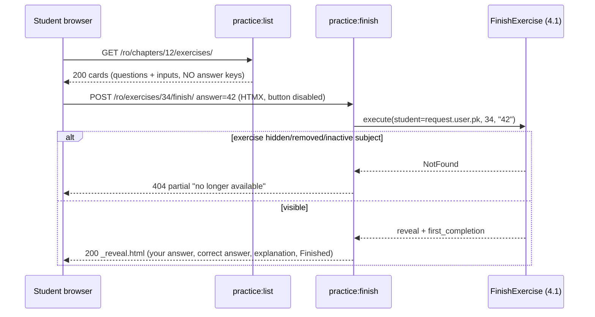

### Story 4.3: Exercise Practice

**BUILDID**: CYCLE-2 | **GitHub**: LOCAL | **AzureDevOps**: LOCAL | **Epic**: 4 - Student Lessons & Practice | **ID**: 4.3 | **Date**: 2026-10-19
**File**: `docs/plans/stories/epic-4-story-4.3-Exercise-Practice.md`
**Build Ref**: `docs/plans/builds/cycle-2/cycle-plan.md` — CYCLE-2 (Workshop Day 3: exercises list + "Finish exercise" reveal, unscored, completion recorded)
**Wave**: 8
**Requires**: [3.1, 4.1]
**Enables**: [4.4]
**Files Touched**:
  - src/infrastructure/persistence/content/queries/practice.py
  - src/infrastructure/web/practice/**
  - src/infrastructure/web/templates/practice/**
  - src/infrastructure/web/static/css/practice.css
  - src/config/urls.py
  - src/infrastructure/i18n/locale/ro/LC_MESSAGES/django.po
  - src/infrastructure/i18n/locale/en/LC_MESSAGES/django.po
  - tests/integration/web/test_role_access_matrix.py
  - docs/architecture/design/00-system-architecture-greenfield.md
  - tests/integration/web/practice/**
**Roles Ref**: docs/requirements.md#roles--permissions-matrix — personas this story differentiates: Student, Teacher, Parent/Guardian, Admin
**QA Candidate**: Yes — **Observable:** from a lesson's "Practise" button, a Student sees the chapter's exercises one under another, each with the question and its answer input (options, true/false, or a number box). "Finish exercise" replaces that card in place with "Your answer", "Correct answer" and the explanation, with no score. The card then shows a "Finished" mark that persists on later visits. Correct answers are **not present in the page** before finishing. **Mechanism:**
- `GET /<lang>/chapters/<id>/exercises/` (`practice:list`, `lessons:view`) → `exercises_for_chapter(chapter_id, student_id)` (visible exercises of an active subject; the DTO excludes answer keys and explanations; ≤ 2 queries)
- `POST /<lang>/exercises/<id>/finish/` (`practice:finish`, `exercises:complete`) → `FinishExercise` (Story 4.1: visibility check, completion recorded once, response not stored) → HTMX partial `_reveal.html` (or the full list page with that card revealed when not HTMX)

**Authz & preconditions:** Student only (`lessons:view` to list, `exercises:complete` to finish); content must be ACTIVE in an active subject (404 otherwise). **Edge & idempotency:**
- Finishing the same exercise again reveals again and records nothing new.
- An empty answer reveals with "No answer".
- An unknown option id or non-numeric text is shown as typed (escaped) or as "No answer"; no error and no score.
- An exercise hidden between page load and finish → 404 partial.
- Double clicks are prevented by the button spinner/disable.

**Regression:** no answer-key leakage in list HTML (the integrity of practice for children), moderation visibility, per-student "Finished" marks (IDOR), 403 for non-students, bilingual reveal.

---

#### 👤 User Reference

**Description**:
After reading a lesson, students practise with the chapter's exercises.
- **The exercise page:** a student sees every exercise of the chapter, each with its question and a way to answer: choosing an option, picking "True" or "False", or typing a number. "2,5" and "2.5" both work, and no keyboard tricks are needed.
- **Finishing an exercise:** when ready, the student presses "Finish exercise" and, in the same spot, sees:
  - what they answered
  - the correct answer
  - a short explanation from the teacher, in the language they're using
- **No scores:** there are no points and no "right/wrong" verdicts, because exercises are for learning (the requirements say exercises aren't scored).
- **"Finished" marks:** each finished exercise gets a "Finished" mark that stays when the student comes back. Students can try an exercise again whenever they like.
- **No peeking:** the correct answers aren't hidden somewhere in the page; they only come from the platform after the student presses "Finish exercise".
- **Hidden content:** as with lessons, exercises an administrator has hidden never appear.

These pages are only for students.

**Acceptance Criteria** (plain-English):
- From a lesson, "Practise" opens the chapter's exercises in order, with questions in the current language.
- Each exercise offers the right way to answer for its type: options, true/false, or a number box.
- "Finish exercise" shows the student's answer, the correct answer and the explanation in place, with no score.
- Finishing with no answer still shows the correct answer and explanation ("No answer" for theirs).
- Each finished exercise shows a "Finished" mark, now and on later visits; only the student's own marks are shown.
- Finishing the same exercise again shows the answers again and doesn't count twice.
- The correct answers and explanations can't be found in the page before finishing.
- Exercises that aren't active, or belong to subjects outside the pilot, never appear and can't be finished.
- The button shows it's working and can't be pressed twice while waiting.
- Teachers, parents and administrators get "Access denied".

**User Flow** (role-differentiated):

### Student
**Scenario / narrative**: As a grade-2 Student, I press "Practise" under the addition lesson. I see six exercises. For "Cât face 27 + 15?" I pick 42 and press "Finish exercise"; the button spins for a moment and the card shows "Răspunsul tău: 42 · Răspunsul corect: 42" and "27 + 15 = 42, pentru că 7 + 5 = 12…". For the number question I type "15,0" and see the correct answer "15". I skip one exercise by pressing "Finish" without answering: it shows "Niciun răspuns" and the correct answer. When I come back tomorrow, the three exercises I finished have a ✓ "Terminat" mark.
**Steps**:
1. `GET /ro/chapters/<cid>/exercises/` → `@require_permission(LESSONS_VIEW)` → `exercises_for_chapter(cid, request.user.pk)` (404 unless the chapter exists in an active subject) → cards with inputs; answer keys **not** in the DTO.
2. "Finish exercise" → HTMX `POST /ro/exercises/<eid>/finish/` (`hx-target` = the card, `hx-swap="outerHTML"`, `hx-disabled-elt="this"`) with `answer` → `@require_permission(EXERCISES_COMPLETE)` → `FinishExercise.execute(FinishExerciseCommand(request.user.pk, eid, answer))` → `_reveal.html` (your answer, correct answer, explanation, "Finished" mark, "Try again" link).
3. Without JS: the same POST returns the full list page (200) with that card revealed.
4. Exercise hidden meanwhile → `NotFound` → 404 partial "This exercise is no longer available."

### Teacher
**Scenario / narrative**: As a Teacher, I author exercises in the editor (Story 3.7); the student practice pages aren't for me and answer "Access denied".
**Steps**:
1. `GET /ro/chapters/<cid>/exercises/` → 403; `POST /ro/exercises/<eid>/finish/` → 403 (lacks `exercises:complete`).

### Parent/Guardian
**Scenario / narrative**: As a Parent, I'll see my child's progress next cycle; I can't practise or finish exercises on their behalf: "Access denied".
**Steps**:
1. Both routes → 403.

### Admin
**Scenario / narrative**: As the Admin, practice pages are denied to me; I review content through moderation (next cycle).
**Steps**:
1. Both routes → 403.

**Flow Diagram**:



---

#### 🤖 AI Agent Reference

**Must Read**:
- `docs/requirements.md` — "Exercises are not scored. After the student selects 'Finish exercise,' show correct answers and explanations."
- `docs/architecture/design/00-system-architecture-greenfield.md` — route catalogue (`/chapters/<id>/exercises/`, `POST /exercises/<id>/finish/` contract: idempotent completion, HTMX partial), Moderation visibility, Answer key formats
- `docs/architecture/design/01-patterns-and-standards-greenfield.md` — §6.3 (scope in query, DTOs), §7.4 HTMX (`is_htmx`, partial vs full page, `hx-disabled-elt`), §7.5
- `docs/ui-ux/ui-ux-spec.md` — student theme, `success_feedback: in_place`, `loading_states: button_spinner_disable`, 44px controls
- `docs/plans/stories/epic-4-story-4.1-Progress-Data-and-Use-Cases.md` — `FinishExercise`, `ExerciseReveal`, `ExerciseCompletionModel`
- `docs/plans/stories/epic-3-story-3.1-Content-Domain-Rules.md` — `QuestionKind`, `Option`

**Description**:
1. **Query** `persistence/content/queries/practice.py`: `exercises_for_chapter(chapter_id, student_id) -> PracticeDTO`, with the chapter header (titles, subject/grade names for the breadcrumb) and `exercises: tuple[PracticeExerciseDTO(id, number, kind, prompt_ro, prompt_en, options, completed)]`:
   - `number` is the 1-based order among **visible** exercises (gaps from hidden ones aren't shown)
   - `completed` reflects only this student's completions
   - the DTO has **no** `answer_key` or explanation fields
   - `NotFound` unless the chapter exists in an active subject; ≤ 2 queries
2. **Web** `web/practice/` (`app_name = "practice"`, included in `i18n_patterns` at `""`):
   - `views.py`: `exercise_list`, `finish_exercise`
   - `presenters.py`: pure display helpers, e.g. `describe_answer(kind, options, value, lang)` → "42" / "True" / "No answer", and `describe_correct(reveal, lang)`
3. **Templates** `practice/list.html`, `_exercise_card.html` (form with kind-specific inputs), `_reveal.html`, `_unavailable.html`; CSS `static/css/practice.css`.

**Design Tokens** (FE — student theme):
- Page: bg `#FFF8EC`, max 960px; `ui_page_header` breadcrumb Catalogue › {grade} › {subject} › Chapter {n} › Exercises; `ui_progress done=completed total=count label="Finished"`.
- Exercise card: `ui_card` (radius 16px, padding 32px, elevation-1), heading "Exercise {n}" 20px/600, prompt 18px.
- Inputs: MCQ options as large radio tiles (min-height 44px, radius 16px, border 2px `#6B7280`; selected border `#0E7490` + bg `#CFFAFE`); TF as two 44px tiles "True"/"False"; numeric `<input inputmode="decimal">` 44px high, 18px, width 12ch.
- "Finish exercise": `ui_button` primary, icon `check-circle` duotone, `hx_post`, `hx_target="#exercise-{id}"`, `hx_swap="outerHTML"`, `hx_disabled_elt="this"` (spinner).
- Reveal: card bg `#FFFFFF` with left border 4px `#0E7490`; rows "Your answer" / "Correct answer" 18px with labels 600; explanation paragraph; neutral styling (no red/green right/wrong). "Finished" mark: `check-circle` duotone 20px + text in `#15803D`. Container `role="status" aria-live="polite"`. "Try again" link `#0E7490`.
- Unavailable partial: `ui_alert "info"` "This exercise is no longer available."
- Empty: `ui_empty_state` "No exercises in this chapter yet."

**Acceptance Criteria**:
1. `practice:list` → `GET /<lang>/chapters/<int:chapter_id>/exercises/`, `@require_safe` + `@require_permission(LESSONS_VIEW)`. 200 with ACTIVE exercises in position order, or the empty state. 404 when the chapter doesn't exist or its subject is inactive.
2. The list HTML contains **no** answer key data and no explanation text: no `option_id` markers of correctness, no `data-correct`, no explanation strings. A test asserts that each seeded exercise's `explanation_en` and numeric key are absent from the response body.
3. Inputs per kind:
   - MCQ: radios `name="answer"` with option ids as values and localized labels
   - TRUE_FALSE: radios `true` / `false`
   - NUMERIC: text input `inputmode="decimal"`, `maxlength=30`

   Each card is a `<section id="exercise-{id}" aria-labelledby="exercise-{id}-title">` whose `<h2 id="exercise-{id}-title">` reads "Exercise {n}" (the HTMX swap target, and the accessible name Story 4.4 uses), containing a `<form method="post" action="">` with CSRF.
4. `practice:finish` → `POST /<lang>/exercises/<int:exercise_id>/finish/`, `@require_POST` + `@require_permission(EXERCISES_COMPLETE)` → `FinishExercise`. HTMX → 200 `_reveal.html` for that card. Non-HTMX → 200 full list page with that card replaced by the reveal.
5. The reveal shows:
   - **Your answer:** MCQ → localized option text, or "No answer" for empty or unknown ids; TF → "True"/"False" or "No answer"; NUMERIC → the trimmed typed text (escaped), or "No answer"
   - **Correct answer:** MCQ → localized correct option text; TF → "True"/"False"; NUMERIC → the canonical key value with the locale decimal separator (`15`, `2,5` in RO, `2.5` in EN)
   - **Explanation:** localized
   - the "Finished" mark
   - no score and no right/wrong verdict text
6. Repeat finish → the same reveal; `progress_exercise_completion` row count unchanged.
7. Hidden, removed or inactive-subject exercise on finish → 404 (HTMX: `_unavailable.html` partial with status 404). Nothing recorded.
8. Completion marks are per student (another student's completion never marks the card).
9. Route catalogue updated; RO/EN translations ("Exercises", "Exercise %(n)s", "Finish exercise", "Your answer", "Correct answer", "Explanation", "No answer", "Finished", "Try again", "True", "False", "This exercise is no longer available.", "No exercises in this chapter yet.").

**RBAC Enforcement**:

| Persona | Permission key | Guarded route/endpoint | Allowed | Denied behavior | UI when denied |
|---------|----------------|------------------------|---------|-----------------|----------------|
| Student | `lessons:view` | `GET /<lang>/chapters/<id>/exercises/` | active subjects, ACTIVE exercises | otherwise 404 | — |
| Student | `exercises:complete` | `POST /<lang>/exercises/<id>/finish/` | ACTIVE exercises | hidden → 404 partial | "no longer available" alert |
| Teacher | — | both | no | 403 | no Practise link (lesson page is student-only) |
| Parent/Guardian | — | both | no | 403 | — |
| Admin | — | both | no | 403 | — |
| Anonymous | — | both | no | 302 login (POST too) | sign-in |

- **Enforcement point(s):** `@require_permission` in `web/practice/views.py`; visibility in `exercises_for_chapter` (`visible_to_learners()` + active subject) and in `FinishExercise` via `DjangoLearnerContentReader`.
- **Denied-access contract:** 403 for roles; 404 for hidden or unknown content.
- **Scope derivation:** `student_id` = `request.user.pk` for completion marks and recording; no form field identifies a student; the `answer` value is display-only and never stored.

**System responses + error cases**:

| Trigger | Response | Side-effect |
|---------|----------|-------------|
| Student GET list (6 ACTIVE, 1 BLOCKED) | `200` 6 cards numbered 1–6 | none |
| Student GET list, no exercises | `200` empty state | none |
| HTMX POST finish MCQ `answer=b` | `200` reveal: your "42", correct "42", explanation | 1 completion row |
| Repeat POST finish same exercise | `200` same reveal | none |
| POST finish NUMERIC `answer="15,0"` | `200` your "15,0", correct "15" | completion row (first time) |
| POST finish with empty answer | `200` your "No answer" | completion row (first time) |
| POST finish MCQ `answer="z"` (tampered) | `200` your "No answer" | completion row (first time) |
| Non-HTMX POST finish | `200` full list page with that card revealed | completion row (first time) |
| POST finish on an exercise blocked after page load | `404` partial "no longer available" | none |
| GET list of a chapter in an inactive subject / unknown chapter | `404` | none |
| Teacher/Parent/Admin either route | `403` | none |
| POST finish without CSRF | `403` | none |

**QA-observable behaviour**:
- View-source of the list page contains none of the exercises' explanations or correct numeric values.
- After finishing 3 of 6 exercises, `progress_exercise_completion` has exactly 3 rows for the student. The list shows 3 "Finished" marks and the progress meter reads "3/6". Another student's page shows 0.
- Repeating a finish leaves the row count unchanged.
- The reveal never contains the words "Correct!"/"Wrong", or a score.
- **What does NOT change**: exercise content and moderation state; no answer text is stored anywhere; lesson views unaffected.

**Prerequisites**:
- Story 4.1 (`FinishExercise`, completions, reader) and Story 3.1 (`QuestionKind`) merged; content models/factories (3.2).
- Story 4.2 runs in parallel; its lesson "Practise" button links here once both are merged.

**Context**: `docs/architecture/design/00-system-architecture-greenfield.md`, `docs/architecture/design/01-patterns-and-standards-greenfield.md`, `docs/ui-ux/08-visual-foundation.md`, `src/application/progress/finish_exercise.py`, `src/domain/content/questions.py`, `src/infrastructure/web/common/htmx.py`

**Patterns**: Query services with DTOs and scope in the query (§6.3), Thin views (§7.1–7.2), HTMX partial vs full page (§7.4), Primitives (§11.2) — see `docs/architecture/design/01-patterns-and-standards-greenfield.md`

**Steps**:

1. **Tests first** (query: visibility, numbering, no-key DTO, marks, query count; views per System-responses row; presenters unit-tested through the reveal).

2. **Query** (excerpt):
   ```python
   # src/infrastructure/persistence/content/queries/practice.py
   def exercises_for_chapter(chapter_id: int, student_id: int) -> PracticeDTO:
       chapter = (ChapterModel.objects.select_related("subject__grade")
                  .filter(pk=chapter_id, subject__is_active=True).first())
       if chapter is None:
           raise NotFound("chapter")
       done = ExerciseCompletionModel.objects.filter(student_id=student_id, exercise=OuterRef("pk"))
       rows = (ExerciseModel.objects.visible_to_learners().filter(chapter=chapter)
               .annotate(completed=Exists(done)).order_by("position")
               .only("id", "kind", "prompt_ro", "prompt_en", "options"))  # never load answer_key/explanations here
       exercises = tuple(
           PracticeExerciseDTO(row.pk, number, QuestionKind(row.kind), row.prompt_ro, row.prompt_en,
                               tuple(Option(o["id"], o["ro"], o["en"]) for o in row.options), row.completed)
           for number, row in enumerate(rows, start=1))
       return PracticeDTO(chapter.pk, chapter.number, chapter.title_ro, chapter.title_en, chapter.subject.name_ro,
                          chapter.subject.name_en, chapter.subject.grade.name_ro, chapter.subject.grade.name_en, exercises)
   ```
   > The `select_related` + filter is query 1 and the annotated exercises are query 2.

3. **Presenters** (`web/practice/presenters.py`, pure, unit-testable):
   ```python
   from django.utils.translation import gettext as _

   from domain.common.numbers import parse_numeric
   from domain.content.questions import QuestionKind


   def describe_response(kind, options, raw: str, lang: str) -> str:
       raw = (raw or "").strip()
       if not raw:
           return _("No answer")
       if kind is QuestionKind.MCQ:
           match = next((o for o in options if o.id == raw), None)
           return getattr(match, lang) if match else _("No answer")
       if kind is QuestionKind.TRUE_FALSE:
           return {"true": _("True"), "false": _("False")}.get(raw, _("No answer"))
       return raw  # numeric: show exactly what the child typed (autoescaped in the template)


   def describe_correct(reveal, lang: str) -> str:
       if reveal.kind is QuestionKind.MCQ:
           return next(getattr(o, lang) for o in reveal.options if o.id == reveal.answer_key["option_id"])
       if reveal.kind is QuestionKind.TRUE_FALSE:
           return _("True") if reveal.answer_key["value"] else _("False")
       value = str(parse_numeric(reveal.answer_key["value"]))
       return value.replace(".", ",") if lang == "ro" else value
   ```

4. **Views:**
   ```python
   # src/infrastructure/web/practice/views.py (excerpt)
   @require_POST
   @require_permission(Permission.EXERCISES_COMPLETE)
   def finish_exercise(request, exercise_id: int):
       """POST /<lang>/exercises/<id>/finish/ — exercises:complete; unscored reveal (requirements)."""
       try:
           result = container.finish_exercise().execute(
               FinishExerciseCommand(request.user.pk, exercise_id, request.POST.get("answer", "")))
       except NotFound:
           if is_htmx(request):
               return render(request, "practice/_unavailable.html", status=404)
           raise
       context = _reveal_context(result, content_language())
       if is_htmx(request):
           return render(request, "practice/_reveal.html", context)
       page = exercises_for_chapter(result.reveal.chapter_id, request.user.pk)
       return render(request, "practice/list.html", {"page": page, "revealed": {exercise_id: context}})
   ```
   > The `NotFound` catch renders an in-place partial for HTMX only (UX: in-place feedback). Non-HTMX re-raises to the standard 404 page via `DomainErrorMiddleware`.

5. **Templates and CSS** per Design Tokens; **URLs** (`web/practice/urls.py`, include in `config/urls.py`), **route catalogue**, **translations**, then **all gates**.

**Tests**:

```python
# tests/integration/web/practice/test_practice.py
import pytest

from infrastructure.persistence.catalogue.models import SubjectModel
from infrastructure.persistence.content.queries.practice import exercises_for_chapter
from infrastructure.persistence.progress.models import ExerciseCompletionModel
from tests.factories.accounts import StudentFactory
from tests.factories.content import ChapterFactory, ExerciseFactory

pytestmark = pytest.mark.django_db
HX = {"HX-Request": "true"}


@pytest.fixture
def chapter():
    mem = SubjectModel.objects.get(grade__code="2", code="MEM")
    chapter = ChapterFactory(subject=mem, number=1)
    ExerciseFactory(chapter=chapter, position=1, explanation_en="Because seven plus five is twelve.")
    ExerciseFactory(chapter=chapter, position=2, numeric=True, answer_key={"value": "15"},
                    explanation_en="Fifteen it is.")
    ExerciseFactory(chapter=chapter, position=3, moderation_status="BLOCKED", prompt_en="Hidden question")
    return chapter


def test_list_shows_visible_exercises_without_answers(student_client, chapter):
    html = student_client.get(f"/en/chapters/{chapter.pk}/exercises/").content.decode()

    assert "Exercise 1" in html and "Exercise 2" in html and "Hidden question" not in html
    assert "seven plus five" not in html and "Fifteen it is." not in html
    assert "data-correct" not in html


def test_query_is_bounded_and_marks_are_per_student(chapter, student, django_assert_max_num_queries):
    ExerciseCompletionModel.objects.create(student=StudentFactory(), exercise=chapter.exercises.first(),
                                           completed_at="2026-11-01T08:00Z")
    with django_assert_max_num_queries(2):
        page = exercises_for_chapter(chapter.pk, student.pk)

    assert [e.completed for e in page.exercises] == [False, False]


def test_finish_reveals_and_records_once(student_client, student, chapter):
    exercise = chapter.exercises.get(position=2)

    first = student_client.post(f"/en/exercises/{exercise.pk}/finish/", {"answer": "15,0"}, headers=HX)
    second = student_client.post(f"/en/exercises/{exercise.pk}/finish/", {"answer": "14"}, headers=HX)

    html = first.content.decode()
    assert first.status_code == second.status_code == 200
    assert "15,0" in html and "Fifteen it is." in html and "<html" not in html
    assert "Correct!" not in html and "Wrong" not in html
    assert ExerciseCompletionModel.objects.filter(student=student, exercise=exercise).count() == 1


def test_empty_and_tampered_answers_show_no_answer(student_client, chapter):
    mcq = chapter.exercises.get(position=1)

    assert "No answer" in student_client.post(f"/en/exercises/{mcq.pk}/finish/", {"answer": ""}, headers=HX).content.decode()
    assert "No answer" in student_client.post(f"/en/exercises/{mcq.pk}/finish/", {"answer": "z"}, headers=HX).content.decode()


def test_romanian_reveal_uses_decimal_comma(student_client, chapter):
    exercise = chapter.exercises.get(position=2)
    exercise.answer_key = {"value": "2.5"}
    exercise.save()

    html = student_client.post(f"/ro/exercises/{exercise.pk}/finish/", {"answer": "2.5"}, headers=HX).content.decode()

    assert "2,5" in html


def test_hidden_exercise_finish_is_404_partial_and_not_recorded(student_client, chapter):
    hidden = chapter.exercises.get(position=3)

    response = student_client.post(f"/en/exercises/{hidden.pk}/finish/", {"answer": "b"}, headers=HX)

    assert response.status_code == 404 and "no longer available" in response.content.decode()
    assert not ExerciseCompletionModel.objects.filter(exercise=hidden).exists()


def test_non_htmx_finish_returns_full_page(student_client, chapter):
    exercise = chapter.exercises.get(position=1)

    response = student_client.post(f"/en/exercises/{exercise.pk}/finish/", {"answer": "b"})

    assert response.status_code == 200 and "<html" in response.content.decode()


@pytest.mark.parametrize("fixture", ["teacher_client", "parent_client", "admin_client"])
def test_non_students_are_denied(request, fixture, chapter):
    client, exercise = request.getfixturevalue(fixture), chapter.exercises.get(position=1)

    assert client.get(f"/ro/chapters/{chapter.pk}/exercises/").status_code == 403
    assert client.post(f"/ro/exercises/{exercise.pk}/finish/", {"answer": "b"}).status_code == 403
```

Manual:
- As Student (RO and EN): practise all three kinds; finish with an empty answer; finish again; reload and check marks and the progress meter. View the page source before finishing and confirm no answers or explanations appear.
- Block an exercise in the DB while the page is open, then press Finish: the "no longer available" alert appears in place.
- Keyboard only: tab to an option, select with Space, Tab to "Finish exercise", Enter. The reveal is announced (screen reader).
- As Teacher, Parent and Admin: 403 on both routes.

**Quality**: ruff 0; mypy passes; tests pass; coverage ≥85%; list ≤ 2 queries; no answer keys in list HTML; primitives reused; no inline `style`/`script`; no `TODO`.

**OUT**:
- ❌ Scoring, right/wrong verdicts or storing student answers (requirements: unscored).
- ❌ Chapter tests (CYCLE-3).
- ❌ Progress summary pages and parent visibility (CYCLE-3).
- ❌ Hints, timers or randomised option order (not required).

**Evidence**: pytest output, coverage %, screenshots of the exercise list (RO) before finishing, a revealed MCQ and numeric card (RO with decimal comma), the "Finished" marks after reload, and a view-source excerpt showing no answer data, all recorded in `docs/stories-implemented/story-4.3-review.md` under "## DoD Evidence".
