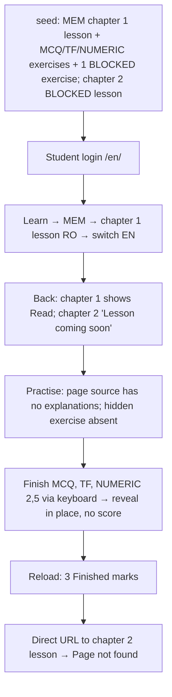

### Story 4.4: Learning E2E Journeys

**BUILDID**: CYCLE-2 | **GitHub**: LOCAL | **AzureDevOps**: LOCAL | **Epic**: 4 - Student Lessons & Practice | **ID**: 4.4 | **Date**: 2026-10-19
**File**: `docs/plans/stories/epic-4-story-4.4-Learning-E2E-Journeys.md`
**Build Ref**: `docs/plans/builds/cycle-2/cycle-plan.md` — CYCLE-2 (Workshop Day 4: Playwright journey "student reads and practises")
**Wave**: 9
**Requires**: [4.2, 4.3]
**Enables**: [6.1, 6.2, 8.1, 8.2]
**Files Touched**:
  - tests/e2e/test_student_learning.py
**Roles Ref**: docs/requirements.md#roles--permissions-matrix — single-actor — no role variation in *this story's code* (test-only; the journeys exercise the Student behaviour delivered by Stories 4.2–4.3)
**QA Candidate**: No — test-only story. It automates Epic 4 QA Group 1, adds no product behaviour, and its green run is the CYCLE-2 learner sign-off evidence.

---

#### 👤 User Reference

**Description**:
This story adds browser "robot student" tests for the learning experience. With a chapter prepared in advance (lesson and exercises in both languages), the robot student:
- signs in and opens "Learn", then the Mathematics subject
- reads chapter 1's lesson in Romanian, switches to English and sees the English version
- goes back and sees the chapter marked "Read"
- opens the exercises and finishes a multiple-choice, a true/false and a number exercise (typing "2,5"), each time seeing their answer, the correct answer and the explanation, without a score
- comes back and sees the "Finished" marks

The tests also prove the two safety promises of this cycle:
- **No peeking:** correct answers aren't in the exercise page before finishing.
- **Hidden content:** content an administrator has hidden never appears: a hidden lesson shows "Page not found", and a hidden exercise isn't listed.

**Acceptance Criteria** (plain-English):
- One command runs the learning journeys in a real browser.
- The student can go from the catalogue to a lesson, read it in both languages, and see the "Read" mark afterwards.
- Finishing exercises of each type shows the answers and explanation in place, with no score, and leaves a "Finished" mark that remains after reload.
- Before finishing, the page doesn't contain the correct answers or explanations.
- A hidden lesson can't be opened (Page not found) and a hidden exercise isn't shown.
- The journeys work with the keyboard for answering and finishing.
- No browser security-policy errors occur.

**User Flow**:
Actor: system — no role variation.

**Flow Diagram**:



---

#### 🤖 AI Agent Reference

**Must Read**:
- `docs/plans/implementation-plan.md` — Epic 4 QA Group 1
- `docs/plans/builds/cycle-2/cycle-plan.md` — CYCLE-2 learner acceptance criteria
- `docs/plans/stories/epic-1-story-1.10-Foundation-E2E-Journeys.md` — harness and rules
- `docs/plans/stories/epic-4-story-4.2-Chapter-List-and-Lesson-Reading.md`, `docs/plans/stories/epic-4-story-4.3-Exercise-Practice.md` — labels, messages, routes

**Description**:
`tests/e2e/test_student_learning.py` with:
- a module-local `seeded_mem` fixture built from factories (`ChapterFactory`, `LessonFactory`, `ExerciseFactory` with the `true_false` and `numeric` traits, a BLOCKED exercise, and chapter 2 with a BLOCKED lesson)
- `test_student_reads_lesson_in_both_languages`
- `test_student_practises_all_kinds_without_scores`
- `test_answers_not_in_page_before_finishing`
- `test_hidden_content_never_shown`

EN-first selectors; the Romanian check asserts `html[lang=ro]` and the RO body text, which is seeded content and doesn't depend on compiled catalogues.

**Acceptance Criteria**:
1. `uv run pytest -m e2e tests/e2e/test_student_learning.py` is green three times in a row, in < 90 s.
2. Lesson journey: Learn → MEM → chapter 1 → RO body heading visible and `html[lang=ro]` → language switch to EN → EN body heading visible → back to the subject: chapter 1 has "Read", chapter 2 shows "Lesson coming soon".
3. Practice journey (keyboard): for the MCQ select the option with Space, Tab to "Finish exercise", Enter → reveal shows "Your answer", "Correct answer" and the explanation. TF: same. NUMERIC: type "2,5" → reveal shows "2,5" typed and the correct value. No "Correct!"/"Wrong"/score text. Reload → 3 "Finished" marks; the progress meter reads "3/3".
4. No-peeking check: before finishing, `page.content()` contains none of the seeded explanations or the numeric key.
5. Hidden content: the BLOCKED exercise's prompt is absent from the list; a direct visit to chapter 2's lesson URL shows "Page not found".
6. `console_errors` is used by every test; no `time.sleep`.

**RBAC Enforcement**:
No role-differentiated access — single actor.
- Test-only; signs in as a Student through the real login page.

**System responses + error cases** (harness behaviour):

| Trigger | Response | Side-effect |
|---------|----------|-------------|
| `uv run pytest` (default) | e2e deselected | none |
| `-m e2e` | journeys run on `live_server` | transactional DB discarded |
| Expected text/role missing | failure with trace + screenshot | artefacts in `test-results/` |
| CSP console error | test fails | none |
| Re-run | identical results | none persisted |

**Prerequisites**:
- Stories 4.2 and 4.3 merged (and their dependencies); CYCLE-1 harness; Chromium installed.

**Context**: `tests/e2e/conftest.py`, `tests/factories/content.py`, Stories 4.2 and 4.3

**Patterns**: E2E tests (§12.5) — see `docs/architecture/design/01-patterns-and-standards-greenfield.md`

**Steps**:

1. **Seed fixture and journeys** (excerpt):
   ```python
   # tests/e2e/test_student_learning.py
   import pytest
   from playwright.sync_api import Page, expect

   from infrastructure.persistence.catalogue.models import SubjectModel
   from tests.e2e.conftest import login
   from tests.factories.accounts import StudentFactory
   from tests.factories.content import ChapterFactory, ExerciseFactory, LessonFactory

   pytestmark = pytest.mark.e2e
   EXPLANATIONS = ("Because 27 and 15 make 42.", "Two is bigger than one.", "Half of five is two and a half.")


   @pytest.fixture
   def seeded_mem():
       mem = SubjectModel.objects.get(grade__code="2", code="MEM")
       one = ChapterFactory(subject=mem, number=1, title_ro="Adunarea", title_en="Addition")
       LessonFactory(chapter=one, body_ro="## Lecția de adunare", body_en="## The addition lesson")
       ExerciseFactory(chapter=one, position=1, explanation_en=EXPLANATIONS[0])
       ExerciseFactory(chapter=one, position=2, true_false=True, explanation_en=EXPLANATIONS[1])
       ExerciseFactory(chapter=one, position=3, numeric=True, answer_key={"value": "2.5"}, explanation_en=EXPLANATIONS[2])
       ExerciseFactory(chapter=one, position=4, moderation_status="BLOCKED", prompt_en="Hidden exercise")
       two = ChapterFactory(subject=mem, number=2)
       LessonFactory(chapter=two, moderation_status="BLOCKED")
       return mem, one, two


   def test_answers_not_in_page_before_finishing(page: Page, base_url, console_errors, seeded_mem):
       _, one, _ = seeded_mem
       StudentFactory(username="s-e2e", preferred_language="en")
       login(page, base_url, "s-e2e", lang="en")

       page.goto(f"{base_url}/en/chapters/{one.pk}/exercises/")

       content = page.content()
       assert not [text for text in EXPLANATIONS if text in content]
       assert "Hidden exercise" not in content


   def test_student_practises_all_kinds_without_scores(page: Page, base_url, console_errors, seeded_mem):
       _, one, _ = seeded_mem
       StudentFactory(username="s-e2e", preferred_language="en")
       login(page, base_url, "s-e2e", lang="en")
       page.goto(f"{base_url}/en/chapters/{one.pk}/exercises/")

       numeric = page.get_by_role("region", name="Exercise 3")
       numeric.get_by_role("textbox").fill("2,5")
       numeric.get_by_role("button", name="Finish exercise").press("Enter")

       expect(page.get_by_text(EXPLANATIONS[2])).to_be_visible()
       expect(page.get_by_text("Correct!")).to_have_count(0)
   ```
   The other two tests follow AC 2 and AC 5. Every AC step is implemented explicitly in the final file. Exercise cards are `<section aria-labelledby>` named "Exercise {n}" (Story 4.3 markup); if the implemented markup differs, align the locator with the real accessible name, not with CSS classes.

2. **Run three times**, record timings, do one deliberate local failure to check trace artefacts, then revert.

**Tests**: this story *is* tests. Proof = 3 consecutive green runs + one deliberate failure.

Manual: one `--headed --slowmo=200` run watched end to end.

**Quality**: ruff 0; role/label/text locators only; no `time.sleep`; 3 consecutive green runs; < 90 s.

**OUT**:
- ❌ Authoring journeys (Story 3.9).
- ❌ Test taking and progress pages (CYCLE-3).
- ❌ Production-code changes (defects via `aire-raise-defect`).
- ❌ CI wiring (DevOps).

**Evidence**: output of 3 consecutive runs, the AC → journey-step mapping table, and the deliberate-failure trace screenshot, all recorded in `docs/stories-implemented/story-4.4-review.md` under "## DoD Evidence".
