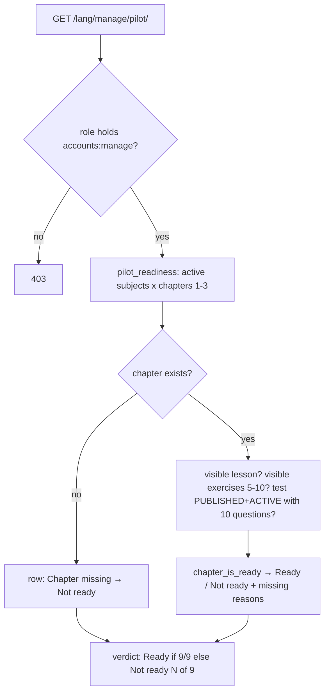

### Story 5.1: Pilot Readiness Dashboard

**BUILDID**: CYCLE-2 | **GitHub**: LOCAL | **AzureDevOps**: LOCAL | **Epic**: 5 - Pilot Reporting | **ID**: 5.1 | **Date**: 2026-10-19
**File**: `docs/plans/stories/epic-5-story-5.1-Pilot-Readiness-Dashboard.md`
**Build Ref**: `docs/plans/builds/cycle-2/cycle-plan.md` — CYCLE-2 Epic 5 part 1 (readiness section of `/manage/pilot/`: SC-2 / FC-1)
**Wave**: 7
**Requires**: [3.2]
**Enables**: [3.9]
**Files Touched**:
  - src/infrastructure/persistence/reporting/**
  - src/infrastructure/web/reporting/**
  - src/infrastructure/web/templates/reporting/**
  - src/infrastructure/web/static/css/reporting.css
  - src/config/urls.py
  - src/infrastructure/i18n/locale/ro/LC_MESSAGES/django.po
  - src/infrastructure/i18n/locale/en/LC_MESSAGES/django.po
  - tests/integration/web/test_role_access_matrix.py
  - docs/architecture/design/00-system-architecture-greenfield.md
  - tests/integration/web/reporting/**
**Roles Ref**: docs/requirements.md#roles--permissions-matrix — personas this story differentiates: Admin, Teacher, Student, Parent/Guardian
**QA Candidate**: Yes — **Observable:** "Pilot" in the Admin menu opens `/<lang>/manage/pilot/`, a readiness table of the 9 pilot chapters (3 grade-2 subjects × chapters 1–3). Each row shows lesson ✓/✗, the active exercise count against 5–10, test status, and Ready / Not ready with the missing items named. The overall verdict reads "Ready" only when all 9 are ready, otherwise "Not ready (N of 9 chapters ready)". **Mechanism:**
- `GET /manage/pilot/` (`reporting:pilot`, `accounts:manage`) → `pilot_readiness()` query in `persistence/reporting/queries.py` (≤ 3 queries)
- counts only learner-visible content (ACTIVE lesson/exercises; PUBLISHED + ACTIVE test) and evaluates each slot with the shared domain rule `chapter_is_ready` (Story 3.1); missing chapters count as not ready

**Authz & preconditions:** Admin only (`accounts:manage`); read-only. **Edge & idempotency:**
- A chapter slot with no chapter shows "Chapter missing".
- Blocked/flagged content counts as missing (students can't see it, FC-1).
- More than 10 visible exercises flags "too many exercises".
- Repeat loads are identical and side-effect free.
- With zero content: 0 of 9.

**Regression:** the readiness rule matches the teacher dashboard's "Complete" (same function), the 403 boundary, the SC-2/FC-1 launch gate before 2026-11-19.

---

#### 👤 User Reference

**Description**:
The pilot can only launch when all nine chapters are complete: three subjects, three chapters each, every chapter with a lesson, 5–10 exercises and a published 10-question test. The requirements call a launch with any gap unacceptable.

This story gives the administrator a "Pilot" page to track exactly that during the two weeks of content entry:
- **Rows:** one for each of the nine chapters, saying what's there, what's missing, and whether it's ready.
- **Overall verdict:** "Ready" only when everything is complete; otherwise, how many of the nine are ready.
- **What counts:** only what students can actually see. A lesson an administrator has blocked doesn't count until it's fixed and cleared (next cycle).
- **Shared rule:** it uses exactly the same rule as the teachers' "Complete" marker on their Dashboard, so teachers and the administrator always see the same picture.

Next cycle adds account onboarding and test-completion numbers to this page. Only administrators can open it.

**Acceptance Criteria** (plain-English):
- Administrators see "Pilot" in their menu; it lists the 9 pilot chapters grouped by subject.
- Each row shows: lesson present, number of active exercises (5–10 needed), test status, and Ready / Not ready with the missing items in words.
- A missing chapter shows "Chapter missing" and is not ready.
- Hidden (flagged or blocked) content counts as missing.
- The overall verdict says "Ready" only when all 9 chapters are ready; otherwise "Not ready (N of 9 chapters ready)".
- The page uses the same readiness rule as the teacher Dashboard.
- Teachers, students and parents get "Access denied".
- The page only reads data; opening it changes nothing.

**User Flow** (role-differentiated):

### Admin
**Scenario / narrative**: As the pilot Admin on 2026-11-12, I open "Pilot" from my menu. MEM chapters 1–3 are "Ready". CLR chapter 2 says "Not ready: 4 exercises (5–10 needed); test not published". English chapter 3 says "Chapter missing". The top verdict reads "Not ready (6 of 9 chapters ready)". I message the teachers. Two days later all rows are green and the verdict says "Ready", so I can plan onboarding.
**Steps**:
1. `GET /ro/manage/pilot/` → `@require_permission(ACCOUNTS_MANAGE)` → `pilot_readiness()`: active subjects (query 1), chapters with annotated visible counts (query 2), test question counts (query 3, or folded into 2) → `ReadinessDTO(rows, ready_count, total=9)`.
2. Each row → `chapter_is_ready(...)` plus `missing` reasons (ordered: chapter, lesson, exercises low/high, test) → table.

### Teacher
**Scenario / narrative**: As a Teacher, I follow completeness on my own Dashboard ("Complete" markers use the same rule). The admin's Pilot page answers "Access denied" for me.
**Steps**:
1. `GET /ro/manage/pilot/` → lacks `accounts:manage` → 403.

### Student
**Scenario / narrative**: As a Student, I never see the Pilot page or its link; its URL shows "Access denied".
**Steps**:
1. `GET /ro/manage/pilot/` → 403.

### Parent/Guardian
**Scenario / narrative**: As a Parent, I have no access to pilot administration: "Access denied".
**Steps**:
1. `GET /ro/manage/pilot/` → 403.

**Flow Diagram**:



---

#### 🤖 AI Agent Reference

**Must Read**:
- `docs/requirements.md` — SC-2, FC-1 (definition of a complete chapter), Admin permissions (`accounts:manage`)
- `docs/architecture/design/00-system-architecture-greenfield.md` — `reporting` module, `/manage/pilot/` (`accounts:manage`), Observability "Pilot metrics"
- `docs/architecture/design/01-patterns-and-standards-greenfield.md` — §6.3 query services (DTOs, bounded queries), §7.1–7.2, §11.2 primitives
- `docs/plans/stories/epic-3-story-3.1-Content-Domain-Rules.md` — `chapter_is_ready`, constants
- `docs/plans/stories/epic-3-story-3.2-Content-Data-Model.md` — models, visibility rules
- `docs/plans/builds/cycle-3/cycle-plan.md` — part 2 (SC-1/SC-3) adds sections to the same page

**Description**:
1. **Query** `persistence/reporting/queries.py` (`persistence/reporting/__init__.py`; not a Django app, as there are no models): `pilot_readiness() -> ReadinessDTO`, a frozen dataclass with `rows: tuple[ReadinessRowDTO, ...]`, `ready_count`, `total` and `is_ready`. Each row: `subject_id`, `subject_name_ro/en`, `number`, `chapter_id | None`, `chapter_title_ro/en`, `has_active_lesson`, `visible_exercises`, `test_visible`, `test_questions`, `ready` and `missing: tuple[ReasonDTO, ...]` (`ReasonDTO(code, params)`). Rows cover every active subject × numbers 1–3, ordered by subject then number.
2. **Missing-reason codes:** `chapter_missing`, `lesson_missing`, `exercises_too_few` {count}, `exercises_too_many` {count}, `test_not_published`, `test_incomplete` {count}. They're translated in the web layer (`web/reporting/messages.py`).
3. **Web** `web/reporting/` (`app_name = "reporting"`, included in `i18n_patterns` at `manage/`): `views.py::pilot` (`@require_safe`, `@require_permission(ACCOUNTS_MANAGE)`); template `reporting/pilot.html` with a "Content readiness" section built so CYCLE-3 can append "Onboarding" and "Test completion" sections; CSS `static/css/reporting.css`.
4. The Story 1.7 registry entry `reporting:pilot` (Admin, `accounts:manage`) now resolves, so "Pilot" appears in the Admin menu and home cards automatically.

**Design Tokens** (FE — staff theme):
- Page: `ui_page_header` "Pilot" (h1 24px/700) with subtitle "Launch target: 19 November 2026" 14px `#4B5563`; bg `#F5F7FA`; max 1200px.
- Verdict card (`ui_card`, padding 24px): ready → Phosphor `check-circle` 32px `#15803D` + "Ready" 20px/700; not ready → `warning-circle` 32px `#B45309` + "Not ready (N of 9 chapters ready)"; `ui_progress done=N total=9 label="Chapters ready"`.
- Table (`ui_table`, caption "Content readiness"): columns Subject · Chapter · Lesson · Exercises · Test · Status · Missing. Lesson ✓/✗ = `check-circle`/`x-circle` 20px **with** text "Yes"/"No"; exercises "{n} / 5–10"; test via `ui_status_pill` (PUBLISHED/DRAFT) or "None"; Status = "Ready" (`#15803D` + icon) / "Not ready" (`#B45309` + icon); Missing = comma-separated reasons 14px.
- Never colour alone; table header bg `#F5F7FA`, row padding 8px 12px.

**Acceptance Criteria**:
1. Route `reporting:pilot` → `GET /<lang>/manage/pilot/`, `@require_safe` + `@require_permission(Permission.ACCOUNTS_MANAGE)`. POST → 405.
2. `pilot_readiness()` returns `len(active subjects) × 3` rows (9 with the seeded catalogue), ordered by the subject's grade/sort order, then chapter number. ≤ 3 SQL queries (asserted).
3. Per row:
   - `has_active_lesson` = an ACTIVE lesson exists
   - `visible_exercises` = count of ACTIVE exercises
   - `test_visible` = test PUBLISHED and ACTIVE
   - `test_questions` = question count of that test (0 if none)
   - `ready = chapter_id is not None and chapter_is_ready(...)`
4. Missing reasons in fixed order:
   - `chapter_missing` (alone, when there's no chapter)
   - otherwise any of `lesson_missing`, `exercises_too_few{count}` / `exercises_too_many{count}`, `test_not_published` (no visible test), `test_incomplete{count}` (visible but ≠ 10 questions)
5. `ready_count` = rows ready; `is_ready = total > 0 and ready_count == total`.
6. The page renders the verdict card, the progress meter and the table with translated reasons, e.g. "4 exercises (5–10 needed)", "Test not published", "Chapter missing".
7. A slot's readiness on this page equals its "Complete" marker on Story 3.5's dashboard for the same data. A test builds identical fixtures and compares both, as long as Story 3.5 is merged when the test runs (otherwise it's skipped, with a reason stating the dependency).
8. Role-access matrix rows: `/ro/manage/pilot/` → Admin 200, Teacher/Student/Parent 403, anonymous 302.
9. Route catalogue updated; RO/EN translations for all strings.

**RBAC Enforcement**:

| Persona | Permission key | Guarded route/endpoint | Allowed | Denied behavior | UI when denied |
|---------|----------------|------------------------|---------|-----------------|----------------|
| Admin | `accounts:manage` | `GET /<lang>/manage/pilot/` | yes | n/a | "Pilot" in the menu |
| Teacher | — | `GET /<lang>/manage/pilot/` | no | 403 | not in menu |
| Student | — | same | no | 403 | not in menu |
| Parent/Guardian | — | same | no | 403 | not in menu |
| Anonymous | — | same | no | 302 login | sign-in |

- **Enforcement point(s):** `@require_permission(Permission.ACCOUNTS_MANAGE)` in `web/reporting/views.py` (architecture: `/manage/pilot/` guarded by `accounts:manage`).
- **Denied-access contract:** 403 page for roles; the link is never rendered without the permission (Story 1.7 registry).
- **Scope derivation:** aggregate, content-only data (no personal data in this part); the admin sees all pilot content by role.

**System responses + error cases**:

| Trigger | Response | Side-effect |
|---------|----------|-------------|
| Admin GET with no content | `200` 9 rows "Chapter missing", verdict "Not ready (0 of 9 chapters ready)" | none |
| Admin GET with 1 complete chapter | `200` that row "Ready"; verdict 1 of 9 | none |
| Same GET repeated | identical `200` | none |
| Chapter with 4 active exercises | row "Not ready: 4 exercises (5–10 needed)" | none |
| Chapter with 11 exercises, one BLOCKED (10 visible) | counts 10 → may be ready | none |
| Lesson BLOCKED | row "Not ready: Lesson missing" | none |
| Test DRAFT | "Test not published" | none |
| All 9 complete | `200` verdict "Ready" | none |
| Teacher/Student/Parent GET | `403` | none |
| Anonymous GET | `302` login | none |
| POST | `405` | none |

**QA-observable behaviour**:
- With the seeded catalogue the table has exactly 9 rows: CLR, MEM, EN × 1–3.
- After `complete_chapter(MEM, 1)`, that row shows "Ready" and the verdict "Not ready (1 of 9 chapters ready)". Blocking that lesson in the DB flips the row to "Not ready: Lesson missing" and the verdict to 0 of 9.
- The same chapter shows "Complete" on the teacher Dashboard exactly when it shows "Ready" here.
- **What does NOT change**: no writes (pure read; asserted with `CaptureQueriesContext` showing only SELECTs); content, statuses and accounts untouched.

**Prerequisites**:
- Story 3.2 merged (models, factories `complete_chapter`). Story 3.1's `chapter_is_ready` is part of wave 6 and therefore merged too. CYCLE-1 (decorators, primitives, menu registry).
- Story 3.5 (same rule on the dashboard) is in a later wave. AC 7's comparison test runs once 3.5 is present.

**Context**: `docs/requirements.md`, `docs/architecture/design/00-system-architecture-greenfield.md`, `docs/architecture/design/01-patterns-and-standards-greenfield.md`, `src/domain/content/chapters.py`, `src/infrastructure/persistence/content/models.py`, `src/infrastructure/web/home/navigation.py`

**Patterns**: Query services / DTOs / bounded queries (§6.3), Thin views + decorators (§7.1–7.2), Primitives (§11.2) — see `docs/architecture/design/01-patterns-and-standards-greenfield.md`

**Steps**:

1. **Tests first** (query rows, reasons, query count, read-only; views per role).

2. **Query** (excerpt):
   ```python
   # src/infrastructure/persistence/reporting/queries.py
   from django.db.models import Count, Exists, OuterRef, Q

   from domain.content.chapters import CHAPTERS_PER_SUBJECT, MAX_EXERCISES_PER_CHAPTER, MIN_EXERCISES_FOR_READY, chapter_is_ready
   from domain.content.publication import QUESTIONS_PER_TEST
   from infrastructure.persistence.catalogue.models import SubjectModel
   from infrastructure.persistence.content.models import ChapterModel, ChapterTestModel, LessonModel


   def pilot_readiness() -> ReadinessDTO:
       subjects = list(SubjectModel.objects.filter(is_active=True).order_by("grade__sort_order", "sort_order"))   # 1
       visible_test = ChapterTestModel.objects.visible_to_learners().filter(chapter=OuterRef("pk"))
       chapters = {
           (c.subject_id, c.number): c
           for c in ChapterModel.objects.filter(subject__in=subjects).annotate(
               has_active_lesson=Exists(LessonModel.objects.visible_to_learners().filter(chapter=OuterRef("pk"))),
               visible_exercises=Count("exercises", filter=Q(exercises__moderation_status="ACTIVE"), distinct=True),
               test_visible=Exists(visible_test),
               test_questions=Count("test__questions", distinct=True))                                             # 2
       }
       rows = tuple(_row(subject, number, chapters.get((subject.pk, number)))
                    for subject in subjects for number in range(1, CHAPTERS_PER_SUBJECT + 1))
       ready = sum(row.ready for row in rows)
       return ReadinessDTO(rows, ready, len(rows), bool(rows) and ready == len(rows))
   ```
   `_row` builds `missing` per AC 4 using the domain constants and `chapter_is_ready`.

3. **View, URLs** (`web/reporting/urls.py`; include in `config/urls.py` within `i18n_patterns` at `manage/`), **template, CSS, messages** (`web/reporting/messages.py` mapping reason codes → translated strings with params), **matrix rows**, **route catalogue**, **translations**, then **all gates**.

**Tests**:

```python
# tests/integration/web/reporting/test_pilot_readiness.py
import pytest
from django.db import connection
from django.test.utils import CaptureQueriesContext

from infrastructure.persistence.catalogue.models import SubjectModel
from infrastructure.persistence.content.models import ExerciseModel, LessonModel
from infrastructure.persistence.reporting.queries import pilot_readiness
from tests.factories.content import ChapterFactory, complete_chapter

pytestmark = pytest.mark.django_db


@pytest.fixture
def mem():
    return SubjectModel.objects.get(grade__code="2", code="MEM")


def row(report, subject, number):
    return next(r for r in report.rows if r.subject_id == subject.pk and r.number == number)


def test_nine_rows_all_missing_without_content(django_assert_max_num_queries):
    with django_assert_max_num_queries(3):
        report = pilot_readiness()

    assert len(report.rows) == 9 and report.ready_count == 0 and not report.is_ready
    assert {tuple(m.code for m in r.missing) for r in report.rows} == {("chapter_missing",)}


def test_complete_chapter_is_ready(mem):
    complete_chapter(mem, 1)

    report = pilot_readiness()

    assert row(report, mem, 1).ready and report.ready_count == 1


def test_hidden_content_counts_as_missing(mem):
    chapter = complete_chapter(mem, 1)
    LessonModel.objects.filter(chapter=chapter).update(moderation_status="BLOCKED")

    assert [m.code for m in row(pilot_readiness(), mem, 1).missing] == ["lesson_missing"]


def test_too_few_exercises_reported_with_count(mem):
    chapter = complete_chapter(mem, 1)
    ExerciseModel.objects.filter(chapter=chapter, position=5).delete()

    assert [(m.code, dict(m.params)) for m in row(pilot_readiness(), mem, 1).missing] == [("exercises_too_few", {"count": 4})]


def test_chapter_without_test_reports_not_published(mem):
    ChapterFactory(subject=mem, number=2)

    assert "test_not_published" in [m.code for m in row(pilot_readiness(), mem, 2).missing]


def test_page_is_read_only_and_admin_only(admin_client, teacher_client, student_client, parent_client):
    with CaptureQueriesContext(connection) as queries:
        response = admin_client.get("/en/manage/pilot/")

    assert response.status_code == 200 and "Not ready (0 of 9 chapters ready)" in response.content.decode()
    assert not [q for q in queries if q["sql"].lstrip().upper().startswith(("INSERT", "UPDATE", "DELETE"))
                and "django_session" not in q["sql"] and "axes" not in q["sql"]]
    for client in (teacher_client, student_client, parent_client):
        assert client.get("/en/manage/pilot/").status_code == 403
```

Manual:
- As Admin (RO and EN): open "Pilot" from the menu with an empty DB (0 of 9), then seed one complete chapter (`complete_chapter` in the shell) and refresh; block its lesson in the DB and refresh (row flips).
- As Teacher, Student and Parent: `/ro/manage/pilot/` gives 403.

**Quality**: ruff 0; mypy passes; tests pass; coverage ≥85%; ≤ 3 queries; read-only; primitives reused; no inline `style`/`script`; no `TODO`.

**OUT**:
- ❌ Onboarding counts (SC-1) and test completion (SC-3) sections (CYCLE-3, Epic 5 part 2).
- ❌ Notifications or emails about readiness (not required).
- ❌ Teacher-facing readiness (teachers use the Dashboard's "Complete" markers, same rule).
- ❌ Export/CSV (not required).

**Evidence**: pytest output (incl. the query-count and read-only assertions), coverage %, screenshots of the Pilot page at 0/9 and with one ready chapter (RO), and the 403 for a Teacher, all recorded in `docs/stories-implemented/story-5.1-review.md` under "## DoD Evidence".
