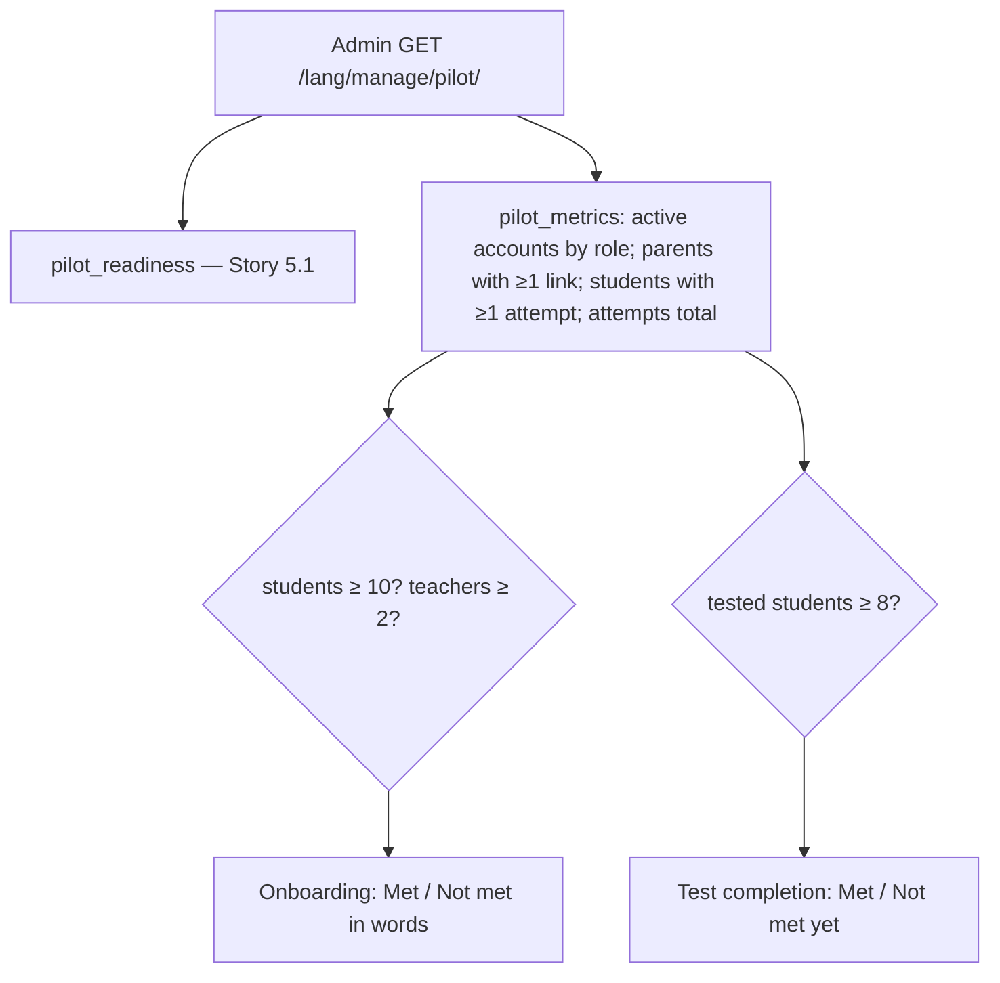

### Story 5.2: Pilot Onboarding & Completion Metrics

**BUILDID**: CYCLE-3 | **GitHub**: LOCAL | **AzureDevOps**: LOCAL | **Epic**: 5 - Pilot Reporting | **ID**: 5.2 | **Date**: 2026-10-19
**File**: `docs/plans/stories/epic-5-story-5.2-Pilot-Onboarding-and-Completion-Metrics.md`
**Build Ref**: `docs/plans/builds/cycle-3/cycle-plan.md` — CYCLE-3 Epic 5 part 2 (`/manage/pilot/` onboarding counts SC-1 and test completion SC-3)
**Wave**: 11
**Requires**: [6.2]
**Enables**: [7.5]
**Files Touched**:
  - src/infrastructure/persistence/reporting/queries.py
  - src/infrastructure/web/reporting/views.py
  - src/infrastructure/web/reporting/messages.py
  - src/infrastructure/web/templates/reporting/**
  - src/infrastructure/i18n/locale/ro/LC_MESSAGES/django.po
  - src/infrastructure/i18n/locale/en/LC_MESSAGES/django.po
  - tests/integration/web/reporting/test_pilot_metrics.py
**Roles Ref**: docs/requirements.md#roles--permissions-matrix — personas this story differentiates: Admin, Teacher, Student, Parent/Guardian
**QA Candidate**: Yes — **Observable:** the Admin's Pilot page gains two sections under "Content readiness" (Story 5.1):
- **"Onboarding" (SC-1):** active Students vs target 10, active Teachers vs target 2, Parents/Guardians with at least one linked child, and Admins
- **"Test completion" (SC-3):** active students who submitted at least one chapter test vs target 8 of 10, plus the number of submitted tests

Each shows met / not met in words. **Mechanism:** `pilot_metrics()` in `persistence/reporting/queries.py` (≤ 3 aggregate queries) → `reporting:pilot` view (Story 5.1, same route and `accounts:manage` guard) renders the new sections with `ui_progress` and status text. Targets are constants from the requirements (`SC1_STUDENTS=10`, `SC1_TEACHERS=2`, `SC3_STUDENTS=8`). **Authz & preconditions:** Admin only (unchanged); aggregate counts only, with no names or personal data. **Edge & idempotency:** zero accounts → 0 / 10 "Not met"; inactive accounts excluded; deleted students drop out; attempts of blocked tests still count (the student did complete a test); repeat loads read-only. **Regression:** SC-1/SC-3 counts match the database; 403 for non-admins; the readiness section (5.1) is unchanged.

---

#### 👤 User Reference

**Description**:
The pilot's success is measured by a few numbers in the requirements:
- **SC-1:** 10 students and 2 teachers onboarded.
- **SC-3:** at least 8 of the 10 students complete a chapter test.

This story adds those numbers to the administrator's Pilot page, next to the content readiness from the previous cycle, so the team can follow the pilot day by day:
- **Onboarding:** how many active student, teacher, parent and administrator accounts exist, with the student and teacher targets and whether they're met.
- **Test completion:** how many students have taken at least one chapter test, against the target of 8, and how many tests were submitted in total.

**Not here:**
- **SC-4** (feedback from every participant) is collected outside the platform, as the architecture notes.
- **Names:** the page shows only totals; individual results are on the Scores page.

**Acceptance Criteria** (plain-English):
- The Pilot page shows active Students, Teachers, linked Parents/Guardians and Administrators, with the targets of 10 students and 2 teachers and whether each is met.
- It shows how many active students have submitted at least one chapter test against the target of 8, and the total number of submitted tests.
- Deactivated accounts aren't counted.
- A test that was blocked after being taken still counts as completed.
- The numbers update as accounts are created and tests are submitted.
- Only administrators can see the page (unchanged); it shows totals only.

**User Flow** (role-differentiated):

### Admin
**Scenario / narrative**: As the pilot Admin on launch day (2026-11-19), I open "Pilot". Content readiness says "Ready (9 of 9)". Onboarding shows "Students 10 / 10 ✓ Met · Teachers 2 / 2 ✓ Met · Parents with linked children 9 · Admins 1". A week later, Test completion shows "6 of 10 students have taken a chapter test (target 8) — Not met yet · 14 tests submitted", so I remind the teachers.
**Steps**:
1. `GET /ro/manage/pilot/` (Story 5.1 view) → `pilot_readiness()` + `pilot_metrics()` → render the three sections.

### Teacher
**Scenario / narrative**: As a Teacher, the Pilot page is an admin tool: "Access denied". I see individual scores on the Scores list.
**Steps**:
1. `GET /ro/manage/pilot/` → 403.

### Student
**Scenario / narrative**: As a Student, I never see the Pilot page: "Access denied".
**Steps**:
1. `GET /ro/manage/pilot/` → 403.

### Parent/Guardian
**Scenario / narrative**: As a Parent, the Pilot page isn't for me: "Access denied".
**Steps**:
1. `GET /ro/manage/pilot/` → 403.

**Flow Diagram**:



---

#### 🤖 AI Agent Reference

**Must Read**:
- `docs/requirements.md` — SC-1, SC-3 (and SC-4 collected outside the app)
- `docs/architecture/design/00-system-architecture-greenfield.md` — Observability "Pilot metrics" (SC-1, SC-2/FC-1, SC-3 on `/manage/pilot/`)
- `docs/plans/stories/epic-5-story-5.1-Pilot-Readiness-Dashboard.md` — the page, view and template being extended
- `docs/plans/stories/epic-6-story-6.2-Assessment-Data-Model.md` — `TestAttemptModel`

**Description**:
1. **Query** `pilot_metrics() -> MetricsDTO` in `persistence/reporting/queries.py`:
   - `students`, `teachers`, `admins`: active accounts per role (one grouped `Count` query)
   - `parents_linked`: distinct active parents with ≥ 1 link
   - `students_tested`: distinct **active** students with ≥ 1 attempt
   - `tests_submitted`: total attempts by active students
   - the `SC1_STUDENTS`, `SC1_TEACHERS`, `SC3_STUDENTS` constants
   - `sc1_met`, `sc3_met` booleans
   - ≤ 3 queries
2. **View** (`web/reporting/views.py`): adds `"metrics": pilot_metrics()` to the existing context.
3. **Template** (`templates/reporting/pilot.html` + new partials `_onboarding.html`, `_completion.html`) and **messages** (`web/reporting/messages.py`: "Met" / "Not met yet" labels).

**Design Tokens** (FE — staff theme, consistent with 5.1):
- Section cards (`ui_card`, padding 24px) titled "Onboarding" and "Test completion" (h2 20px/600).
- Onboarding rows: label · value · `ui_progress done=value total=target` (students, teachers) · status text with icon: met → `check-circle` `#15803D` "Met"; not met → `warning-circle` `#B45309` "Not met yet". Parents and admins: value only.
- Completion: `ui_progress done=students_tested total=SC3_STUDENTS label="Students who took a chapter test"` + "{n} tests submitted" 14px `#4B5563`.
- Never colour alone.

**Acceptance Criteria**:
1. `pilot_metrics()` returns the fields above, counting only `is_active=True` users. `parents_linked` counts distinct parents with ≥ 1 `ParentChildLinkModel`. `students_tested` counts distinct active students with ≥ 1 `TestAttemptModel` (any test state). ≤ 3 queries.
2. `sc1_met = students >= 10 and teachers >= 2`; `sc3_met = students_tested >= 8`. Constants named exactly as above, with a comment citing SC-1/SC-3.
3. The Pilot page (Admin) shows both new sections below "Content readiness", with values, targets and Met / Not met yet text. Story 5.1's section and tests are unchanged.
4. Non-admin access stays 403 (Story 5.1 matrix rows already cover the route).
5. RO/EN translations ("Onboarding", "Students", "Teachers", "Parents/Guardians with linked children", "Administrators", "Test completion", "Students who took a chapter test", "%(n)s tests submitted", "Met", "Not met yet", "Target: %(n)s").

**RBAC Enforcement**:

| Persona | Permission key | Guarded route/endpoint | Allowed | Denied behavior | UI when denied |
|---------|----------------|------------------------|---------|-----------------|----------------|
| Admin | `accounts:manage` | `GET /<lang>/manage/pilot/` | yes (aggregates only) | n/a | — |
| Teacher | — | same | no | 403 | not in menu |
| Student | — | same | no | 403 | not in menu |
| Parent/Guardian | — | same | no | 403 | not in menu |

- **Enforcement point(s):** the existing `@require_permission(ACCOUNTS_MANAGE)` on `reporting:pilot` (Story 5.1).
- **Denied-access contract:** 403 page for roles.
- **Scope derivation:** aggregate counts only; no personal data rendered.

**System responses + error cases**:

| Trigger | Response | Side-effect |
|---------|----------|-------------|
| Admin GET, empty pilot | `200` 0 / 10, 0 / 2 "Not met yet"; 0 / 8 | none |
| Admin GET with 10 students, 2 teachers | SC-1 "Met" | none |
| 8 distinct students with attempts | SC-3 "Met" | none |
| Same student with 3 attempts | counts once in `students_tested`, 3 in `tests_submitted` | none |
| Deactivated student with an attempt | excluded from both counts | none |
| Attempt on a later-blocked test | still counted | none |
| Teacher/Student/Parent GET | `403` | none |
| Repeat GET | identical | none |

**QA-observable behaviour**:
- `students` = `SELECT COUNT(*) FROM accounts_user WHERE role='STUDENT' AND is_active`, and similarly for the other roles.
- `students_tested` = distinct active students in `assessment_test_attempt`.
- The status words switch exactly at the thresholds (9 → "Not met yet", 10 → "Met" for students; 7 → 8 for SC-3).
- **What does NOT change**: no writes; Story 5.1's readiness numbers.

**Prerequisites**:
- Story 6.2 (attempt model) and Story 5.1 merged.

**Context**: `src/infrastructure/persistence/reporting/queries.py`, `src/infrastructure/web/reporting/views.py`, `src/infrastructure/web/templates/reporting/pilot.html`, `src/infrastructure/persistence/accounts/models.py`, `src/infrastructure/persistence/assessment/models.py`

**Patterns**: Query services, bounded aggregates (§6.3), Thin views (§7.1), Primitives (§11.2) — see `docs/architecture/design/01-patterns-and-standards-greenfield.md`

**Steps**:

1. **Tests first** (thresholds, exclusions, query bound, page sections).
2. **Query** (excerpt):
   ```python
   SC1_STUDENTS, SC1_TEACHERS, SC3_STUDENTS = 10, 2, 8  # requirements SC-1 / SC-3 targets


   def pilot_metrics() -> MetricsDTO:
       by_role = dict(UserModel.objects.filter(is_active=True).values_list("role").annotate(n=Count("id")))   # 1
       parents_linked = (ParentChildLinkModel.objects.filter(parent__is_active=True)
                         .values("parent_id").distinct().count())                                            # 2
       attempts = TestAttemptModel.objects.filter(student__is_active=True).aggregate(
           tested=Count("student_id", distinct=True), total=Count("id"))                                     # 3
       students, teachers = by_role.get("STUDENT", 0), by_role.get("TEACHER", 0)
       return MetricsDTO(students, teachers, by_role.get("ADMIN", 0), parents_linked, attempts["tested"],
                         attempts["total"], students >= SC1_STUDENTS and teachers >= SC1_TEACHERS,
                         attempts["tested"] >= SC3_STUDENTS)
   ```
3. **View, templates, messages, translations,** then **all gates**.

**Tests**:

```python
# tests/integration/web/reporting/test_pilot_metrics.py
import pytest

from infrastructure.persistence.content.models import ChapterTestModel
from infrastructure.persistence.reporting.queries import pilot_metrics
from tests.factories.accounts import ParentChildLinkFactory, ParentFactory, StudentFactory, TeacherFactory
from tests.factories.assessment import attempt_for
from tests.factories.content import ChapterFactory, published_test

pytestmark = pytest.mark.django_db


def test_counts_active_accounts_and_linked_parents(django_assert_max_num_queries):
    students = [StudentFactory() for _ in range(3)]
    StudentFactory(is_active=False)
    TeacherFactory()
    parent = ParentFactory()
    ParentChildLinkFactory(parent=parent, student=students[0])
    ParentFactory()  # no link

    with django_assert_max_num_queries(3):
        metrics = pilot_metrics()

    assert (metrics.students, metrics.teachers, metrics.parents_linked) == (3, 1, 1)
    assert metrics.sc1_met is False


def test_sc1_met_at_thresholds():
    for _ in range(10):
        StudentFactory()
    TeacherFactory()
    TeacherFactory()

    assert pilot_metrics().sc1_met is True


def test_students_tested_distinct_and_blocked_tests_count():
    test_a, test_b = published_test(ChapterFactory(number=1)), published_test(ChapterFactory(number=2))
    ana = StudentFactory()
    attempt_for(ana, test_a, set())
    attempt_for(ana, test_b, set())
    attempt_for(StudentFactory(is_active=False), test_a, set())
    ChapterTestModel.objects.filter(pk=test_a.pk).update(moderation_status="BLOCKED")

    metrics = pilot_metrics()

    assert (metrics.students_tested, metrics.tests_submitted) == (1, 2)


def test_page_shows_sections_to_admin_only(admin_client, teacher_client):
    html = admin_client.get("/en/manage/pilot/").content.decode()

    assert "Onboarding" in html and "Test completion" in html and "Not met yet" in html
    assert teacher_client.get("/en/manage/pilot/").status_code == 403
```

Manual: as Admin, create accounts until the targets are reached and watch the status words flip; submit tests as students and see the completion count rise.

**Quality**: ruff 0; mypy passes; tests pass (5.1 tests unchanged); ≤ 3 queries; coverage ≥85%; no `TODO`.

**OUT**:
- ❌ SC-4 feedback collection (outside the app per architecture).
- ❌ Learning-outcome metrics (requirements: none required).
- ❌ Named lists of students (the Scores page covers individuals).

**Evidence**: pytest output, coverage %, and screenshots of the Pilot page with the three sections (RO) before and after reaching a target, all recorded in `docs/stories-implemented/story-5.2-review.md` under "## DoD Evidence".
