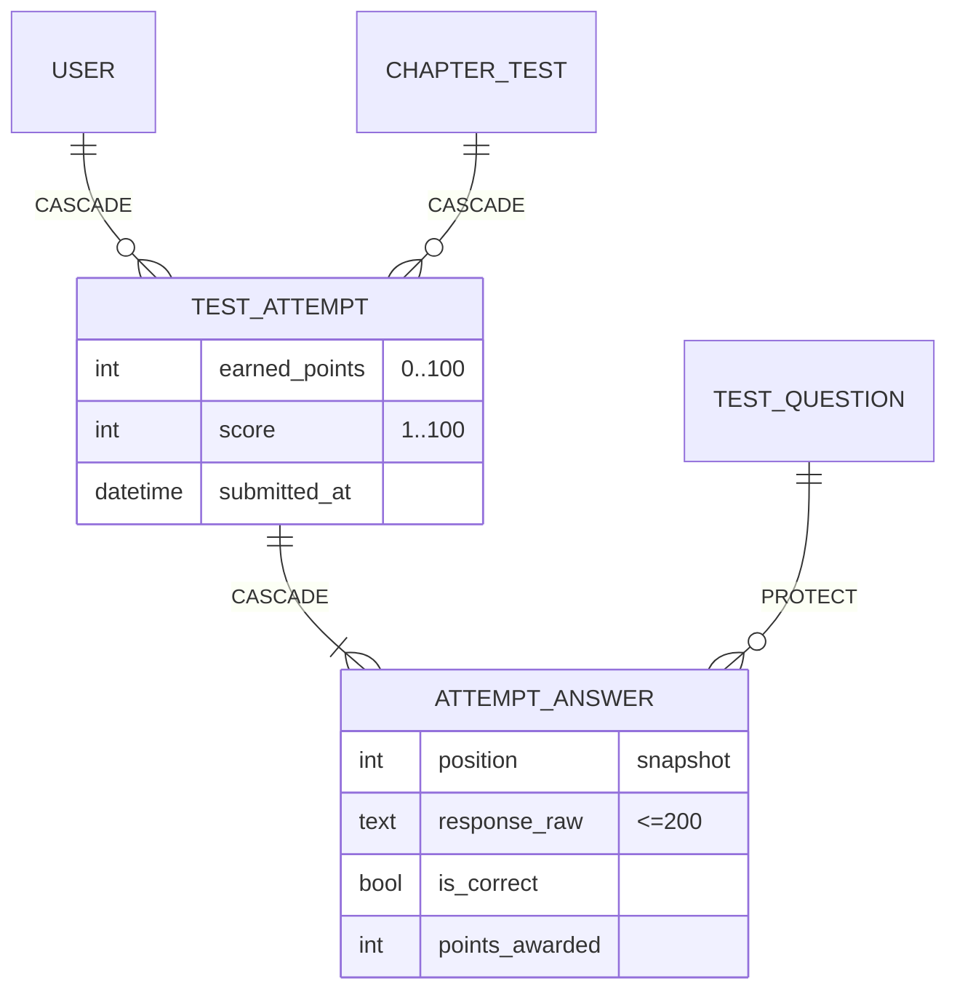

### Story 6.2: Assessment Data Model

**BUILDID**: CYCLE-3 | **GitHub**: LOCAL | **AzureDevOps**: LOCAL | **Epic**: 6 - Chapter Tests & Scoring | **ID**: 6.2 | **Date**: 2026-10-19
**File**: `docs/plans/stories/epic-6-story-6.2-Assessment-Data-Model.md`
**Build Ref**: `docs/plans/builds/cycle-3/cycle-plan.md` — CYCLE-3 (Workshop Day 1: `UNIQUE(student, test)`, attempt answers stored)
**Wave**: 10
**Requires**: [3.9, 4.4]
**Enables**: [5.2, 6.3, 6.5, 7.1]
**Files Touched**:
  - src/infrastructure/persistence/assessment/__init__.py
  - src/infrastructure/persistence/assessment/apps.py
  - src/infrastructure/persistence/assessment/models.py
  - src/infrastructure/persistence/assessment/migrations/**
  - src/config/settings/base.py
  - tests/factories/assessment.py
  - tests/integration/persistence/assessment/test_models.py
**Roles Ref**: docs/requirements.md#roles--permissions-matrix — single-actor — no role variation (schema and integrity only)
**QA Candidate**: No — tables, constraints and factories with no route. The one-attempt rule and score range are proven by DB-level tests here and become user-observable in 6.3/6.4, where QA checks them.

---

#### 👤 User Reference

**Description**:
When a student submits a chapter test, the platform must remember:
- **The result:** the final score and when the test was taken.
- **Each answer:** what the student answered for each question, and whether it was right. This is kept for the record; students only ever see their final score.

This story creates where that is stored. The database itself guarantees the most important promises:
- **One attempt:** a student can have only one attempt per test, even if two submissions arrive at the same moment.
- **Score range:** a stored score is always between 1 and 100.
- **Answers can't break the record:** a question that already has student answers can't be deleted.

**Retention and blocking:**
- In line with the retention rule, deleting a student's account removes their attempts.
- Results stay even if the test is later blocked; the decision is that students and parents keep seeing earned scores.

Nothing changes on screen yet.

**Acceptance Criteria** (plain-English):
- Each submitted test stores the student, the test, the points earned, the final score and the time.
- Each answer stores the question, what was answered, whether it was correct and the points it earned.
- A student can never have two attempts for the same test.
- Scores outside 1–100, or earned points outside 0–100, are impossible to store.
- A question with stored answers can't be deleted; questions without answers can.
- Deleting a student removes their attempts and answers; blocking a test doesn't affect them.

**User Flow**:
Actor: system — no role variation.

**Flow Diagram**:



---

#### 🤖 AI Agent Reference

**Must Read**:
- `docs/architecture/design/00-system-architecture-greenfield.md` — Data Model (`TEST_ATTEMPT`, `ATTEMPT_ANSWER`), Integrity rules (one attempt, score range), account-deletion cascade, decision "scores of a blocked test remain visible"
- `docs/architecture/design/01-patterns-and-standards-greenfield.md` — §6.2 reference `TestAttemptModel` code, §6.4 migrations, §12.3 factories
- `docs/plans/stories/epic-3-story-3.2-Content-Data-Model.md` — `ChapterTestModel`, `TestQuestionModel`

**Description**:
New Django app `infrastructure.persistence.assessment` (label `assessment`):
- **`TestAttemptModel`** (`assessment_test_attempt`) per patterns §6.2: student FK `CASCADE`, test FK → `content.ChapterTestModel` `CASCADE`, `earned_points`, `score`, `submitted_at`. Constraints: `uniq_attempt_per_student_test`, `attempt_score_1_100`, `attempt_earned_0_100`.
- **`AttemptAnswerModel`** (`assessment_attempt_answer`): attempt FK `CASCADE` (`related_name="answers"`), question FK → `content.TestQuestionModel` **`PROTECT`**, `position` snapshot, `response_raw` CharField(200, blank), `is_correct`, `points_awarded` PositiveSmallIntegerField. `UniqueConstraint(attempt, question)`.
- Migration `0001` (depends on `content 0001`); settings `INSTALLED_APPS`; factories.

> **Why `PROTECT` on the question:** Story 3.8's `replace_questions` deletes and recreates questions on save. After an attempt exists, Story 6.5 switches that save to in-place wording updates (scoring lock). `PROTECT` is the database safety net that makes an accidental delete fail loudly instead of silently erasing students' answers.

**Acceptance Criteria**:
1. Models, fields, table names and constraint names exactly as in the Description. `TestAttemptModel.Meta.ordering = ["-submitted_at"]`; index on `(test, submitted_at)`.
2. Second attempt for the same `(student, test)` → `IntegrityError`.
3. `score` 0 or 101, or `earned_points` 101 → `IntegrityError`.
4. Deleting a `TestQuestionModel` referenced by an answer → `ProtectedError`. Deleting one without answers succeeds.
5. Deleting a student cascades attempts and answers. Updating the test's `moderation_status` to BLOCKED leaves attempts untouched.
6. `tests/factories/assessment.py`:
   - `TestAttemptFactory`
   - `AttemptAnswerFactory`
   - helper `attempt_for(student, test, correct_positions: set[int])`, which builds answers for every question of `test`, computes `earned_points` / `score = max(1, earned)` from the questions' points, and returns the attempt
7. `INSTALLED_APPS` gains `"infrastructure.persistence.assessment"`; `makemigrations --check` clean; `migrate assessment zero` round-trips.

**RBAC Enforcement**:
No role-differentiated access — single actor.
- No route. Reads of attempts are scoped by Stories 6.4 and 7.1 (own records, linked children, `scores:view-all`).

**System responses + error cases**:

| Trigger | Response | Side-effect |
|---------|----------|-------------|
| `migrate` | "Applying assessment.0001_initial… OK" | 2 tables |
| `migrate` repeated | "No migrations to apply." | none |
| Insert attempt (valid) | row created | — |
| Insert second attempt same student/test | `IntegrityError` | none |
| Insert `score=0` / `score=101` | `IntegrityError` | none |
| Delete a question with answers | `ProtectedError` | none |
| Delete a question without answers | deleted | — |
| Delete student | — | attempts + answers deleted |
| Block the test (status update) | — | attempts unchanged |

**Prerequisites**:
- CYCLE-2 complete (content models from 3.2; factories `published_test`).

**Context**: `docs/architecture/design/01-patterns-and-standards-greenfield.md`, `src/infrastructure/persistence/content/models.py`, `tests/factories/content.py`

**Patterns**: Models & constraints (§6.2), Migrations (§6.4), Factories (§12.3) — see `docs/architecture/design/01-patterns-and-standards-greenfield.md`

**Steps**:

1. **Tests first** (`tests/integration/persistence/assessment/test_models.py`).
2. **Models:** `TestAttemptModel` exactly as the patterns §6.2 reference, plus:
   ```python
   class AttemptAnswerModel(models.Model):
       attempt = models.ForeignKey(TestAttemptModel, on_delete=models.CASCADE, related_name="answers")
       question = models.ForeignKey("content.TestQuestionModel", on_delete=models.PROTECT, related_name="+")
       position = models.PositiveSmallIntegerField()
       response_raw = models.CharField(max_length=200, blank=True)
       is_correct = models.BooleanField()
       points_awarded = models.PositiveSmallIntegerField()

       class Meta:
           db_table = "assessment_attempt_answer"
           constraints = [models.UniqueConstraint(fields=["attempt", "question"], name="uniq_answer_per_question")]
   ```
3. **App, settings, migration, factories** (`attempt_for` uses each question's `points`), then **all gates**.

**Tests**:

```python
# tests/integration/persistence/assessment/test_models.py
import pytest
from django.db import IntegrityError, transaction
from django.db.models import ProtectedError

from infrastructure.persistence.assessment.models import AttemptAnswerModel, TestAttemptModel
from infrastructure.persistence.content.models import ChapterTestModel
from tests.factories.accounts import StudentFactory
from tests.factories.assessment import TestAttemptFactory, attempt_for
from tests.factories.content import ChapterFactory, published_test

pytestmark = pytest.mark.django_db


@pytest.fixture
def chapter_test():
    return published_test(ChapterFactory())


def test_one_attempt_per_student_and_test(chapter_test):
    student = StudentFactory()
    TestAttemptFactory(student=student, test=chapter_test)

    with pytest.raises(IntegrityError), transaction.atomic():
        TestAttemptFactory(student=student, test=chapter_test)


@pytest.mark.parametrize(("score", "earned"), [(0, 0), (101, 100), (50, 101)])
def test_score_and_earned_ranges(chapter_test, score, earned):
    with pytest.raises(IntegrityError), transaction.atomic():
        TestAttemptFactory(test=chapter_test, score=score, earned_points=earned)


def test_attempt_for_scores_all_wrong_as_one(chapter_test):
    attempt = attempt_for(StudentFactory(), chapter_test, correct_positions=set())

    assert (attempt.earned_points, attempt.score, attempt.answers.count()) == (0, 1, 10)


def test_question_with_answers_is_protected(chapter_test):
    attempt_for(StudentFactory(), chapter_test, correct_positions={1})

    with pytest.raises(ProtectedError):
        chapter_test.questions.get(position=1).delete()


def test_student_deletion_cascades_and_blocking_does_not(chapter_test):
    student = StudentFactory()
    attempt_for(student, chapter_test, correct_positions={1, 2})
    ChapterTestModel.objects.filter(pk=chapter_test.pk).update(moderation_status="BLOCKED")
    assert TestAttemptModel.objects.count() == 1

    student.delete()

    assert TestAttemptModel.objects.count() == 0 and AttemptAnswerModel.objects.count() == 0
```

Manual: `uv run python manage.py migrate`; round-trip `migrate assessment zero` / `migrate`.

**Quality**: ruff 0; mypy passes; `makemigrations --check` clean; tests pass; coverage ≥85%; no `TODO`.

**OUT**:
- ❌ Submission logic and repositories (6.3); test pages (6.4); progress/score queries (7.1).
- ❌ Storing exercise answers (exercises are unscored and not stored — Story 4.1).

**Evidence**: pytest output, migrate + round-trip output, coverage %, all recorded in `docs/stories-implemented/story-6.2-review.md` under "## DoD Evidence".
