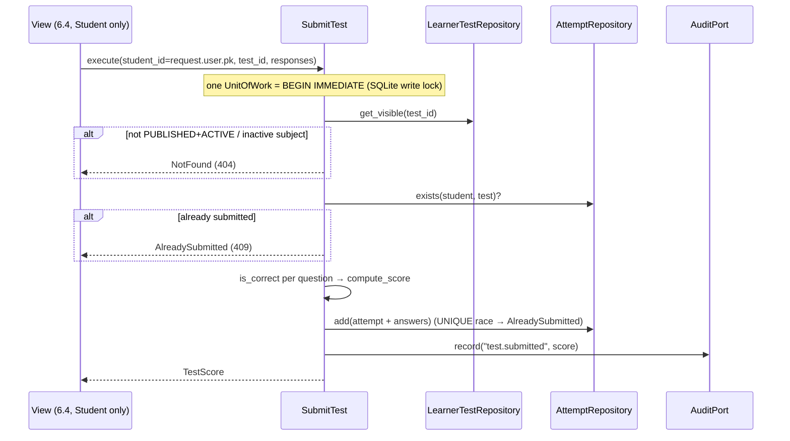

### Story 6.3: Test Submission

**BUILDID**: CYCLE-3 | **GitHub**: LOCAL | **AzureDevOps**: LOCAL | **Epic**: 6 - Chapter Tests & Scoring | **ID**: 6.3 | **Date**: 2026-10-19
**File**: `docs/plans/stories/epic-6-story-6.3-Test-Submission.md`
**Build Ref**: `docs/plans/builds/cycle-3/cycle-plan.md` — CYCLE-3 (Workshop Day 1: submission with a single attempt, incl. a concurrent double-submit test)
**Wave**: 11
**Requires**: [6.1, 6.2]
**Enables**: [6.4]
**Files Touched**:
  - src/application/assessment/submit_test.py
  - src/infrastructure/persistence/assessment/repositories.py
  - src/infrastructure/container.py
  - tests/unit/application/assessment/**
  - tests/integration/persistence/assessment/test_submit_repository.py
**Roles Ref**: docs/requirements.md#roles--permissions-matrix — single-actor — no role variation (use case and repositories; the Student-only routes are Story 6.4)
**QA Candidate**: No — backend use case with no route. Its behaviour (one attempt, score, stored answers, audit) is user-observable through Story 6.4 and its E2E (6.6), where QA checks it. It's proven here by unit and transactional integration tests, including a real concurrent double submit.

---

#### 👤 User Reference

**Description**:
This story is the heart of the test: what happens when a student presses "Submit".

**On submit**, in one indivisible step, the platform:
1. checks that the test is published and visible to students (not flagged or blocked) in a pilot subject
2. checks that the student hasn't already submitted it
3. marks every answer with the rules from Story 6.1
4. calculates the score
5. stores the attempt with every answer
6. writes an entry in the audit log ("test submitted", with the score but never the answers)

**One attempt, guaranteed:** if anything fails, nothing is stored. If two submissions from the same student arrive at the same moment (a double click, or two browser tabs), exactly one is accepted and the other gets "You already submitted this test."

**Answers:**
- Answers to questions that aren't part of the test are ignored.
- Unanswered questions count as wrong.
- Very long answers are shortened for storage.

**Acceptance Criteria** (plain-English):
- Submitting a visible, published test stores exactly one attempt with every question's answer, correctness and points, and returns the score.
- The score follows the rules: sum of correct points, minimum 1, maximum 100.
- A second submission, even at the same moment, is refused as "already submitted" and stores nothing new.
- A test that's a draft, hidden (flagged or blocked) or in a non-pilot subject can't be submitted ("not found").
- Unanswered questions count as wrong; answers to other questions are ignored.
- Each submission adds one audit entry with the score and no answers.
- If anything fails during submission, nothing is saved.

**User Flow**:
Actor: system — no role variation.

**Flow Diagram**:



---

#### 🤖 AI Agent Reference

**Must Read**:
- `docs/architecture/design/00-system-architecture-greenfield.md` — `POST /tests/<id>/submit/` contract (one `BEGIN IMMEDIATE` transaction), ADR-009, Security Design (audit of test submissions)
- `docs/architecture/design/01-patterns-and-standards-greenfield.md` — §5 `SubmitTest` reference code, §6.3 `DjangoAttemptRepository` reference (IntegrityError → `AlreadySubmitted`), §9 (no answers in audit/logs)
- `docs/plans/stories/epic-6-story-6.1-Assessment-Domain-Rules.md` — `is_correct`, `compute_score`, ports, `AlreadySubmitted`
- `docs/plans/stories/epic-6-story-6.2-Assessment-Data-Model.md` — models, `attempt_for`
- `docs/plans/stories/epic-1-story-1.8-Audit-Log.md` — `AuditPort`, `FakeAuditPort`, forbidden metadata keys

**Description**:
1. **`application/assessment/submit_test.py`:** `SubmitTestCommand(student_id, test_id, responses: Mapping[int, str])` and `SubmitTest(tests, attempts, uow, clock, audit).execute(cmd) -> TestScore`, per the patterns §5 reference, with three refinements:
   - only responses for the test's own question ids are considered
   - responses are trimmed and truncated to 200 characters before storage
   - the audit entry is `record("test.submitted", actor_id=student_id, target=("chapter_test", str(test_id)), metadata={"score": score.score})`, with **no answers** (the `DjangoAuditPort` forbidden-key guard backs this up)
2. **`persistence/assessment/repositories.py`:**
   - `DjangoLearnerTestRepository.get_visible(test_id)`: `ChapterTestModel.objects.visible_to_learners().filter(pk=…, chapter__subject__is_active=True)` + questions → `VisibleTest`, or `None`
   - `DjangoAttemptRepository.exists` / `add`: attempt + `bulk_create` answers; `IntegrityError` → `AlreadySubmitted`
3. **Container** `submit_test()` wiring `DjangoUnitOfWork`, `SystemClock`, `DjangoAuditPort`.

**Acceptance Criteria**:
1. Valid submission → exactly one `TestAttemptModel` and one `AttemptAnswerModel` per test question (position snapshot, trimmed response, `is_correct`, `points_awarded` = points if correct else 0). Returns `TestScore`.
2. `score = max(1, Σ points of correct answers)`; all wrong → 1; all right → 100.
3. Existing attempt → `AlreadySubmitted` before any scoring; DB unchanged.
4. Concurrent duplicate submissions (two threads, `transactional_db`) → exactly one attempt; the other raises `AlreadySubmitted` (from `exists` or the `UNIQUE` constraint).
5. Test not visible (DRAFT, FLAGGED, BLOCKED, RESUBMITTED, inactive subject, unknown id) → `NotFound`; nothing written.
6. Missing responses count as incorrect (`response_raw=""`). Responses for ids not in the test are ignored. Responses over 200 chars are stored truncated.
7. One audit row `test.submitted` per successful submission, with `metadata == {"score": N}`. No audit row on any failure (same UoW).
8. Any exception after the attempt insert (e.g. the audit write fails) rolls everything back: no attempt, no answers.
9. Coverage: `application/assessment/submit_test.py` 100%; overall ≥85%.

**RBAC Enforcement**:
No role-differentiated access — single actor.
- No route. Callers (6.4) must guard with `tests:submit` and pass `student_id = request.user.pk`. The use case never reads a student id from the responses mapping, and the repository scopes the attempt to that id.

**System responses + error cases** (use-case contract):

| Trigger | Response | Side-effect |
|---------|----------|-------------|
| Valid submission, 7 of 10 correct (10 pts each) | `TestScore(70, 70)` | 1 attempt, 10 answers, 1 audit row |
| All wrong | `TestScore(0, 1)` | as above |
| Repeat by the same student | `AlreadySubmitted` | none |
| Two concurrent submits | one `TestScore`, one `AlreadySubmitted` | exactly 1 attempt |
| DRAFT / FLAGGED / BLOCKED / inactive subject / unknown test | `NotFound` | none |
| Responses `{}` (nothing answered) | `TestScore(0, 1)` | answers stored with `response_raw=""` |
| Response for a foreign question id | ignored | — |
| Audit write raises | exception propagates | full rollback (no attempt) |

**Prerequisites**:
- Stories 6.1 and 6.2 merged; CYCLE-1 audit (`AuditPort`, `DjangoUnitOfWork` with `transaction_mode=IMMEDIATE`).

**Context**: `docs/architecture/design/01-patterns-and-standards-greenfield.md`, `src/domain/assessment/**`, `src/infrastructure/persistence/assessment/models.py`, `src/infrastructure/persistence/content/models.py`, `src/infrastructure/container.py`

**Patterns**: Use case + UoW (§5), Repository with IntegrityError mapping (§6.3), Audit inside the UoW (§9), Fakes (§12.2), Transactional tests (§12.3) — see `docs/architecture/design/01-patterns-and-standards-greenfield.md`

**Steps**:

1. **Tests first:** unit (fakes) and transactional integration including concurrency.

2. **Use case:**
   ```python
   # src/application/assessment/submit_test.py
   from collections.abc import Mapping
   from dataclasses import dataclass

   from application.common.audit import AuditPort
   from application.common.unit_of_work import UnitOfWork
   from domain.assessment.answer_checker import is_correct
   from domain.assessment.errors import AlreadySubmitted
   from domain.assessment.ports import AttemptRepository, LearnerTestRepository
   from domain.assessment.scoring import QuestionResult, TestScore, compute_score
   from domain.common.clock import Clock
   from domain.common.errors import NotFound

   MAX_RESPONSE_CHARS = 200


   @dataclass(frozen=True)
   class SubmitTestCommand:
       student_id: int  # request.user.pk — never from the form
       test_id: int
       responses: Mapping[int, str]  # question_id -> raw response; missing = incorrect


   class SubmitTest:
       def __init__(self, tests: LearnerTestRepository, attempts: AttemptRepository,
                    uow: UnitOfWork, clock: Clock, audit: AuditPort) -> None:
           self._tests, self._attempts, self._uow = tests, attempts, uow
           self._clock, self._audit = clock, audit

       def execute(self, cmd: SubmitTestCommand) -> TestScore:
           with self._uow:
               test = self._tests.get_visible(cmd.test_id)
               if test is None:
                   raise NotFound("test")
               if self._attempts.exists(cmd.student_id, cmd.test_id):
                   raise AlreadySubmitted()
               responses = {q.id: (cmd.responses.get(q.id) or "").strip()[:MAX_RESPONSE_CHARS] for q in test.questions}
               results = [QuestionResult(q.id, q.points, is_correct(q.kind, q.answer_key, responses[q.id]))
                          for q in test.questions]
               score = compute_score(results)
               self._attempts.add(cmd.student_id, cmd.test_id, results, responses, score, self._clock.now())
               self._audit.record("test.submitted", actor_id=cmd.student_id,
                                  target=("chapter_test", str(cmd.test_id)), metadata={"score": score.score})
           return score
   ```

3. **Repositories** (`persistence/assessment/repositories.py`): `DjangoAttemptRepository.add` per patterns §6.3, extended to store `position` and `response_raw` from `responses`. `DjangoLearnerTestRepository.get_visible` returns `VisibleTest` with `TestQuestionKey`s ordered by position.

4. **Container** factory `submit_test()`. **Run gates.**

**Tests**:

```python
# tests/unit/application/assessment/test_submit_test.py
import pytest

from application.assessment.submit_test import SubmitTest, SubmitTestCommand
from domain.assessment.errors import AlreadySubmitted
from domain.assessment.ports import TestQuestionKey, VisibleTest
from domain.common.errors import NotFound
from domain.content.questions import QuestionKind
from tests.fakes import FakeAuditPort, FakeUnitOfWork, FixedClock

TEST = VisibleTest(7, 1, tuple(TestQuestionKey(100 + p, p, QuestionKind.NUMERIC, {"value": str(p)}, 10)
                                for p in range(1, 11)))


class FakeTests:
    def __init__(self, visible):
        self.visible = visible

    def get_visible(self, test_id):
        return self.visible.get(test_id)


class FakeAttempts:
    def __init__(self):
        self.rows = {}

    def exists(self, student_id, test_id):
        return (student_id, test_id) in self.rows

    def add(self, student_id, test_id, results, responses, score, at):
        if (student_id, test_id) in self.rows:
            raise AlreadySubmitted()
        self.rows[(student_id, test_id)] = (results, dict(responses), score)
        return len(self.rows)


def make(visible=None):
    attempts, audit = FakeAttempts(), FakeAuditPort()
    use_case = SubmitTest(FakeTests(visible if visible is not None else {7: TEST}), attempts,
                          FakeUnitOfWork(), FixedClock(), audit)
    return use_case, attempts, audit


def test_scores_correct_answers_and_audits_score_only():
    use_case, attempts, audit = make()
    responses = {100 + p: f"{p},0" for p in range(1, 8)}  # 7 correct, 3 missing

    score = use_case.execute(SubmitTestCommand(5, 7, responses))

    assert (score.earned_points, score.score) == (70, 70)
    assert audit.records[0]["metadata"] == {"score": 70}
    stored = attempts.rows[(5, 7)][1]
    assert len(stored) == 10 and sorted(stored.values()).count("") == 3


def test_all_wrong_scores_one():
    use_case, _, _ = make()

    assert use_case.execute(SubmitTestCommand(5, 7, {})).score == 1


def test_second_submission_is_rejected_before_scoring():
    use_case, attempts, audit = make()
    use_case.execute(SubmitTestCommand(5, 7, {}))

    with pytest.raises(AlreadySubmitted):
        use_case.execute(SubmitTestCommand(5, 7, {101: "1"}))

    assert len(attempts.rows) == 1 and len(audit.records) == 1


def test_invisible_test_is_not_found():
    use_case, attempts, _ = make(visible={})

    with pytest.raises(NotFound):
        use_case.execute(SubmitTestCommand(5, 7, {}))

    assert attempts.rows == {}


def test_foreign_ids_ignored_and_long_answers_truncated():
    use_case, attempts, _ = make()

    use_case.execute(SubmitTestCommand(5, 7, {999: "x", 101: "9" * 500}))

    stored = attempts.rows[(5, 7)][1]
    assert 999 not in stored and len(stored[101]) == 200
```

```python
# tests/integration/persistence/assessment/test_submit_repository.py
import threading

import pytest
from django.db import connection

from domain.assessment.errors import AlreadySubmitted
from domain.common.errors import NotFound
from infrastructure import container
from infrastructure.persistence.assessment.models import AttemptAnswerModel, TestAttemptModel
from infrastructure.persistence.audit.models import AuditLogModel
from application.assessment.submit_test import SubmitTestCommand
from infrastructure.persistence.content.models import ChapterTestModel
from tests.factories.accounts import StudentFactory
from tests.factories.content import ChapterFactory, published_test

pytestmark = pytest.mark.django_db(transaction=True)


def test_submission_persists_attempt_answers_and_audit():
    student, test = StudentFactory(), published_test(ChapterFactory())
    first = test.questions.get(position=1)

    score = container.submit_test().execute(SubmitTestCommand(student.pk, test.pk, {first.pk: "true"}))

    attempt = TestAttemptModel.objects.get()
    assert (attempt.score, AttemptAnswerModel.objects.count()) == (score.score, 10)
    entry = AuditLogModel.objects.get(action="test.submitted")
    assert entry.metadata == {"score": score.score}


@pytest.mark.parametrize("status", ["FLAGGED", "BLOCKED", "RESUBMITTED"])
def test_hidden_test_cannot_be_submitted(status):
    test = published_test(ChapterFactory())
    ChapterTestModel.objects.filter(pk=test.pk).update(moderation_status=status)

    with pytest.raises(NotFound):
        container.submit_test().execute(SubmitTestCommand(StudentFactory().pk, test.pk, {}))

    assert TestAttemptModel.objects.count() == 0


def test_concurrent_double_submit_creates_one_attempt():
    student, test = StudentFactory(), published_test(ChapterFactory())
    outcomes = []

    def submit():
        try:
            container.submit_test().execute(SubmitTestCommand(student.pk, test.pk, {}))
            outcomes.append("ok")
        except AlreadySubmitted:
            outcomes.append("already")
        finally:
            connection.close()

    threads = [threading.Thread(target=submit) for _ in range(2)]
    for thread in threads:
        thread.start()
    for thread in threads:
        thread.join()

    assert sorted(outcomes) == ["already", "ok"]
    assert TestAttemptModel.objects.count() == 1


def test_audit_failure_rolls_back_attempt(monkeypatch):
    from infrastructure.persistence.audit.repositories import DjangoAuditPort

    def boom(*args, **kwargs):
        raise RuntimeError("audit down")

    monkeypatch.setattr(DjangoAuditPort, "record", boom)
    test = published_test(ChapterFactory())

    with pytest.raises(RuntimeError):
        container.submit_test().execute(SubmitTestCommand(StudentFactory().pk, test.pk, {}))

    assert TestAttemptModel.objects.count() == 0
```

> SQLite + threads: the second thread waits on the `IMMEDIATE` write lock (20 s timeout), then sees the first attempt via `exists` (or hits the UNIQUE constraint). Both paths raise `AlreadySubmitted`. The test uses a file-based test DB (pytest-django default for `transaction=True` with the Story 1.0 settings); in-memory SQLite can't share between threads.

Manual: none (no UI). Run the concurrency test five times to confirm stability; record the timings.

**Quality**: ruff 0; mypy strict for `application.assessment`; tests pass (incl. concurrency ×5); 100% coverage for `submit_test.py`; no answers in audit/logs; no `TODO`.

**OUT**:
- ❌ The test page, confirmation and result screens (6.4).
- ❌ Time limits, resume, multiple attempts (out of scope: one attempt, created at submit — ADR-009).
- ❌ Showing per-question correctness to students (requirements: final score only).

**Evidence**: pytest output (unit + integration, concurrency test 5× green), coverage for `submit_test.py` (100%), and an `audit_log` excerpt showing `test.submitted` with score-only metadata, all recorded in `docs/stories-implemented/story-6.3-review.md` under "## DoD Evidence".
