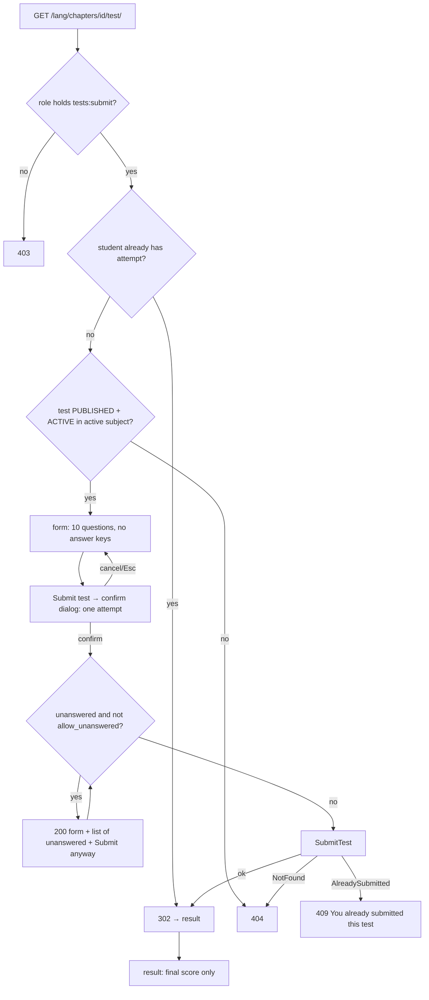

### Story 6.4: Student Test Page & Result

**BUILDID**: CYCLE-3 | **GitHub**: LOCAL | **AzureDevOps**: LOCAL | **Epic**: 6 - Chapter Tests & Scoring | **ID**: 6.4 | **Date**: 2026-10-19
**File**: `docs/plans/stories/epic-6-story-6.4-Student-Test-Page-and-Result.md`
**Build Ref**: `docs/plans/builds/cycle-3/cycle-plan.md` — CYCLE-3 (Workshop Day 1: student test page, confirm dialog for unanswered questions, button spinner, result page with final score only)
**Wave**: 12
**Requires**: [6.3]
**Enables**: [6.6, 7.5]
**Files Touched**:
  - src/infrastructure/persistence/content/queries/test_taking.py
  - src/infrastructure/web/assessment/**
  - src/infrastructure/web/templates/assessment/**
  - src/infrastructure/web/static/css/assessment.css
  - src/infrastructure/web/templates/lessons/lesson.html
  - src/infrastructure/web/lessons/views.py
  - src/infrastructure/web/templatetags/ui.py
  - src/infrastructure/web/templates/components/confirm_dialog.html
  - src/infrastructure/web/common/errors.py
  - src/config/urls.py
  - src/infrastructure/i18n/locale/ro/LC_MESSAGES/django.po
  - src/infrastructure/i18n/locale/en/LC_MESSAGES/django.po
  - tests/integration/web/test_role_access_matrix.py
  - docs/architecture/design/00-system-architecture-greenfield.md
  - tests/integration/web/assessment/**
**Roles Ref**: docs/requirements.md#roles--permissions-matrix — personas this story differentiates: Student, Teacher, Parent/Guardian, Admin
**QA Candidate**: Yes — **Observable:**
- A Student finds "Take the chapter test" on the lesson page and opens the 10-question test (inputs per type, no answers in the page).
- "Submit test" opens a confirmation ("You can submit only once").
- If questions are unanswered, the page lists them with "Submit anyway" before anything is stored.
- After submitting, the student lands on a result page showing only the final score (1–100).
- Revisiting the test shows the result instead of the form; a second submission is refused ("You already submitted this test.").

**Mechanism:**
- `GET /<lang>/chapters/<id>/test/` (`assessment:test`, `tests:submit`) → `test_for_student(chapter_id)` (PUBLISHED + ACTIVE, active subject, **no answer keys**); 302 to the result if the student already has an attempt.
- `POST /<lang>/tests/<test_id>/submit/` (`assessment:submit`, `tests:submit`) → unanswered check (`allow_unanswered`) → `SubmitTest` (Story 6.3) → 302 to `GET /<lang>/tests/<test_id>/result/` (`assessment:result`, `scores:view-own`), which reads **the student's own attempt only**.
- `AlreadySubmitted` → 409 via `DomainErrorMiddleware` with the registered message.
- The shared confirm dialog gains a `form_id` option so the confirmation submits the answer form itself.

**Authz & preconditions:** Student only for test and submit (`tests:submit`), own result only (`scores:view-own`); test PUBLISHED + ACTIVE for taking; the result stays readable even if the test is later blocked (user decision). **Edge & idempotency:**
- Reloading the result page is harmless.
- Back-button resubmission → 409.
- A test hidden between load and submit → 404.
- Forged question ids are ignored.
- Another student's result URL → 404 (IDOR).
- An unanswered-confirm round trip never stores an attempt until confirmed.

**Regression:** one attempt, score bounds, no per-question correctness shown, answer keys absent from HTML, 403 for non-students, blocked-test score visibility, keyboard-operable confirm dialog.

---

#### 👤 User Reference

**Description**:
After practising, students take each chapter's test.
- **Finding it:** the lesson page shows a "Take the chapter test" button once the teacher has published the test.
- **Taking it:** the test shows its 10 questions in the student's language, each answered the same way as exercises (options, true/false, or a number). The correct answers aren't hidden in the page.

**Submitting:**
- Students get **one attempt**, so pressing "Submit test" first asks for confirmation.
- If they skipped questions, the platform points them out ("Questions 3 and 7 have no answer") and lets them go back or submit anyway. Unanswered questions count as wrong.
- After submitting, the student sees only their **final score**, for example "87 / 100", with no list of which answers were right or wrong (as the requirements say).

**Afterwards:**
- Coming back to the test later shows the score again, not the questions.
- Trying to submit again (for example with the browser's Back button) is refused.
- If an administrator later blocks the test, its questions disappear for students, but a student who already took it still sees their score.

Teachers, parents and administrators don't take tests; these pages answer "Access denied" for them.

**Acceptance Criteria** (plain-English):
- The lesson page shows "Take the chapter test" when a published test is available, or "See your result" once the student has taken it.
- The test page shows the 10 questions in the current language with the right input for each type; correct answers aren't present in the page.
- "Submit test" asks for confirmation that there is only one attempt.
- If any questions are unanswered, the student sees which ones and can go back or submit anyway; nothing is saved until they confirm.
- After submitting, the student sees only their final score (1–100).
- Reopening the test shows the result instead of the questions; a second submission is refused with "You already submitted this test."
- A student can only ever see their own result; other students' result addresses show "Page not found".
- A test that's a draft or hidden can't be opened or submitted; a score already earned stays visible.
- Teachers, parents and administrators get "Access denied".

**User Flow** (role-differentiated):

### Student
**Scenario / narrative**: As a grade-2 Student, I finish the lesson and see "Take the chapter test". The test page shows 10 questions. I answer eight and press "Submit test". A box says "You can submit this test only once. Submit now?" I confirm, and the page says "Questions 4 and 9 have no answer" with "Go back" and "Submit anyway". I go back, answer them, submit and confirm. The page shows "Your score: 87 / 100 — this was your only attempt." The next day I open the test from the lesson page and see "See your result", which shows the same score.
**Steps**:
1. `GET /ro/chapters/<cid>/lesson/` → the lesson view computes `test_link` (`assessment:result` if attempted, `assessment:test` if a visible test exists, else none).
2. `GET /ro/chapters/<cid>/test/` → `@require_permission(TESTS_SUBMIT)` → `student_attempt_test_id(student, cid)` → 302 result if present → else `test_for_student(cid)` (`NotFound` if not visible) → form `id="test-form"` with `q_<question_id>` inputs.
3. "Submit test" → `ui_dialog_trigger` → dialog confirm button `form="test-form" name="confirmed" value="1"` → POST `/ro/tests/<tid>/submit/`.
4. Server: unanswered positions computed from the posted `q_*` values; if any and `allow_unanswered != "1"` → 200 re-render with answers kept and an alert listing them, plus "Submit anyway" (posts `allow_unanswered=1`) and "Go back" (anchor to the first unanswered question).
5. Otherwise `container.submit_test().execute(SubmitTestCommand(request.user.pk, tid, responses))` → 302 `/ro/tests/<tid>/result/` → `own_result(student, tid)` → `ui_score`.

### Teacher
**Scenario / narrative**: As a Teacher, I configure tests in the editor (Story 3.8) and see results on the Scores list (Story 7.4). Student test pages answer "Access denied".
**Steps**:
1. `GET /ro/chapters/<cid>/test/` → lacks `tests:submit` → 403; result URLs → lacks `scores:view-own` → 403.

### Parent/Guardian
**Scenario / narrative**: As a Parent, I see my child's scores on the children pages (Story 7.3); I can't take or view tests here: "Access denied".
**Steps**:
1. All three routes → 403.

### Admin
**Scenario / narrative**: As the Admin, I see all scores on the Scores list; the student test pages are denied to me.
**Steps**:
1. All three routes → 403.

**Flow Diagram**:



---

#### 🤖 AI Agent Reference

**Must Read**:
- `docs/requirements.md` — Feature "Chapter tests" (one attempt; no per-question score; final score after submission)
- `docs/architecture/design/00-system-architecture-greenfield.md` — routes `/chapters/<id>/test/`, `POST /tests/<id>/submit/` (contract: `q_<question_id>`, confirm when unanswered, 302 → result, 404/409/400), `/tests/<id>/result/`
- `docs/ui-ux/ui-ux-spec.md` — `confirm: [test_submit]`, `loading: button_spinner_disable`, student theme
- `docs/plans/stories/epic-6-story-6.3-Test-Submission.md` — `SubmitTest`, `AlreadySubmitted`
- `docs/plans/stories/epic-1-story-1.6-Molecule-Primitives.md` — `ui_confirm_dialog`, `ui_dialog_trigger`, `ui.js`
- `docs/plans/stories/epic-4-story-4.2-Chapter-List-and-Lesson-Reading.md` — lesson page/view being extended
- `docs/plans/stories/epic-4-story-4.3-Exercise-Practice.md` — answer input markup (reuse the same per-kind input partial pattern)

**Description**:
1. **Query** `persistence/content/queries/test_taking.py` (all reads; no answer keys ever loaded into page DTOs):
   - `test_for_student(chapter_id) -> TestPageDTO`: test id, chapter header names, `questions` (id, number, kind, prompts, options). Uses `ChapterTestModel.objects.visible_to_learners()` + active subject, `.only(...)` excluding `answer_key`.
   - `test_available(chapter_id) -> bool`
   - `student_attempt_test_id(student_id, chapter_id) -> int | None`
   - `own_result(student_id, test_id) -> ResultDTO`: score, `submitted_at`, chapter/subject names; `NotFound` if this student has no attempt. **No visibility filter** (a blocked test's score stays visible).
2. **Web** `web/assessment/` (`app_name = "assessment"`, included at `""` in `i18n_patterns`): `views.py` (`take_test`, `submit_test`, `result`), `forms.py` (`parse_test_responses(post, question_ids)` keeps only `q_<id>` for this test's ids).
3. **Templates:** `assessment/test.html` (`<form id="test-form">`, question sections, unanswered alert), `_question.html` (per-kind inputs, as in Story 4.3), `result.html`.
4. **Shared dialog enhancement** (`templatetags/ui.py`, `components/confirm_dialog.html`): `ui_confirm_dialog(..., form_id=None)`. When `form_id` is set, the dialog renders **no** inner form, and its confirm button is `ui_button(..., form=form_id, name="confirmed", value="1")`. `ui_button` gains an optional `form` parameter (emits `form="…"`). Existing callers are unchanged.
5. **Lesson page:** `lessons/views.py` adds `test_link` (`(label, url)` or `None`) and `lessons/lesson.html` renders it as a secondary button next to "Practise".
6. **Errors:** `web/common/errors.py` registers `ERROR_MESSAGES["test_already_submitted"] = _("You already submitted this test.")`.

**Design Tokens** (FE — student theme):
- Page bg `#FFF8EC`, max 960px; `ui_page_header` breadcrumb Catalogue › {grade} › {subject} › Chapter {n} › Test; intro `ui_alert "info"` "You can submit this test only once. Answer all 10 questions."
- Question sections: `ui_card` (radius 16px, padding 32px), heading "Question {n}" 20px/600; inputs exactly as Story 4.3 (44px tiles; numeric `inputmode="decimal"`).
- Unanswered alert: `ui_alert "warning"` (`#B45309` on `#FEF3C7`) "Questions {list} have no answer." with buttons "Go back" (secondary, link to `#question-{first}`) and "Submit anyway" (primary, `name="allow_unanswered" value="1"`, plus `confirmed=1`).
- Submit: `ui_dialog_trigger` primary "Submit test" (icon `exam` duotone, min-height 44px); dialog title "Submit your test?", body "You can submit this test only once.", confirm "Submit" (primary, a normal POST of `#test-form`).
- Result: `ui_page_header` "Chapter {n} test"; `ui_score value=score` (40px number), text "This was your only attempt." 18px `#4B5563`; links "Back to the subject" and "My progress" (if `progress:me` resolves).
- 409 page: Story 1.1 template with the registered message.

**Acceptance Criteria**:
1. Routes:
   - `"chapters/<int:chapter_id>/test/"` → `take_test` (`assessment:test`), GET, `TESTS_SUBMIT`
   - `"tests/<int:test_id>/submit/"` → `submit_test` (`assessment:submit`), POST, `TESTS_SUBMIT`
   - `"tests/<int:test_id>/result/"` → `result` (`assessment:result`), GET, `SCORES_VIEW_OWN`
2. `take_test`: an existing attempt → 302 result. A visible test → 200 with 10 question sections in position order: each a `<section id="question-{n}" aria-labelledby="question-{n}-title">` whose heading reads "Question {n}" (anchor target for "Go back", and the accessible name used by Story 6.6), inputs named `q_<question_id>`. Otherwise 404. The HTML contains **no** answer keys (`option_id` of correct answers, numeric key values) and no `data-correct`.
3. `submit_test`:
   - parse only `q_<id>` for this test's question ids (missing ids allowed)
   - if `confirmed != "1"` → 400 (the confirmation dialog is required)
   - if unanswered and `allow_unanswered != "1"` → 200 re-render with the posted answers kept and the unanswered list (positions); nothing stored
   - else `SubmitTest` → 302 `assessment:result`
   - `AlreadySubmitted` → 409 with "You already submitted this test."
   - `NotFound` → 404
4. `result`: 200 with `ui_score` for **request.user's** attempt on that test, the chapter title and "This was your only attempt." No per-question data at all. No own attempt → 404 (covers other students' tests: IDOR). A test BLOCKED after the attempt → still 200 with the score.
5. Lesson page: `test_link` = "See your result" → result if attempted; else "Take the chapter test" → test if `test_available`; else none.
6. `ui_confirm_dialog(form_id=...)` renders a dialog without a `<form>`; its confirm `<button type="submit" form="test-form" name="confirmed" value="1">`. The existing behaviour without `form_id` is unchanged (Story 1.6 tests stay green).
7. `ui_button(..., form=None)`: when given, it emits `form="…"`. It still accepts only `hx_*` extra kwargs (Story 1.5 rule).
8. Double-submit protection: **no extra JavaScript is added** (`ui.js` isn't in this story's files). The guarantee is server-side: Story 6.3's single attempt (`exists` check + UNIQUE constraint) turns a double click into a 409 "You already submitted this test." while the first submission's redirect shows the score.
9. Role-access matrix: dynamic ids, so access is asserted in this story's tests (Student 200/302, Teacher/Parent/Admin 403, anonymous 302).
10. Route catalogue updated; RO/EN translations ("Take the chapter test", "See your result", "Submit test", "Submit your test?", "You can submit this test only once.", "Questions %(list)s have no answer.", "Go back", "Submit anyway", "Your score", "This was your only attempt.", "You already submitted this test.").

**RBAC Enforcement**:

| Persona | Permission key | Guarded route/endpoint | Allowed | Denied behavior | UI when denied |
|---------|----------------|------------------------|---------|-----------------|----------------|
| Student | `tests:submit` | `GET /<lang>/chapters/<id>/test/`, `POST /<lang>/tests/<id>/submit/` | visible tests, one attempt | not visible → 404; repeat → 409 | lesson page shows the right link |
| Student | `scores:view-own` | `GET /<lang>/tests/<id>/result/` | own attempt only | no own attempt → 404 | — |
| Teacher | — | all three | no | 403 | no links in teacher UI |
| Parent/Guardian | — | all three | no | 403 | — |
| Admin | — | all three | no | 403 | — |
| Anonymous | — | all three | no | 302 login | sign-in |

- **Enforcement point(s):** `@require_permission` in `web/assessment/views.py`; visibility in `test_for_student`; ownership in `own_result` (`filter(student_id=request.user.pk, test_id=…)`).
- **Denied-access contract:** 403 for roles; 404 for hidden tests and for results that aren't the viewer's own (indistinguishable from non-existent).
- **Scope derivation:** `student_id` is always `request.user.pk`; the URL's `test_id` is only the subject; posted fields can't name a student.

**System responses + error cases**:

| Trigger | Response | Side-effect |
|---------|----------|-------------|
| Student GET test (no attempt, visible) | `200` form, no answer keys | none |
| Student GET test (already attempted) | `302` → result | none |
| GET test DRAFT / BLOCKED / inactive subject | `404` | none |
| POST submit without `confirmed=1` | `400` | none |
| POST submit with 2 unanswered, no `allow_unanswered` | `200` form + "Questions 4, 9 have no answer." | none |
| POST submit all answered (or `allow_unanswered=1`) | `302` → result | attempt + answers + audit (6.3) |
| POST submit again (back button) | `409` "You already submitted this test." | none |
| POST submit after the test was blocked | `404` | none |
| POST with forged `q_99999` | ignored | — |
| GET result (own) | `200` score only | none |
| GET result of a test the student never took (another student's attempt exists) | `404` | none |
| GET result after the test was blocked | `200` score | none |
| Teacher/Parent/Admin any route | `403` | none |
| POST without CSRF | `403` | none |

**QA-observable behaviour**:
- View-source of the test page contains none of the test's correct option ids marked as such, nor numeric key values.
- After submitting, `assessment_test_attempt` has exactly one row for (student, test). The result page shows the same score and nothing about individual questions.
- A back-button resubmission leaves the row count at 1 and shows the 409 message.
- After the admin blocks the test, the student's result page still shows the score, while the test page returns 404 for students who haven't taken it.
- The lesson page link switches from "Take the chapter test" to "See your result" after submitting.
- **What does NOT change**: no content or other students' attempts; no per-question correctness is ever rendered; the unanswered round trip stores nothing.

**Prerequisites**:
- Story 6.3 merged (and 6.1/6.2); CYCLE-2 lesson page (4.2) and practice markup (4.3); Story 1.6 dialog primitives.

**Context**: `docs/architecture/design/00-system-architecture-greenfield.md`, `docs/architecture/design/01-patterns-and-standards-greenfield.md`, `src/application/assessment/submit_test.py`, `src/infrastructure/web/templatetags/ui.py`, `src/infrastructure/web/templates/components/confirm_dialog.html`, `src/infrastructure/web/lessons/views.py`, `src/infrastructure/web/templates/practice/_exercise_card.html`

**Patterns**: Query services without secrets (§6.3), Thin views + decorators (§7.1–7.2), Responses 302/400/404/409 (§7.5), Error registry (§8), Primitives (§11.2) — see `docs/architecture/design/01-patterns-and-standards-greenfield.md`

**Steps**:

1. **Tests first** (views per System-responses row; dialog `form_id` rendering; lesson link states).

2. **Views** (excerpt):
   ```python
   # src/infrastructure/web/assessment/views.py
   @require_safe
   @require_permission(Permission.TESTS_SUBMIT)
   def take_test(request, chapter_id: int):
       """GET /<lang>/chapters/<id>/test/ — tests:submit; one attempt, then the result."""
       if (attempted := student_attempt_test_id(request.user.pk, chapter_id)) is not None:
           return redirect("assessment:result", test_id=attempted)
       return render(request, "assessment/test.html", {"page": test_for_student(chapter_id), "answers": {}})


   @require_POST
   @require_permission(Permission.TESTS_SUBMIT)
   def submit_test(request, test_id: int):
       """POST /<lang>/tests/<id>/submit/ — confirm required; unanswered round trip stores nothing."""
       if request.POST.get("confirmed") != "1":
           return HttpResponseBadRequest()
       page = test_page_by_test_id(test_id)  # NotFound → 404 (visibility re-checked)
       responses = parse_test_responses(request.POST, [q.id for q in page.questions])
       unanswered = [q.number for q in page.questions if not responses.get(q.id)]
       if unanswered and request.POST.get("allow_unanswered") != "1":
           return render(request, "assessment/test.html",
                         {"page": page, "answers": responses, "unanswered": unanswered})
       container.submit_test().execute(SubmitTestCommand(request.user.pk, test_id, responses))
       return redirect("assessment:result", test_id=test_id)
   ```
   > `test_page_by_test_id` is the `test_id`-keyed sibling of `test_for_student` in `test_taking.py`. Both share one private loader.

3. **Dialog enhancement** (`ui.py` and `confirm_dialog.html`):
   ```django
   {# components/confirm_dialog.html — form_id variant #}
   <dialog id="{{ dialog_id }}" class="dialog" aria-labelledby="{{ dialog_id }}-title" aria-describedby="{{ dialog_id }}-body">
     
       <div class="dialog__form">
         <h2 id="{{ dialog_id }}-title">{{ title }}</h2>
         <p id="{{ dialog_id }}-body">{{ body }}</p>
         <div class="dialog__actions">
           <button type="button" class="button button--secondary" data-dialog-close></button>
           
         </div>
       </div>
     
       {# existing form-based markup from Story 1.6, unchanged #}
     
   </dialog>
   ```
   In `ui_button`, add `form: str | None = None` to the signature and the template (`form="{{ form }}"`). Keep the `hx_*` guard.

4. **Lesson link** (`lessons/views.py` adds `test_link`), **errors registry**, **query module**, **templates/CSS**, **URLs** (include `web/assessment/urls.py`), **route catalogue**, **translations**, then **all gates**.

**Tests**:

```python
# tests/integration/web/assessment/test_taking_tests.py
import pytest

from infrastructure.persistence.assessment.models import TestAttemptModel
from infrastructure.persistence.content.models import ChapterTestModel
from tests.factories.accounts import StudentFactory
from tests.factories.assessment import attempt_for
from tests.factories.content import ChapterFactory, LessonFactory, published_test

pytestmark = pytest.mark.django_db


@pytest.fixture
def chapter_test():
    chapter = ChapterFactory()
    LessonFactory(chapter=chapter)
    return published_test(chapter)


def answers(test, value="true"):
    return {f"q_{q.pk}": value for q in test.questions.all()}


def test_page_has_no_answer_keys(student_client, chapter_test):
    html = student_client.get(f"/en/chapters/{chapter_test.chapter_id}/test/").content.decode()

    assert html.count('name="q_') >= 10 and "data-correct" not in html and "answer_key" not in html


def test_submit_requires_confirmation(student_client, chapter_test):
    assert student_client.post(f"/en/tests/{chapter_test.pk}/submit/", answers(chapter_test)).status_code == 400


def test_unanswered_round_trip_stores_nothing(student_client, chapter_test):
    data = answers(chapter_test) | {"confirmed": "1"}
    first_two = list(data)[:2]
    for key in first_two:
        data[key] = ""

    response = student_client.post(f"/en/tests/{chapter_test.pk}/submit/", data)

    assert response.status_code == 200 and "have no answer" in response.content.decode()
    assert TestAttemptModel.objects.count() == 0


def test_submit_then_result_then_resubmit_conflict(student_client, student, chapter_test):
    data = answers(chapter_test) | {"confirmed": "1"}

    response = student_client.post(f"/en/tests/{chapter_test.pk}/submit/", data)
    assert response.status_code == 302 and response["Location"] == f"/en/tests/{chapter_test.pk}/result/"

    result = student_client.get(response["Location"]).content.decode()
    assert "100" in result and "only attempt" in result and "Question" not in result

    again = student_client.post(f"/en/tests/{chapter_test.pk}/submit/", data)
    assert again.status_code == 409 and "You already submitted this test." in again.content.decode()
    assert TestAttemptModel.objects.filter(student=student).count() == 1
    assert student_client.get(f"/en/chapters/{chapter_test.chapter_id}/test/")["Location"].endswith("/result/")


def test_result_is_own_only_and_survives_blocking(student_client, student, chapter_test):
    attempt_for(StudentFactory(), chapter_test, correct_positions={1})
    assert student_client.get(f"/en/tests/{chapter_test.pk}/result/").status_code == 404  # IDOR

    attempt_for(student, chapter_test, correct_positions={1, 2, 3})
    ChapterTestModel.objects.filter(pk=chapter_test.pk).update(moderation_status="BLOCKED")

    response = student_client.get(f"/en/tests/{chapter_test.pk}/result/")
    assert response.status_code == 200 and "30" in response.content.decode()


@pytest.mark.parametrize("status", ["DRAFT", "BLOCKED"])
def test_hidden_test_is_404(student_client, chapter_test, status):
    field = "status" if status == "DRAFT" else "moderation_status"
    ChapterTestModel.objects.filter(pk=chapter_test.pk).update(**{field: status})

    assert student_client.get(f"/en/chapters/{chapter_test.chapter_id}/test/").status_code == 404
    assert student_client.post(f"/en/tests/{chapter_test.pk}/submit/",
                               answers(chapter_test) | {"confirmed": "1"}).status_code == 404


def test_lesson_page_link_switches_after_submitting(student_client, student, chapter_test):
    lesson_url = f"/en/chapters/{chapter_test.chapter_id}/lesson/"
    assert "Take the chapter test" in student_client.get(lesson_url).content.decode()

    attempt_for(student, chapter_test, correct_positions=set())

    assert "See your result" in student_client.get(lesson_url).content.decode()


@pytest.mark.parametrize("fixture", ["teacher_client", "parent_client", "admin_client"])
def test_non_students_are_denied(request, fixture, chapter_test):
    client = request.getfixturevalue(fixture)

    assert client.get(f"/ro/chapters/{chapter_test.chapter_id}/test/").status_code == 403
    assert client.post(f"/ro/tests/{chapter_test.pk}/submit/", {"confirmed": "1"}).status_code == 403
    assert client.get(f"/ro/tests/{chapter_test.pk}/result/").status_code == 403
```

```python
# tests/integration/web/assessment/test_confirm_dialog_form_id.py
from django.template import Context, Template


def test_dialog_with_form_id_has_no_inner_form_and_targets_the_page_form():
    html = Template('') \
        .render(Context({}))

    assert "<form" not in html
    assert 'form="test-form"' in html and 'name="confirmed"' in html and 'value="1"' in html
```

Manual:
- As Student (RO): take a test with two questions skipped; see the unanswered list; go back and answer; submit via the dialog using the keyboard; see the score; press Back and resubmit (409); reopen from the lesson page ("See your result").
- As Admin, block the test in the DB; the student's result still shows; another student gets 404 on the test page.
- As Teacher, Parent and Admin: all three routes give 403.

**Quality**: ruff 0; mypy passes; tests pass (incl. Story 1.6's dialog tests unchanged); coverage ≥85%; no answer keys in HTML; no inline `style`/`script`; no `TODO`.

**OUT**:
- ❌ Per-question feedback, review of answers, or correct answers after the test (requirements: final score only).
- ❌ Timers, saving drafts of answers, multiple attempts (out of scope).
- ❌ Progress and score lists (Epic 7).
- ❌ Teacher/Admin "preview as student" (not required).

**Evidence**: pytest output, coverage %, screenshots of the test page, the confirmation dialog, the unanswered alert, the result page (RO), and the 409 on resubmission, plus a view-source excerpt without answer data, all recorded in `docs/stories-implemented/story-6.4-review.md` under "## DoD Evidence".
