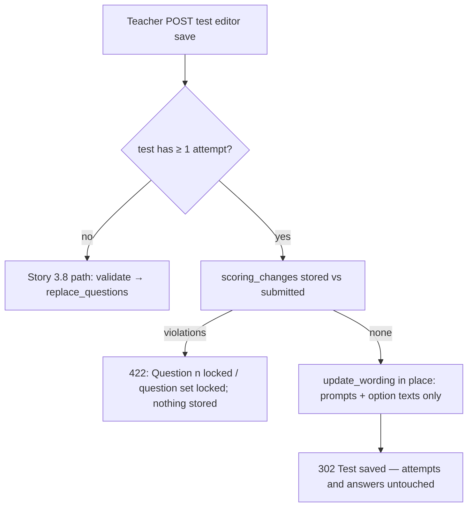

### Story 6.5: Scoring Lock in the Test Editor

**BUILDID**: CYCLE-3 | **GitHub**: LOCAL | **AzureDevOps**: LOCAL | **Epic**: 6 - Chapter Tests & Scoring | **ID**: 6.5 | **Date**: 2026-10-19
**File**: `docs/plans/stories/epic-6-story-6.5-Scoring-Lock-in-Test-Editor.md`
**Build Ref**: `docs/plans/builds/cycle-3/cycle-plan.md` — CYCLE-3 (Workshop Day 1: `ScoringLockPolicy` — after the first attempt, answer keys, points, kinds and the question set are frozen; wording and typo fixes still allowed)
**Wave**: 11
**Requires**: [6.1, 6.2]
**Enables**: [6.6]
**Files Touched**:
  - src/domain/content/ports.py
  - src/application/content/save_chapter_test.py
  - src/infrastructure/persistence/content/repositories/chapter_tests.py
  - src/infrastructure/web/content/forms/question.py
  - src/infrastructure/web/templates/content/chapter_test/**
  - src/infrastructure/i18n/locale/ro/LC_MESSAGES/django.po
  - src/infrastructure/i18n/locale/en/LC_MESSAGES/django.po
  - tests/unit/application/content/test_save_chapter_test.py
  - tests/integration/web/content/chapter_test/test_scoring_lock.py
**Roles Ref**: docs/requirements.md#roles--permissions-matrix — personas this story differentiates: Teacher, Student, Parent/Guardian, Admin
**QA Candidate**: Yes — **Observable:** once any student has submitted a chapter test, its editor shows a lock banner. Points, answer inputs and question types are read-only, and adding or clearing a question is refused. Saving wording or option-text corrections still works and keeps every student's stored answers and score. **Mechanism:**
- `ChapterTestRepository` gains `has_attempts(test_id)` and `update_wording(test_id, questions, actor_id, at)`.
- `SaveChapterTest` checks `has_attempts`. If true, it compares stored and submitted drafts with `scoring_changes` (Story 6.1) and either refuses with `PolicyViolation` or calls `update_wording`, which updates prompt and option **texts in place** (same question rows, so `AttemptAnswerModel`'s `PROTECT` FK is never triggered).
- Without attempts, the Story 3.8 behaviour (`replace_questions`) is unchanged.
- The editor template reads `locked` from the editor DTO to render read-only controls with hidden mirrors of stored values.

**Authz & preconditions:** `tests:configure` (Teacher only, unchanged); lock applies when ≥ 1 attempt exists. **Edge & idempotency:**
- Re-saving identical content on a locked test is accepted (no scoring change).
- A forged POST changing points on a locked test → 422, nothing stored.
- Publishing is unaffected (already published).
- Lock state is derived live from attempts (no flag to get out of sync).

**Regression:** students' scores and stored answers never change after editing; wording fixes still possible; 3.8's unlocked behaviour unchanged.

---

#### 👤 User Reference

**Description**:
Once students start taking a chapter test, its marking must stay exactly as it was. Otherwise two students giving the same answers could get different scores.

**After the first student submits**, the test editor:
- **shows a clear message:** "Students have taken this test. You can still correct wording, but answers, points and question types are locked."
- **shows the correct answers, points and question types as read-only**
- **refuses to add or remove questions**

**Still allowed:** teachers can fix typos in the questions and answer options in both languages, which students taking the test afterwards will see.

**Students' records:** they're never touched; their stored answers and scores stay exactly as they were. Before any student has taken the test, the editor works exactly as before.

**Acceptance Criteria** (plain-English):
- Before anyone takes a test, editing works as in Story 3.8.
- After the first submission, the editor shows the lock message.
- Correct answers, points and question types appear read-only; changing them (even by tampering with the page) is refused with a message per question.
- Adding or removing questions is refused after the first submission.
- Wording and option-text corrections save normally in both languages.
- Saving a correction never changes any student's stored answers or score.
- Only teachers can edit tests (unchanged).

**User Flow** (role-differentiated):

### Teacher
**Scenario / narrative**: As a Teacher, on 2026-11-10 I notice a typo in question 6 of MEM chapter 1's test, which three students have already taken. I open the test editor and see the lock banner; points and answers are greyed out. I fix "adunare" → "adunarea" in Romanian, save, and get "Test saved." When I try to change question 2's points (by editing the page in dev tools), the save is refused: "Question 2: answers, points and type are locked because students have taken this test." The three students' scores are unchanged.
**Steps**:
1. `GET /ro/teach/chapters/<cid>/test/` → `load_for_edit` includes `locked = has_attempts(test_id)` → template renders read-only scoring controls + hidden inputs with stored values + banner.
2. POST save → forms validated → `SaveChapterTest.execute(...)` → `has_attempts` → `scoring_changes(stored, submitted)` → empty → `update_wording` (in place) → 302 "Test saved."; non-empty → `PolicyViolation` → 422 with the messages.

### Student
**Scenario / narrative**: As a Student who took the test, my score stays exactly the same however the teacher corrects wording. I never see the editor (403).
**Steps**:
1. Editor routes → 403 (unchanged from 3.8).

### Parent/Guardian
**Scenario / narrative**: As a Parent, my child's earned score never changes after it's recorded; I can't open the editor (403).
**Steps**:
1. Editor routes → 403.

### Admin
**Scenario / narrative**: As the Admin, I can't edit tests (no `tests:configure`); the lock protects the integrity of the scores I report.
**Steps**:
1. Editor routes → 403.

**Flow Diagram**:



---

#### 🤖 AI Agent Reference

**Must Read**:
- `docs/architecture/design/00-system-architecture-greenfield.md` — Integrity rules ("Scoring lock"), decision log ("Test edits after attempts: scoring locked")
- `docs/plans/stories/epic-6-story-6.1-Assessment-Domain-Rules.md` — `scoring_changes`
- `docs/plans/stories/epic-6-story-6.2-Assessment-Data-Model.md` — `AttemptAnswerModel.question` `PROTECT`
- `docs/plans/stories/epic-3-story-3.8-Test-Editor-and-Publishing.md` — `SaveChapterTest`, repository, editor templates
- `docs/plans/stories/epic-3-story-3.4-Authoring-Web-Kit.md` — `VIOLATION_MESSAGES`, `violation_text`

**Description**:
1. **Port** (`domain/content/ports.py`, `ChapterTestRepository`): add `has_attempts(test_id) -> bool` and `update_wording(test_id, questions: Sequence[QuestionDraft], actor_id, at) -> None`.
2. **Use case** (`save_chapter_test.py`): after per-question validation, if the test exists and `has_attempts`:
   - `violations += scoring_changes(load_questions(test_id), cmd.questions)`
   - when none: `update_wording`; otherwise `PolicyViolation`
   - the unlocked path is unchanged
3. **Repository** (`chapter_tests.py`):
   - `has_attempts` = `TestAttemptModel.objects.filter(test_id=…).exists()`
   - `update_wording` updates `prompt_ro/en` and each option's `ro/en` text by matching position and option id
   - `load_for_edit` adds `locked`
4. **Messages** (`forms/question.py`): add `VIOLATION_MESSAGES["scoring_locked"]` = "Answers, points and type are locked because students have taken this test." (prefixed with "Question {position}:" by `violation_text`) and `["scoring_locked_question_set"]` = "Questions can't be added or removed after students have taken this test."
5. **Template** (`content/chapter_test/edit.html`, `_slot.html`): when `locked`, show the banner (`ui_alert "warning"`, icon `lock-simple`), render the kind radios, `correct_*` inputs and points as `disabled`/`readonly` **plus hidden inputs with the stored values** (so the POST carries them and the comparison passes), and hide the empty slots (no adding).

**Design Tokens** (FE — staff theme):
- Banner: `ui_alert "warning"` (`#78350F` on `#FEF3C7`) with Phosphor `lock-simple` 20px, text "Students have taken this test. You can still correct wording, but answers, points and question types are locked."
- Locked controls: bg `#F3F4F6`, text `#4B5563`, border dashed 1px `#6B7280`, `aria-readonly="true"` on readonly text inputs; a lock icon (`aria-hidden`) next to "Points".
- Live total badge: still shown (always 100 when locked).

**Acceptance Criteria**:
1. No attempts → behaviour identical to Story 3.8 (its tests stay green).
2. With ≥ 1 attempt:
   - submitting identical scoring + changed prompts/option texts → 302 "Test saved."; `TestQuestionModel` row ids unchanged; texts updated; `AttemptAnswerModel` rows and `TestAttemptModel.score` unchanged
   - changed points / answer key / kind / option ids at position n → 422 with "Question n: Answers, points and type are locked because students have taken this test."; nothing stored
   - fewer or more questions → 422 "Questions can't be added or removed after students have taken this test."
3. `update_wording` never deletes rows (asserted: no `ProtectedError`, same ids).
4. The editor shows the banner and read-only scoring controls with hidden mirrors when locked, and doesn't render empty slots.
5. The lock is computed from live data (`has_attempts`) on every GET and POST.
6. RO/EN translations for the banner and both messages.

**RBAC Enforcement**:

| Persona | Permission key | Guarded route/endpoint | Allowed | Denied behavior | UI when denied |
|---------|----------------|------------------------|---------|-----------------|----------------|
| Teacher | `tests:configure` | `GET/POST /<lang>/teach/chapters/<id>/test/` | yes (wording only when locked) | scoring change → 422 | read-only controls + banner |
| Student | — | same | no | 403 (unchanged) | — |
| Parent/Guardian | — | same | no | 403 | — |
| Admin | — | same | no | 403 | — |

- **Enforcement point(s):** existing `@require_permission(TESTS_CONFIGURE)` (Story 3.8); lock enforced in `SaveChapterTest` (server-side), with the UI read-only state as a convenience.
- **Denied-access contract:** forged scoring changes → 422 with per-question messages; nothing stored.
- **Scope derivation:** the test comes from the chapter's stored test (`draft_or_existing`); `actor_id` = `request.user.pk`.

**System responses + error cases**:

| Trigger | Response | Side-effect |
|---------|----------|-------------|
| Teacher GET editor, test with attempts | `200` banner + read-only scoring | none |
| POST typo fix (wording only) | `302` "Test saved." | prompts/option texts updated in place |
| Same POST again (identical) | `302` | `updated_*` only |
| POST with points changed at 2 (forged) | `422` "Question 2: …locked…" | none |
| POST with answer key changed at 5 | `422` | none |
| POST with question 10 cleared | `422` question-set message | none |
| POST on a test without attempts | Story 3.8 behaviour | as 3.8 |
| Student/Parent/Admin | `403` | none |

**QA-observable behaviour**:
- For a locked test, `SELECT id FROM content_test_question WHERE test_id=…` returns the same 10 ids before and after a wording save; `prompt_ro` of the edited question changed.
- The attempts' `score` values and `assessment_attempt_answer` rows are byte-identical before and after any save.
- A forged points change leaves every row unchanged and shows the per-question message.
- **What does NOT change**: attempts, answers, scores; publication status; moderation status.

**Prerequisites**:
- Stories 6.1 (`scoring_changes`) and 6.2 (attempt models) merged; Story 3.8.

**Context**: `src/application/content/save_chapter_test.py`, `src/infrastructure/persistence/content/repositories/chapter_tests.py`, `src/domain/content/scoring_lock.py`, `src/infrastructure/web/templates/content/chapter_test/edit.html`

**Patterns**: Use case + UoW (§5), Repository (§6.3), Forms & violation messages (§7.3), Primitives (§11.2) — see `docs/architecture/design/01-patterns-and-standards-greenfield.md`

**Steps**:

1. **Tests first** (unit: locked/unlocked paths with fakes; integration: real attempt + wording save + forged change).

2. **Use case change** (excerpt):
   ```python
   # src/application/content/save_chapter_test.py (inside execute, after computing test_id)
   if self._tests.has_attempts(test_id):
       violations += scoring_changes(self._tests.load_questions(test_id), cmd.questions)
       if violations:
           raise PolicyViolation(violations)
       self._tests.update_wording(test_id, cmd.questions, cmd.actor_id, self._clock.now())
       return test_id
   ```

3. **Repository** (`update_wording`):
   ```python
   def update_wording(self, test_id, questions, actor_id, at) -> None:
       by_position = {q.position: q for q in questions}
       for row in TestQuestionModel.objects.filter(test_id=test_id):
           draft = by_position[row.position]  # same set guaranteed by scoring_changes
           texts = {o.id: (o.ro, o.en) for o in draft.options}
           row.prompt_ro, row.prompt_en = draft.prompt_ro, draft.prompt_en
           row.options = [{**o, "ro": texts[o["id"]][0], "en": texts[o["id"]][1]} for o in row.options]
           row.save(update_fields=["prompt_ro", "prompt_en", "options"])
       ChapterTestModel.objects.filter(pk=test_id).update(updated_by_id=actor_id, updated_at=at)
   ```

4. **Messages, template and translations,** then **all gates** (incl. Story 3.8's tests unchanged).

**Tests**:

```python
# tests/unit/application/content/test_save_chapter_test.py (additions)
from dataclasses import replace

# Story 3.8's FakeTests gains the new port method (unlocked by default):
#     def has_attempts(self, test_id):
#         return False


class LockedFakeTests(FakeTests):
    def __init__(self, stored):
        super().__init__(status="PUBLISHED")
        self.stored, self.wording = list(stored), None

    def has_attempts(self, test_id):
        return True

    def load_questions(self, test_id):
        return self.stored

    def update_wording(self, test_id, questions, actor_id, at):
        self.wording = list(questions)


def test_locked_test_accepts_wording_only():
    stored = [q(i) for i in range(1, 11)]
    repo = LockedFakeTests(stored)
    edited = [replace(x, prompt_en="Typo fixed") for x in stored]

    run(repo, edited)

    assert repo.wording == edited and repo.saved is None


def test_locked_test_refuses_points_change():
    stored = [q(i) for i in range(1, 11)]
    repo = LockedFakeTests(stored)
    edited = list(stored)
    edited[1] = replace(stored[1], points=15)
    edited[2] = replace(stored[2], points=5)

    with pytest.raises(PolicyViolation) as error:
        run(repo, edited)

    assert [(v.code, v.params.get("position")) for v in error.value.violations] == [
        ("scoring_locked", 2), ("scoring_locked", 3)]
    assert repo.wording is None
```

```python
# tests/integration/web/content/chapter_test/test_scoring_lock.py
import pytest

from infrastructure.persistence.assessment.models import AttemptAnswerModel, TestAttemptModel
from infrastructure.persistence.content.models import TestQuestionModel
from tests.factories.accounts import StudentFactory
from tests.factories.assessment import attempt_for
from tests.factories.content import ChapterFactory, published_test

pytestmark = pytest.mark.django_db


def slot_data(test, **overrides):
    data = {}
    for question in test.questions.order_by("position"):
        p = f"q{question.position}"
        data |= {f"{p}-kind": question.kind, f"{p}-prompt_ro": question.prompt_ro, f"{p}-prompt_en": question.prompt_en,
                 f"{p}-correct_bool": "true" if question.answer_key.get("value") else "false",
                 f"{p}-points": str(question.points)}
    return data | overrides


@pytest.fixture
def locked_test():
    test = published_test(ChapterFactory())
    attempt_for(StudentFactory(), test, correct_positions={1, 2, 3})
    return test


def test_editor_shows_lock_banner(teacher_client, locked_test):
    html = teacher_client.get(f"/en/teach/chapters/{locked_test.chapter_id}/test/").content.decode()

    assert "Students have taken this test." in html


def test_wording_fix_keeps_rows_and_scores(teacher_client, locked_test):
    ids_before = list(TestQuestionModel.objects.filter(test=locked_test).values_list("id", flat=True))
    score_before = TestAttemptModel.objects.get().score

    response = teacher_client.post(f"/en/teach/chapters/{locked_test.chapter_id}/test/",
                                   slot_data(locked_test, **{"q6-prompt_ro": "Întrebare corectată"}))

    assert response.status_code == 302
    assert list(TestQuestionModel.objects.filter(test=locked_test).values_list("id", flat=True)) == ids_before
    assert TestQuestionModel.objects.get(test=locked_test, position=6).prompt_ro == "Întrebare corectată"
    assert TestAttemptModel.objects.get().score == score_before and AttemptAnswerModel.objects.count() == 10


def test_forged_points_change_is_refused(teacher_client, locked_test):
    response = teacher_client.post(f"/en/teach/chapters/{locked_test.chapter_id}/test/",
                                   slot_data(locked_test, **{"q2-points": "15", "q3-points": "5"}))

    assert response.status_code == 422
    assert "Question 2: Answers, points and type are locked" in response.content.decode()
    assert TestQuestionModel.objects.get(test=locked_test, position=2).points == 10
```

Manual:
- As Teacher: take a test as a student in another browser, then open the editor (banner, read-only controls), fix a typo (saved), and try changing points with dev tools (422). Check that the student's result page still shows the same score.

**Quality**: ruff 0; mypy strict for `application.content`; tests pass (Story 3.8 tests unchanged and green); coverage ≥85%; no `TODO`.

**OUT**:
- ❌ Re-scoring existing attempts (never: scores are final).
- ❌ Unlocking a test or deleting attempts (not required; admins delete accounts only).
- ❌ Lock for exercises (unscored; no lock needed).

**Evidence**: pytest output, coverage %, screenshots of the locked editor and the 422 message, and a DB excerpt showing unchanged question ids and scores after a wording fix, all recorded in `docs/stories-implemented/story-6.5-review.md` under "## DoD Evidence".
