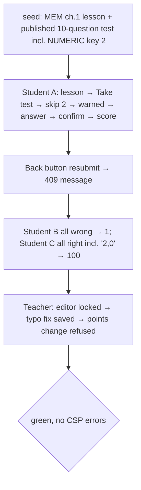

### Story 6.6: Test-Taking E2E Journeys

**BUILDID**: CYCLE-3 | **GitHub**: LOCAL | **AzureDevOps**: LOCAL | **Epic**: 6 - Chapter Tests & Scoring | **ID**: 6.6 | **Date**: 2026-10-19
**File**: `docs/plans/stories/epic-6-story-6.6-Test-Taking-E2E-Journeys.md`
**Build Ref**: `docs/plans/builds/cycle-3/cycle-plan.md` — CYCLE-3 (Workshop Day 4: Playwright journeys; FC-2 test workflows)
**Wave**: 13
**Requires**: [6.4, 6.5]
**Enables**: []
**Files Touched**:
  - tests/e2e/test_student_test_taking.py
**Roles Ref**: docs/requirements.md#roles--permissions-matrix — single-actor — no role variation in *this story's code* (test-only; exercises Student and Teacher behaviour from 6.4/6.5)
**QA Candidate**: No — test-only story. It automates Epic 6 QA Group 1; its green run is CYCLE-3 sign-off evidence for the test workflows (FC-2: "incorrect test scoring/result display").

---

#### 👤 User Reference

**Description**:
Browser "robot" tests that take chapter tests exactly like students will, and check every scoring promise:
- **One attempt:** a student answers, skips two questions, is warned, goes back, submits with confirmation, sees only the final score, and is refused a second submission.
- **Score bounds:** another student answers everything wrong and gets 1 (not 0); a third answers everything right and gets 100.
- **Number answers:** "2,0" counts as correct for an answer of 2.
- **Scoring lock:** a teacher then opens the same test, sees the lock, fixes a typo successfully, and can't change the points.

**Acceptance Criteria** (plain-English):
- One command runs the test-taking journeys in a real browser.
- A student can take a test once, be warned about unanswered questions, confirm, and see only the final score.
- Submitting again is refused with "You already submitted this test."
- All-wrong gives 1, all-right gives 100, and a comma decimal is accepted for number answers.
- The correct answers aren't present in the test page.
- After students have taken a test, the teacher can fix wording but not points or answers.
- No browser security-policy errors occur.

**User Flow**:
Actor: system — no role variation.

**Flow Diagram**:



---

#### 🤖 AI Agent Reference

**Must Read**:
- `docs/plans/implementation-plan.md` — Epic 6 QA Group 1
- `docs/plans/stories/epic-1-story-1.10-Foundation-E2E-Journeys.md` — harness rules
- `docs/plans/stories/epic-6-story-6.4-Student-Test-Page-and-Result.md`, `docs/plans/stories/epic-6-story-6.5-Scoring-Lock-in-Test-Editor.md` — labels and messages

**Description**:
`tests/e2e/test_student_test_taking.py` with a module-local `seeded_test` fixture (factories: MEM chapter 1, lesson, `published_test` with 9 TRUE_FALSE questions × 10 points + 1 NUMERIC question with key `"2"`, 10 points). Tests:
- `test_single_attempt_with_unanswered_warning`
- `test_all_wrong_scores_one_and_all_right_scores_100`
- `test_answers_not_in_test_page`
- `test_teacher_sees_lock_and_can_fix_wording_only`

EN-first selectors; keyboard used for the dialog.

**Acceptance Criteria**:
1. `uv run pytest -m e2e tests/e2e/test_student_test_taking.py` is green three times in a row, in < 90 s.
2. Single-attempt journey:
   - lesson → "Take the chapter test" → answer 8 → "Submit test" → dialog (keyboard Enter) → "have no answer" listing two numbers → "Go back" → answer them → submit + confirm → result shows "100" (when all correct) and "This was your only attempt."
   - `page.go_back()` twice and resubmit → "You already submitted this test."
3. Score bounds: student B answers every TF opposite and the numeric "5" → score shows "1"; student C answers all correctly with numeric "2,0" → "100".
4. `page.content()` on the test page contains no `"value": "2"` key fragments and no `data-correct`.
5. Teacher journey: the editor shows "Students have taken this test."; edit the Q6 RO prompt → "Test saved."; set Q2 points via `page.evaluate` to bypass readonly → save → "Question 2: Answers, points and type are locked".
6. `console_errors` used everywhere; no `time.sleep`.

**RBAC Enforcement**:
No role-differentiated access — single actor.
- Test-only; signs in as Students and a Teacher via the real login page.

**System responses + error cases** (harness behaviour):

| Trigger | Response | Side-effect |
|---------|----------|-------------|
| `uv run pytest` | e2e deselected | none |
| `-m e2e` | journeys run on `live_server` | transactional DB discarded |
| Assertion failure | trace + screenshot in `test-results/` | artefacts |
| CSP console error | test fails | none |

**Prerequisites**:
- Stories 6.4 and 6.5 merged; Chromium installed.

**Context**: `tests/e2e/conftest.py`, `tests/factories/content.py`, `tests/factories/assessment.py`

**Patterns**: E2E tests (§12.5) — see `docs/architecture/design/01-patterns-and-standards-greenfield.md`

**Steps**:

1. **Journeys** (excerpt):
   ```python
   # tests/e2e/test_student_test_taking.py
   import pytest
   from playwright.sync_api import Page, expect

   from tests.e2e.conftest import login
   from tests.factories.accounts import StudentFactory

   pytestmark = pytest.mark.e2e


   def submit_with_keyboard(page: Page) -> None:
       page.get_by_role("button", name="Submit test").focus()
       page.keyboard.press("Enter")
       page.get_by_role("dialog", name="Submit your test?").get_by_role("button", name="Submit").press("Enter")


   def test_all_wrong_scores_one_and_all_right_scores_100(page: Page, base_url, console_errors, seeded_test):
       StudentFactory(username="wrong", preferred_language="en")
       login(page, base_url, "wrong", lang="en")
       page.goto(f"{base_url}/en/chapters/{seeded_test.chapter_id}/test/")
       for n in range(1, 10):
           page.get_by_role("region", name=f"Question {n}").get_by_label("False").check()
       page.get_by_role("region", name="Question 10").get_by_role("textbox").fill("5")

       submit_with_keyboard(page)

       expect(page.get_by_label("Score: 1 out of 100")).to_be_visible()
   ```
   The remaining journeys implement AC 2, AC 4 and AC 5 explicitly (no placeholders in the final file). Question sections are named "Question {n}" (Story 6.4 markup, `<section aria-labelledby>` as in Story 4.3's cards).

2. **Run three times**; one deliberate local failure to check artefacts; revert.

**Tests**: this story *is* tests (3 green runs + one deliberate failure).

Manual: one `--headed --slowmo=200` run.

**Quality**: ruff 0; role/label/text locators; no `time.sleep`; 3 green runs; < 90 s.

**OUT**:
- ❌ Progress/score visibility journeys (7.5) and moderation journeys (8.6).
- ❌ Production-code changes (defects via `aire-raise-defect`).

**Evidence**: 3-run output, AC → step mapping table, deliberate-failure trace, all recorded in `docs/stories-implemented/story-6.6-review.md` under "## DoD Evidence".
