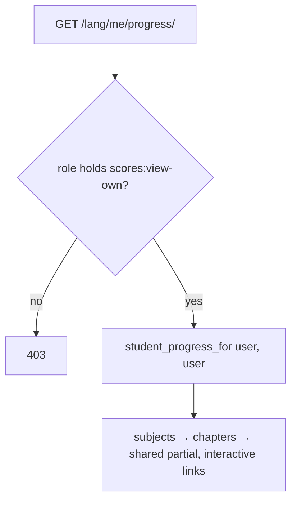

### Story 7.2: My Progress

**BUILDID**: CYCLE-3 | **GitHub**: LOCAL | **AzureDevOps**: LOCAL | **Epic**: 7 - Progress & Score Visibility | **ID**: 7.2 | **Date**: 2026-10-19
**File**: `docs/plans/stories/epic-7-story-7.2-My-Progress.md`
**Build Ref**: `docs/plans/builds/cycle-3/cycle-plan.md` — CYCLE-3 (Workshop Day 2: Student `/me/progress/`)
**Wave**: 12
**Requires**: [7.1]
**Enables**: [7.5]
**Files Touched**:
  - src/infrastructure/web/progress/views/me.py
  - src/infrastructure/web/templates/progress/me/**
  - src/infrastructure/web/progress/urls.py
  - src/infrastructure/i18n/locale/ro/LC_MESSAGES/django.po
  - src/infrastructure/i18n/locale/en/LC_MESSAGES/django.po
  - tests/integration/web/test_role_access_matrix.py
  - docs/architecture/design/00-system-architecture-greenfield.md
  - tests/integration/web/progress/me/**
**Roles Ref**: docs/requirements.md#roles--permissions-matrix — personas this story differentiates: Student, Teacher, Parent/Guardian, Admin
**QA Candidate**: Yes — **Observable:** "My progress" in the Student menu opens `/<lang>/me/progress/`. It shows, per pilot subject and chapter, whether the lesson was read, exercises finished out of available ones, and the chapter test score (or "Available"/"Not available yet"), with buttons to continue learning. Only the signed-in student's own data appears. **Mechanism:** `GET /me/progress/` (`progress:me`, `scores:view-own`) → `student_progress_for(request.user.pk, request.user.role, request.user.pk)` (Story 7.1, scoped) → the shared `_chapter_progress.html` partial with `interactive=True`. The Story 1.7 registry entry `progress:me` now resolves, so the menu item and home card appear automatically. **Authz & preconditions:** Student only; identity from the session (no student id in the URL). **Edge & idempotency:** a student with no activity sees every chapter "Not read · 0/n · Available/Not available yet"; a blocked test's earned score still shows; reloads are read-only; pilot subjects without chapters show an empty state. **Regression:** own-data-only (no id parameter exists to tamper with), counting rules from 7.1, 403 for other roles, menu entry appears.

---

#### 👤 User Reference

**Description**:
Students get their own **"My progress"** page, from the menu or a card on their home page. For each pilot subject it lists the chapters and, for each chapter, shows simply:
- **Lesson:** whether they've read it.
- **Exercises:** how many they've finished out of those available.
- **Chapter test:** their score if they've taken it; otherwise whether it's available yet.

Buttons let them jump straight back into the lesson, the exercises or the test. The page only ever shows the signed-in student's own progress; there's no way to look at anyone else's. A score already earned stays visible even if an administrator later blocks that test.

**Acceptance Criteria** (plain-English):
- Students see "My progress" in their menu and on their home page.
- The page lists each pilot subject's chapters with lesson read or not, exercises finished out of available, and test score or availability.
- Only the student's own data appears.
- Buttons lead to the lesson, exercises or test where those are available.
- A student who hasn't started yet sees everything at zero / not read, with friendly wording.
- A score for a test that was later blocked still appears.
- Teachers, parents and administrators get "Access denied" (they have their own views).

**User Flow** (role-differentiated):

### Student
**Scenario / narrative**: As a grade-2 Student, I open "My progress". Under "Matematică și explorarea mediului" I see chapter 1: "Lecție: citită ✓ · Exerciții 4/6 · Test: 87/100", chapter 2: "Lecție: necitită · Exerciții 0/5 · Test disponibil" with a "Începe testul" button, and chapter 3: "Test: nu este disponibil încă". The page only ever shows my own results.
**Steps**:
1. `GET /ro/me/progress/` → `@require_permission(SCORES_VIEW_OWN)` → `student_progress_for(user.pk, user.role, user.pk)` → render subjects; each chapter via ``.

### Teacher
**Scenario / narrative**: As a Teacher, I use the Scores list (7.4). "My progress" is a student page: "Access denied".
**Steps**:
1. `GET /ro/me/progress/` → 403.

### Parent/Guardian
**Scenario / narrative**: As a Parent, I use "My children" (7.3); this page answers "Access denied".
**Steps**:
1. `GET /ro/me/progress/` → 403.

### Admin
**Scenario / narrative**: As the Admin, I use Scores and Pilot; this student page answers "Access denied".
**Steps**:
1. `GET /ro/me/progress/` → 403.

**Flow Diagram**:



---

#### 🤖 AI Agent Reference

**Must Read**:
- `docs/architecture/design/00-system-architecture-greenfield.md` — route `/me/progress/` (`scores:view-own`), Progress read model
- `docs/plans/stories/epic-7-story-7.1-Progress-Read-Models-and-Web-Scaffold.md` — `student_progress_for`, partial, CSS
- `docs/plans/stories/epic-1-story-1.7-App-Shell-and-Role-Homes.md` — registry entry `progress:me`
- `docs/ui-ux/ui-ux-spec.md` — student theme

**Description**:
`web/progress/views/me.py::my_progress` view; route `"me/progress/"` named `me` (`progress:me`) appended to `web/progress/urls.py`; template `progress/me/index.html` (extends base, `ui_page_header` "My progress", one `<section>` per subject with its chapters via the shared partial, `ui_empty_state` for subjects without chapters); matrix rows; route catalogue; translations.

**Design Tokens** (FE — student theme):
- Page bg `#FFF8EC`, max 960px; `ui_page_header` "My progress" (h1 32px/700); subject heading h2 24px/700.
- Chapter cards from the shared partial (Story 7.1 tokens); interactive buttons 44px, secondary style, icons `book-open`, `pencil-simple`, `exam` (duotone).
- Empty subject: `ui_empty_state` "No chapters here yet."

**Acceptance Criteria**:
1. `progress:me` → `GET /<lang>/me/progress/`, `@require_safe` + `@require_permission(SCORES_VIEW_OWN)`.
2. The view calls `student_progress_for(request.user.pk, request.user.role, request.user.pk)`. **No** query/path parameter selects a student; extra parameters (`?student=…`) are ignored.
3. For each active subject, chapters render in order via the partial with `interactive=True`, so links appear only where the target is available (lesson readable, exercises > 0, test available or result).
4. The Student menu shows "My progress" (registry `progress:me` resolves), and the home page shows its card.
5. Matrix rows: `/ro/me/progress/` → Student 200; Teacher/Parent/Admin 403; anonymous 302.
6. Route catalogue + RO/EN translations ("My progress", "No chapters here yet.", labels from the partial if new).

**RBAC Enforcement**:

| Persona | Permission key | Guarded route/endpoint | Allowed | Denied behavior | UI when denied |
|---------|----------------|------------------------|---------|-----------------|----------------|
| Student | `scores:view-own` | `GET /<lang>/me/progress/` | own data only | n/a (no other-student parameter exists) | — |
| Teacher | — | same | no | 403 | not in menu |
| Parent/Guardian | — | same | no | 403 | not in menu |
| Admin | — | same | no | 403 | not in menu |
| Anonymous | — | same | no | 302 login | sign-in |

- **Enforcement point(s):** `@require_permission(Permission.SCORES_VIEW_OWN)`; scoping inside `student_progress_for` (7.1).
- **Denied-access contract:** 403 for other roles.
- **Scope derivation:** viewer and student are both `request.user.pk`; the route has no id segment (IDOR surface removed by design).

**System responses + error cases**:

| Trigger | Response | Side-effect |
|---------|----------|-------------|
| Student GET (activity present) | `200` subjects + chapter rows | none |
| Student GET (no activity) | `200` zeros / "Not read" / availability | none |
| Same GET repeated | identical `200` | none |
| GET `?student_id=<other>` | `200` own data (parameter ignored) | none |
| Blocked test with own attempt | row shows score | none |
| Teacher/Parent/Admin GET | `403` | none |
| Anonymous GET | `302` login | none |
| POST | `405` | none |

**QA-observable behaviour**:
- The page contains only the signed-in student's numbers. Adding `?student_id=<other>` changes nothing.
- Numbers match `student_progress_for` (7.1). A blocked test's score still appears.
- "My progress" appears in the Student navigation and home cards.
- **What does NOT change**: no writes; other students' data never appears.

**Prerequisites**:
- Story 7.1 merged; Epic 6 data (attempts) for scores.

**Context**: `src/infrastructure/persistence/progress/queries.py`, `src/infrastructure/web/templates/progress/_chapter_progress.html`, `src/infrastructure/web/progress/urls.py`

**Patterns**: Thin views + decorators (§7.1–7.2), Query services (§6.3), Primitives (§11.2) — see `docs/architecture/design/01-patterns-and-standards-greenfield.md`

**Steps**:

1. **Tests first.**
2. **View:**
   ```python
   # src/infrastructure/web/progress/views/me.py
   @require_safe
   @require_permission(Permission.SCORES_VIEW_OWN)
   def my_progress(request):
       """GET /<lang>/me/progress/ — scores:view-own; the signed-in student's own progress only."""
       user = request.user
       return render(request, "progress/me/index.html",
                     {"progress": student_progress_for(user.pk, user.role, user.pk)})
   ```
3. **URL** (append `path("me/progress/", my_progress, name="me")`), **template**, **matrix rows**, **route catalogue**, **translations**, then **all gates**.

**Tests**:

```python
# tests/integration/web/progress/me/test_my_progress.py
import pytest

from infrastructure.persistence.catalogue.models import SubjectModel
from tests.factories.accounts import StudentFactory
from tests.factories.assessment import attempt_for
from tests.factories.content import complete_chapter

pytestmark = pytest.mark.django_db


@pytest.fixture
def chapter():
    return complete_chapter(SubjectModel.objects.get(grade__code="2", code="MEM"), 1)


def test_student_sees_own_score(student_client, student, chapter):
    attempt_for(student, chapter.test, correct_positions={1, 2, 3, 4})

    html = student_client.get("/en/me/progress/").content.decode()

    assert "Score: 40 out of 100" in html


def test_other_student_data_never_appears(student_client, chapter):
    attempt_for(StudentFactory(), chapter.test, correct_positions=set(range(1, 11)))

    html = student_client.get("/en/me/progress/?student_id=999").content.decode()

    assert "Score: 100 out of 100" not in html


@pytest.mark.parametrize("fixture", ["teacher_client", "parent_client", "admin_client"])
def test_non_students_are_denied(request, fixture):
    assert request.getfixturevalue(fixture).get("/ro/me/progress/").status_code == 403


def test_menu_shows_my_progress(student_client):
    assert 'href="/en/me/progress/"' in student_client.get("/en/").content.decode()
```

Manual: as Student (RO/EN) compare the page with your activity; append `?student_id=` (no effect); as other roles, 403.

**Quality**: ruff 0; mypy passes; tests pass; coverage ≥85%; no `TODO`.

**OUT**:
- ❌ Parent and teacher views (7.3, 7.4).
- ❌ Per-question test details, rankings or comparisons with classmates (not required).

**Evidence**: pytest output, coverage %, screenshots of My progress (RO) with read/finished/score states, all recorded in `docs/stories-implemented/story-7.2-review.md` under "## DoD Evidence".
