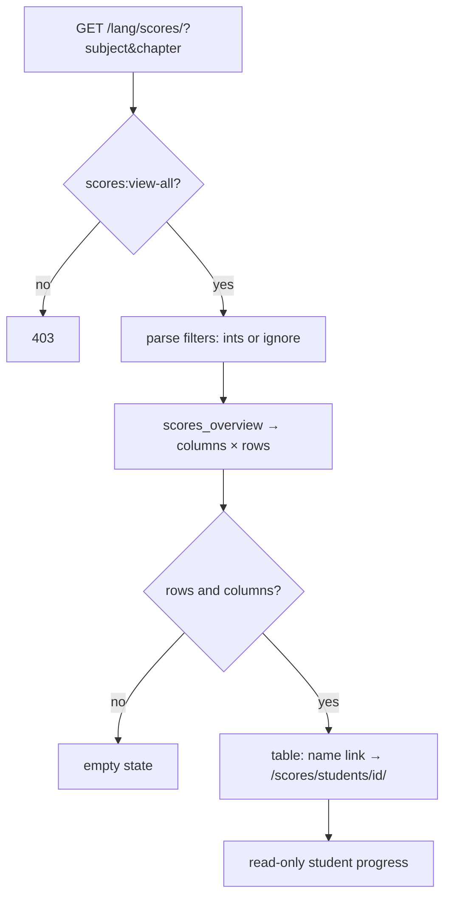

### Story 7.4: Scores List

**BUILDID**: CYCLE-3 | **GitHub**: LOCAL | **AzureDevOps**: LOCAL | **Epic**: 7 - Progress & Score Visibility | **ID**: 7.4 | **Date**: 2026-10-19
**File**: `docs/plans/stories/epic-7-story-7.4-Scores-List.md`
**Build Ref**: `docs/plans/builds/cycle-3/cycle-plan.md` — CYCLE-3 (Workshop Day 2: Teacher/Admin `/scores/` — all pilot students)
**Wave**: 12
**Requires**: [7.1]
**Enables**: [7.5]
**Files Touched**:
  - src/infrastructure/web/progress/views/scores.py
  - src/infrastructure/web/templates/progress/scores/**
  - src/infrastructure/web/progress/urls.py
  - src/infrastructure/i18n/locale/ro/LC_MESSAGES/django.po
  - src/infrastructure/i18n/locale/en/LC_MESSAGES/django.po
  - tests/integration/web/test_role_access_matrix.py
  - docs/architecture/design/00-system-architecture-greenfield.md
  - tests/integration/web/progress/scores/**
**Roles Ref**: docs/requirements.md#roles--permissions-matrix — personas this story differentiates: Teacher, Admin, Student, Parent/Guardian
**QA Candidate**: Yes — **Observable:** "Scores" in the Teacher and Admin menus opens `/<lang>/scores/`, a table of every active pilot student (rows) against each chapter test (columns), showing the score or "—" when not taken. Filters by subject and chapter narrow the columns; each student name links to that student's progress page. **Mechanism:**
- `GET /scores/?subject=<id>&chapter=<n>` (`progress:scores`, `scores:view-all`) → `scores_overview(subject_id, chapter_number)` (Story 7.1) → `ui_table`
- the filter form is plain GET; invalid filter values are ignored (all columns)
- student links go to `progress:student` → `GET /scores/students/<id>/` (`scores:view-all`) → `student_progress_for(viewer, role, id)` with `interactive=False`

**Authz & preconditions:** `scores:view-all` (Teacher and Admin per the matrix); the others get 403. **Edge & idempotency:**
- No students or no tests → `ui_table` empty state.
- Scores of blocked tests remain.
- Inactive students are excluded from the table.
- Repeat loads are read-only.

**Regression:** the matrix permission split (Teacher+Admin allowed; Student/Parent 403), completeness of rows/columns versus the DB, filter behaviour.

---

#### 👤 User Reference

**Description**:
Teachers and administrators need the class picture at a glance.
- **The table:** "Scores" shows one row per pilot student and one column per chapter test, with each student's score, or a dash if they haven't taken that test yet.
- **Filters:** narrow it to one subject or one chapter.
- **Per student:** clicking a student's name opens their full progress (lessons read, exercises finished, scores), read-only.

As agreed, a score stays in the table even if the administrator later blocks that test. Deactivated student accounts aren't listed. Students and parents can't open this page; they have their own views.

**Acceptance Criteria** (plain-English):
- Teachers and administrators see "Scores" in their menu.
- The table lists every active pilot student and every chapter test that's published or already taken, with scores or "—".
- Subject and chapter filters narrow the table; an unknown filter shows everything.
- A student's name opens that student's read-only progress page.
- Scores of later-blocked tests remain visible.
- An empty pilot shows a friendly empty message instead of an empty table.
- Students and parents get "Access denied".

**User Flow** (role-differentiated):

### Teacher
**Scenario / narrative**: As a Teacher on 2026-11-13, I open "Scores" and filter "Matematică și explorarea mediului". I see ten students: eight have scores for chapter 1 and two show "—". I click Ion's name and see he read the lesson but hasn't finished the exercises, so I'll encourage him tomorrow.
**Steps**:
1. `GET /ro/scores/?subject=<MEM id>` → `@require_permission(SCORES_VIEW_ALL)` → `scores_overview(subject_id=<id>)` → `ui_table` with `Cell` objects (student name as link `progress:student`).
2. `GET /ro/scores/students/<sid>/` → `@require_permission(SCORES_VIEW_ALL)` → `student_progress_for(user.pk, user.role, sid)` → read-only partial.

### Admin
**Scenario / narrative**: As the Admin, I use Scores to check SC-3 by eye and spot students who haven't taken any test before the pilot review.
**Steps**:
1. Same as Teacher (Admin holds `scores:view-all`).

### Student
**Scenario / narrative**: As a Student, I only see my own progress; the class table answers "Access denied".
**Steps**:
1. Both routes → 403.

### Parent/Guardian
**Scenario / narrative**: As a Parent, I see only my linked children; the class table answers "Access denied".
**Steps**:
1. Both routes → 403.

**Flow Diagram**:



---

#### 🤖 AI Agent Reference

**Must Read**:
- `docs/architecture/design/00-system-architecture-greenfield.md` — `/scores/` (`scores:view-all`, Teacher and Admin)
- `docs/ui-ux/ui-ux-spec.md` — `filters: staff_inline_get`, staff density, `ui_table`
- `docs/plans/stories/epic-7-story-7.1-Progress-Read-Models-and-Web-Scaffold.md` — `scores_overview`, `student_progress_for`
- `docs/plans/stories/epic-1-story-1.6-Molecule-Primitives.md` — `ui_table`, `Cell`

**Description**:
`web/progress/views/scores.py` with `scores` and `student_detail`. Routes: `"scores/"` (`progress:scores`) and `"scores/students/<int:student_id>/"` (`progress:student`) appended to `web/progress/urls.py`. Templates `progress/scores/index.html` (filter row + table) and `detail.html`. Matrix rows, route catalogue, translations. The registry entry `progress:scores` (Story 1.7, Teacher and Admin) now resolves.

**Design Tokens** (FE — staff theme):
- `ui_page_header` "Scores"; filter row: two selects ("Subject", "Chapter") + "Apply" secondary button, labels visible, 32px controls, `method="get"`.
- `ui_table` caption "Chapter test scores", first column student (link `#0E7490`), then one column per chapter test labelled "{subject code} · Ch. {n}"; score cells right-aligned numbers, "—" (`#4B5563`) with `aria-label="Not taken"`.
- Empty: "No scores to show yet."
- Detail: breadcrumb Scores › {student}; shared partial with `interactive=False`.

**Acceptance Criteria**:
1. `progress:scores` → `GET /<lang>/scores/`, `@require_safe` + `@require_permission(SCORES_VIEW_ALL)`. `subject` and `chapter` query params are parsed as ints (1–3 for chapter). Invalid values are ignored (no 400).
2. The table renders exactly `scores_overview(...)` rows × columns, with "—" for `None`. The student cell links to `progress:student`.
3. `progress:student` → `GET /<lang>/scores/students/<int:student_id>/`, `@require_safe` + `@require_permission(SCORES_VIEW_ALL)` → `student_progress_for(request.user.pk, request.user.role, student_id)` (non-student/unknown → 404), rendered read-only.
4. Empty data → `ui_table` empty state ("No scores to show yet.").
5. Matrix rows: `/ro/scores/` → Teacher 200, Admin 200, Student 403, Parent 403, anonymous 302.
6. Route catalogue + RO/EN translations ("Scores", "Chapter test scores", "Subject", "Chapter", "Apply", "Not taken", "No scores to show yet.").

**RBAC Enforcement**:

| Persona | Permission key | Guarded route/endpoint | Allowed | Denied behavior | UI when denied |
|---------|----------------|------------------------|---------|-----------------|----------------|
| Teacher | `scores:view-all` | `GET /<lang>/scores/`, `/scores/students/<id>/` | all active pilot students | non-student id → 404 | — |
| Admin | `scores:view-all` | same | yes | same | — |
| Student | — | both | no | 403 | not in menu |
| Parent/Guardian | — | both | no | 403 | not in menu |
| Anonymous | — | both | no | 302 login | sign-in |

- **Enforcement point(s):** `@require_permission(Permission.SCORES_VIEW_ALL)` in `views/scores.py`; `student_progress_for` re-applies `RecordAccessPolicy` (Teacher/Admin → all).
- **Denied-access contract:** 403 for Student/Parent; 404 for non-student ids on the detail.
- **Scope derivation:** viewer from `request.user`; filters only narrow columns; no parameter widens scope beyond the role.

**System responses + error cases**:

| Trigger | Response | Side-effect |
|---------|----------|-------------|
| Teacher GET `/scores/` | `200` full table | none |
| Admin GET `/scores/?subject=<MEM>` | `200` MEM columns only | none |
| GET `?chapter=7` or `?subject=abc` | `200` filter ignored | none |
| Same GET repeated | identical | none |
| Empty pilot (no students/tests) | `200` empty state | none |
| Teacher GET `/scores/students/<student>/` | `200` read-only progress | none |
| Teacher GET `/scores/students/<teacher id>/` | `404` | none |
| Student/Parent GET | `403` | none |
| Anonymous | `302` login | none |

**QA-observable behaviour**:
- Row count = active STUDENT accounts; column count = chapters with a published or attempted test; each cell equals `assessment_test_attempt.score` for that pair, or "—".
- A blocked test's column and scores remain.
- Deactivating a student removes their row.
- **What does NOT change**: no writes.

**Prerequisites**:
- Story 7.1 merged; Epic 6 attempts.

**Context**: `src/infrastructure/persistence/progress/queries.py`, `src/infrastructure/web/templatetags/ui.py` (`Cell`), `src/infrastructure/web/progress/urls.py`

**Patterns**: Thin views (§7.1–7.2), Query services (§6.3), Primitives — table/filters (§11.2) — see `docs/architecture/design/01-patterns-and-standards-greenfield.md`

**Steps**:

1. **Tests first.**
2. **Views:**
   ```python
   # src/infrastructure/web/progress/views/scores.py
   def _int(value: str | None, allowed: range | None = None) -> int | None:
       try:
           number = int(value or "")
       except ValueError:
           return None
       return number if allowed is None or number in allowed else None


   @require_safe
   @require_permission(Permission.SCORES_VIEW_ALL)
   def scores(request):
       """GET /<lang>/scores/ — scores:view-all (Teacher, Admin); GET filters only narrow columns."""
       overview = scores_overview(_int(request.GET.get("subject")), _int(request.GET.get("chapter"), range(1, 4)))
       return render(request, "progress/scores/index.html", {"overview": overview, "rows": _cells(overview)})
   ```
   `_cells` turns the overview into `ui_table` rows (`Cell(name, href=reverse("progress:student", args=[id]))`, then scores or "—").
3. **URLs, templates, matrix rows, route catalogue, translations,** then **all gates**.

**Tests**:

```python
# tests/integration/web/progress/scores/test_scores_list.py
import pytest

from infrastructure.persistence.catalogue.models import SubjectModel
from infrastructure.persistence.content.models import ChapterTestModel
from tests.factories.accounts import StudentFactory
from tests.factories.assessment import attempt_for
from tests.factories.content import complete_chapter

pytestmark = pytest.mark.django_db


@pytest.fixture
def scored():
    mem = SubjectModel.objects.get(grade__code="2", code="MEM")
    chapter = complete_chapter(mem, 1)
    ana, ion = StudentFactory(full_name="Ana Pop"), StudentFactory(full_name="Ion Ene")
    attempt_for(ana, chapter.test, correct_positions={1, 2, 3, 4, 5, 6, 7, 8})
    return mem, chapter, ana, ion


@pytest.mark.parametrize("fixture", ["teacher_client", "admin_client"])
def test_staff_see_all_students_and_scores(request, fixture, scored):
    html = request.getfixturevalue(fixture).get("/en/scores/").content.decode()

    assert "Ana Pop" in html and "Ion Ene" in html and ">80<" in html and 'aria-label="Not taken"' in html


def test_blocked_test_scores_remain(teacher_client, scored):
    _, chapter, _, _ = scored
    ChapterTestModel.objects.filter(pk=chapter.test.pk).update(moderation_status="BLOCKED")

    assert ">80<" in teacher_client.get("/en/scores/").content.decode()


def test_invalid_filters_are_ignored(teacher_client, scored):
    assert teacher_client.get("/en/scores/?chapter=7&subject=abc").status_code == 200


def test_student_detail_and_non_student_404(teacher_client, teacher, scored):
    _, _, ana, _ = scored

    assert teacher_client.get(f"/en/scores/students/{ana.pk}/").status_code == 200
    assert teacher_client.get(f"/en/scores/students/{teacher.pk}/").status_code == 404


@pytest.mark.parametrize("fixture", ["student_client", "parent_client"])
def test_students_and_parents_are_denied(request, fixture):
    assert request.getfixturevalue(fixture).get("/ro/scores/").status_code == 403
```

Manual: as Teacher and Admin (RO/EN) use the filters; open a student; block a taken test in the DB and confirm the score stays; as Student/Parent, 403.

**Quality**: ruff 0; mypy passes; tests pass; coverage ≥85%; primitives reused; no `TODO`.

**OUT**:
- ❌ CSV export, charts, rankings (not required).
- ❌ Editing scores (scores are final).

**Evidence**: pytest output, coverage %, screenshots of the Scores table (filtered and unfiltered) and a student detail, all recorded in `docs/stories-implemented/story-7.4-review.md` under "## DoD Evidence".
