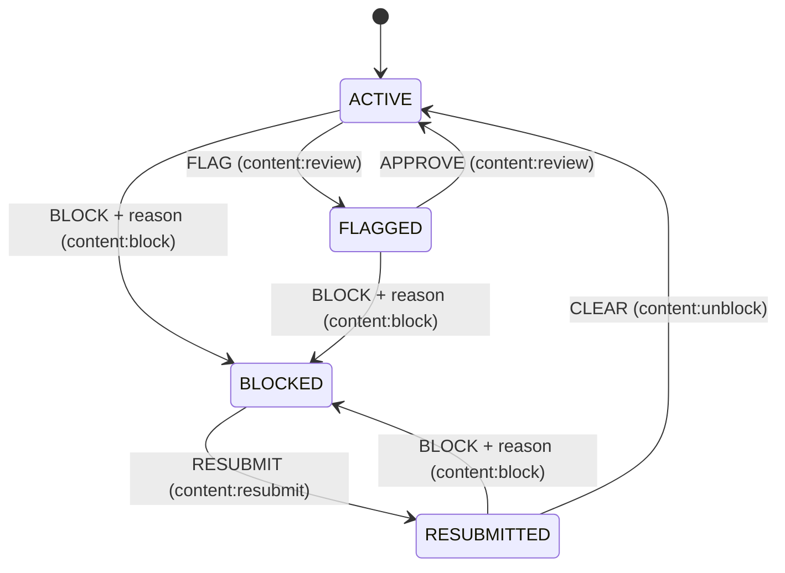

### Story 8.1: Moderation Domain Rules

**BUILDID**: CYCLE-3 | **GitHub**: LOCAL | **AzureDevOps**: LOCAL | **Epic**: 8 - Content Moderation & Notifications | **ID**: 8.1 | **Date**: 2026-10-19
**File**: `docs/plans/stories/epic-8-story-8.1-Moderation-Domain-Rules.md`
**Build Ref**: `docs/plans/builds/cycle-3/cycle-plan.md` — CYCLE-3 (Workshop Day 3: full state machine)
**Wave**: 10
**Requires**: [3.9, 4.4]
**Enables**: [8.3]
**Files Touched**:
  - src/domain/moderation/state_machine.py
  - src/domain/moderation/notifications.py
  - src/domain/moderation/ports.py
  - src/application/moderation/__init__.py
  - tests/unit/domain/moderation/test_state_machine.py
  - tests/unit/domain/moderation/test_notifications.py
**Roles Ref**: docs/requirements.md#roles--permissions-matrix — single-actor — no role variation in the pure rules (the action → permission table maps actions to the canonical keys; enforcement happens in 8.4/8.5 views)
**QA Candidate**: No — pure domain rules with no route, verified by an exhaustive transition-table test at 100% coverage. They become observable through 8.3–8.5, where QA checks them.

---

#### 👤 User Reference

**Description**:
This story writes the moderation rules from the requirements and the architecture as one precise table.

**Content states:** each lesson, exercise and test is in one of four states. Only "active" content is visible to students and parents.
- **Active:** visible.
- **Flagged:** an administrator wants to review it. Hidden.
- **Blocked:** the administrator found a problem. Hidden, and the teacher is told why.
- **Resubmitted:** the teacher fixed it and asked for another look. Still hidden.

**Allowed moves:**
| From | Action | To |
|------|--------|-----|
| Active | administrator flags it | Flagged |
| Flagged | administrator approves it | Active |
| Active, Flagged or Resubmitted | administrator blocks it, giving a reason of 10–1,000 characters | Blocked |
| Blocked | teacher resubmits it | Resubmitted |
| Resubmitted | administrator clears it | Active |

Anything else, like clearing something that was never blocked, is refused.

**Who's notified:** when something is blocked, the teacher who created it and the teacher who last changed it each get a notice (once each, even if they're the same person).

**Acceptance Criteria** (plain-English):
- Exactly the transitions above are allowed; every other combination is refused as an invalid action.
- Blocking requires a reason of 10 to 1,000 characters.
- Each action is tied to the permission from the requirements (flag/approve: review; block; clear: unblock; resubmit: teacher's resubmit).
- Only "active" content is visible to learners.
- When content is blocked, its creator and its last editor are notified, each once, ignoring missing or deleted accounts.

**User Flow**:
Actor: system — no role variation.

**Flow Diagram**:



---

#### 🤖 AI Agent Reference

**Must Read**:
- `docs/architecture/design/00-system-architecture-greenfield.md` — Moderation state machine, rules table (visibility, notification, illegal transition → 409), permission → action mapping, ADR-008
- `docs/architecture/design/01-patterns-and-standards-greenfield.md` — §4 reference `state_machine.py` (table-driven)
- `docs/plans/stories/epic-3-story-3.1-Content-Domain-Rules.md` — `ModerationStatus`, `is_visible_to_learners` (`domain/moderation/status.py`)

**Description**:
1. **`state_machine.py`:**
   - `ModerationAction` StrEnum (FLAG, APPROVE, BLOCK, RESUBMIT, CLEAR)
   - `ContentType` StrEnum (`lesson`, `exercise`, `test`)
   - `InvalidModerationTransition(ConflictError)` with code `invalid_moderation_transition`
   - `_TRANSITIONS` table and `next_status(current, action)` (patterns §4)
   - `REQUIRED_PERMISSION: Mapping[ModerationAction, Permission]`
   - `validate_block_reason(reason) -> list[Violation]` (`block_reason_length` {min: 10, max: 1000}, on stripped text)
2. **`notifications.py`:** `block_notice_recipients(created_by: int | None, updated_by: int | None) -> tuple[int, ...]`, distinct, non-null, creator first.
3. **`ports.py`:**
   - `ModeratedItem(content_type, content_id, status, created_by, updated_by, reason)` (`reason` = current `moderation_reason`)
   - `ModeratedContentRepository` (`get(content_type, content_id) -> ModeratedItem | None`, `set_status(content_type, content_id, status, reason, at) -> None`)
   - `ModerationEventRepository.add(...)`
   - `NotifierPort.notify_block(recipient_ids, content_type, content_id, reason, at)`
4. **`application/moderation/__init__.py`:** empty package for 8.3.

**Acceptance Criteria**:
1. `next_status` returns the target for the 7 allowed `(status, action)` pairs and raises `InvalidModerationTransition` for all other 13 combinations of the 4 statuses × 5 actions (exhaustive parametrised test).
2. `InvalidModerationTransition.code == "invalid_moderation_transition"` and it's a `ConflictError` (409 via Story 1.1).
3. `REQUIRED_PERMISSION` = FLAG→`content:review`, APPROVE→`content:review`, BLOCK→`content:block`, CLEAR→`content:unblock`, RESUBMIT→`content:resubmit`. A test asserts each key exists in `ROLE_PERMISSIONS` of exactly the expected role (Admin for review/block/unblock, Teacher for resubmit).
4. `validate_block_reason`: < 10 or > 1,000 characters after stripping → `[Violation("block_reason_length", {"min": 10, "max": 1000})]`; otherwise `[]`.
5. `block_notice_recipients(3, 3) == (3,)`, `(3, 5) == (3, 5)`, `(None, 5) == (5,)`, `(None, None) == ()`.
6. Stdlib + `domain.*` only; `mypy --strict`; 100% coverage.

**RBAC Enforcement**:
No role-differentiated access — single actor.
- `REQUIRED_PERMISSION` is data consumed by the 8.4/8.5 views' decorators; no enforcement happens in the domain itself.

**System responses + error cases** (function contract):

| Trigger | Response | Side-effect |
|---------|----------|-------------|
| `next_status(ACTIVE, FLAG)` | `FLAGGED` | none |
| Same call repeated | `FLAGGED` (pure) | none |
| `next_status(BLOCKED, BLOCK)` | `InvalidModerationTransition` | none |
| `next_status(ACTIVE, CLEAR)` | `InvalidModerationTransition` | none |
| `validate_block_reason("short")` | `[block_reason_length]` | none |
| `validate_block_reason("Răspuns greșit la exercițiul 3.")` | `[]` | none |
| `block_notice_recipients(None, None)` | `()` | none |

**Prerequisites**:
- CYCLE-2 complete (`ModerationStatus` from 3.1); CYCLE-1 `Permission`/`ROLE_PERMISSIONS`.

**Context**: `src/domain/moderation/status.py`, `src/domain/accounts/permissions.py`, `src/domain/common/errors.py`

**Patterns**: Table-driven state machine (§4, §15), 100% domain coverage (§12.6) — see `docs/architecture/design/01-patterns-and-standards-greenfield.md`

**Steps**:

1. **Tests first** (exhaustive 4×5 matrix).
2. **State machine** per patterns §4, plus:
   ```python
   REQUIRED_PERMISSION: Mapping[ModerationAction, Permission] = MappingProxyType({
       A.FLAG: Permission.CONTENT_REVIEW, A.APPROVE: Permission.CONTENT_REVIEW, A.BLOCK: Permission.CONTENT_BLOCK,
       A.CLEAR: Permission.CONTENT_UNBLOCK, A.RESUBMIT: Permission.CONTENT_RESUBMIT,
   })
   REASON_MIN, REASON_MAX = 10, 1000


   def validate_block_reason(reason: str) -> list[Violation]:
       length = len((reason or "").strip())
       return [] if REASON_MIN <= length <= REASON_MAX else [
           Violation("block_reason_length", {"min": REASON_MIN, "max": REASON_MAX})]
   ```
3. **Recipients and ports;** **run gates.**

**Tests**:

```python
# tests/unit/domain/moderation/test_state_machine.py
import itertools

import pytest

from domain.accounts.permissions import ROLE_PERMISSIONS
from domain.accounts.roles import Role
from domain.moderation.state_machine import (
    REQUIRED_PERMISSION, InvalidModerationTransition, ModerationAction as A, next_status, validate_block_reason)
from domain.moderation.status import ModerationStatus as S

ALLOWED = {
    (S.ACTIVE, A.FLAG): S.FLAGGED, (S.FLAGGED, A.APPROVE): S.ACTIVE, (S.ACTIVE, A.BLOCK): S.BLOCKED,
    (S.FLAGGED, A.BLOCK): S.BLOCKED, (S.RESUBMITTED, A.BLOCK): S.BLOCKED, (S.BLOCKED, A.RESUBMIT): S.RESUBMITTED,
    (S.RESUBMITTED, A.CLEAR): S.ACTIVE,
}


@pytest.mark.parametrize(("status", "action"), list(itertools.product(S, A)))
def test_full_transition_table(status, action):
    if (status, action) in ALLOWED:
        assert next_status(status, action) is ALLOWED[(status, action)]
    else:
        with pytest.raises(InvalidModerationTransition):
            next_status(status, action)


@pytest.mark.parametrize(("action", "role"), [(A.FLAG, Role.ADMIN), (A.APPROVE, Role.ADMIN), (A.BLOCK, Role.ADMIN),
                                              (A.CLEAR, Role.ADMIN), (A.RESUBMIT, Role.TEACHER)])
def test_each_action_maps_to_exactly_one_role(action, role):
    holders = [r for r, perms in ROLE_PERMISSIONS.items() if REQUIRED_PERMISSION[action] in perms]

    assert holders == [role]


@pytest.mark.parametrize(("reason", "ok"), [("", False), ("too short", False), ("x" * 10, True),
                                            ("  " + "x" * 9 + "  ", False), ("x" * 1000, True), ("x" * 1001, False)])
def test_block_reason_length(reason, ok):
    assert (validate_block_reason(reason) == []) is ok
```

```python
# tests/unit/domain/moderation/test_notifications.py
import pytest

from domain.moderation.notifications import block_notice_recipients


@pytest.mark.parametrize(("created", "updated", "expected"), [(3, 3, (3,)), (3, 5, (3, 5)), (None, 5, (5,)),
                                                              (3, None, (3,)), (None, None, ())])
def test_recipients_are_distinct_and_non_null(created, updated, expected):
    assert block_notice_recipients(created, updated) == expected
```

Manual: none.

**Quality**: ruff 0; `mypy --strict`; lint-imports kept; 100% coverage of the three modules; no `TODO`.

**OUT**:
- ❌ Persistence (8.2), use cases (8.3), UI (8.4/8.5).
- ❌ Versioned content snapshots (rejected in ADR-008).

**Evidence**: pytest output (all 20 transition cases), 100% coverage, mypy strict output, all recorded in `docs/stories-implemented/story-8.1-review.md` under "## DoD Evidence".
