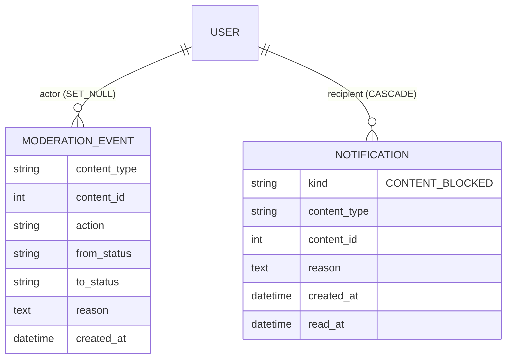

### Story 8.2: Moderation & Notification Data

**BUILDID**: CYCLE-3 | **GitHub**: LOCAL | **AzureDevOps**: LOCAL | **Epic**: 8 - Content Moderation & Notifications | **ID**: 8.2 | **Date**: 2026-10-19
**File**: `docs/plans/stories/epic-8-story-8.2-Moderation-and-Notification-Data.md`
**Build Ref**: `docs/plans/builds/cycle-3/cycle-plan.md` — CYCLE-3 (`MODERATION_EVENT`, `NOTIFICATION` records)
**Wave**: 10
**Requires**: [3.9, 4.4]
**Enables**: [8.3]
**Files Touched**:
  - src/infrastructure/persistence/moderation/**
  - src/infrastructure/persistence/notifications/**
  - src/config/settings/base.py
  - tests/factories/moderation.py
  - tests/integration/persistence/moderation/**
**Roles Ref**: docs/requirements.md#roles--permissions-matrix — single-actor — no role variation (schema only)
**QA Candidate**: No — tables, constraints and factories with no route. Records become user-observable in 8.3–8.5, where QA checks them.

---

#### 👤 User Reference

**Description**:
Two kinds of records are needed for moderation.
- **Moderation history:** every time an administrator flags, approves, blocks or clears content, or a teacher resubmits it, the platform records what happened, to which item, who did it, when, and the reason for a block. Together with the audit log, this gives a complete, permanent history of every decision about children's learning content.
- **Teacher notices:** when content is blocked, each teacher concerned gets an in-app message with the reason, which they can mark as read.

This story creates both. Nothing changes on screen yet.

**Account deletion:**
- If a teacher's account is deleted, their notices go with it.
- Moderation history stays, keeping the record of who decided what.

**Acceptance Criteria** (plain-English):
- Each moderation action can be stored with the item, the action, the before and after states, the reason, the person and the time.
- Each block notice can be stored for a teacher with the item, the reason, the time and whether it's been read.
- Notices can be listed quickly per teacher, unread first.
- Deleting a teacher removes their notices but keeps moderation history (without their account link).
- Both structures install and uninstall cleanly.

**User Flow**:
Actor: system — no role variation.

**Flow Diagram**:



---

#### 🤖 AI Agent Reference

**Must Read**:
- `docs/architecture/design/00-system-architecture-greenfield.md` — Data Model (`MODERATION_EVENT`, `NOTIFICATION`), moderation rules (audit + events in one transaction)
- `docs/architecture/design/01-patterns-and-standards-greenfield.md` — §6.2 models, §6.4 migrations
- `docs/plans/stories/epic-8-story-8.1-Moderation-Domain-Rules.md` — action/status/content-type values (literal choices here; 8.3 tests equality)

**Description**:
Two Django apps:
- `infrastructure.persistence.moderation` (label `moderation`): `ModerationEventModel` (`moderation_event`)
  - `content_type` CharField(10, choices lesson/exercise/test), `content_id` PositiveIntegerField
  - `action` CharField(10), `from_status`/`to_status` CharField(12), `reason` TextField(blank)
  - `actor` FK user `SET_NULL`, `actor_username` CharField(150), `created_at`
  - index `(content_type, content_id, created_at)`; append-only (same `save`/`delete` guard pattern as Story 1.8's audit model)
- `infrastructure.persistence.notifications` (label `notifications`): `NotificationModel` (`notification`)
  - `recipient` FK user `CASCADE` (`related_name="notifications"`), `kind` CharField(20, default `CONTENT_BLOCKED`)
  - `content_type`, `content_id`, `reason` TextField, `created_at`, `read_at` DateTimeField(null)
  - index `(recipient, read_at, created_at)`

Migrations, settings and factories (`ModerationEventFactory`, `NotificationFactory`).

**Acceptance Criteria**:
1. Models, tables, fields and indexes exactly as described; `NotificationModel.Meta.ordering = ["read_at", "-created_at"]` (unread first: NULL sorts first in SQLite ascending).
2. `ModerationEventModel` rejects updates and deletes through the ORM (`PermissionError`), like the audit log. Deleting the actor sets `actor=NULL` and keeps `actor_username`.
3. Deleting a recipient cascades their notifications.
4. `INSTALLED_APPS` gains both apps; `makemigrations --check` clean; both apps round-trip `migrate <app> zero`.
5. Factories produce valid rows with sensible defaults (`content_type="lesson"`, `action="BLOCK"`, statuses ACTIVE→BLOCKED, a 20-char reason).

**RBAC Enforcement**:
No role-differentiated access — single actor.
- No route; reads are scoped in 8.4 (Admin queue) and 8.5 (recipient = `request.user` only).

**System responses + error cases**:

| Trigger | Response | Side-effect |
|---------|----------|-------------|
| `migrate` | both apps applied | 2 tables |
| `migrate` repeated | "No migrations to apply." | none |
| Insert event | created | — |
| `event.save()` on an existing row / `event.delete()` | `PermissionError` | none |
| Delete actor | — | `actor_id=NULL`, username kept |
| Delete recipient | — | their notifications deleted |
| List a teacher's notifications | unread first, newest first | none |

**Prerequisites**:
- CYCLE-2 complete; Story 1.8's append-only pattern as reference.

**Context**: `src/infrastructure/persistence/audit/models.py`, `docs/architecture/design/01-patterns-and-standards-greenfield.md`

**Patterns**: Models & constraints (§6.2), append-only pattern (Story 1.8), Migrations (§6.4) — see `docs/architecture/design/01-patterns-and-standards-greenfield.md`

**Steps**:

1. **Tests first** (`tests/integration/persistence/moderation/test_models.py`).
2. **Models, apps, migrations, settings, factories** (reuse the `_AppendOnlyQuerySet` approach from 1.8 locally in `moderation/models.py`; don't import across apps for a private class).
3. **Run gates.**

**Tests**:

```python
# tests/integration/persistence/moderation/test_models.py
import pytest

from infrastructure.persistence.moderation.models import ModerationEventModel
from infrastructure.persistence.notifications.models import NotificationModel
from tests.factories.accounts import TeacherFactory
from tests.factories.moderation import ModerationEventFactory, NotificationFactory

pytestmark = pytest.mark.django_db


def test_events_are_append_only():
    event = ModerationEventFactory()

    with pytest.raises(PermissionError):
        event.save()
    with pytest.raises(PermissionError):
        event.delete()


def test_actor_deletion_keeps_history():
    actor = TeacherFactory(username="admin-x")
    ModerationEventFactory(actor=actor, actor_username="admin-x")

    actor.delete()

    event = ModerationEventModel.objects.get()
    assert (event.actor_id, event.actor_username) == (None, "admin-x")


def test_notifications_unread_first_and_cascade():
    teacher = TeacherFactory()
    read = NotificationFactory(recipient=teacher, read_at="2026-11-09T10:00Z", created_at="2026-11-09T09:00Z")
    unread = NotificationFactory(recipient=teacher, read_at=None, created_at="2026-11-08T09:00Z")

    assert list(NotificationModel.objects.filter(recipient=teacher)) == [unread, read]

    teacher.delete()
    assert NotificationModel.objects.count() == 0
```

Manual: `migrate` and round-trips for both apps.

**Quality**: ruff 0; mypy passes; `makemigrations --check` clean; tests pass; no `TODO`.

**OUT**:
- ❌ Writing events/notifications (8.3), queue and notice pages (8.4, 8.5).
- ❌ Email or push notifications (in-app only per requirements).

**Evidence**: pytest output and migrate round-trip output, all recorded in `docs/stories-implemented/story-8.2-review.md` under "## DoD Evidence".
