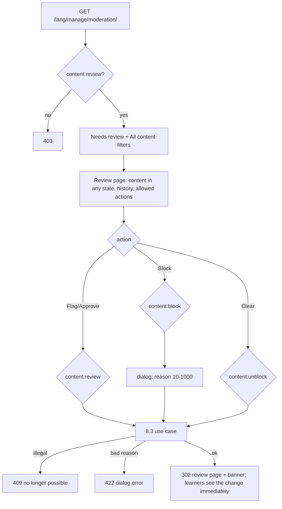

### Story 8.4: Admin Moderation Queue & Actions

**BUILDID**: CYCLE-3 | **GitHub**: LOCAL | **AzureDevOps**: LOCAL | **Epic**: 8 - Content Moderation & Notifications | **ID**: 8.4 | **Date**: 2026-10-19
**File**: `docs/plans/stories/epic-8-story-8.4-Admin-Moderation-Queue-and-Actions.md`
**Build Ref**: `docs/plans/builds/cycle-3/cycle-plan.md` — CYCLE-3 (Workshop Day 3: admin queue and actions)
**Wave**: 12
**Requires**: [8.3]
**Enables**: [8.6]
**Files Touched**:
  - src/infrastructure/persistence/moderation/queries.py
  - src/infrastructure/web/moderation/**
  - src/infrastructure/web/templates/moderation/**
  - src/infrastructure/web/static/css/moderation.css
  - src/infrastructure/web/common/errors.py
  - src/config/urls.py
  - src/infrastructure/i18n/locale/ro/LC_MESSAGES/django.po
  - src/infrastructure/i18n/locale/en/LC_MESSAGES/django.po
  - tests/integration/web/test_role_access_matrix.py
  - docs/architecture/design/00-system-architecture-greenfield.md
  - tests/integration/web/moderation/**
**Roles Ref**: docs/requirements.md#roles--permissions-matrix — personas this story differentiates: Admin, Teacher, Student, Parent/Guardian
**QA Candidate**: Yes — **Observable:** "Moderation" in the Admin menu opens `/<lang>/manage/moderation/`, which has two parts:
- **"Needs review":** FLAGGED and RESUBMITTED items, oldest first.
- **"All content":** filterable by type, status and subject.

Each item opens a review page showing its full content (lesson rendered, exercise answers, test questions with answers), its status, history and last reason, and only the actions valid from its state:
- **Flag / Approve**
- **Block** (dialog with a required reason, 10–1,000 characters)
- **Clear block**

Results show as banners; illegal or stale actions get a 409 page.

**Mechanism:**
- Routes: `moderation:queue`, `moderation:detail`, `moderation:flag`, `moderation:approve`, `moderation:block`, `moderation:clear`.
- Each POST is guarded by `REQUIRED_PERMISSION[action]` (Story 8.1) and calls the 8.3 use case with `actor = request.user`.
- `persistence/moderation/queries.py` reads content in **any** state (admin `content:review`).
- `ERROR_MESSAGES` gains `invalid_moderation_transition` and `block_reason_length`.

**Authz & preconditions:** Admin (`content:review`, `content:block`, `content:unblock`); teachers, students and parents get 403. **Edge & idempotency:**
- Double-submitting an action → the second is an illegal transition → 409 "This action is no longer possible for this item".
- A block without a reason or too short → 422, re-showing the dialog with the error.
- Unknown items → 404.
- The queue is read-only and repeatable.

**Regression:** the permission per action, immediate hiding verified on learner routes, reason required, history visible, 403 for non-admins.

---

#### 👤 User Reference

**Description**:
This is the administrator's moderation workspace, opened from "Moderation" in the menu.

**The queue:**
- **Needs review:** everything flagged for review, and everything teachers have resubmitted after a block, oldest first, so nothing waits forever.
- **All content:** every lesson, exercise and chapter test, which can be filtered (for example "all blocked exercises in Mathematics") to find something to flag.

**The review page** shows an item exactly as written:
- the lesson text
- the exercise with its correct answer and explanation
- the test questions with their correct answers and points

It also shows the item's current status, its history (who did what, when, and why) and only the buttons that make sense for its state:
- **Flag for review:** hides the item from students while reviewing.
- **Approve:** makes a flagged item visible again.
- **Block:** a box asks for the reason, which is required (at least 10 characters) because the teacher will read it.
- **Clear block:** makes a resubmitted item visible again.

Every action takes effect immediately and is recorded. Only administrators can use these pages.

**Acceptance Criteria** (plain-English):
- Administrators see "Moderation" in their menu; it lists items needing review (flagged and resubmitted), oldest first, and a filterable list of all content.
- The review page shows the full content in both languages, the status, the history with reasons, and only the actions allowed in the current state.
- Flagging hides the item from students and parents at once; approving brings it back.
- Blocking requires a reason of 10–1,000 characters; the teacher gets the reason.
- Clearing a resubmitted item makes it visible again.
- If an action is no longer possible (for example someone already did it), a clear message says so and nothing changes.
- Every action is recorded in the history and the audit log.
- Teachers, students and parents get "Access denied".

**User Flow** (role-differentiated):

### Admin
**Scenario / narrative**: As the pilot Admin, a parent emails me that a MEM exercise has a wrong answer. I open "Moderation", filter "All content" by Exercise + MEM, open exercise 3 of chapter 1 and see the correct answer is wrong. I click "Block", write "The correct answer should be 42, not 52. Please fix." and confirm. The status turns BLOCKED, students no longer see it, and the teachers get the notice. Two days later it appears under "Needs review" as RESUBMITTED. I open it, check the fix and click "Clear block"; it's visible again. Earlier I accidentally clicked "Approve" twice on another item; the second click said "This action is no longer possible for this item" and nothing changed.
**Steps**:
1. `GET /ro/manage/moderation/?type=exercise&subject=<id>` → `@require_permission(CONTENT_REVIEW)` → `moderation_queue()` + `content_list(filters)` → tables.
2. `GET /ro/manage/moderation/exercise/<id>/` → `review_item(type, id)` (any state; `NotFound` if unknown) → content preview + history + allowed actions (`allowed_actions(status)` from the transition table).
3. "Block" → `ui_confirm_dialog` with `extra_template="moderation/_reason_field.html"` → POST `…/block/` → `@require_permission(CONTENT_BLOCK)` → `container.block_content().execute(ModerationCommand(type, id, user.pk, user.username, reason))` → 302 detail + "Content blocked."
4. Illegal → `InvalidModerationTransition` → 409 page with the registered message. Short reason → 422 detail with the dialog error.

### Teacher
**Scenario / narrative**: As a Teacher, I can't moderate (I only resubmit my content from the dashboard). `/ro/manage/moderation/` shows "Access denied".
**Steps**:
1. All moderation routes → 403.

### Student
**Scenario / narrative**: As a Student, I never see moderation; its URLs answer "Access denied".
**Steps**:
1. All routes → 403.

### Parent/Guardian
**Scenario / narrative**: As a Parent, I report problems to the administrator by other means; these pages answer "Access denied".
**Steps**:
1. All routes → 403.

**Flow Diagram**:



---

#### 🤖 AI Agent Reference

**Must Read**:
- `docs/requirements.md` — admin moderation feature; Admin permissions
- `docs/architecture/design/00-system-architecture-greenfield.md` — `/manage/moderation/…` routes and contracts (block: reason 10–1000, 409 illegal, 422 short reason), moderation rules
- `docs/plans/stories/epic-8-story-8.1-Moderation-Domain-Rules.md` — `REQUIRED_PERMISSION`, transition table
- `docs/plans/stories/epic-8-story-8.3-Moderation-Use-Cases.md` — use cases, `ModerationCommand`
- `docs/plans/stories/epic-1-story-1.6-Molecule-Primitives.md` — `ui_confirm_dialog(extra_template=…)`, `ui_table`
- `docs/plans/stories/epic-3-story-3.3-Markdown-Rendering.md` — `render_markdown` for lesson preview

**Description**:
1. **Queries** `persistence/moderation/queries.py`:
   - `moderation_queue() -> tuple[QueueItemDTO]`: FLAGGED + RESUBMITTED lessons/exercises/tests, ordered by `moderation_updated_at` ascending, with subject/chapter labels and a title snippet
   - `content_list(type=None, status=None, subject_id=None) -> tuple[QueueItemDTO]`
   - `review_item(type, id) -> ReviewDTO`: full bilingual content incl. answer keys/points for staff review, status, reason, history from `ModerationEventModel`, `allowed_actions`; `NotFound` if unknown
2. **Web** `web/moderation/` (`app_name = "moderation"`, included at `manage/moderation/` in `i18n_patterns`): views `queue`, `detail`, and one POST view per action built from a small factory `action_view(action, use_case_factory)` that applies `@require_permission(REQUIRED_PERMISSION[action])`.
3. **Templates** `moderation/queue.html`, `detail.html`, `_reason_field.html`, `_history.html`; CSS.
4. **Errors registry:** `ERROR_MESSAGES["invalid_moderation_transition"] = _("This action is no longer possible for this item.")`, `["block_reason_length"] = _("Please give a reason between {min} and {max} characters.")`.

**Design Tokens** (FE — staff theme):
- Queue: `ui_page_header` "Moderation"; section "Needs review" (`ui_table`: Type · Subject · Chapter · Item · Status pill · Since) and "All content" with an inline GET filter row (Type, Status, Subject + "Apply"); empty states "Nothing needs review." / "No content matches these filters."
- Detail: breadcrumb Moderation › {item}; status `ui_status_pill` + reason (`ui_alert "warning"` when BLOCKED/RESUBMITTED); content preview card (lesson: rendered Markdown RO | EN columns; exercise/test: prompts, options with the correct one marked by `check-circle` + text "Correct", points); history `ui_table` (When · Who · Action · From → To · Reason).
- Actions bar: only allowed actions; Flag (secondary, `flag`), Approve (primary, `check-circle`), Block (danger, `prohibit`, opens the dialog), Clear block (primary, `arrow-counter-clockwise`). Each via `ui_dialog_trigger` + `ui_confirm_dialog` (Block with the reason textarea, `maxlength=1000`, required, help "The teacher will see this reason.").
- Banners: "Content flagged." / "Content approved." / "Content blocked." / "Block cleared."

**Acceptance Criteria**:
1. Routes (under `/<lang>/manage/moderation/`):
   - `""` → `queue` (`moderation:queue`), GET, `CONTENT_REVIEW`
   - `"<str:content_type>/<int:content_id>/"` → `detail` (`moderation:detail`), GET, `CONTENT_REVIEW`
   - `.../flag/` → `CONTENT_REVIEW`
   - `.../approve/` → `CONTENT_REVIEW`
   - `.../block/` → `CONTENT_BLOCK`
   - `.../clear/` → `CONTENT_UNBLOCK`

   All action routes are POST only. `content_type` must be `lesson|exercise|test`, else 404.
2. Queue: FLAGGED + RESUBMITTED only, oldest first; "All content" filters work by type, status and subject; invalid filter values are ignored.
3. Detail: shows full content in both languages in any state, current status + reason, history newest first, and **only** the actions where `(status, action)` is in the transition table.
4. Each action calls its 8.3 use case with `actor_id=request.user.pk`, `actor_username=request.user.username`. Success → 302 detail + banner. `InvalidModerationTransition` → 409 with the registered message. `PolicyViolation` (reason) → 422 detail with the dialog open state and the error. `NotFound` → 404.
5. Immediately after a FLAG/BLOCK, the item's learner route (lesson page / exercise list / test page) returns 404 or omits it (integration test).
6. The Admin menu "Moderation" (registry `moderation:queue`) appears.
7. Matrix rows: `/ro/manage/moderation/` → Admin 200; Teacher/Student/Parent 403; anonymous 302.
8. Route catalogue + RO/EN translations.

**RBAC Enforcement**:

| Persona | Permission key | Guarded route/endpoint | Allowed | Denied behavior | UI when denied |
|---------|----------------|------------------------|---------|-----------------|----------------|
| Admin | `content:review` | queue, detail, flag, approve | yes | illegal → 409 | only allowed buttons render |
| Admin | `content:block` | block | yes | short reason → 422; illegal → 409 | — |
| Admin | `content:unblock` | clear | yes | illegal → 409 | — |
| Teacher | — | all | no | 403 | not in menu |
| Student | — | all | no | 403 | not in menu |
| Parent/Guardian | — | all | no | 403 | not in menu |
| Anonymous | — | all | no | 302 login | sign-in |

- **Enforcement point(s):** `@require_permission(REQUIRED_PERMISSION[action])` on each action view; `CONTENT_REVIEW` on queue/detail; transition legality in the 8.3 use cases.
- **Denied-access contract:** 403 for roles; 409 for illegal transitions; 404 for unknown items or types.
- **Scope derivation:** actor from `request.user`; the item from the URL is validated to exist; no hidden "as admin" parameters.

**System responses + error cases**:

| Trigger | Response | Side-effect |
|---------|----------|-------------|
| Admin GET queue | `200` | none |
| Admin GET detail (lesson BLOCKED) | `200` content + reason; no action buttons (from BLOCKED only the teacher's Resubmit is allowed) | none |
| POST flag ACTIVE item | `302` + "Content flagged." | status FLAGGED, event, audit |
| POST flag again | `409` "no longer possible" | none |
| POST block with reason "short" | `422` dialog error | none |
| POST block with valid reason | `302` + "Content blocked." | BLOCKED, event, notices, audit |
| POST clear RESUBMITTED | `302` + "Block cleared." | ACTIVE, event, audit |
| POST clear ACTIVE | `409` | none |
| GET detail `/manage/moderation/video/1/` | `404` | none |
| Teacher/Student/Parent any | `403` | none |
| POST without CSRF | `403` | none |

**QA-observable behaviour**:
- After a block, the student lesson/exercise/test route returns 404 (or the exercise is absent) on the next request. `notification` rows exist for the creator/editor with the exact reason text.
- The detail page shows only the buttons valid for the status (e.g. BLOCKED shows none for the Admin; RESUBMITTED shows Block and Clear).
- History lists each transition with actor and reason, newest first.
- **What does NOT change**: content text (moderation never edits content); attempts and scores of blocked tests; other items.

**Prerequisites**:
- Story 8.3 merged; CYCLE-1 primitives; CYCLE-2 renderer.

**Context**: `src/application/moderation/**`, `src/domain/moderation/state_machine.py`, `src/infrastructure/persistence/moderation/models.py`, `src/infrastructure/web/common/errors.py`

**Patterns**: Thin views + decorators (§7.1–7.2), Responses 409/422 (§7.5), Error registry (§8), Primitives — table, dialog, filters (§11.2) — see `docs/architecture/design/01-patterns-and-standards-greenfield.md`

**Steps**:

1. **Tests first** (per role; per action; legal/illegal; reason validation; learner effect).
2. **Action view factory:**
   ```python
   # src/infrastructure/web/moderation/views.py (excerpt)
   CONTENT_TYPES = {t.value for t in ContentType}


   def action_view(action: ModerationAction, use_case_factory, success_message):
       @require_POST
       @require_permission(REQUIRED_PERMISSION[action])
       def view(request, content_type: str, content_id: int):
           """POST /<lang>/manage/moderation/<type>/<id>/<action>/ — permission per REQUIRED_PERMISSION."""
           if content_type not in CONTENT_TYPES:
               raise NotFound("content type")
           command = ModerationCommand(ContentType(content_type), content_id, request.user.pk,
                                       request.user.username, request.POST.get("reason", ""))
           try:
               use_case_factory().execute(command)
           except PolicyViolation as error:  # only BLOCK's reason; rendered into the dialog
               return render(request, "moderation/detail.html",
                             {"item": review_item(content_type, content_id), "reason_errors": error.violations,
                              "open_dialog": "block"}, status=422)
           messages.success(request, success_message)
           return redirect("moderation:detail", content_type=content_type, content_id=content_id)
       return view


   flag = action_view(ModerationAction.FLAG, container.flag_content, _("Content flagged."))
   block = action_view(ModerationAction.BLOCK, container.block_content, _("Content blocked."))
   ```
   `InvalidModerationTransition` and `NotFound` propagate to `DomainErrorMiddleware` (409/404). Each generated view carries `required_permissions` (Story 1.3), so the URL-coverage test passes.
3. **Queries, templates, CSS, errors registry, URLs, matrix rows, route catalogue, translations,** then **all gates**.

**Tests**:

```python
# tests/integration/web/moderation/test_moderation_pages.py
import pytest

from infrastructure.persistence.content.models import LessonModel
from infrastructure.persistence.notifications.models import NotificationModel
from tests.factories.accounts import TeacherFactory
from tests.factories.content import LessonFactory

pytestmark = pytest.mark.django_db
REASON = "Wrong example in the second section."


def url(lesson, action=""):
    return f"/en/manage/moderation/lesson/{lesson.pk}/{action + '/' if action else ''}"


def test_queue_lists_flagged_and_resubmitted_only(admin_client):
    flagged = LessonFactory(moderation_status="FLAGGED", body_en="## Flagged one")
    LessonFactory(moderation_status="ACTIVE", body_en="## Active one")

    html = admin_client.get("/en/manage/moderation/").content.decode()

    assert f"/lesson/{flagged.pk}/" in html.split("All content")[0]


def test_flag_hides_lesson_from_students_immediately(admin_client, student_client):
    lesson = LessonFactory()

    assert admin_client.post(url(lesson, "flag")).status_code == 302
    assert student_client.get(f"/en/chapters/{lesson.chapter_id}/lesson/").status_code == 404


def test_block_requires_reason_and_notifies(admin_client):
    creator = TeacherFactory()
    lesson = LessonFactory(created_by=creator, updated_by=creator)

    short = admin_client.post(url(lesson, "block"), {"reason": "short"})
    ok = admin_client.post(url(lesson, "block"), {"reason": REASON})

    assert short.status_code == 422 and "between 10 and 1000 characters" in short.content.decode()
    assert ok.status_code == 302
    assert NotificationModel.objects.get(recipient=creator).reason == REASON


def test_illegal_or_repeated_action_is_409(admin_client):
    lesson = LessonFactory()
    admin_client.post(url(lesson, "flag"))

    assert admin_client.post(url(lesson, "flag")).status_code == 409
    assert admin_client.post(url(lesson, "clear")).status_code == 409


def test_detail_shows_only_allowed_actions(admin_client):
    lesson = LessonFactory(moderation_status="RESUBMITTED")

    html = admin_client.get(url(lesson)).content.decode()

    assert "Clear block" in html and "Block" in html and "Approve" not in html and "Flag for review" not in html


def test_unknown_type_is_404(admin_client):
    assert admin_client.get("/en/manage/moderation/video/1/").status_code == 404


@pytest.mark.parametrize("fixture", ["teacher_client", "student_client", "parent_client"])
def test_non_admins_are_denied(request, fixture):
    client, lesson = request.getfixturevalue(fixture), LessonFactory()

    assert client.get("/ro/manage/moderation/").status_code == 403
    assert client.post(url(lesson, "flag")).status_code == 403
    assert LessonModel.objects.get(pk=lesson.pk).moderation_status == "ACTIVE"
```

Manual: as Admin (RO/EN) flag → approve; block with a short then a valid reason (dialog via keyboard); check the student view (404) and the teacher's notice (8.5); resubmit as Teacher; clear as Admin; check history. As other roles: 403.

**Quality**: ruff 0; mypy passes; tests pass; coverage ≥85%; primitives reused; no inline `style`/`script`; no `TODO`.

**OUT**:
- ❌ Teacher notifications and resubmit UI (8.5).
- ❌ Bulk moderation actions (UX: none).
- ❌ Editing content from the moderation page (teachers fix content; admins decide).

**Evidence**: pytest output, coverage %, screenshots of the queue, a review page with history, the block dialog with a reason error, and the 409 message, all recorded in `docs/stories-implemented/story-8.4-review.md` under "## DoD Evidence".
