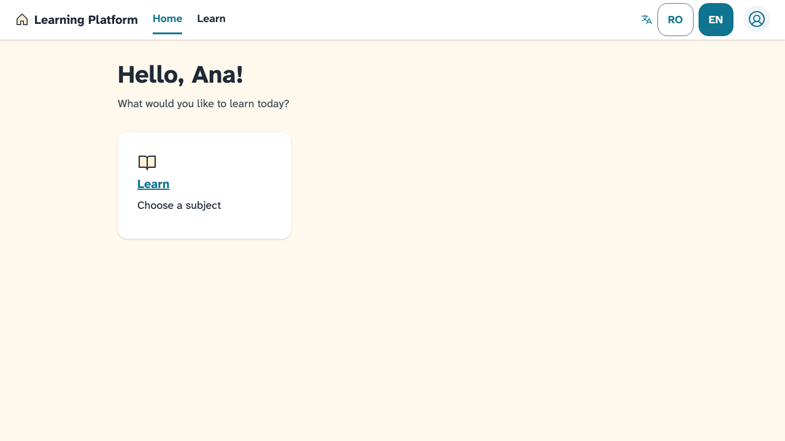

# Story 1.10 Self-Review

**Date**: 2026-10-23
**Story**: Foundation E2E Journeys (`docs/plans/stories/epic-1-story-1.10-Foundation-E2E-Journeys.md`)
**Developer**: DEV Agent (Dev 1, one-by-one mode)

---

## What Was Implemented

- **Harness** (`tests/e2e/conftest.py`):
  - **E2E-only options:** `pytest_configure` applies them only when `-m e2e` is selected: Chromium, `tracing=retain-on-failure`, `screenshot=only-on-failure`, output to `test-results/`, and `DJANGO_ALLOW_ASYNC_UNSAFE`.
  - **Fixtures and helpers:**
    - a session-scoped `base_url` from `live_server`;
    - `login()` and `logout()` helpers;
    - `console_errors`, plus `watch_console()` and `assert_no_csp_violations()` for second browser contexts.
  - **Per-journey environment:**
    - every e2e item is marked `django_db(transaction=True, serialized_rollback=True)`;
    - a `_seeded_snapshot` hand-over makes serialized rollback restore the seeded catalogue under Playwright;
    - the audit append-only triggers are dropped only for pytest-django's teardown flush;
    - `ROOT_URLCONF` is pointed at `tests.e2e.urls`, and the e2e templates directory is added through the `settings` fixture.
- **Test-only urlconf** (`tests/e2e/urls.py`): it extends `config.urls` and re-exports its `handler400` to `handler500`. It adds `/<lang>/e2e/dialog/` under `i18n_patterns`. `config.urls` is untouched.
- **Test-only page** (`tests/e2e/templates/e2e/dialog.html`): it has a dismissible `ui_alert`, `ui_dialog_trigger` with `ui_confirm_dialog`, and a 40-field labelled form that makes the page taller than the viewport.
- **8 journey files, 17 tests:** one file per area. They are listed in the AC map below.
- **README:** a new "End-to-end tests" section covering `playwright install chromium`, `pytest -m e2e`, `--headed`, traces and `show-trace`.
- **No production code changed:** `git diff main -- src/` is empty. **No defects found**, so none were raised.

## Files Changed

| File | Change Type | Description |
|------|-------------|-------------|
| `tests/e2e/conftest.py` | New | Harness: options, fixtures, helpers, DB/trigger/urlconf environment |
| `tests/e2e/urls.py` | New | `config.urls` + test-only dialog page; error handlers re-exported |
| `tests/e2e/templates/e2e/dialog.html` | New | Alert + confirm dialog + long labelled form |
| `tests/e2e/test_admin_journey.py` | New | AC 3 |
| `tests/e2e/test_role_logins.py` | New | AC 4 (4 roles) |
| `tests/e2e/test_language.py` | New | AC 5 |
| `tests/e2e/test_lockout.py` | New | AC 6 |
| `tests/e2e/test_access_denied.py` | New | AC 7 (3 roles + anonymous) |
| `tests/e2e/test_error_pages.py` | New | AC 8 (RO + EN) |
| `tests/e2e/test_dialog_keyboard.py` | New | AC 9 + hand-offs from the 1.6 and 1.7 reviews |
| `tests/e2e/test_catalogue_journey.py` | New | AC 10 |
| `README.md` | Modified | "End-to-end tests" subsection under Testing |
| `docs/stories-implemented/story-1.10-deliberate-failure.png` | New | Failure screenshot from the deliberate-break check |

## DoD Evidence

### Three consecutive runs (`uv run pytest -m e2e -v`)

```
run 1: 17 passed, 1497 deselected in 6.99s | wall 7.36s
run 2: 17 passed, 1497 deselected in 7.03s | wall 7.33s
run 3: 17 passed, 1497 deselected in 7.00s | wall 7.30s
test-results/ after a green run: 0 entries
```

Run 3, verbose:

```
test_access_denied.py::test_non_admins_see_access_denied_in_the_admin_area[chromium-student] PASSED
test_access_denied.py::test_non_admins_see_access_denied_in_the_admin_area[chromium-teacher] PASSED
test_access_denied.py::test_non_admins_see_access_denied_in_the_admin_area[chromium-parent] PASSED
test_access_denied.py::test_anonymous_home_redirects_to_sign_in[chromium] PASSED
test_admin_journey.py::test_admin_creates_accounts_links_parent_and_sees_audit[chromium] PASSED
test_catalogue_journey.py::test_student_catalogue_active_and_unavailable[chromium] PASSED
test_dialog_keyboard.py::test_dialog_opens_traps_focus_and_returns_focus[chromium] PASSED
test_dialog_keyboard.py::test_dismissing_an_alert_keeps_focus_on_main[chromium] PASSED
test_dialog_keyboard.py::test_focus_is_never_hidden_under_the_sticky_top_bar[chromium] PASSED
test_error_pages.py::test_not_found_page[chromium-ro] PASSED
test_error_pages.py::test_not_found_page[chromium-en] PASSED
test_language.py::test_switch_to_english_survives_sign_out_and_sign_in[chromium] PASSED
test_lockout.py::test_lockout_and_admin_unlock[chromium] PASSED
test_role_logins.py::test_role_login_home_and_logout[chromium-student] PASSED
test_role_logins.py::test_role_login_home_and_logout[chromium-teacher] PASSED
test_role_logins.py::test_role_login_home_and_logout[chromium-parent] PASSED
test_role_logins.py::test_role_login_home_and_logout[chromium-admin] PASSED
```

**AC 13:** the full suite takes about 7.3 s on the dev laptop, against a 3-minute limit.

### Deliberate-failure check

I removed `aria-label=""` from `layouts/_top_bar.html` in a local edit, then restored it from a backup.

```
$ uv run pytest -m e2e tests/e2e/test_role_logins.py
FAILED test_role_logins.py::test_role_login_home_and_logout[chromium-student|teacher|parent|admin]
4 failed in 122.14s
E   playwright._impl._errors.TimeoutError: Locator.click: Timeout 30000ms exceeded.
E     - waiting for get_by_label("Account menu")
test-results/tests-e2e-test-role-logins-py-test-role-login-home-and-logout-chromium-<role>/trace.zip   (x4)
trace.zip: 49 files, 796,944 bytes; test-failed-1.png beside it
after restore: git status --short src/ -> (empty)
```



**Note:** a journey that fails on a missing element waits out Playwright's default 30 s timeout. A green run stays near 7 s.

### Default run unchanged, plus the static gates

```
$ uv run pytest --cov=src --cov-branch --cov-fail-under=85 -q
1497 passed, 17 deselected in 13.50s
TOTAL 1364 0 196 0 100% | Required test coverage of 85% reached. Total coverage: 100.00%
$ uv run ruff format --check .                             -> 187 files already formatted
$ uv run ruff check .                                      -> All checks passed!
$ uv run mypy --no-incremental                             -> Success: no issues found in 115 source files
$ PYTHONPATH=src uv run lint-imports                       -> Contracts: 2 kept, 0 broken.
$ uv run python manage.py makemigrations --check --dry-run -> No changes detected
```

The default run's test count and duration are the same as before the story: 1,497 tests in about 13 s. The 17 journeys are deselected by the existing `-m 'not e2e'`; `pyproject.toml` is untouched.

### CYCLE-1 acceptance criteria → evidence

| CYCLE-1 criterion (`cycle-plan.md`) | Browser journey | Also proven by (integration) |
|---|---|---|
| Admin creates accounts and links a parent to a student | `test_admin_journey` (Student, Teacher, Parent; link; duplicate-link error; audit rows) | Admin-role creation: Story 1.9 admin tests |
| Non-Admin roles get 403 on `/admin/` | `test_access_denied` ×3 ("Acces interzis") | `test_admin_access.py:41,47` |
| Each role lands on its role home in its preferred language | `test_role_logins` ×4 (URL, theme, nav, full name, sign-out) | Story 1.7 home tests |
| RO/EN switch persists | `test_language` (switch → sign out → sign in → `/en/`) | Story 1.4 tests |
| 5 failed logins lock the account; the lockout is audited | `test_lockout` (lockout page; correct password still refused; admin unlock; sign-in) | `test_audit_login_flow.py:87` (`auth.lockout`), `test_lockout_and_audit_admin.py:56` (`auth.lockout_cleared`) |
| Catalogue K–8: only grade 2 CLR/MEM/EN interactive; others unavailable and 404 | `test_catalogue_journey` (exactly 3 grade-2 links; grade 5 "Unavailable", 0 links; inactive URL 404; subject shell) | Story 2.2 catalogue tests |
| `ROLE_PERMISSIONS` matches the matrix; every URL protected or public | — (no browser behaviour) | `test_url_protection.py:69`, role-access matrix |
| `/_styleguide/` renders 16 primitives; 404 without DEBUG | — (DEBUG-only page; the e2e server runs with `DEBUG=False`) | `test_styleguide.py:321` |
| Data survives a restart | — | `test_restart_persistence.py:51`, `test_catalogue_migrate_commands.py:64` |
| Quality gates green | — | Static gates above |
| Error pages friendly (user reference) | `test_error_pages` RO and EN | Story 1.1 tests |
| Dialog keyboard behaviour (user reference) | `test_dialog_keyboard` ×3 | Story 1.6 tests (static) |
| No CSP violations | Every test takes `console_errors`; the lockout admin context uses `watch_console` | Story 1.1 CSP header tests |

### Gate 1 — Spec Echo

| # | Requirement | Proof |
|---|-------------|-------|
| AC1 | Install documented; `-m e2e` runs only e2e; default run excludes it | README "End-to-end tests"; runs above (17 selected / 1497 deselected and the reverse) |
| AC2 | Only `get_by_role` / `get_by_label` / `get_by_text`; no CSS-class or XPath | All journeys. The only `locator()` calls are `locator("html")` and `locator("body")`, which read `lang` and the theme class as in the story's own example (see Deviations) |
| AC3 | Admin creates 3 accounts, links, duplicate error, audit `accounts.created` ×3 and `accounts.parent_linked` ×1 | `test_admin_journey.py` |
| AC4 | 4 roles: URL `/en/`, theme class, exact nav, full name in avatar menu, sign out → login | `test_role_logins.py` (`theme-student` / `theme-staff`; nav `to_have_text` exact list) |
| AC5 | EN switch → `/en/`, `html[lang=en]` → sign out / in → `/en/` | `test_language.py` |
| AC6 | 5 wrong → "Too many attempts"; correct still refused; admin deletes attempt; sign-in works | `test_lockout.py` |
| AC7 | Student/Teacher/Parent `/ro/admin/` → "Access denied" heading; anonymous `/ro/` → login | `test_access_denied.py` (RO heading "Acces interzis"; the RO catalogue is compiled) |
| AC8 | `/ro/nu-exista/` "Pagina nu a fost găsită", `/en/missing/` "Page not found", both with the back-home link | `test_error_pages.py` (RO "Înapoi la pagina principală" / EN "Back to home"; `lang` asserted) |
| AC9 | Enter opens `dialog[open]`; Tab stays in the dialog; Escape closes; focus returns to the trigger | `test_dialog_keyboard.py::test_dialog_opens_traps_focus_and_returns_focus` (Tab: see Deviations) |
| AC10 | Learn → 3 grade-2 links; other grade "Unavailable" with no link; inactive URL → "Page not found"; subject shell + empty state | `test_catalogue_journey.py` |
| AC11 | Every test uses `console_errors`; CSP errors fail | `grep -L console_errors tests/e2e/test_*.py` → none |
| AC12 | Trace + screenshot on failure in `test-results/` (git-ignored) | Deliberate-failure check; `.gitignore:25` |
| AC13 | Under 3 minutes, recorded | ~7.3 s |
| Hand-off 1.6 ISS-002 | Enter on the alert × removes it; focus on `<main id="content">` | `test_dismissing_an_alert_keeps_focus_on_main` |
| Hand-off 1.7 ISS-001 | Long page: Shift+Tab to a field near the top; box top ≥ 64 px | `test_focus_is_never_hidden_under_the_sticky_top_bar` (Field 40 → Field 1, `y >= 64`) |
| OUT | No production code; no CI job, cross-browser, visual diff, or CYCLE-2/3 journeys | `git diff main --stat -- src/ pyproject.toml` empty |

**AC rows: 13 / 13. Steps: 5 / 5. Hand-offs: 2 / 2.**

### Gate 2 — Negative-Space Check

```
time.sleep / wait_for_timeout in tests/e2e ............... none (Playwright auto-wait + expect)
CSS-class / XPath selectors .............................. none
src/, pyproject.toml, config.urls changes ................ none
TODO/FIXME/print ......................................... none
files <= 400 lines ....................................... largest tests/e2e/conftest.py (136)
```

### Gate 3 — Contract Consistency

| Producer | Consumer | Check |
|---|---|---|
| `tests/factories/accounts.py` default password | `conftest.PASSWORD` | same value (`pilot-pass-123`) |
| audit migration `0002` `CREATE_TRIGGERS` / `DROP_TRIGGERS` | `_e2e_environment` | constants imported, not copied |
| `config.urls` `urlpatterns` and `handler4xx/500` | `tests/e2e/urls.py` | extended and re-exported; production 403/404 templates render |
| UI labels ("Account menu", "Sign out", "Main", region names) | locators | taken from rendered pages; the deliberate break proves one is load-bearing |

## Challenges Encountered

| Challenge | Resolution |
|---|---|
| pytest-playwright's `base_url` is session-scoped (ScopeMismatch) | Session-scoped override from `live_server` |
| `SynchronousOnlyOperation` in pytest-django's teardown flush | `DJANGO_ALLOW_ASYNC_UNSAFE` set in `pytest_configure`, e2e sessions only |
| The flush hit the append-only audit triggers (`IntegrityError`) | Triggers are recreated per journey and dropped only for the teardown flush, using the migration's own constants |
| The flush also deleted the migration-seeded catalogue | Collection-time `serialized_rollback` marker. Playwright runs tests in a greenlet with an event loop, so Django's context-local `connections` returns a **fresh connection object without the snapshot**, and the restore was silently skipped. `_seeded_snapshot` captures the snapshot at DB setup and hands it to that object |
| 403/404 pages rendered Django's defaults under the e2e urlconf | Re-export the handlers from `config.urls` |
| `logout()` toggled `<details>` closed when it was already open | `logout()` opens the menu only when "Sign out" isn't visible |
| Admin "Password:" label; "Field 1" matching Field 10–19 | Anchored regex; `exact=True` |

## Deviations from Plan

- **Dialog Tab (AC 9):** a native modal `<dialog>` makes the rest of the page inert. Tab cycles through the dialog's controls plus one stop on the document itself (the browser chrome in a real window). It never reaches page content. The assertion therefore accepts focus inside the dialog **or** on `document.body`. This is browser behaviour, not a defect, so no defect was raised.
- **Test page URL:** `/en/e2e/dialog/` under `i18n_patterns`, not `/e2e/dialog/`. Outside the language prefixes the page rendered in Romanian, and the journeys run in English.
- **`login()` defaults to `lang="en"`:** the story text says `lang="ro"`, but its own note says to write journeys in EN by default. The RO journeys pass `lang="ro"`.
- **`locator("html")` / `locator("body")`:** used only to read the `lang` attribute and the theme class, as in the story's own example. These are element locators, not CSS-class or XPath selectors.
- **Test-harness DB handling:** `serialized_rollback` and the audit-trigger drop for the flush exist only in `tests/e2e/conftest.py`. Production triggers are unchanged, and the journeys run with them in place.
- **Admin journey creates Student, Teacher and Parent** (story AC 3). Creating an Admin account (CYCLE criterion 1) is covered by Story 1.9's integration tests.

## Lessons Learned

1. Under Playwright's sync API, Django's `connections` is context-local per greenlet. Per-connection test state, such as serialized-rollback snapshots, doesn't carry over to the connection object the test actually uses.
2. A journey that never fails proves little. Breaking one label on purpose showed both the failure message and the artefacts are usable.

## Next Steps

- [ ] Ready for code review (`aire-review-code`)
- [ ] Manual: `uv run pytest -m e2e --headed --slowmo=300` once, then CYCLE-1 demo and sign-off
- [ ] DevOps: add the e2e job (browser install) to CI, out of scope here
